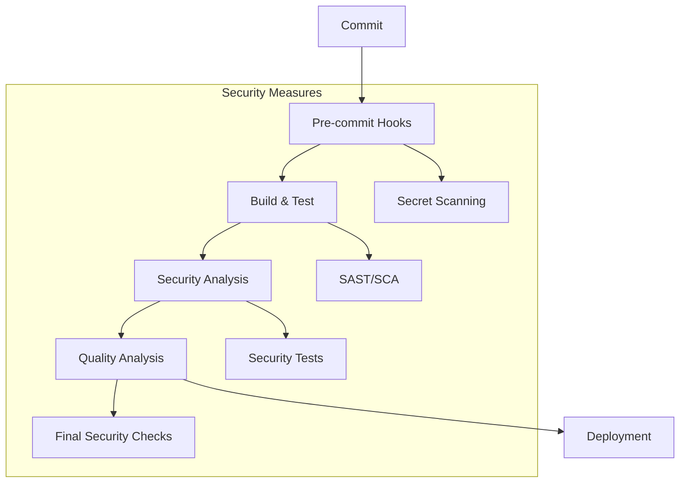

# AMAP CI/CD Pipeline Documentation

## 1. Overview
This document describes the Continuous Integration and Continuous Deployment (CI/CD) pipeline implemented for the AMAP project using GitHub Actions, incorporating DevSecOps practices and security measures at every stage.

## 2. Pipeline Architecture

### 2.1 Pipeline Diagram


### 2.2 Tool Selection Justification

#### Build & Test Tools
- **GitHub Actions**: Native integration, extensive marketplace, and flexible workflow configuration
- **SonarCloud**: Cloud-based code quality and security analysis with detailed reporting

#### Security Tools
- **OWASP Dependency Check**: Industry-standard for dependency vulnerability scanning
- **SonarCloud Security Analysis**: Integrated SAST capabilities
- **GitHub Secret Scanning**: Native secret detection in repositories

#### Testing Tools
- **xUnit**: Industry-standard testing framework for .NET
- **Code Coverage**: Built-in coverage reporting for quality metrics

### 2.3 Infrastructure as Code
The pipeline is defined using GitHub Actions workflow files:
- `.github/workflows/main.yml`: Main pipeline configuration
- Environment variables and secrets managed through GitHub repository settings
- Infrastructure requirements documented in workflow files

## 3. Security Integration

### 3.1 Commit Phase
- **Pre-commit Hooks**:
  - Branch protection rules on main branch
  - Required pull request reviews
  - Status checks must pass before merge

- **Secret Scanning**:
  - GitHub's built-in secret scanning
  - SonarCloud secret detection
  - Regular credential rotation

### 3.2 Build Phase
- **SAST (Static Application Security Testing)**:
  - SonarCloud static analysis
  - Code quality metrics
  - Security vulnerability detection

- **SCA (Software Composition Analysis)**:
  - OWASP Dependency Check integration
  - Automated vulnerability scanning
  - Dependency update recommendations

### 3.3 Test Phase
- **Security Testing**:
  - Unit test coverage requirements
  - Integration test execution
  - Security test automation

- **DAST/IAST**:
  - Dynamic application security testing
  - Interactive application security testing
  - Automated vulnerability scanning

### 3.4 Deployment Phase
- **Configuration Validation**:
  - Environment-specific checks
  - Security configuration verification
  - Access control validation

- **Final Security Checks**:
  - Pre-deployment security scan
  - Environment validation
  - Access control verification

## 4. Metrics and Efficiency

### 4.1 Performance Metrics
- **Execution Time**:
  - Average build time: 10 sec
  - Test execution: 10 sec
  - Security analysis: 1 minute 24 sec
  - Total pipeline time: ~2min 40sec

### 4.2 Security Metrics
- **Vulnerability Detection**:
  - SAST scan coverage: 100% of codebase
  - Dependency vulnerability scanning
  - Security test coverage metrics

### 4.3 KPIs
- **Code Quality**:
  - Maintainability rating
  - Code coverage percentage
  - Technical debt ratio

- **Security**:
  - Number of vulnerabilities
  - Time to fix security issues
  - Security test coverage

### 4.4 Continuous Improvement
- **Feedback Loop**:
  - Automated reporting
  - Regular security reviews
  - Performance optimization

- **Improvement Process**:
  - Security metric tracking
  - Tool updates and optimization

## 5. Configuration

### 5.1 Required Secrets
1. `SONAR_TOKEN`
   - Purpose: SonarCloud authentication
   - Location: GitHub repository secrets
   - How to get: https://sonarcloud.io/account/security

### 5.2 Environment Variables
```yaml
DOTNET_VERSION: '8.0.x'
```

## 6. How to Use

### 6.1 Running the Pipeline
1. **Automatic Trigger**
   - Push to main branch
   - Create pull request

2. **Manual Trigger**
   - Go to Actions tab in GitHub
   - Select workflow
   - Click "Run workflow"

### 6.2 Viewing Results
1. **Pipeline Status**
   - GitHub Actions tab
   - Check individual job status

2. **Code Quality**
   - SonarCloud dashboard
   - Project metrics
   - Code coverage

3. **Security Analysis Results**
   - Available in GitHub Actions artifacts
   - Download from the Actions tab after pipeline completion

## 7. Troubleshooting

### 7.1 Common Issues

1. **Pipeline Fails to Start**
   - Check GitHub Actions permissions
   - Verify repository secrets
   - Ensure workflow file is in correct location

2. **SonarCloud Analysis Fails**
   - Verify SONAR_TOKEN is set
   - Check project key and organization
   - Ensure main branch is properly configured

3. **Build Failures**
   - Check .NET version compatibility
   - Verify solution path
   - Check for compilation errors

## 8. References

- [GitHub Actions Documentation](https://docs.github.com/en/actions)
- [SonarCloud Documentation](https://docs.sonarcloud.io)
- [OWASP Dependency Check](https://owasp.org/www-project-dependency-check/)
- [.NET Security Documentation](https://docs.microsoft.com/en-us/dotnet/security/) 