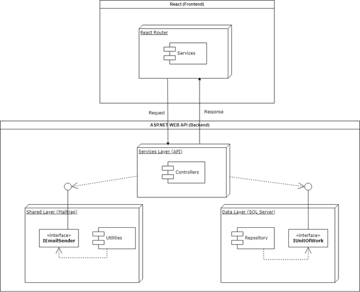
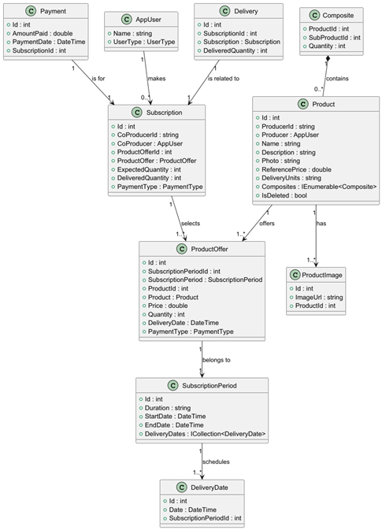

> # Modelação de Ameaças - Sistema AMAP (Fase 1)

|  |  |
|:------------------------------------:|:----------------------------------------:|

**Desenvolvimento de Software Seguros**  
**Mestrado em Engenharia Informática - 2024/2025 **  

**Professores:** 
Paulo Baltarejo de Sousa (T),
Joana Santos (PL),
Cláudio Maia (TP)

**Autores: **
Diana Marques 1240445, 
Diogo Costa 1211514, 
Pedro Costa 1211439, 
Pedro Vilarinho 1211149, 
Tiago Tavares 1240494

**Porto, 2025-04-27**

---

## Índice

[TOC]

---

## Introdução

Este documento apresenta a modelação de ameaças para o sistema AMAP (Associação para a Manutenção da Agricultura de Proximidade), originalmente desenvolvido no âmbito da disciplina de Engenharia de Requisitos (ENGREQ) e agora utilizado como base para a aplicação de conceitos de segurança na disciplina de Desenvolvimento de Software Seguro (DESOFS). O presente trabalho incide exclusivamente sobre a componente de backend do sistema, analisando as suas vulnerabilidades e propondo estratégias de mitigação.

---

### Contexto do projeto

O projeto tem por objetivo criar uma solução informática que suporte a operação das AMAP/CSAs (Associações para a Manutenção da Agricultura de Proximidade / Comunidades que Sustentam a Agricultura).

A AMAP Porto foi selecionada como piloto para a implementação e teste do protótipo, com vista a modernizar e otimizar a gestão, comercialização e distribuição de bens alimentares produzidos por agricultores locais, ligando‑os a consumidores de forma eficiente e sustentável.

---

### O sistema AMAP

O sistema AMAP é uma plataforma de gestão que permite a coordenação entre gestores, produtores e co‑produtores, facilitando:

- Gestão dos períodos de subscrição de produtos agrícolas  
- Criação e manutenção de catálogos de produtos  
- Gestão das ofertas de produtos pelos produtores  
- Processamento das subscrições pelos co‑produtores  
- Gestão de pagamentos  
- Organização das datas de entrega  
- Gestão de utilizadores com diferentes níveis de acesso (Gestor, Produtor, Co‑produtor)
- Gestão de arquivos

A arquitetura do sistema baseia‑se numa API RESTful desenvolvida em ASP.NET Core, fornecendo endpoints seguros para todas as operações necessárias.

---

### Objetivo e âmbito da modelação de ameaças

Este documento corresponde à Fase 1 do processo de desenvolvimento seguro (SSDLC – Secure Software Development Life Cycle), concentrando‑se nas etapas de análise e de design de segurança. O âmbito da modelação de ameaças inclui:

1. **Análise arquitetural:** compreensão da arquitetura do sistema, dos seus componentes e das suas interações  
2. **Modelação de fluxo de dados:** identificação dos principais fluxos de informação no sistema  
3. **Identificação de ameaças:** aplicação da metodologia STRIDE para deteção sistemática de ameaças  
4. **Avaliação de riscos:** priorização das ameaças identificadas com base em critérios objetivos  
5. **Definição de mitigações:** proposta de controlos e estratégias para mitigar as ameaças mais críticas  
6. **Requisitos de segurança:** estabelecimento de requisitos de segurança específicos para o desenvolvimento  
7. **Planeamento de testes:** definição de uma estratégia para validar a implementação dos controlos de segurança  

Esta modelação de ameaças servirá de base às fases subsequentes do projeto, nas quais os requisitos de segurança identificados serão implementados e validados através de práticas de DevSecOps, testes de segurança e integração contínua.  Análise do Sistema.

---

## Visão Geral do Sistema

O sistema AMAP (Associação para a Manutenção da Agricultura de Proximidade) foi concebido para modernizar e otimizar a gestão, comercialização e distribuição de produtos agrícolas locais, ligando produtores diretamente a consumidores (co‑produtores). Suporta o modelo de negócio das AMAP/CSA (Associações para a Manutenção da Agricultura de Proximidade / Comunidades que Sustentam a Agricultura), promovendo agricultura sustentável e comércio justo.

---

### Arquitetura do Sistema

A componente de back‑end do AMAP assenta numa arquitetura n‑camadas, que garante separação de responsabilidades, escalabilidade e facilidade de manutenção. A estrutura principal inclui:

#### Camada de Serviços (API)

- **Tecnologia:** ASP.NET Core Web API  
- **Responsabilidade:** expor endpoints RESTful seguros e robustos para todas as operações  
- **Componentes principais:**  
  - **Controladores (Controllers):** implementam a lógica de negócio e coordenam as operações  
  - **Middleware:** gere autenticação, autorização e tratamento global de exceções  
  - **Filtros:** aplicam validações e transformações transversais às requisições  

#### Camada de Dados

- **Tecnologia:** Entity Framework Core com SQL Server  
- **Responsabilidade:** gerir a persistência e recuperação de dados  
- **Componentes principais:**  
  - **Repositórios (Repositories):** encapsulam as operações de acesso a dados por entidade  
  - **Unit of Work:** assegura transações atómicas entre vários repositórios  
  - **DbContext:** faz o mapeamento das entidades às tabelas e gere o ciclo de vida dos objetos  

#### Camada Partilhada

- **Responsabilidade:** definir o modelo de domínio e componentes comuns  
- **Entidades principais:**  
  - **Utilizador (AppUser):** representa utilizadores com diferentes perfis de acesso  
  - **Product, ProductOffer, ProductImage:** armazenam informação sobre produtos agrícolas  
  - **SubscriptionPeriod, DeliveryDate:** gerem períodos de subscrição e datas de entrega  
  - **Composite, Delivery, Payment:** controlam composições de produtos, entregas e pagamentos  
- **Utilities:**  
  - **EmailSender:** serviço de envio de notificações por e‑mail  
  - **Enumerações de domínio:** UserType, PaymentType  
- **ViewModels:** objetos que preparam dados para apresentação nas interfaces  

#### Fluxo de Comunicação

1. O cliente envia uma requisição HTTP para um endpoint da API.  
2. O controlador correspondente processa a requisição e chama os repositórios para operações de dados.  
3. O Unit of Work coordena, se necessário, transações atómicas entre múltiplas alterações.  
4. Os serviços auxiliares (por exemplo, EmailSender) executam tarefas complementares.  
5. A API devolve uma resposta HTTP padronizada com o resultado ou uma mensagem de erro.

---

### Modelo de Domínio

O modelo de domínio do AMAP descreve as entidades centrais do negócio e as suas relações, servindo de base conceptual ao sistema:

#### Entidades Principais

- **AppUser**: representa utilizadores do sistema, com os seguintes perfis:
  - **Gestor** (Manager): gere a AMAP e configura os períodos de subscrição  
  - **Produtor** (Producer): regista produtos e define as respetivas ofertas  
  - **Co‑produtor** (CoProducer): efetua subscrições e pagamentos  

- **SubscriptionPeriod**: define um intervalo temporal (por exemplo, semestral) para subscrições, contendo:
  - **Duration**: descrição textual do período  
  - **StartDate / EndDate**: datas de início e fim  
  - **DeliveryDates**: conjunto de datas agendadas para entrega  

- **DeliveryDate**: representa uma data específica de entrega:
  - **Date**: data e hora da entrega  
  - **SubscriptionPeriodId**: identifica o período de subscrição a que pertence  

- **Product**: representa um produto agrícola, com atributos como:
  - **ProducerId / Producer**: produtor responsável  
  - **Name / Description**: nome e descrição  
  - **Photo**: imagem do produto  
  - **ReferencePrice**: preço base de referência  
  - **DeliveryUnits**: unidade de medida para entrega  
  - **IsDeleted**: flag de eliminação lógica  
  - **Composites**: relação com subprodutos (para produtos compostos)  

- **ProductImage**: armazena imagens de produtos:
  - **ImageUrl**: URL da imagem  
  - **ProductId**: produto associado  

- **ProductOffer**: associa produtos a períodos de subscrição, especificando:
  - **SubscriptionPeriodId / SubscriptionPeriod**: período de subscrição  
  - **ProductId / Product**: produto oferecido  
  - **Price**: preço para esse período  
  - **Quantity**: quantidade disponível  
  - **DeliveryDate**: data prevista para entrega  
  - **PaymentType**: forma de pagamento aceite  

- **Subscription**: representa a subscrição de um co‑produtor numa oferta:
  - **CoProducerId / CoProducer**: co‑produtor  
  - **ProductOfferId / ProductOffer**: oferta selecionada  
  - **ExpectedQuantity**: quantidade esperada  
  - **DeliveredQuantity**: quantidade efetivamente entregue  
  - **PaymentType**: forma de pagamento escolhida  

- **Delivery**: regista a entrega efetiva de uma subscrição:
  - **SubscriptionId / Subscription**: subscrição associada  
  - **DeliveredQuantity**: quantidade entregue (pode diferir da esperada)  

- **Payment**: documenta pagamentos efetuados:
  - **AmountPaid**: valor pago  
  - **PaymentDate**: data do pagamento  
  - **SubscriptionId**: subscrição relacionada  

- **Composite**: estabelece a composição de produtos:
  - **ProductId**: produto principal  
  - **SubProductId**: subproduto componente  
  - **Quantity**: quantidade do subproduto  

#### Padrões e Decisões de Design

- **Padrão Composite (Compósito):** implementado para permitir produtos simples e compostos, como cabazes de legumes.  
- **Remoção lógica:** produtos são marcados com a flag `IsDeleted` em vez de serem eliminados fisicamente.  
- **Filtros globais:** configurados através do Entity Framework para excluir automaticamente entidades marcadas como removidas.  
- **Relacionamentos controlados:** definições de cascata ou restrição adaptadas para manter a integridade referencial.  

---

### Requisitos Funcionais do Backend

1. **Gestão de períodos de subscrição**  
   - Criar e eliminar períodos com datas de início, fim e datas de entrega associadas.  
   - Notificar automaticamente os produtores sobre novos períodos.  

2. **Catálogo de produtos**  
   - Registar produtos simples e compostos.  
   - Gerir atributos como preço, descrição e unidades de entrega.  
   - Aplicar remoção lógica de produtos para preservar histórico.  

3. **Gestão de ofertas**  
   - Criar ofertas ligadas a produtos e períodos de subscrição.  
   - Definir preços, quantidades disponíveis e métodos de pagamento.  

4. **Gestão de subscrições**  
   - Processar subscrições de co‑produtores.  
   - Monitorizar quantidades esperadas e associar as respetivas formas de pagamento.  

5. **Gestão de entregas**  
   - Registar entregas efetivas.  
   - Controlar discrepâncias entre quantidades subscritas e efetivamente entregues.  

6. **Processamento de pagamentos**  
   - Registar pagamentos realizados.  
   - Calcular valores a pagar e a receber.  

7. **Notificações por e‑mail**  
   - Enviar comunicações automáticas a produtores e co‑produtores sobre novos períodos de subscrição e outras atualizações.  

8. **Controlo de acesso**  
   - Autenticação e autorização baseadas em perfis de utilizador.  
   - Restringir operações conforme o tipo de utilizador (Gestor, Produtor, Co‑produtor).  

9. **Gestão de arquivos**  
   - Implementa funcionalidades para importação e exportação de ficheiros.  
   - Criar diretórios na raiz do projeto para armazenar ficheiros importados e exportados:  
     - **ExportedProducts**: Pasta que contém ficheiros exportados com todos os produtos de um produtor.  
     - **ProductsUpload**: Pasta onde os produtores podem importar ficheiros com novos produtos, os quais são armazenados na base de dados.  

---

### Requisitos Não Funcionais do Backend

Os requisitos não funcionais concentram‑se em aspetos qualitativos essenciais ao funcionamento e manutenção do backend:

#### Desempenho
- **Tempo de resposta:** consultas complexas processadas em menos de 3 segundos  
- **Indexação:** otimização de índices para acelerar as consultas mais frequentes  
- **Monitorização:** supervisão contínua do desempenho das queries  

#### Segurança
- **Autenticação:** robusta, implementada via ASP.NET Identity  
- **Encriptação:** palavras‑passe protegidas com SHA‑256 (com salt)  
- **Cookies:** configuração segura (HttpOnly, Secure, SameSite)  
- **Validação de inputs:** controlo rigoroso dos dados recebidos no back‑end  
- **Prevenção de ataques:** proteção contra injeções SQL e outras ameaças comuns  

#### Manutenibilidade
- **Modularidade:** código organizado em camadas (API, Data, Shared)  
- **Documentação:** API documentada automaticamente através do Swagger  
- **Gestão de erros:** tratamento consistente de exceções e mensagens de erro  

#### Confiabilidade
- **Integridade de dados:** validações e restrições para garantir consistência  
- **Recuperação:** procedimentos regulares de backup e restauro de dados  

#### Escalabilidade
- **Arquitetura desacoplada:** camadas que permitem distribuição de carga  
- **Preparação para crescimento:** design que suporta aumento do volume de dados  
- **Otimização contínua:** consultas ajustadas para crescer com o número de registos  

Esta análise detalhada do sistema AMAP estabelece a base para a subsequente modelação de ameaças, proporcionando uma visão clara dos componentes, arquitetura e requisitos que precisam ser protegidos.

---

## Fluxo de Dados

### Introdução

Os Diagramas de Fluxo de Dados (DFDs) são ferramentas essenciais para visualizar como a informação flui através do sistema AMAP. Estes diagramas permitem identificar os componentes principais do sistema, como os dados são processados, armazenados e trocados entre diferentes partes da aplicação e entidades externas.

---

### Componentes do Sistema

#### Entidades Externas

- **Gestor**: Responsável pela administração do sistema, criação de períodos de subscrição e monitorização de pagamentos.

- **Produtor**: Fornecedor dos produtos agrícolas, responsável por cadastrar produtos, definir quantidades e criar ofertas.

- **CoProdutor**: Utilizador que subscreve as ofertas disponíveis e realiza pagamentos.

- **Sistema de Email**: Componente externo utilizado para enviar notificações aos produtores sobre as datas de início e fim do período e das datas de entregas presentes nesse mesmo período.

#### Processos Principais

- **<u>Processo Central</u>**: **"Sistema de Gestão e Subscrição de Ofertas de Produtos da AMAP"** - Representa todo o sistema como um único processo.

- **Autenticação**: Processo responsável por autenticar os diferentes tipos de utilizadores (Gestor, Produtor, CoProdutor).

- **Gestão de Períodos de Subscrição**: Permite ao Gestor criar e gerir períodos de subscrição com respetivas datas de entrega.

- **Gestão de Produtos e Quantidades**: Permite aos Produtores criar produtos no sistema.

- **Criação de Ofertas**: Processo onde os Produtores podem criar ofertas de produtos para determinados períodos de subscrição.

- **Subscrição**: Processo que permite aos CoProdutores subscreverem ofertas disponíveis.

- **Pagamento**: Gestão dos pagamentos realizados pelos CoProdutores.

- **Controlo de Pagamentos**: Processo para monitorização e gestão de pagamentos pelo Gestor.

- **Notificar Produtor**: Envio de notificações aos Produtores sobre novos períodos e respetivas datas de entrega.

#### Armazenamentos de Dados

- **Utilizadores**: Armazenamento dos dados de utilizadores do sistema (Gestor, Produtor, CoProdutor).

- **Produtos**: Repositório dos produtos cadastrados pelos Produtores.

- **Ofertas de Produtos**: Armazenamento das ofertas criadas pelos Produtores.

- **Subscrições**: Registo das subscrições feitas pelos CoProdutores.

- **Períodos de Subscrição**: Armazenamento dos períodos e datas de entrega.

- **Pagamentos**: Registo dos pagamentos realizados pelos CoProdutores.

---

### Diagramas de Fluxo de Dados

#### Nível 0

O DFD de Nível 0 (ou Diagrama de Contexto) apresenta uma visão global do sistema AMAP, mostrando como ele interage com as entidades externas.

A seguinte figura apresenta o Diagrama de Fluxo de Dados de Nível 0 (Diagrama de Contexto) do sistema AMAP, ilustrando as interações entre o processo central e as entidades externas, bem como os limites de confiança estabelecidos.

##### Descrição dos Fluxos Principais

- Gestor ←→ Sistema:
  - Autenticação/Gestão Períodos: O Gestor autentica-se e gere os períodos de subscrição.
  - Controlo de Pagamentos: O Gestor monitoriza e controla os pagamentos no sistema.

- Produtor ←→ Sistema:
  - Visualização do Catálogo e Quantidades: O Produtor pode visualizar seu catálogo de produtos, bem como as quantidades subscritas pelos CoProdutores.
  - Autenticação/Gestão de Produtos e Quantidades/Criação de Ofertas: O Produtor autentica-se, gere seus produtos, cria ofertas e pode alterar a quantidade de produtos entregue fase ao que foi subscrito pelo CoProdutor.

- CoProdutor ←→ Sistema:
  - Autenticação/Subscrição/Pagamentos: O CoProdutor autentica-se, realiza subscrições e efetua pagamentos.
  - Informação das Ofertas Disponíveis: O sistema fornece informações sobre as ofertas disponíveis.

- Sistema → Sistema de Email:
  - Envio de Notificações sobre períodos e datas de entrega: O sistema envia notificações aos produtores através do sistema de email.
  - Comunicação Externa: Representa a comunicação do sistema com o serviço externo de email.

##### Limites de Confiança
Os limites de confiança no diagrama (linhas tracejadas) representam pontos críticos onde:

1. Interface de Utilizador: Separa a camada de apresentação (frontend) do núcleo do sistema, indicando que todas as interações dos utilizadores passam por esta fronteira de segurança.
2. Comunicação Externa: Delimita a fronteira entre o sistema AMAP e o serviço externo de email, indicando um ponto onde dados saem do controlo direto da aplicação.

Estes limites são essenciais para identificar pontos onde:

- Os dados podem ser interceptados ou manipulados

- É necessário implementar validações e controlos de acesso

- Medidas de proteção específicas devem ser aplicadas para garantir a integridade e confidencialidade das informações

#### Nível 1

O DFD de Nível 1 expande o processo central do DFD Nível 0, detalhando os subprocessos internos e como eles interagem entre si, com as entidades externas e com os armazenamentos de dados.

A apresenta a baixo representa o Diagrama de Fluxo de Dados de Nível 1 do sistema AMAP, detalhando os processos internos, armazenamentos de dados e os fluxos de informação entre eles, além de identificar os diversos limites de confiança presentes no sistema.

##### Processos Detalhados

1. Autenticação:

   - Recebe credenciais de login dos utilizadores (Gestor, Produtor, CoProdutor).

   - Valida as credenciais contra o armazenamento de Utilizadores.

   - Retorna dados do utilizador autenticado.

   - Estabelece o controlo de acesso por perfil.

2. Gestão de Períodos de Subscrição:

   - Recebe dados de novos períodos do Gestor autenticado.

   - Armazena os períodos de subscrição no respetivo armazenamento.

   - Fornece informações sobre períodos existentes.

3. Gestão de Produtos e Quantidades:

   - Recebe dados de produtos do Produtor autenticado.

   - Regista produtos no armazenamento correspondente.

   - Fornece informações sobre produtos existentes.

4. Criação de Ofertas:

   - Recebe lista de produtos com quantidades definidas.

   - Regista ofertas no armazenamento de Ofertas de Produtos.

   - Disponibiliza informações sobre ofertas existentes.

5. Subscrição:

   - Recebe pedidos de subscrição do CoProdutor autenticado.

   - Regista subscrições no armazenamento correspondente.

   - Envia dados da subscrição para o processo de Pagamento.

   - Fornece informações sobre subscrições existentes.

6. Pagamento:

   - Recebe dados de subscrição para pagamento.

   - Regista informações de pagamento no armazenamento.

   - Fornece informações sobre pagamentos existentes.

7. Controlo de Pagamentos:

   - Acessa informações de subscrições e pagamentos existentes.

   - Fornece ao Gestor ferramentas para monitorizar e gerir pagamentos.

8. Notificar Produtor:

   - Recebe notificação e-mail do processo de Gestão de Períodos.

   - Integra-se com o Sistema de Email para enviar notificações aos Produtores.

##### Fluxos de Dados Importantes

- Credenciais de Login → Autenticação: Dados de login fornecidos pelos utilizadores.

- Utilizador Autenticado → Diversos Processos: Informações do utilizador após autenticação.

- Dados do Novo Período → Gestão de Períodos: Informações sobre novos períodos de subscrição.

- Registo de Produtos → Armazenamento de Produtos: Dados de produtos para armazenamento.

- Lista de Produtos com Quantidades → Criação de Ofertas: Produtos disponíveis para criação de ofertas.

- Registo de Ofertas → Armazenamento de Ofertas: Dados de ofertas para armazenamento.

- Registo de Subscrições → Armazenamento de Subscrições: Dados de subscrições para armazenamento.

- Dados de Subscrição para Pagamento → Pagamento: Informações para processamento de pagamento.

- Registo de Pagamento → Armazenamento de Pagamentos: Dados de pagamentos para armazenamento.

- Mensagem de Notificação → Sistema de Email: Conteúdo a ser enviado por email.

##### Limites de Confiança 

Os limites de confiança no DFD Nível 1 são mais detalhados, identificando:

1. **Perímetro de Autenticação:** Separa os utilizadores não autenticados dos autenticados.
2. **Controlo de Acesso por Perfil:** Limita o acesso a funcionalidades específicas baseado no tipo de utilizador.
3. **Database Boundary:** Limites entre processos e armazenamentos de dados, indicando pontos onde os dados precisam ser protegidos durante o armazenamento.
4. **Integração com Sistema de Email:** Limite entre o sistema AMAP e o serviço externo de email.

---

### Conclusão

A análise de fluxo de dados do sistema AMAP revela uma arquitetura modular com separação clara de responsabilidades entre diferentes processos. Os diagramas demonstram como os dados fluem entre utilizadores, processos e armazenamentos, destacando pontos críticos onde medidas de segurança são necessárias (limites de confiança).

Esta documentação de fluxo de dados é essencial para compreender o funcionamento do sistema, identificar potenciais vulnerabilidades de segurança e garantir que todos os componentes interajam corretamente para fornecer as funcionalidades esperadas.

A estrutura do sistema, composta por processos de autenticação, gestão de períodos, produtos, ofertas, subscrições e pagamentos, reflete a arquitetura da aplicação revelada na análise do código-fonte, particularmente nos controladores e modelos encontrados no projeto AMAP.

---

## Identificação e Análise de Ameaças

### Introdução 

Nesta secção, aplicamos a metodologia STRIDE para identificar e analisar as ameaças mais relevantes para o sistema AMAP. Para cada elemento do DFD, identificamos as ameaças aplicáveis, detalhamos os vetores de ataque, identificamos potenciais agentes de ameaça e ilustramos com casos de abuso concretos.

---

### Aplicação da Metodologia STRIDE

A metodologia STRIDE é utilizada para identificar ameaças de segurança, onde cada letra representa uma categoria:

- **Spoofing**: Falsificação de identidade

- **Tampering**: Adulteração de dados

- **Repudiation**: Repúdio de ações realizadas

- **Information Disclosure**: Divulgação não autorizada de informação

- **Denial of Service**: Negação de serviço

- **Elevation of Privilege**: Elevação de privilégios

---

### Análise de Ameaças por Elemento do DFD

#### 1. Elementos do Processo

##### 1.1 Processo de Autenticação

**Ameaças STRIDE Aplicáveis**: S, E

**Ameaças Identificadas**:

- S (Spoofing): Falsificação de identidade para obter acesso não autorizado como Gestor, Produtor ou CoProdutor.

- E (Elevation of Privilege): Escalação de privilégios de uma conta de CoProdutor para Produtor ou Gestor.

**Vetores de Ataque**:

- Ataques de força bruta contra o endpoint de login da API (`/api/Account/login`)

- Manipulação de Claims nos tokens JWT para alterar o UserType

- Roubo de credenciais através de phishing

**Agentes de Ameaça**:

- Atacantes externos que procuram acesso à plataforma

- CoProdutores que tentam obter privilégios de Produtor/Gestor

- Ex-utilizadores cujo acesso não foi revogado

**Casos de Abuso**:

1. Um atacante obtém credenciais de um Gestor através de phishing e acede a funcionalidades administrativas.
2. Um CoProdutor manipula o seu token de autenticação para alterar o seu UserType para Gestor, tentando assim aceder às funcionalidades de gestão de períodos.

##### 1.2 Processo de Gestão de Períodos de Subscrição

**Ameaças STRIDE Aplicáveis:** T, E

**Ameaças Identificadas:**

- T (Tampering): Modificação não autorizada de períodos de subscrição e datas de entrega, comprometendo a integridade do sistema de planeamento.

- E (Elevation of Privilege): Acesso indevido às funcionalidades de gestão de períodos por utilizadores sem privilégios de Gestor.

**Vetores de Ataque:**

- Manipulação de parâmetros na chamada à API para o endpoint `/api/SubscriptionPeriod`

- Exploração de vulnerabilidades no controlo de acesso baseado em roles (RBAC)

- Injeção SQL para modificar diretamente dados de períodos na base de dados

- Obstrução e alteração de pedidos HTTP durante a criação ou modificação de períodos

**Agentes de Ameaça:**

- Gestores mal-intencionados com acesso legítimo ao sistema

- Produtores que tentam obter vantagens comerciais através de períodos favoráveis

- Atacantes externos que conseguiram comprometer contas de Gestor

- Ex-funcionários com conhecimento do sistema e potenciais motivos para sabotagem

**Casos de Abuso:**

1. Um Gestor corrupto cria períodos de subscrição com datas estrategicamente favoráveis para certos Produtores, prejudicando a concorrência justa no sistema.
2. Um Produtor explora uma vulnerabilidade no controlo de acesso da API e consegue aceder ao endpoint `/api/SubscriptionPeriod/SubscriptionPeriod` que deveria ser restrito a Gestores, criando períodos favoráveis para os seus próprios produtos.
3. Um atacante com acesso à base de dados modifica diretamente os registos de datas de entrega, criando inconsistências que comprometem o funcionamento do sistema e causam confusão entre Produtores e CoProdutores.
4. Um atacante realiza um ataque Man-in-the-Middle, intercetando e modificando pedidos HTTP legítimos de Gestores durante a criação de períodos, alterando datas e durações sem o conhecimento do utilizador.

##### 1.3 Processo de Gestão de Produtos e Quantidades

**Ameaças STRIDE Aplicáveis:** T, I

**Ameaças Identificadas:**

- T (Tampering): Alteração não autorizada de informações de produtos, como preços, descrições, fotos ou quantidades disponíveis após a criação de ofertas ou subscrições.

- I (Information Disclosure): Divulgação não autorizada de informações de produtos antes do lançamento oficial, comprometendo a concorrência justa.

**Vetores de Ataque:**

- Manipulação de pedidos à API `/api/Product` para alterar dados de produtos existentes

- Exploração de falhas na validação de entrada para injetar dados maliciosos (ex: XSS em descrições de produtos)

- Upload de imagens maliciosas contendo código executável ou conteúdo inadequado

- Acesso direto à base de dados para modificar informações de produtos sem passar pelas validações da API

- Manipulação de ficheiros CSV durante o processo de importação/exportação de produtos

- Injeção de código malicioso em ficheiros de produtos antes do upload

- Exploração de vulnerabilidades no processamento de ficheiros durante a importação automática para a base de dados

**Agentes de Ameaça:**

- Produtores desonestos que manipulam os seus próprios produtos após subscrições

- Atacantes que comprometeram contas de Produtores legítimos

- Concorrentes que tentam prejudicar a reputação de outros Produtores

- Insiders com acesso privilegiado à base de dados ou sistemas backend

- CoProdutores técnicos que tentam alterar preços ou quantidades de produtos subscritos
- Utilizadores maliciosos com conhecimentos técnicos capazes de manipular ficheiros CSV

**Casos de Abuso:**

1. Um Produtor cria um produto com características atrativas, e após receber múltiplas subscrições, altera a descrição, quantidade ou outras características através do endpoint `/api/Product`, prejudicando os CoProdutores que já subscreveram com base nas informações originais.
2. Um atacante consegue comprometer a conta de um Produtor respeitado e modifica as fotos dos produtos para imagens contendo conteúdo malicioso ou inapropriado, prejudicando a reputação do Produtor e potencialmente comprometendo dispositivos de utilizadores.
3. Um Produtor desonesto insere intencionalmente preços muito baixos no campo ReferencePrice dos seus produtos para atrair subscrições, e depois alega ter sido um erro técnico, tentando renegociar os valores ou entregando produtos de qualidade inferior.
4. Um Produtor malicioso manipula um ficheiro CSV de produtos antes de fazer o upload, inserindo comandos de injeção SQL ou scripts maliciosos nos campos de descrição ou nome. Quando o sistema processa automaticamente este ficheiro para criar produtos na base de dados, os comandos são executados, comprometendo a integridade do sistema.
5. Um atacante consegue acesso ao endpoint de exportação de produtos (download de ficheiro) e obtém informações confidenciais sobre todos os produtos do sistema, incluindo aqueles que ainda não foram publicados, permitindo análise competitiva indevida.
6. Um Produtor técnico explora vulnerabilidades no mecanismo de processamento de ficheiros para injetar produtos falsos ou modificar produtos existentes durante o processo de importação automática, contornando as validações normais da API.
7. Um concorrente com conhecimentos técnicos explora uma vulnerabilidade de injeção SQL no sistema para aceder antecipadamente às informações de novos produtos que serão lançados por outros Produtores, obtendo vantagem competitiva indevida.
8. Um Produtor desonesto utiliza a funcionalidade de exportação de ficheiro para obter uma lista completa de produtos de outros Produtores, incluindo detalhes que normalmente não seriam visíveis através da interface normal, e utiliza estas informações para estabelecer preços estrategicamente abaixo da concorrência.
9. Um atacante interceta comunicações não encriptadas durante o upload de fotos de produtos através do endpoint `/api/Product` e substitui as imagens por outras manipuladas, causando potenciais danos à reputação do Produtor ou inserindo conteúdo malicioso.

##### 1.4 Processo de Criação de Ofertas

**Ameaças STRIDE Aplicáveis:** S, T

**Ameaças Identificadas:**

- S (Spoofing): Criação de ofertas falsas ou fraudulentas em nome de outros Produtores, comprometendo a confiança no sistema.

- T (Tampering): Modificação não autorizada de ofertas existentes, alterando preços, quantidades, datas de entrega ou outras condições após a publicação e subscrição.

**Vetores de Ataque:**

- Manipulação de parâmetros em pedidos à API `/api/ProductOffer` para alterar ofertas após a criação

- Falsificação do identificador de Produtor (ProductId) durante a criação ou modificação de ofertas

- Exploração de falhas no controlo de acesso para modificar ofertas de outros Produtores

- Modificação direta dos registos na base de dados, contornando as validações da API

- Injeção de valores inválidos nos campos de preço (Price), quantidade (Quantity) ou data de entrega (DeliveryDate)

**Agentes de Ameaça:**

- Produtores desonestos que alteram ofertas após receberem subscrições

- Atacantes que comprometeram contas de Produtores

- Concorrentes tentando prejudicar a reputação de outros Produtores

- Administradores de sistema corruptos com acesso privilegiado

- Atacantes externos explorando vulnerabilidades na aplicação

**Casos de Abuso:**

1. Um atacante que conseguiu acesso ao sistema cria uma oferta com preços anormalmente baixos em nome de um Produtor respeitado utilizando o endpoint `/api/ProductOffer`. Quando os CoProdutores fazem subscrições, o Produtor legítimo é confrontado com pedidos que não consegue satisfazer, prejudicando a sua reputação.
2. Um Produtor publica ofertas atrativas com quantidades generosas e preços competitivos. Após receber um grande número de subscrições, modifica as condições através da API, reduzindo quantidades ou aumentando preços, alegando um erro técnico no sistema quando confrontado.
3. Um funcionário interno com acesso à base de dados modifica diretamente os campos de PaymentType em ofertas existentes, alterando os métodos de pagamento aceites após CoProdutores já terem feito subscrições, causando confusão e potenciais disputas.
4. Um Produtor desonesto consegue explorar uma vulnerabilidade no sistema para alterar o campo SubscriptionPeriodId de uma oferta, movendo-a para um período diferente após subscrições já terem sido feitas, causando problemas logísticos para CoProdutores e outros Produtores.

##### 1.5 Processo de Subscrição

**Ameaças STRIDE Aplicáveis:** T, R

**Ameaças Identificadas:**

- T (Tampering): Alteração não autorizada de dados de subscrição, como quantidades esperadas ou tipos de pagamento, após a subscrição ter sido confirmada.

- R (Repudiation): Negação de ter realizado uma subscrição específica após o recebimento do produto, tentando evitar o pagamento ou outras obrigações.

**Vetores de Ataque:**

- Manipulação de parâmetros nos pedidos à API `/api/Subscription` para alterar dados de subscrições

- Exploração de falhas no controlo de acesso para modificar subscrições de outros CoProdutores

- Modificação direta dos registos na base de dados, contornando as validações da API

- Alteração do campo ExpectedQuantity após a subscrição ter sido confirmada

- Manipulação do campo PaymentType para utilizar métodos de pagamento diferentes dos aceites na oferta

- Injeção de SQL para modificar ou eliminar registos de auditoria de subscrições

**Agentes de Ameaça:**

- CoProdutores mal-intencionados que tentam obter mais produtos pelo mesmo preço

- CoProdutores que pretendem negar transações realizadas

- Atacantes que comprometeram contas de CoProdutores legítimos

- Concorrentes que tentam reservar produtos populares para impedir outros de os obterem

- Administradores de sistema corruptos com acesso privilegiado à base de dados

**Casos de Abuso:**

1. Um CoProdutor faz uma subscrição através do endpoint `/api/Subscription` para uma quantidade específica de um produto. Após a confirmação, utiliza ferramentas para obstruir e modificar as comunicações com a API, alterando o campo ExpectedQuantity para um valor maior sem pagar a diferença.
2. Um CoProdutor faz uma subscrição, recebe e consome o produto, mas depois nega ter realizado a transação, alegando que alguém utilizou a sua conta sem autorização. Na ausência de registos de auditoria robustos, o sistema não consegue provar que foi realmente o CoProdutor a realizar a subscrição.
3. Um atacante com conhecimentos técnicos compromete uma conta de CoProdutor e realiza múltiplas subscrições para produtos populares que têm quantidades limitadas, impedindo que outros CoProdutores legítimos possam adquirir esses produtos e potencialmente criando um mercado negro.
4. Um CoProdutor mal-intencionado explora uma vulnerabilidade no sistema que permite modificar o campo ProductOfferId após a subscrição, alterando para um produto diferente ou mais caro sem pagar a diferença de preço.
5. Um atacante com acesso à base de dados modifica diretamente os registos de subscrição, alterando os detalhes da transação ou até mesmo eliminando o registo da subscrição após o produto ter sido recebido, dificultando a rastreabilidade e o controlo financeiro do sistema.

##### 1.6 Processo de Pagamento

**Ameaças STRIDE Aplicáveis:** T, R

**Ameaças Identificadas:**

- T (Tampering): Alteração não autorizada de informações de pagamento, como valores, estados de pagamento ou métodos utilizados.

- R (Repudiation): Negação de ter realizado um pagamento após a transação ter sido concluída e o produto recebido.

**Vetores de Ataque:**

- Manipulação de parâmetros nos pedidos à API `/api/Payment` para alterar detalhes de pagamentos

- Modificação direta de registos na tabela de pagamentos na base de dados

- Alteração do campo PaymentType para utilizar um método diferente do originalmente acordado

- Exploração de falhas no registo de auditoria para eliminar provas de pagamentos

- Injeção de SQL para modificar o estado ou detalhes de pagamentos existentes

- Manipulação das comunicações entre o cliente e servidor durante o processamento de pagamentos

**Agentes de Ameaça:**

- CoProdutores que tentam pagar menos do que o devido

- Utilizadores que tentam obter produtos sem efetuar o pagamento completo

- Administradores de sistema com acesso privilegiado à base de dados

- Atacantes que comprometeram contas de CoProdutores legítimos

- Insiders (funcionários) com acesso ao backend do sistema

**Casos de Abuso:**

1. Um CoProdutor tecnicamente habilidoso interceta e modifica o pedido HTTP durante a submissão de um pagamento ao endpoint `/api/Payment`, alterando o valor a ser pago para um montante menor, enquanto aparenta estar a pagar o valor total acordado.
2. Um CoProdutor realiza uma subscrição, recebe o produto, e depois modifica os registos de pagamento diretamente na base de dados (se tiver esse acesso) ou explora uma vulnerabilidade na API para marcar o pagamento como "pendente" novamente, tentando evitar o pagamento enquanto mantém o produto.
3. Um administrador de sistema ou funcionário com acesso ao backend acede indevidamente à tabela Payment na base de dados e altera o estado de pagamentos específicos para beneficiar certos CoProdutores ou prejudicar determinados Produtores.
4. Um CoProdutor realiza um pagamento utilizando um determinado PaymentType (como MBway), mas depois alega ter pago por outro método (como transferência bancária) que é mais difícil de verificar, explorando potenciais falhas no rastreamento e verificação de pagamentos.
5. Um atacante com conhecimentos técnicos compromete o sistema e modifica os registos de pagamento para redirecioná-los para contas diferentes, prejudicando financeiramente os Produtores legítimos.
6. Um CoProdutor faz um pagamento, recebe o produto, e depois nega ter autorizado o pagamento, alegando que não há provas suficientes de que foi ele quem realizou a transação, devido à falta de mecanismos robustos de não-repúdio no sistema.

##### 1.7 Processo de Controlo de Pagamentos

**Ameaças STRIDE Aplicáveis:** I, E

**Ameaças Identificadas:**

- I (Information Disclosure): Divulgação não autorizada de informações financeiras sensíveis sobre pagamentos, subscrições e transações dos CoProdutores e Produtores.

- E (Elevation of Privilege): Acesso não autorizado a funcionalidades de controlo de pagamentos que são restritas exclusivamente a utilizadores com perfil de Gestor.

**Vetores de Ataque:**

- Exploração de vulnerabilidades no controlo de acesso baseado em roles (`[Authorize(Roles = nameof(UserType.Manager))]`)

- Manipulação de tokens JWT para modificar as claims de perfil de utilizador

- Acesso direto à API `/api/PaymentsInfo` contornando as verificações de autorização

- Ataques de elevação de privilégios para obter acesso a endpoints restritos

- Intercepção de comunicações contendo dados financeiros sensíveis

- Exploração de falhas nas consultas à base de dados que recuperam informações de pagamentos

- Acesso não autorizado a endpoints como `/api/PaymentsInfo/GetPaymentsCC` que expõem dados financeiros agregados

**Agentes de Ameaça:**

- Produtores que tentam aceder a informações financeiras de outros Produtores

- CoProdutores que tentam aceder a informações de pagamentos para além das suas próprias subscrições

- Utilizadores com conhecimentos técnicos que tentam elevar privilégios

- Atacantes externos que comprometeram o sistema

- Funcionários internos sem autorização adequada

- Gestores desonestos abusando do seu acesso legítimo

**Casos de Abuso:**

1. Um Produtor com conhecimentos técnicos manipula o seu token de autenticação para adicionar a claim de perfil de Gestor (`UserType.Manager`), conseguindo assim aceder ao endpoint `/api/PaymentsInfo` para visualizar informações financeiras de todos os Produtores e CoProdutores no sistema.
2. Um atacante explora uma vulnerabilidade no controlo de acesso do sistema para contornar as anotações `[Authorize]` nos controladores, conseguindo aceder a funcionalidades de controlo de pagamentos mesmo sem ter as permissões necessárias.
3. Um funcionário interno da equipa de suporte técnico, que não deveria ter acesso a informações financeiras, utiliza credenciais de acesso à base de dados para consultar diretamente as tabelas de pagamentos, obtendo informações sensíveis sobre transações.
4. Um Gestor corrupto acede legitimamente ao módulo de controlo de pagamentos e extrai informações financeiras detalhadas de Produtores concorrentes, utilizando-as para oferecer condições mais vantajosas e roubar clientes.
5. Um atacante consegue explorar uma falha no endpoint `/api/PaymentsInfo/GetCoProducerCC` para obter informações sobre métodos de pagamento utilizados por CoProdutores, potencialmente expondo dados sensíveis financeiros.
6. Um utilizador mal-intencionado explora uma potencial falha de segurança no sistema de relatórios de pagamento, conseguindo gerar relatórios com informações financeiras detalhadas às quais não deveria ter acesso.

##### 1.8 Processo de Notificação

**Ameaças STRIDE Aplicáveis:** T, I

**Ameaças Identificadas:**

- T (Tampering): Modificação não autorizada do conteúdo das notificações enviadas aos Produtores, alterando informações sobre períodos de subscrição ou datas de entrega.

- I (Information Disclosure): Acesso não autorizado a informações potencialmente sensíveis incluídas nas notificações, como detalhes de períodos antes do anúncio oficial ou dados específicos de Produtores.

**Vetores de Ataque:**

- Intercepção e manipulação do conteúdo de e-mails enviados pela classe `EmailSender`

- Comprometimento das credenciais utilizadas pelo sistema para enviar e-mails

- Exploração de vulnerabilidades no código de geração de notificações, especialmente no método `SendEmailAsync`

- Acesso não autorizado ao serviço de e-mail utilizado pela aplicação

- Manipulação do corpo (body) do e-mail antes do envio, alterando links ou informações

- Injeção de código malicioso no HTML dos e-mails formatados

- Man-in-the-Middle durante a transmissão de e-mails entre o servidor AMAP e o servidor de email

**Agentes de Ameaça:**

- Administradores de sistema com acesso ao servidor de aplicação

- Atacantes que comprometeram a infraestrutura de rede

- Indivíduos com acesso não autorizado às credenciais de e-mail do sistema

- Insiders com acesso ao código ou à configuração do sistema de notificações

- Atacantes capazes de interceptar comunicações entre o sistema AMAP e o serviço de e-mail

**Casos de Abuso:**

1. Um atacante com acesso ao servidor onde a aplicação AMAP está a correr modifica o código da classe `EmailSender` para alterar o conteúdo das notificações sobre novos períodos de subscrição, inserindo informações falsas sobre datas de entrega ou condições, causando confusão entre os Produtores.
2. Um administrador desonesto com acesso ao sistema intercepta notificações destinadas a todos os Produtores e modifica-as para incluir links de phishing, que tenta roubar credenciais quando os Produtores clicarem nesses links pensando serem legítimos.
3. Um atacante compromete as credenciais utilizadas no método `SendEmailAsync` e utiliza-as para enviar e-mails fraudulentos em nome do sistema AMAP, potencialmente danificando a confiança dos utilizadores na plataforma.
4. Um insider com acesso ao código manipula a função de notificação sobre novos períodos, implementada no método de envio de e-mails após a criação de períodos de subscrição em `SubscriptionPeriodController`, para incluir código HTML malicioso que explorará vulnerabilidades nos navegadores dos Produtores.
5. Um atacante com acesso à configuração do sistema modifica os templates de e-mail utilizados nas notificações, alterando subtilmente informações críticas como datas de entrega, causando problemas operacionais para Produtores e CoProdutores.
6. Um administrador de sistema acede indevidamente ao conteúdo das notificações enviadas, obtendo assim informações confidenciais sobre as operações de vários Produtores, incluindo datas e outros dados comercialmente sensíveis.

---

#### 2. Fluxos de Dados Principais

##### 2.1 Fluxo: Credenciais de Login → Autenticação

**Ameaças STRIDE Aplicáveis:** T, I

**Ameaças Identificadas:**

- T (Tampering): Modificação das credenciais ou tokens de autenticação durante a transmissão, potencialmente permitindo acesso não autorizado.

- I (Information Disclosure): Intercepção e exposição não autorizada das credenciais de login (nome de utilizador e palavra-passe) durante a transmissão entre o cliente e o servidor.

**Vetores de Ataque:**

- Sniffing de tráfego em redes não seguras (especialmente Wi-Fi públicas) para capturar pedidos HTTP contendo credenciais

- Ataques Man-in-the-Middle (MitM) para interceptar comunicações entre o cliente e o servidor de autenticação

- Exploração de conexões não encriptadas (HTTP em vez de HTTPS) no endpoint `/api/Account/login`

- Injeção de scripts maliciosos via XSS para capturar credenciais no navegador antes do envio

- Comprometimento do canal de comunicação através de ataques de DNS spoofing

- Instalação de malware (keyloggers, trojans) no dispositivo do utilizador para capturar credenciais

- Ataques de SSL stripping para forçar o uso de conexões não encriptadas

**Agentes de Ameaça:**

- Atacantes com acesso à mesma rede local (especialmente em redes públicas)

- Administradores de rede maliciosos com capacidade de monitorizar tráfego

- Operadores de pontos de acesso Wi-Fi fraudulentos (rogue access points)

- Atacantes que conseguiram instalar malware nos dispositivos dos utilizadores

- Entidades que controlam infraestrutura de rede intermediária (ISPs, proxies)

- Atores com capacidade de monitorização de redes em grande escala

**Casos de Abuso:**

1. Um atacante cria um ponto de acesso Wi-Fi falso com um nome semelhante a uma rede legítima (ex: "CafeWifi_Free"). Quando um utilizador da AMAP se conecta e acede à plataforma, o atacante captura as credenciais transmitidas, pois a conexão não está devidamente protegida por HTTPS.
2. Um atacante realiza um ataque de DNS spoofing contra um utilizador, redirecionando o tráfego destinado ao domínio da AMAP para um servidor malicioso que imita a página de login. O utilizador insere suas credenciais, que são capturadas pelo atacante antes de reencaminhar o pedido para o servidor legítimo.
3. Um script malicioso é injetado no navegador de um utilizador através de uma vulnerabilidade XSS em outro site. Quando o utilizador acede à plataforma AMAP, o script captura as credenciais no momento em que são digitadas, antes mesmo de serem enviadas.
4. Um atacante compromete o router doméstico de um Gestor da AMAP e instala um firmware malicioso que monitoriza todo o tráfego. Quando o Gestor acede à plataforma, o atacante captura não apenas as credenciais, mas também o token JWT gerado após a autenticação, permitindo acesso prolongado mesmo sem conhecer a palavra-passe.
5. Um atacante utiliza uma ferramenta de SSL stripping num café para interceptar conexões HTTPS e degradá-las para HTTP. Quando um Produtor da AMAP acede à plataforma através desta rede comprometida, suas credenciais são transmitidas em texto simples e facilmente capturadas.

##### 2.2 Fluxo: Dados do Novo Período → Gestão de Períodos

**Ameaças STRIDE Aplicáveis:** T, I

**Ameaças Identificadas:**

- T (Tampering): Adulteração dos dados de períodos de subscrição e datas de entrega durante a transmissão entre o cliente e o servidor, em que pode criar períodos inválidos ou prejudiciais.

- I (Information Disclosure): Acesso não autorizado a informações sobre novos períodos de subscrição antes do seu anúncio oficial, proporcionando vantagens competitivas indevidas.

**Vetores de Ataque:**

- Manipulação de parâmetros JSON no corpo do pedido POST ao endpoint `/api/SubscriptionPeriod/SubscriptionPeriod`

- Intercepção de comunicações entre o cliente e o servidor durante a criação de períodos

- Modificação dos campos StartDate, EndDate ou Duration durante a transmissão

- Alteração dos dados de DeliveryDates associados a um período de subscrição

- Ataques Man-in-the-Middle para monitorizar ou modificar o tráfego

- Exploração de falhas na validação de entrada nos controladores de períodos

- Acesso não autorizado ao endpoint de consulta de períodos `/api/SubscriptionPeriod/SubscriptionPeriod/{id}`

**Agentes de Ameaça:**

- Gestores mal-intencionados com acesso legítimo ao sistema

- Atacantes externos que comprometeram a segurança da rede

- Funcionários internos com acesso parcial ao sistema

- Produtores tentando obter informação privilegiada sobre novos períodos

- Concorrentes tentando sabotar o sistema de períodos e entregas

- Administradores de sistema com acesso privilegiado ao tráfego de rede

**Casos de Abuso:**

1. Um atacante intercepta um pedido legítimo ao endpoint `/api/SubscriptionPeriod/SubscriptionPeriod` e modifica os objetos DeliveryDates no corpo do pedido, alterando as datas para momentos impossíveis (ex: fins-de-semana ou feriados), causando problemas logísticos tanto para Produtores quanto para CoProdutores.
2. Um Gestor desonesto cria um período de subscrição com datas favoráveis para um grupo específico de Produtores, mas, durante a transmissão, um atacante modifica os dados para beneficiar outros Produtores, gerando confusão e potenciais conflitos no sistema.
3. Um funcionário da equipa técnica com acesso à infraestrutura de rede monitoriza os pedidos ao endpoint de criação de períodos e recolhe informações sobre novos períodos planeados antes do anúncio oficial. Estas informações são depois vendidas a Produtores específicos, dando-lhes vantagem para prepararem a sua produção antecipadamente.
4. Um atacante explora uma vulnerabilidade no controller `SubscriptionPeriodController` que permite visualizar períodos ainda não publicados através de um endpoint de consulta mal protegido, obtendo assim informações privilegiadas sobre datas futuras de entrega.
5. Um Produtor tecnicamente habilidoso consegue interceptar as notificações enviadas pelo método de e-mail implementado após a criação de períodos, obtendo informações detalhadas sobre novos períodos antes que outros Produtores as recebam, permitindo-lhe planear estrategicamente as suas ofertas.

##### 2.3 Fluxo: Dados de Subscrição para Pagamento → Pagamento

**Ameaças STRIDE Aplicáveis:** T, I

**Ameaças Identificadas:**

- T (Tampering): Modificação não autorizada dos dados de subscrição durante a transmissão para o processo de pagamento, alterando valores, quantidades ou detalhes do método de pagamento.

- I (Information Disclosure): Acesso não autorizado a informações de transações durante a transmissão entre o processo de subscrição e o processo de pagamento.

**Vetores de Ataque:**

- Manipulação dos parâmetros de pedido enviados ao endpoint `/api/Payment`

- Alteração do valor do campo ExpectedQuantity na subscrição, afetando o valor final a pagar

- Modificação do tipo de pagamento (PaymentType) para utilizar um método diferente do acordo inicial (ex: alterar de transferência bancária para pagamento em dinheiro)

- Intercepção das comunicações entre o módulo de subscrições e o módulo de pagamentos

- Exploração de vulnerabilidades na passagem de dados entre os controllers `SubscriptionController` e `PaymentController`

- Man-in-the-Middle entre componentes do sistema durante o processamento de pagamentos

**Agentes de Ameaça:**

- CoProdutores mal-intencionados que tentam pagar menos do que o devido

- Atacantes externos que comprometeram a segurança da aplicação

- Administradores de sistema com acesso aos servidores

- Funcionários internos com conhecimento da arquitetura do sistema

- Utilizadores técnicos com capacidade para interceptar e modificar comunicações internas

**Casos de Abuso:**

1. Um CoProdutor tecnicamente habilidoso interceta o pedido HTTP quando os dados da sua subscrição são enviados para processamento de pagamento. Utilizando ferramentas como um proxy interceptor, modifica o campo de quantidade esperada ou o preço unitário, reduzindo o valor total a pagar sem afetar a quantidade de produto a receber.
1. Um atacante que comprometeu o sistema explora uma falha na validação de dados entre os módulos de subscrição e pagamento, modificando o PaymentType de uma transação de transferência bancária para dinheiro em mão, dificultando a verificação do pagamento e potencialmente permitindo que um pagamento seja registado como concluído sem realmente o ser.
1. Um administrador de sistema monitoriza o tráfego interno da aplicação e captura informações sobre transações, incluindo detalhes de pagamento como valores, métodos de pagamento escolhidos e padrões de compra dos CoProdutores, obtendo inteligência de negócio indevida.
1. Um funcionário interno com acesso à base de dados explora o momento em que os dados são transmitidos entre a tabela Subscription e a tabela Payment, modificando valores para beneficiar certos CoProdutores ou prejudicar determinados Produtores.
1. Um atacante realiza um Man-in-the-Middle entre os componentes internos da aplicação, modificando os dados de pagamento para alterar registos, manipulando a forma como os dados são passados do SubscriptionController para processamento de pagamento.
1. Um CoProdutor desonesto explora uma vulnerabilidade no processo de verificação de PaymentType que permite que ele selecione um método de pagamento que na realidade não está disponível para aquela oferta específica, contornando as restrições impostas pelo Produtor.

---

#### 3. Armazenamentos de Dados

##### 3.1 Armazenamento: Utilizadores

**Ameaças STRIDE Aplicáveis:** T, I

**Ameaças Identificadas:**

- T (Tampering): Modificação não autorizada de dados de utilizador, incluindo tipo de utilizador (UserType), informações de perfil ou credenciais, comprometendo a integridade do sistema.

- I (Information Disclosure): Acesso não autorizado a informações sensíveis do utilizador, como palavras-passe, dados pessoais ou roles de sistema, violando a confidencialidade.

**Vetores de Ataque:**

- Ataques de injeção SQL nos endpoints de gestão de utilizadores para manipular dados na tabela AspNetUsers

- Exploração de vulnerabilidades na classe AppUser ou no Identity Framework para alterar o campo UserType

- Acesso direto não autorizado à base de dados contornando a camada de aplicação

- Falhas na proteção de backups da base de dados contendo a tabela de utilizadores

- Exploração de vulnerabilidades em stored procedures ou queries que manipulam dados de utilizadores

- Acessos privilegiados indevidos às tabelas relacionadas com AspNetUsers ou AspNetUserRoles

- Manipulação de tokens de autenticação para obter acesso a funcionalidades de gestão de utilizadores

**Agentes de Ameaça:**

- Administradores de sistema com privilégios elevados na base de dados

- Utilizadores com conhecimentos técnicos tentando elevar os seus privilégios

- Atacantes externos que conseguiram comprometer a segurança do sistema

- Insiders (ex: desenvolvedores, administradores) com acesso legítimo aos sistemas

- Ex-funcionários cujos acessos não foram devidamente revogados

- Atacantes que conseguiram acesso às credenciais de serviço ou ficheiros de configuração

**Casos de Abuso:**

1. Um atacante utiliza uma vulnerabilidade de injeção SQL no endpoint de autenticação para modificar o campo UserType na tabela AspNetUsers, alterando o seu perfil de CoProdutor para Gestor, obtendo assim acesso a funcionalidades administrativas do sistema AMAP.
1. Um administrador de base de dados corrupto acede diretamente à tabela AspNetUsers e altera as passwords hash armazenadas, comprometendo contas de Produtores específicos para beneficiar certos CoProdutores em detrimento de outros.
1. Um atacante consegue acesso a um backup não encriptado da base de dados e extrai informações sensíveis, incluindo endereços de email, dados de perfil e potencialmente passwords hash dos utilizadores, particularmente visando contas de Gestores com acesso privilegiado.
1. Um antigo funcionário de TI que mantém acesso aos servidores modifica os dados de perfil (Name e outros campos de AppUser) de Produtores específicos, causando confusão e potencial desinformação para os CoProdutores que interagem com esses perfis.
1. Um desenvolvedor interno com acesso ao sistema de staging da aplicação modifica os mapeamentos do Entity Framework ou do Identity para alterar como as roles são atribuídas aos utilizadores, criando um backdoor que lhe permite elevar privilégios quando necessário sem deixar rastos óbvios nos logs do sistema.
1. Um administrador com acesso à base de dados poderia criar contas adicionais com privilégios de Gestor (UserType.Manager), inserindo-as diretamente nas tabelas do ASP.NET Identity. Estas contas maliciosas permitiriam manter acesso permanente aos módulos administrativos do sistema, mesmo que outras atividades suspeitas fossem detectadas e investigadas.

##### 3.2 Armazenamento: Ofertas de Produtos

**Ameaças STRIDE Aplicáveis:** T, I

**Ameaças Identificadas:**

- T (Tampering): Modificação não autorizada de ofertas de produtos, incluindo preços, quantidades disponíveis, datas de entrega ou métodos de pagamento aceites, comprometendo a integridade do sistema.

- I (Information Disclosure): Acesso antecipado ou não autorizado a informações de ofertas, proporcionando vantagens competitivas indevidas ou expondo dados comercialmente sensíveis.

**Vetores de Ataque:**

- Ataques de injeção SQL direcionados à tabela ProductOffer para manipular dados das ofertas

- Acesso direto não autorizado à base de dados para modificar registos de ofertas

- Exploração de vulnerabilidades na API `/api/ProductOffer` para alterar ofertas sem autorização adequada

- Manipulação do campo ProductId para associar uma oferta a um produto diferente

- Alteração não autorizada dos campos Price, Quantity ou DeliveryDate após subscrições terem sido feitas

- Modificação maliciosa do campo PaymentType para restringir ou ampliar as opções de pagamento

- Falhas no controlo de acesso que permitem a Produtores modificar ofertas de outros Produtores

- Exploração de vulnerabilidades no relacionamento entre ProductOffer e SubscriptionPeriod

**Agentes de Ameaça:**

- Produtores desonestos tentando manipular o mercado ou prejudicar concorrentes

- Administradores de sistema com acesso privilegiado à base de dados

- Atacantes externos que comprometeram a segurança da aplicação

- Desenvolvedores internos com acesso ao código fonte e à base de dados

- CoProdutores técnicos tentando modificar ofertas para obter melhores condições

- Concorrentes tentando sabotar ou espionar atividades na plataforma

**Casos de Abuso:**

1. Um Produtor tecnicamente habilidoso explora uma vulnerabilidade no controlo de acesso da API `/api/ProductOffer` para modificar ofertas de outros Produtores, reduzindo os preços dos concorrentes a níveis não lucrativos ou alterando as datas de entrega para momentos impossíveis, prejudicando a sua reputação.
2. Um atacante com acesso direto à base de dados modifica o campo Price em ofertas existentes na tabela ProductOffer após CoProdutores já terem feito subscrições, criando disputas financeiras quando chegar o momento do pagamento ou da entrega.
3. Um administrador de sistema corrupto utiliza o seu acesso privilegiado para eliminar seletivamente ofertas de determinados Produtores, particularmente as mais atrativas, para favorecer outros Produtores com quem tem acordos clandestinos.
4. Um desenvolvedor interno malicioso cria um backdoor no código que processa as ofertas, permitindo-lhe monitorizar e modificar silenciosamente o campo Quantity de ofertas populares, reduzindo a disponibilidade para manipular artificialmente a procura ou reservar produtos para CoProdutores específicos.
5. Um atacante que comprometeu as credenciais de um Produtor acede à sua conta e modifica o campo PaymentType em todas as suas ofertas para incluir apenas métodos de pagamento difíceis de rastrear, facilitando potenciais fraudes futuras.
6. Um CoProdutor com conhecimentos técnicos consegue explorar uma falha de segurança que lhe permite aceder antecipadamente aos dados de novas ofertas antes de serem publicadas, obtendo assim uma vantagem injusta para garantir as melhores subscrições antes que outros CoProdutores tenham conhecimento delas.
7. Um atacante realiza um ataque de injeção SQL através de uma vulnerabilidade na API de ofertas, conseguindo modificar o campo SubscriptionPeriodId para mover ofertas entre diferentes períodos de subscrição, causando confusão logística e potenciais problemas para Produtores e CoProdutores.

##### 3.3 Armazenamento: Pagamentos

**Ameaças STRIDE Aplicáveis:** T, I

**Ameaças Identificadas:**

- T (Tampering): Alteração não autorizada de registos de pagamentos, modificando estados, valores ou associações entre pagamentos e subscrições, comprometendo a integridade financeira do sistema.

- I (Information Disclosure): Acesso não autorizado a informações financeiras sensíveis, incluindo métodos de pagamento utilizados e histórico de transações dos utilizadores.

**Vetores de Ataque:**

- Acesso direto não autorizado à tabela Payment na base de dados

- Ataques de injeção SQL no endpoint `/api/Payment` para manipular registos de pagamento

- Exploração de vulnerabilidades no PaymentController para modificar estados de pagamento

- Manipulação dos relacionamentos entre as tabelas Payment e Subscription na base de dados

- Modificação não autorizada do campo PaymentType para alterar o método de pagamento registado

- Comprometimento de credenciais de administrador ou de contas com acesso ao sistema de pagamentos

- Exploração de backups não protegidos contendo dados financeiros

- Ataque de elevação de privilégios para obter acesso às funcionalidades de gestão de pagamentos

**Agentes de Ameaça:**

- Funcionários com acesso ao sistema financeiro

- Gestores desonestos com acesso legítimo ao controlo de pagamentos

- Administradores de sistema com acesso privilegiado à base de dados

- CoProdutores mal-intencionados tentando manipular registos de pagamento

- Ex-funcionários com conhecimento do sistema e potenciais acessos remanescentes

- Hackers especializados em fraudes financeiras

**Casos de Abuso:**

1. Um funcionário com acesso ao backend da aplicação modifica diretamente registos na tabela Payment para indicar que um pagamento foi realizado quando na verdade não foi, permitindo que CoProdutores específicos recebam produtos sem terem efetivamente pago por eles.
2. Um administrador de sistema corrupto utiliza o seu acesso privilegiado para extrair informações detalhadas sobre os métodos de pagamento e padrões de transação de todos os CoProdutores, vendendo estas informações valiosas para empresas de marketing ou concorrentes.
3. Um atacante que conseguiu comprometer uma conta de Gestor acede ao endpoint `/api/PaymentsInfo/GetPaymentsCC` e obtém informações completas sobre o estado de pagamentos de todos os CoProdutores, utilizando estes dados para identificar alvos vulneráveis para fraudes.
4. Um desenvolvedor interno cria uma backdoor no sistema que lhe permite modificar o campo PaymentType dos registos existentes, alterando o método de pagamento registado para dificultar a reconciliação financeira e encobrir desvios de fundos.
5. Um hacker realiza um ataque de injeção SQL através de uma vulnerabilidade no sistema, conseguindo manipular a tabela Payment para alterar a associação entre pagamentos e subscrições, atribuindo pagamentos legítimos a subscrições diferentes das originais.
6. Um administrador de base de dados elimina seletivamente registos de pagamento da tabela Payment para encobrir fraudes ou irregularidades cometidas por CoProdutores específicos, comprometendo a auditabilidade do sistema.
7. Um atacante com acesso físico a backups não encriptados do servidor extrai toda a base de dados, incluindo o histórico completo de pagamentos da tabela Payment, obtendo informações valiosas sobre comportamentos financeiros dos utilizadores.
8. Um funcionário do departamento financeiro com acesso legítimo ao sistema utiliza o seu acesso para monitorizar padrões de pagamento de CoProdutores específicos, obtendo inteligência competitiva indevida sobre volumes de compra e preferências, que depois vende a terceiros.

##### 3.4 Armazenamento: Produtos

**Ameaças STRIDE Aplicáveis:** T, I

**Ameaças Identificadas:**

- T (Tampering): Modificação não autorizada de informações de produtos, incluindo descrições, preços de referência, fotos ou unidades de entrega, afetando a integridade do catálogo.

- I (Information Disclosure): Acesso não autorizado a informações potencialmente confidenciais sobre produtos, incluindo detalhes que ainda não foram publicados.

**Vetores de Ataque:**

- Ataques de injeção SQL direcionados à tabela Product para manipular dados de produtos

- Acesso direto não autorizado à base de dados para modificar registos de produtos

- Exploração de vulnerabilidades na API `/api/Product` para alterar produtos sem autorização adequada

- Manipulação do campo ProducerId para associar produtos a outros Produtores

- Alteração não autorizada dos campos Name, Description, Photo ou ReferencePrice

- Exploração de vulnerabilidades no upload de ficheiros para substituir fotos por conteúdo malicioso

- Ataques à funcionalidade de importação/exportação de produtos via ficheiros CSV

**Agentes de Ameaça:**

- Produtores desonestos tentando manipular informações de produtos concorrentes

- Administradores de sistema com acesso privilegiado à base de dados

- Atacantes externos que comprometeram a segurança da aplicação

- Concorrentes tentando sabotar ou copiar catálogos de produtos

- Utilizadores maliciosos explorando funcionalidades de upload de ficheiros

**Casos de Abuso:**

1. Um Produtor tecnicamente habilidoso explora uma vulnerabilidade no controlo de acesso da API `/api/Product` para modificar descrições ou fotos de produtos de concorrentes, prejudicando a sua imagem ou reputação.
2. Um atacante com acesso à base de dados modifica os preços de referência (ReferencePrice) de produtos, criando expectativas irrealistas e causando confusão quando as ofertas forem criadas com preços muito diferentes.
3. Um atacante explora a funcionalidade de upload de ficheiros para substituir fotos de produtos por imagens contendo código malicioso que será executado quando visualizadas no browser.
4. Um concorrente utiliza a funcionalidade de importação/exportação de produtos para obter um catálogo completo de todos os produtos da plataforma, usando esta informação para análise competitiva indevida.

##### 3.5 Armazenamento: Subscrições

**Ameaças STRIDE Aplicáveis:** T, I

**Ameaças Identificadas:**

- T (Tampering): Modificação não autorizada de dados de subscrições, alterando quantidades esperadas, associações com ofertas ou informações de CoProdutor.

- I (Information Disclosure): Acesso não autorizado a informações de subscrições, revelando padrões de compra de CoProdutores ou volumes de negócio de Produtores.

**Vetores de Ataque:**

- Ataques de injeção SQL na tabela Subscription para manipular registos

- Acesso direto não autorizado à base de dados

- Exploração de vulnerabilidades na API `/api/Subscription`

- Modificação do campo ExpectedQuantity após a confirmação

- Alteração da associação entre subscrições e ofertas através do campo ProductOfferId

- Manipulação do campo CoProducerId para associar subscrições a diferentes utilizadores

**Agentes de Ameaça:**

- CoProdutores maliciosos tentando alterar suas próprias subscrições

- Atacantes externos com acesso à aplicação

- Administradores de sistema com acesso privilegiado

- Produtores que tentam manipular volumes de subscrições dos seus produtos

**Casos de Abuso:**

1. Um CoProdutor tecnicamente habilidoso modifica o campo ExpectedQuantity da sua subscrição após a confirmação, aumentando a quantidade sem pagar a diferença.
2. Um atacante com acesso à base de dados altera o campo ProductOfferId de subscrições existentes, redirecionando-as para ofertas diferentes e prejudicando o planeamento de produção.
3. Um administrador de sistema extrai dados de todas as subscrições para realizar análise de mercado não autorizada, identificando padrões de compra valiosos que vende a concorrentes.

##### 3.6 Armazenamento: Períodos de Subscrição

**Ameaças STRIDE Aplicáveis:** T, I

**Ameaças Identificadas:**

- T (Tampering): Modificação não autorizada de períodos de subscrição e datas de entrega, comprometendo todo o ciclo operacional da plataforma.

- I (Information Disclosure): Acesso prematuro a informações sobre períodos futuros, proporcionando vantagens competitivas indevidas.

**Vetores de Ataque:**

- Ataques de injeção SQL à tabela SubscriptionPeriod

- Acesso direto não autorizado à base de dados

- Exploração de vulnerabilidades na API `/api/SubscriptionPeriod`

- Manipulação dos campos StartDate, EndDate ou Duration

- Alteração não autorizada da coleção de DeliveryDates associada a um período

**Agentes de Ameaça:**

- Gestores desonestos com acesso legítimo ao sistema

- Atacantes externos que comprometeram a segurança

- Administradores de sistema com acesso privilegiado

- Produtores que procuram  informações antecipadas para vantagem competitiva

**Casos de Abuso:**

1. Um Gestor corrupto modifica as datas de entrega num período já publicado, criando conflitos logísticos para Produtores específicos.
2. Um atacante com acesso à base de dados altera o campo EndDate de períodos ativos, estendendo-os artificialmente ou encerrando-os prematuramente.
3. Um administrador de sistema acede antecipadamente a informações sobre novos períodos planeados e vende esta informação privilegiada a Produtores específicos.

---

#### 4. Entidades Externas

##### 4.1 Entidade Externa: Gestor

**Ameaças STRIDE Aplicáveis:** S, R

**Ameaças Identificadas:**

- S (Spoofing): Falsificação da identidade de um Gestor para obter acesso administrativo ao sistema AMAP, permitindo controlo sobre períodos de subscrição, monitorização de pagamentos e outras operações privilegiadas.

- R (Repudiation): Negação de ações administrativas realizadas, especialmente criação ou modificação de períodos de subscrição, alteração de datas de entrega ou outras operações críticas para o funcionamento do sistema.

**Vetores de Ataque:**

- Roubo ou comprometimento de credenciais de acesso de utilizadores com perfil `UserType.Manager`

- Exploração de vulnerabilidades no processo de autenticação do endpoint `/api/Account/login`

- Ataques de phishing direcionados a contas de Gestor

- Manipulação de tokens JWT para falsificar claims de autorização

- Acesso não autorizado a sessões ativas em dispositivos desprotegidos

- Ausência de autenticação de dois fatores para operações administrativas críticas

- Falhas no registo (logging) de ações administrativas no sistema

- Exploração de vulnerabilidades no AccountController para elevação de privilégios

**Agentes de Ameaça:**

- Ex-funcionários com conhecimento do sistema e potenciais credenciais ativas

- Atacantes externos motivados a obter controlo administrativo

- Produtores que tentam obter privilégios elevados para manipular períodos ou visualizar informações privilegiadas

- Insiders maliciosos com acesso físico a dispositivos de Gestores

- Atacantes sofisticados capazes de comprometer contas através de engenharia social

- Funcionários descontentes com intenção de causar danos ao sistema

**Casos de Abuso:**

1. Um ex-funcionário que anteriormente tinha perfil de Gestor (`UserType.Manager`) utiliza credenciais que não foram revogadas após a sua saída para aceder ao endpoint `/api/SubscriptionPeriod/SubscriptionPeriod` e criar períodos de subscrição com datas de entrega impossíveis, causando confusão e problemas logísticos para Produtores e CoProdutores.
2. Um atacante realiza um ataque de phishing direcionado enviando um email falso sobre uma suposta violação de segurança da plataforma AMAP. Quando o Gestor clica no link e insere as suas credenciais, o atacante captura-as e utiliza-as para aceder ao sistema, criando contas adicionais com privilégios administrativos para manter acesso permanente.
3. Um Produtor tecnicamente habilidoso explora uma vulnerabilidade no controlo de acesso baseado em roles, manipulando o seu token JWT para incluir claims de `UserType.Manager`. Com este acesso elevado, acede ao endpoint `/api/PaymentsInfo` para visualizar informações financeiras confidenciais sobre outros Produtores e CoProdutores.
4. Um Gestor realiza modificações nos períodos de subscrição através da API `/api/SubscriptionPeriod`, favorecendo certos Produtores com datas de entrega mais convenientes. Quando questionado sobre estas alterações, nega ter efetuado tais mudanças, aproveitando-se da ausência de logs detalhados ou assinaturas digitais que comprovem a autoria das ações.
5. Um atacante com acesso físico temporário ao computador de um Gestor que deixou a sua sessão aberta consegue aceder ao sistema administrativo e modificar configurações críticas, como os métodos de pagamento aceites ou os períodos de subscrição ativos, sem deixar vestígios da sua identidade real.
6. Um funcionário de TI com acesso aos sistemas aproveita uma falha no controlo de acesso para criar contas de Gestor fantasma que não aparecem nas listagens normais, usando estas contas para monitorizar todas as atividades do sistema e extrair informações comercialmente sensíveis sem ser detetado.

##### 4.2 Entidade Externa: Produtor

**Ameaças STRIDE Aplicáveis:** S, R

**Ameaças Identificadas:**

- S (Spoofing): Falsificação da identidade de um Produtor para criar produtos, ofertas ou interagir com CoProdutores, potencialmente danificando a reputação do Produtor legítimo ou realizando atividades fraudulentas.

- R (Repudiation): Negação por parte de um Produtor de ter criado ofertas específicas, definido certos preços ou concordado com condições particulares, após estas terem sido subscritas por CoProdutores.

**Vetores de Ataque:**

- Comprometimento de credenciais de contas com perfil `UserType.Producer`

- Ataques de phishing direcionados a Produtores ativos na plataforma

- Exploração de vulnerabilidades no processo de registo para criar contas de Produtor fraudulentas

- Reutilização de credenciais vazadas de outros serviços

- Acesso não autorizado a dispositivos de Produtores com sessões ativas

- Exploração de falhas no ProductController ou ProductOfferController

- Ataques de força bruta contra o endpoint `/api/Account/login`

- Manipulação de tokens de sessão para aceder como Produtor específico

**Agentes de Ameaça:**

- Produtores concorrentes tentando prejudicar a reputação de outros Produtores

- Atacantes externos visando ganhos financeiros através de fraudes

- Indivíduos mal-intencionados que criam contas falsas de Produtor

- Produtores desonestos que negam intencionalmente as suas próprias ações

- Hackers contratados para danificar operações de Produtores específicos

- Atacantes motivados pela disrupção do mercado ou danos à plataforma

**Casos de Abuso:**

1. Um atacante compromete a conta de um Produtor bem estabelecido através de um ataque de phishing e utiliza o acesso ao endpoint `/api/Product` para adicionar produtos de qualidade inferior ou descrições enganosas. Isto danifica a reputação do Produtor legítimo e resulta em reclamações quando os CoProdutores recebem produtos que não correspondem às descrições originais.
2. Um Produtor desonesto cria deliberadamente ofertas com preços artificialmente baixos através do endpoint `/api/ProductOffer`, atraindo numerosas subscrições. Quando chega o momento de entregar, alega ter ocorrido um "erro técnico" no sistema ao definir os preços, tentando renegociar valores mais elevados ou entregando quantidades inferiores às acordadas.
3. Um atacante cria uma conta falsa de Produtor, passando-se por um agricultor local respeitado. Utiliza a API `/api/Product` para criar produtos aparentemente legítimos e depois cria ofertas atraentes via `/api/ProductOffer`. Após receber pagamentos adiantados dos CoProdutores (utilizando o método `PaymentType.BankTransfer`), desaparece sem entregar nenhum produto.
4. Um Produtor concorrente compromete a conta de outro Produtor e modifica intencionalmente os campos DeliveryDate nas suas ofertas para datas impossíveis ou conflituantes, prejudicando a sua capacidade de cumprir compromissos e danificando a sua reputação junto dos CoProdutores.
5. Um Produtor cria ofertas com condições específicas, mas após várias subscrições e quando os preços de mercado aumentam, tenta negar as condições originais alegando não ter definido aqueles preços ou quantidades. Na ausência de logs detalhados ou assinaturas digitais nas transações, consegue repudiar parcialmente os termos originais.
6. Um atacante que obteve credenciais de vários Produtores modifica as suas ofertas para aceitar apenas pagamentos difíceis de rastrear (`PaymentType.Money`), facilitando um esquema de fraude onde os pagamentos são desviados sem deixar provas digitais.
7. Um indivíduo mal-intencionado cria várias contas falsas de Produtor, explora vulnerabilidades no sistema para estabelecer reputação artificial e, em seguida, cria grande volume de ofertas atraentes para um período futuro. Após acumular um valor significativo em pagamentos antecipados, todas as contas desaparecem num ataque coordenado de "exit scam".

##### 4.3 Entidade Externa: CoProdutor

**Ameaças STRIDE Aplicáveis:** S, R

**Ameaças Identificadas:**

- S (Spoofing): Falsificação da identidade de um CoProdutor para realizar subscrições fraudulentas, aceder a informações pessoais ou modificar detalhes de entregas e pagamentos.

- R (Repudiation): Negação por parte de um CoProdutor de ter realizado uma subscrição específica ou um pagamento, após ter recebido os produtos, que tenta evitar obrigações financeiras.

**Vetores de Ataque:**

- Comprometimento dos dados de acesso das contas com perfil `UserType.CoProducer`

- Ataques de phishing direcionados a CoProdutores ativos na plataforma

- Exploração de vulnerabilidades no processo de registo para criar múltiplas contas fraudulentas

- Acesso não autorizado a sessões de CoProdutores em dispositivos desprotegidos

- Engenharia social para obter acesso a contas legítimas

- Ataques de força bruta contra o endpoint `/api/Account/login`

- Manipulação de tokens JWT para falsificar a identidade de um CoProdutor

- Exploração de falhas no SubscriptionController ou no registo de transações de pagamento

**Agentes de Ameaça:**

- Atacantes visando benefícios financeiros através de fraudes

- Indivíduos tentando obter produtos sem efetuar o pagamento correspondente

- CoProdutores desonestos que repudiam intencionalmente suas próprias transações

- Concorrentes tentando manipular a disponibilidade de produtos

- Hackers procurando dados pessoais e financeiros para uso malicioso

- Atacantes oportunistas explorando falhas no sistema de verificação de pagamentos

**Casos de Abuso:**

1. Um atacante compromete a conta de um CoProdutor através de credenciais obtidas num ataque de phishing e utiliza o acesso ao endpoint `/api/Subscription` para modificar as informações de entrega, redirecionando produtos para outro local. O CoProdutor legítimo não recebe os produtos e o sistema mostra que a entrega foi realizada.
3. Um atacante explora vulnerabilidades no processo de registo para criar dezenas de contas falsas de CoProdutor e utiliza-as coordenadamente para subscrever todas as ofertas de produtos populares ou limitados assim que ficam disponíveis. Isto impede que CoProdutores legítimos tenham acesso a estas ofertas e potencialmente cria um mercado negro ou simplesmente pejudicar o sistema.
4. Um CoProdutor desonesto realiza uma subscrição para uma grande quantidade de produtos, recebe-os e efetua um pagamento. Posteriormente, contacta o seu banco e alega não reconhecer a transação, realizando um chargeback. Devido à falta de provas suficientes de entrega ou autorização, o sistema AMAP acaba por sofrer perda financeira.
5. Um atacante que obteve acesso à conta de um CoProdutor monitoriza as suas subscrições regulares para identificar padrões de compra. Utiliza esta informação para criar um perfil de consumo detalhado que pode ser vendido para fins de marketing ou para fraudes mais sofisticadas.
6. Um indivíduo mal-intencionado cria uma conta falsa de CoProdutor e utiliza meios fraudulentos para estabelecer um histórico de transações aparentemente legítimas. Gradualmente aumenta o volume de compras até realizar uma grande subscrição de produtos valiosos. Após indicar falsamente que o pagamento foi realizado e receber os produtos, desaparece sem deixar rasto.
7. Um CoProdutor explora uma vulnerabilidade no sistema de verificação de pagamentos, manipulando os dados enviados ao endpoint `/api/Payment` para fazer parecer que um pagamento foi concluído quando na realidade não foi. Isto permite que obtenha produtos sem efetivamente pagar por eles.
8. Um atacante com conhecimentos técnicos compromete várias contas de CoProdutores e utiliza-as para criar um padrão artificial de alta procura para certos produtos. Isto pode manipular os preços ou criar escassez artificial, que posteriormente pode ser explorada para benefício financeiro.

##### 4.4 Entidade Externa: Sistema de Email

**Ameaças STRIDE Aplicáveis:** S, I

**Ameaças Identificadas:**

-  (Spoofing): Falsificação do sistema de email da AMAP para enviar notificações maliciosas a Produtores, CoProdutores e Gestores, potencialmente comprometendo os seus dados de acesso ou dispositivos.

- I (Information Disclosure): Intercepção ou acesso não autorizado a notificações contendo informações sensíveis sobre períodos de subscrição, ofertas, pagamentos ou dados pessoais dos utilizadores.

**Vetores de Ataque:**

- Comprometimento das credenciais SMTP utilizadas pelo método `SendEmailAsync` na classe `EmailSender`

- Modificação maliciosa das configurações de e-mail no ficheiro a`ppsettings.json`

- Interceptação de comunicações entre o servidor AMAP e o serviço de email

- Ataques de Man-in-the-Middle na infraestrutura de rede

- Ataques de DNS poisoning para redirecionar o tráfego SMTP

- Comprometimento do próprio serviço de email utilizado pela aplicação

- Criação de domínios de phishing similares ao domínio oficial da AMAP

- Exploração de vulnerabilidades na biblioteca de e-mail utilizada pela aplicação

- Acesso não autorizado aos templates de e-mail ou ao código que gera as notificações

**Agentes de Ameaça:**

- Atacantes com acesso à infraestrutura de rede ou de e-mail

- Administradores de sistema maliciosos com acesso às configurações

- Desenvolvedores internos com acesso ao código fonte

- Phishers especializados em imitar comunicações oficiais

- Concorrentes visando informações privilegiadas

- Hackers que tentam comprometer contas de utilizador através de engenharia social

- Entidades maliciosas interessadas em interromper comunicações críticas

**Casos de Abuso:**

1. Um atacante compromete as credenciais SMTP armazenadas em `appsettings.json` e utiliza-as para enviar e-mails fraudulentos em nome da AMAP. Estes e-mails contêm links de phishing que direcionam Produtores e CoProdutores para uma página falsa que imita o login do sistema, onde as suas credenciais são capturadas.
2. Um administrador de sistema malicioso modifica o código no método `SendEmailAsync` da classe `EmailSender` para encaminhar cópias de todas as notificações para um endereço de e-mail externo. Isto permite ao atacante recolher informações confidenciais, como detalhes sobre novos períodos de subscrição antes do seu anúncio oficial ou informações sobre pagamentos.
3. Um atacante realiza um ataque de DNS poisoning, redirecionando o tráfego SMTP da aplicação AMAP para um servidor controlado pelo atacante. Isto permite interceptar todas as comunicações por e-mail, extrair informações sensíveis e potencialmente modificar o conteúdo antes de reencaminhar as mensagens para os destinatários legítimos.
4. Um phisher cria uma campanha sofisticada utilizando um domínio muito similar ao oficial (por exemplo, ama-p.com em vez de amap.com), enviando notificações falsas sobre problemas de pagamento. Estas notificações incluem um link para uma página falsa, onde os CoProdutores são incentivados a inserir dados, que são então capturados pelo atacante.
5. Um atacante com acesso à base de dados extrai endereços de e-mail de todos os utilizadores e depois utiliza um serviço externo para enviar notificações falsas em massa, contendo malware disfarçado de "atualização necessária" da plataforma AMAP.
6. Um concorrente compromete o sistema de e-mail para monitorizar as notificações enviadas aos Produtores sobre novos períodos de subscrição, obtendo assim informação privilegiada que permite planear estrategicamente a sua própria produção ou ofertas.
7. Um desenvolvedor interno insere código malicioso na função que notifica os Produtores após a criação de um novo período de subscrição, alterando subtilmente dados críticos como datas de entrega ou condições, sem modificar a base de dados. Isto causa confusão quando os Produtores tentam planear a sua produção com base nas informações recebidas.

---

#### 5. Limites de Confiança

##### 5.1 Limite: Database Boundary

**Ameaças STRIDE Aplicáveis:** T, I,

**Ameaças Identificadas:**

- T (Tampering): Manipulação não autorizada de dados quando cruzam o limite entre a aplicação e a base de dados, comprometendo a integridade das informações armazenadas.

- I (Information Disclosure): Exposição não autorizada de dados sensíveis durante a comunicação entre a aplicação e a base de dados, violando a confidencialidade das informações.

**Vetores de Ataque:**

- Ataques de injeção SQL explorando consultas parametrizadas mal implementadas nos repositórios da aplicação

- Exploração de vulnerabilidades no Entity Framework Core utilizado para acesso à base de dados

- Manipulação de queries LINQ para obter dados não autorizados

- Acesso direto não autorizado à base de dados contornando a camada de aplicação

- Exploração de configurações de conexão inseguras no `appsettings.json`

- Manipulação de transações de base de dados para comprometer a integridade dos dados

- Ataques de Man-in-the-Middle na comunicação entre a aplicação e a base de dados

- Exploração de falhas no controlo de acesso implementado no DbContext

**Agentes de Ameaça:**

- Desenvolvedores com conhecimento do modelo de dados e da estrutura das entidades

- Administradores de TI com acesso aos servidores de aplicação ou de base de dados

- Atacantes externos que conseguiram comprometer a aplicação

- Insiders com acesso parcial ao sistema e conhecimento da arquitetura

- Utilizadores tentando elevar privilégios através de vulnerabilidades na camada de dados

- Hackers especializados em ataques a bases de dados SQL Server

**Casos de Abuso:**

1. Um atacante identifica uma vulnerabilidade de injeção SQL num dos métodos de filtragem dos repositórios que não utiliza corretamente consultas parametrizadas do Entity Framework. Através desta vulnerabilidade, executa o ataque ' OR 1=1; -- para obter acesso a todos os registos da tabela AspNetUsers, incluindo informações de perfil e hashes de passwords.
2. Um administrador de sistemas com acesso ao servidor de aplicação extrai as credenciais de conexão à base de dados do ficheiro `appsettings.json` e utiliza-as para estabelecer uma conexão direta à base de dados, contornando toda a lógica de autorização implementada na aplicação. Isto permite-lhe aceder, modificar ou eliminar dados sensíveis como informações de pagamento na tabela Payment.
3. Um desenvolvedor malicioso insere um backdoor na camada de acesso a dados da aplicação, modificando as classes de repositório que gerem o acesso a entidades como Subscription ou ProductOffer. Este backdoor permite enviar cópias dos dados sensíveis para um servidor externo controlado pelo atacante, sempre que determinadas consultas são executadas.
4. Um utilizador com conhecimentos técnicos explora uma vulnerabilidade no mecanismo de filtragem baseado em UserType implementado no DbContext. Manipulando as consultas LINQ, consegue contornar as restrições que normalmente limitariam o acesso apenas aos dados relacionados com o seu próprio utilizador, obtendo assim acesso a informações de outros CoProdutores ou Produtores.
5. Um atacante que conseguiu acesso ao servidor de aplicação intercepta a comunicação entre a aplicação e a base de dados. Mesmo sem conseguir desencriptar o tráfego, observa padrões de comunicação que revelam informações sobre operações sensíveis, como criação de novos períodos ou processamento de pagamentos.
6. Um administrador de base de dados malicioso modifica os procedimentos armazenados ou funções que são utilizados pela aplicação, inserindo lógica que subtilmente altera os dados quando determinadas condições são atendidas. Por exemplo, poderia manipular os valores de pagamento ou redirecionar subscrições para beneficiar certos Produtores.
7. Um atacante explora uma vulnerabilidade no controlo de transações da base de dados, conseguindo iniciar transações pendentes que bloqueiam recursos críticos. Isto pode resultar num ataque de negação de serviço efetivo, impedindo que operações legítimas como pagamentos ou subscrições sejam processadas.
8. Um desenvolvedor interno com acesso ao código fonte explora falhas na implementação dos mapeamentos do Entity Framework, manipulando as relações entre entidades como Subscription, Payment e ProductOffer para criar inconsistências na base de dados que podem ser posteriormente exploradas para fraudes.

##### 5.2 Limite: Perímetro de Autenticação

**Ameaças STRIDE Aplicáveis:** S, T

**Ameaças Identificadas:**

- S (Spoofing): Falsificação de identidade para contornar o processo de autenticação e obter acesso não autorizado ao sistema.

- T (Tampering): Manipulação dos dados de autenticação durante a transmissão ou processamento, permitindo comprometer o mecanismo de verificação de identidade.

**Vetores de Ataque:**

- Ataques de força bruta contra o endpoint `/api/Account/login`

- Interceptação de tokens JWT utilizados para autenticação

- Manipulação de claims dentro dos tokens de autenticação

- Exploração de vulnerabilidades no ASP.NET Core Identity

- Ataques de session fixation ou session hijacking

- Roubo de cookies de autenticação através de ataques XSS

- Manipulação dos cabeçalhos de autenticação em requisições API

**Agentes de Ameaça:**

- Atacantes externos que tentam obter acesso não autorizado

- Ex-utilizadores que tentam recuperar acesso após desativação

- Utilizadores que tentam elevar seus privilégios de acesso

- Atacantes especializados em segurança de autenticação web

**Casos de Abuso:**

1. Um atacante utiliza uma ferramenta automatizada para realizar ataques de força bruta contra o endpoint `/api/Account/login`, tentando descobrir credenciais válidas de Gestores para obter acesso administrativo.
2. Um atacante que conseguiu um token JWT válido manipula as claims no payload, alterando o valor de UserType de "CoProducer" para "Manager", tentando assim elevar seus privilégios de acesso.
3. Um utilizador com conhecimentos técnicos explora uma falha na implementação do refresh token para manter acesso perpétuo ao sistema, mesmo após a tentativa de revogação dos seus privilégios.

##### 5.3 Limite: Controlo de Acesso por Perfil

**Ameaças STRIDE Aplicáveis:** E, I 

**Ameaças Identificadas:**

- E (Elevation of Privilege): Contornar os mecanismos de controlo de acesso baseados em perfil (UserType) para aceder a funcionalidades restritas.

- I (Information Disclosure): Obter acesso a informações que deveriam estar restritas ao perfil do utilizador, violando a confidencialidade.

**Vetores de Ataque:**

- Manipulação de atributos de autorização como [`Authorize(Roles = nameof(UserType.Manager))`]

- Exploração de falhas nas verificações de autorização nos controladores

- Acesso direto a endpoints que não verificam adequadamente permissões

- Falsificação de tokens com claims de autorização manipuladas

- Ataques horizontais, tentando aceder a recursos de outros utilizadores do mesmo nível

**Agentes de Ameaça:**

- CoProdutores que tentam aceder a funcionalidades de Produtores

- Produtores que tentam aceder a funcionalidades de Gestores

- Utilizadores que tentam aceder a dados de outros utilizadores do mesmo tipo

- Atacantes que comprometeram contas de nível básico

**Casos de Abuso:**

1. Um Produtor descobriu que o endpoint `/api/PaymentsInfo` verifica a autorização apenas na interface e não no backend. Enviando requisições diretas à API, consegue aceder a informações financeiras que deveriam estar restritas a Gestores.
2. Um CoProdutor manipula os parâmetros de requisição ao acessar o endpoint `/api/Subscription` para visualizar ou modificar subscrições de outros CoProdutores, explorando uma falha na verificação de propriedade dos recursos.

##### 5.4 Limite: Integração com Sistema de Email

**Ameaças STRIDE Aplicáveis:** T, I 

**Ameaças Identificadas:**

- T (Tampering): Manipulação do conteúdo das mensagens durante a transmissão entre o sistema AMAP e o serviço de email.

- I (Information Disclosure): Intercepção de informações sensíveis contidas nas notificações enviadas pelo sistema.

**Vetores de Ataque:**

- Interceptação da comunicação SMTP entre o sistema e o servidor de email

- Comprometimento das credenciais de email no `appsettings.json`

- Manipulação dos templates de email antes do envio

- Ataques de Man-in-the-Middle na comunicação com o servidor SMTP

- Exploração de configurações inseguras na comunicação com o serviço de email

**Agentes de Ameaça:**

- Atacantes com acesso à rede ou infraestrutura

- Insiders com acesso às configurações do sistema

- Entidades capazes de interceptar tráfego de rede

**Casos de Abuso:**

1. Um atacante com acesso à rede intercepta a comunicação SMTP não encriptada entre o sistema AMAP e o servidor de email, conseguindo capturar o conteúdo de todas as notificações enviadas, incluindo informações sobre novos períodos de subscrição.
2. Um administrador de sistema malicioso modifica os templates de email utilizados para notificações, inserindo links maliciosos ou alterando informações críticas como datas de entrega.

---

### Tabela Resumo de Ameaças STRIDE

| Elemento DFD                      | Ameaças STRIDE | Principais Vetores de Ataque                                 |
| --------------------------------- | -------------- | ------------------------------------------------------------ |
| **Processos**                     |                |                                                              |
| 1.1 Autenticação                  | S, E           | Roubo de credenciais, manipulação de tokens JWT, ataques de phishing |
| 1.2 Gestão de Períodos            | T, E           | Manipulação da API, exploração de falhas RBAC, injeção SQL   |
| 1.3 Gestão de Produtos            | T, I           | Manipulação da API, upload de ficheiros maliciosos, exploração de importação CSV |
| 1.4 Criação de Ofertas            | S, T           | Falsificação de identidade, modificação de ofertas após subscrições |
| 1.5 Subscrição                    | T, R           | Alteração de parâmetros, negação de transações               |
| 1.6 Pagamento                     | T, R           | Modificação de registos, repúdio de pagamentos               |
| 1.7 Controlo de Pagamentos        | I, E           | Exploração de falhas no controlo de acesso, manipulação de JWT |
| 1.8 Notificação                   | T, I           | Comprometimento do sistema de email, manipulação de conteúdo |
| **Fluxos de Dados**               |                |                                                              |
| 2.1 Credenciais → Autenticação    | T, I           | Sniffing de rede, MitM, ataques XSS                          |
| 2.2 Dados de Período → Gestão     | T, I           | Intercepção de comunicações, manipulação de parâmetros       |
| 2.3 Subscrição → Pagamento        | T, I           | Manipulação de valores de pagamento, intercepção de dados financeiros |
| **Armazenamentos**                |                |                                                              |
| 3.1 Utilizadores                  | T, I           | Injeção SQL, acesso direto à BD, manipulação de perfis       |
| 3.2 Ofertas de Produtos           | T, I           | Modificação não autorizada de ofertas, acesso prematuro a informações |
| 3.3 Pagamentos                    | T, I           | Alteração de registos de pagamento, exposição de dados financeiros |
| 3.4 Produtos                      | T, I           | Manipulação de descrições/fotos, acesso a dados confidenciais |
| 3.5 Subscrições                   | T, I           | Modificação de quantidades, acesso a padrões de compra       |
| 3.6 Períodos de Subscrição        | T, I           | Alteração de datas, acesso prematuro a informações de períodos |
| **Entidades Externas**            |                |                                                              |
| 4.1 Gestor                        | S, R           | Falsificação de identidade, repúdio de ações administrativas |
| 4.2 Produtor                      | S, R           | Criação de contas falsas, negação de termos de ofertas       |
| 4.3 CoProdutor                    | S, R           | Falsificação de identidade, repúdio de subscrições/pagamentos |
| 4.4 Sistema de Email              | S, I           | Comprometimento de credenciais SMTP, intercepção de mensagens |
| **Limites de Confiança**          |                |                                                              |
| 5.1 Database Boundary             | T, I           | Injeção SQL, acesso direto à BD, manipulação de queries      |
| 5.2 Perímetro de Autenticação     | S, T           | Falsificação de identidade, manipulação de tokens            |
| 5.3 Controlo de Acesso por Perfil | E, I           | Contorno de verificações RBAC, acesso a dados restritos      |
| 5.4 Integração Sistema de Email   | T, I           | Intercepção SMTP, manipulação de templates                   |

---

### Conclusão

A análise STRIDE identificou diversas ameaças potenciais ao sistema AMAP, aplicadas a cada elemento do DFD. As ameaças mais relevantes estão relacionadas com autenticação, manipulação de dados de pagamento, e proteção de informações sensíveis.

Os vetores de ataque principais incluem: injeção SQL, ataques de Man-in-the-Middle, engenharia social, manipulação de parâmetros de requisição, e exploração de vulnerabilidades de autenticação. Os agentes de ameaça mais significativos são atacantes externos, insiders maliciosos, e utilizadores legítimos que tentam abusar do sistema.

Esta análise fornece a base para o desenvolvimento de estratégias de mitigação e requisitos de segurança nas próximas fases do projeto, garantindo que o sistema AMAP esteja protegido contra as ameaças identificadas.

---

## Avaliação de Risco

### Introdução à Metodologia
Para avaliar o risco das ameaças identificadas no sistema AMAP, aplicamos a metodologia DREAD. Esta abordagem permite uma avaliação quantitativa dos riscos através de cinco fatores:

- **Damage potential (Potencial de dano):** Quão significativo seria o dano se a ameaça fosse explorada?
- **Reproducibility (Reprodutibilidade):** Quão fácil é reproduzir o ataque?
- **Exploitability (Facilidade de exploração):** Quão fácil é executar o ataque?
- **Affected users (Utilizadores afetados):** Que percentagem de utilizadores seria afetada?
- **Discoverability (Facilidade de descoberta):** Quão fácil é descobrir esta vulnerabilidade?

---

### Critérios de Avaliação DREAD
Para cada fator, utilizaremos uma escala de 1-10, onde 1 representa o menor risco e 10 o maior:

#### Damage Potential (D)
- **1-3:** Dano mínimo, sem impacto significativo
- **4-6:** Dano moderado, impacto temporário nas operações
- **7-8:** Dano significativo, impacto nas finanças ou reputação
- **9-10:** Dano crítico, comprometimento do sistema ou risco legal

#### Reproducibility (R)
- **1-3:** Muito difícil de reproduzir, requer condições específicas raras
- **4-6:** Reproduzível com esforço considerável
- **7-8:** Reproduzível com algum esforço e conhecimento específico
- **9-10:** Facilmente reproduzível em qualquer momento

#### Exploitability (E)
- **1-3:** Requer conhecimento avançado e múltiplos pré-requisitos
- **4-6:** Requer conhecimento técnico moderado e acesso específico
- **7-8:** Requer habilidades básicas e poucas barreiras
- **9-10:** Muito fácil de explorar, não requer conhecimento técnico especial

#### Affected Users (A)
- **1-3:** Afeta pouquíssimos utilizadores individuais
- **4-6:** Afeta um grupo específico de utilizadores 
- **7-8:** Afeta a maioria dos utilizadores 
- **9-10:** Afeta todos os utilizadores do sistema

#### Discoverability (D)
- **1-3:** Extremamente difícil de descobrir
- **4-6:** Apenas pode ser descoberto com análise direcionada
- **7-8:** Facilmente descoberto com ferramentas comuns
- **9-10:** Óbvia de detectar, visível por qualquer pessoa

---

### Avaliação de Risco das Principais Ameaças

#### Processo de Autenticação (1.1)
**Spoofing (S):** Falsificação de identidade para obter acesso não autorizado

| Fator DREAD          | Pontuação | Justificação                                                 |
| -------------------- | --------- | ------------------------------------------------------------ |
| **Damage **          | 9         | Acesso administrativo completo ao sistema permite manipulação de períodos, visualização de dados financeiros e controlo de transações |
| **Reproducibility ** | 7         | Requer obtenção de credenciais via phishing ou outros meios; após a obtenção, o acesso é totalmente reproduzível |
| **Exploitability **  | 6         | Requer técnicas de engenharia social ou exploração de vulnerabilidades no processo de autenticação |
| **Affected Users **  | 10        | Afeta todos os utilizadores do sistema, pois um Gestor comprometido pode impactar todas as operações |
| **Discoverability ** | 8         | Vulnerabilidades de autenticação são amplamente conhecidas e testadas |
| **Pontuação DREAD**  | **8.0**   | **ALTO**                                                     |

**Elevation of Privilege (E):** Escalação de privilégios de CoProdutor para Produtor/Gestor

| Fator DREAD          | Pontuação | Justificação                                                 |
| -------------------- | --------- | ------------------------------------------------------------ |
| **Damage **          | 9         | Permite acesso a funcionalidades restritas e potencial manipulação do sistema |
| **Reproducibility ** | 6         | Requer manipulação de tokens JWT ou exploração de vulnerabilidades específicas no controlo de acesso |
| **Exploitability **  | 7         | Necessita de conhecimentos técnicos, mas existem ferramentas para manipular tokens JWT |
| **Affected Users **  | 9         | Pode afectar todos os utilizadores do sistema se funções administrativas forem comprometidas |
| **Discoverability ** | 7         | Vulnerabilidade conhecida em sistemas que usam JWT ou implementam RBAC de forma incorrecta |
| **Pontuação DREAD**  | **7.6**   | **ALTO**                                                     |

#### Processo de Gestão de Períodos de Subscrição (1.2)
**Tampering (T):** Modificação não autorizada de períodos de subscrição e datas de entrega

| Fator DREAD          | Pontuação | Justificação                                                 |
| -------------------- | --------- | ------------------------------------------------------------ |
| **Damage**           | 8         | Compromete todo o ciclo operacional da plataforma, afectando o planeamento e as entregas |
| **Reproducibility ** | 6         | Requer acesso à API ou à base de dados com permissões específicas |
| **Exploitability **  | 7         | Requer conhecimentos técnicos sobre a estrutura da API e métodos de autenticação |
| **Affected Users**   | 9         | Afecta todos os utilizadores que dependem dos períodos para o planeamento |
| **Discoverability ** | 6         | Requer conhecimento da estrutura de dados e de endpoints específicos |
| **Pontuação DREAD**  | **7.2**   | **ALTO**                                                     |

**Elevation of Privilege (E):** Acesso indevido às funcionalidades de gestão de períodos

| Fator DREAD          | Pontuação | Justificação                                                 |
| -------------------- | --------- | ------------------------------------------------------------ |
| **Damage**           | 8         | Permite manipulação de períodos fundamentais para o funcionamento do sistema |
| **Reproducibility ** | 6         | Requer exploração de vulnerabilidades específicas no RBAC    |
| **Exploitability **  | 6         | Necessita de conhecimento sobre o mecanismo de controlo de acesso e as suas falhas |
| **Affected Users**   | 8         | Impacta potencialmente todos os utilizadores do sistema      |
| **Discoverability ** | 5         | Requer análise específica do sistema de autorização          |
| **Pontuação DREAD**  | **6.6**   | **ALTO**                                                     |

#### Processo de Gestão de Produtos e Quantidades (1.3)
**Tampering (T):** Alteração não autorizada de informações de produtos

| Fator DREAD          | Pontuação | Justificação                                                 |
| -------------------- | --------- | ------------------------------------------------------------ |
| **Damage**           | 7         | Compromete a confiança no sistema e causa prejuízo financeiro aos CoProdutores |
| **Reproducibility ** | 9         | Facilmente reproduzível por qualquer Produtor com acesso legítimo |
| **Exploitability **  | 8         | Requer apenas acesso de Produtor e conhecimentos básicos da interface |
| **Affected Users**   | 7         | Afecta todos os CoProdutores que subscreveram os produtos modificados |
| **Discoverability ** | 9         | Funcionalidade de edição facilmente identificável na interface normal do sistema |
| **Pontuação DREAD**  | **8.0**   | **ALTO**                                                     |

**Information Disclosure (I):** Divulgação não autorizada de informações de produtos

| Fator DREAD          | Pontuação | Justificação                                                 |
| -------------------- | --------- | ------------------------------------------------------------ |
| **Damage **          | 7         | Exposição de informações comerciais sensíveis, comprometendo a concorrência justa |
| **Reproducibility ** | 7         | Reproduzível se existirem vulnerabilidades no controlo de acesso |
| **Exploitability **  | 6         | Requer conhecimentos sobre o sistema de controlo de acesso ou acesso direto à base de dados |
| **Affected Users **  | 6         | Afeta principalmente os Produtores cujas informações são expostas |
| **Discoverability ** | 6         | Requer análise do sistema e conhecimento dos endpoints       |
| **Pontuação DREAD**  | **6.4**   | **ALTO**                                                     |

#### Processo de Criação de Ofertas (1.4)

**Spoofing (S):** Criação de ofertas falsas em nome de outros Produtores

| Fator DREAD          | Pontuação | Justificação                                                 |
| -------------------- | --------- | ------------------------------------------------------------ |
| **Damage **          | 8         | Prejudica a reputação do Produtor legítimo e causa perdas financeiras aos CoProdutores |
| **Reproducibility ** | 6         | Requer comprometimento de credenciais ou exploração de vulnerabilidades específicas |
| **Exploitability **  | 7         | Necessita de conhecimentos técnicos ou acesso a credenciais  |
| **Affected Users **  | 8         | Afecta o Produtor vítima e todos os CoProdutores que realizarem subscrições |
| **Discoverability ** | 7         | Requer investigação sobre o funcionamento do sistema de ofertas |
| **Pontuação DREAD**  | **7.2**   | **ALTO**                                                     |

**Tampering (T):** Modificação não autorizada de ofertas existentes

| Fator DREAD          | Pontuação | Justificação                                                 |
| -------------------- | --------- | ------------------------------------------------------------ |
| **Damage **          | 8         | Compromete a confiabilidade do sistema e causa prejuízos diretos aos CoProdutores |
| **Reproducibility ** | 8         | Relativamente fácil para Produtores modificarem as suas próprias ofertas ou para atacantes com acesso ao sistema |
| **Exploitability **  | 7         | Requer acesso à API ou à base de dados, com conhecimentos técnicos moderados |
| **Affected Users **  | 7         | Afecta CoProdutores que subscreveram as ofertas modificadas  |
| **Discoverability ** | 8         | Funcionalidade de modificação é parte normal do sistema      |
| **Pontuação DREAD**  | **7.6**   | **ALTO**                                                     |

#### Processo de Subscrição (1.5)
**Tampering (T):** Alteração não autorizada de dados de subscrição

| Fator DREAD          | Pontuação | Justificação                                                 |
| -------------------- | --------- | ------------------------------------------------------------ |
| **Damage **          | 7         | Causa prejuízos financeiros e operacionais para Produtores e outros CoProdutores |
| **Reproducibility ** | 7         | Requer interceptação e modificação de comunicações ou acesso à base de dados |
| **Exploitability **  | 6         | Necessita de conhecimentos técnicos para manipular comunicações da API |
| **Affected Users **  | 6         | Afecta diretamente os Produtores e CoProdutores envolvidos nas transacções específicas |
| **Discoverability ** | 7         | Requer análise específica dos mecanismos de subscrição       |
| **Pontuação DREAD**  | **6.6**   | **ALTO**                                                     |

**Repudiation (R):** Negação de ter realizado uma subscrição específica

| Fator DREAD          | Pontuação | Justificação                                                 |
| -------------------- | --------- | ------------------------------------------------------------ |
| **Damage **          | 6         | Causa prejuízo financeiro ao Produtor e afecta a confiança no sistema |
| **Reproducibility ** | 8         | Facilmente reproduzível na ausência de mecanismos de não-repúdio |
| **Exploitability **  | 9         | Requer apenas negar a acção, sem necessidade de habilidades técnicas |
| **Affected Users**   | 5         | Afecta principalmente o Produtor envolvido na transacção específica |
| **Discoverability ** | 9         | Trivial descobrir esta possibilidade em sistemas sem rastreabilidade adequada |
| **Pontuação DREAD**  | **7.4**   | **ALTO**                                                     |

#### Processo de Pagamento (1.6)

**Tampering (T):** Alteração não autorizada de informações de pagamento

| Fator DREAD          | Pontuação | Justificação                                                 |
| -------------------- | --------- | ------------------------------------------------------------ |
| **Damage **          | 9         | Causa prejuízos financeiros diretos significativos           |
| **Reproducibility ** | 7         | Requer acesso à API ou à base de dados com permissões específicas |
| **Exploitability **  | 8         | Necessita de conhecimentos técnicos sobre o sistema de pagamentos |
| **Affected Users **  | 7         | Afeta diretamente as partes envolvidas na transação e, indiretamente, a confiança no sistema |
| **Discoverability ** | 7         | Requer investigação sobre o processamento de pagamentos      |
| **Pontuação DREAD**  | **7.6**   | **ALTO**                                                     |

**Repudiation (R):** Negação de ter realizado um pagamento

| Fator DREAD          | Pontuação | Justificação                                                 |
| -------------------- | --------- | ------------------------------------------------------------ |
| **Damage **          | 8         | Causa prejuízo financeiro direto aos Produtores e afecta a confiança no sistema |
| **Reproducibility ** | 8         | Facilmente reproduzível na ausência de mecanismos robustos de não-repúdio |
| **Exploitability **  | 9         | Requer apenas negar a ação, sem necessidade de habilidades técnicas |
| **Affected Users **  | 6         | Afeta diretamente os Produtores que não recebem os pagamentos e, indiretamente, outros utilizadores |
| **Discoverability ** | 9         | Trivial em sistemas sem verificação adequada de pagamentos   |
| **Pontuação DREAD**  | **8.0**   | **ALTO**                                                     |

#### Processo de Controlo de Pagamentos (1.7)

**Information Disclosure (I):**  Divulgação não autorizada de informações financeiras

| Fator DREAD          | Pontuação | Justificação                                                 |
| -------------------- | --------- | ------------------------------------------------------------ |
| **Damage **          | 8         | Viola a privacidade dos utilizadores e expõe dados financeiros sensíveis |
| **Reproducibility ** | 6         | Requer elevação de privilégios ou comprometimento de contas específicas |
| **Exploitability **  | 7         | Necessita de conhecimentos técnicos para manipular tokens ou explorar vulnerabilidades |
| **Affected Users**   | 9         | Potencialmente expõe dados financeiros de todos os utilizadores |
| **Discoverability ** | 6         | Requer conhecimento da estrutura de autorização e dos endpoints específicos |
| **Pontuação DREAD**  | **7.2**   | **ALTO**                                                     |

**Elevation of Privilege (E):** Acesso não autorizado a funcionalidades de controlo

| Fator DREAD          | Pontuação | Justificação                                                 |
| -------------------- | --------- | ------------------------------------------------------------ |
| **Damage **          | 8         | Permite acesso a informações financeiras sensíveis e potencial manipulação |
| **Reproducibility    | 6         | Requer exploração de vulnerabilidades no controlo de acesso baseado em roles |
| **Exploitability **  | 7         | Necessita de conhecimentos técnicos sobre tokens JWT e mecanismos de autorização |
| **Affected Users**   | 9         | Afecta potencialmente todos os utilizadores via acesso a informações sensíveis |
| **Discoverability ** | 6         | Requer análise específica do mecanismo de autorização        |
| **Pontuação DREAD**  | **7.2**   | **ALTO**                                                     |

------

#### Processo de Notificação (1.8)

**Tampering (T):** Modificação não autorizada do conteúdo das notificações

| Fator DREAD          | Pontuação | Justificação                                                 |
| -------------------- | --------- | ------------------------------------------------------------ |
| **Damage**           | 7         | Pode causar confusão operacional e potencialmente redirecionar utilizadores para sites maliciosos |
| **Reproducibility ** | 6         | Requer acesso ao servidor ou às credenciais de email do sistema |
| **Exploitability **  | 5         | Necessita de conhecimentos técnicos e acesso à infraestrutura |
| **Affected Users **  | 8         | Pode afectar todos os utilizadores que recebem notificações  |
| **Discoverability ** | 5         | Requer conhecimento específico da implementação do sistema de notificações |
| **Pontuação DREAD**  | **6.2**   | **ALTO**                                                     |

------

**Information Disclosure (I):**  Acesso não autorizado a informações nas notificações

| Fator DREAD          | Pontuação | Justificação                                                 |
| -------------------- | --------- | ------------------------------------------------------------ |
| **Damage **          | 6         | Exposição de informações potencialmente sensíveis sobre períodos e operações |
| **Reproducibility ** | 6         | Requer acesso à infraestrutura de rede ou email              |
| **Exploitability **  | 5         | Necessita de conhecimentos técnicos específicos e posicionamento privilegiado |
| **Affected Users **  | 7         | Afecta utilizadores cujas informações estão contidas nas notificações |
| **Discoverability ** | 5         | Requer monitorização específica das comunicações             |
| **Pontuação DREAD**  | **5.8**   | **MÉDIO**                                                    |

#### Fluxo: Credenciais de Login → Autenticação (2.1)

**Tampering (T):** Modificação das credenciais ou tokens durante a transmissão

| Fator DREAD          | Pontuação | Justificação                                                 |
| -------------------- | --------- | ------------------------------------------------------------ |
| **Damage **          | 9         | Permite acesso não autorizado a contas potencialmente privilegiadas |
| **Reproducibility ** | 8         | Altamente reproduzível em redes não seguras com ferramentas MitM disponíveis |
| **Exploitability **  | 7         | Requer posicionamento na rede ou capacidade de interceptar tráfego |
| **Affected Users **  | 8         | Afeta qualquer utilizador que aceda ao sistema a partir de redes não seguras |
| **Discoverability ** | 8         | Vulnerabilidade bem conhecida em sistemas sem HTTPS adequado |
| **Pontuação DREAD**  | **8.0**   | **ALTO**                                                     |

**Information Disclosure (I):** Interceção de credenciais durante a transmissão

| Fator DREAD          | Pontuação | Justificação                                                 |
| -------------------- | --------- | ------------------------------------------------------------ |
| **Damage **          | 9         | Exposição de credenciais permite acesso completo às contas comprometidas |
| **Reproducibility ** | 8         | Facilmente reproduzível em redes não seguras ou com ferramentas de MitM |
| **Exploitability **  | 7         | Requer posicionamento na rede ou ferramentas específicas     |
| **Affected Users**   | 8         | Afeta todos os utilizadores que acedem ao sistema via redes não seguras |
| **Discoverability ** | 7         | Vulnerabilidade comumente testada e conhecida em aplicações web |
| **Pontuação DREAD**  | **7.8**   | **ALTO**                                                     |

------

#### Fluxo: Dados do Novo Período → Gestão de Períodos (2.2)

**Tampering (T):** Adulteração dos dados de períodos durante a transmissão

| Fator DREAD          | Pontuação | Justificação                                                 |
| -------------------- | --------- | ------------------------------------------------------------ |
| **Damage **          | 8         | Compromete o planeamento operacional do sistema com datas inválidas |
| **Reproducibility ** | 6         | Requer intercetação de comunicações específicas durante a criação de períodos |
| **Exploitability **  | 6         | Necessita de conhecimentos técnicos e posicionamento adequado na rede |
| **Affected Users**   | 9         | Afeta todos os utilizadores que dependem de períodos válidos para operações |
| **Discoverability ** | 6         | Requer análise do tráfego específico de criação de períodos  |
| **Pontuação DREAD**  | **7.0**   | **ALTO**                                                     |

**Information Disclosure (I): **Acesso antecipado a informações de períodos

| Fator DREAD          | Pontuação | Justificação                                                 |
| -------------------- | --------- | ------------------------------------------------------------ |
| **Damage **          | 7         | Proporciona vantagem competitiva indevida a certos Produtores |
| **Reproducibility ** | 6         | Requer intercetação de comunicações específicas ou acesso privilegiado |
| **Exploitability **  | 6         | Necessita conhecimentos técnicos e acesso à infraestrutura de rede |
| **Affected Users **  | 7         | Afeta a concorrência justa entre Produtores no sistema       |
| **Discoverability ** | 5         | Requer monitorização específica de tráfego relacionado a períodos |
| **Pontuação DREAD**  | **6.2**   | **ALTO**                                                     |

------

#### Fluxo: Dados de Subscrição para Pagamento → Pagamento (2.3)

 **Tampering (T):** Modificação não autorizada dos dados de subscrição

| Fator DREAD          | Pontuação | Justificação                                                 |
| -------------------- | --------- | ------------------------------------------------------------ |
| **Damage **          | 9         | Permite fraudes financeiras diretas, como pagamentos reduzidos por produtos recebidos |
| **Reproducibility ** | 7         | Requer interseção de comunicações específicas relacionadas a pagamentos |
| **Exploitability **  | 7         | Necessita conhecimentos técnicos sobre a estrutura da API e o fluxo de pagamento |
| **Affected Users**   | 7         | Afeta Produtores que não recebem o valor correto e compromete a integridade do sistema |
| **Discoverability ** | 7         | Requer análise específica do fluxo de pagamento, mas é um alvo comum de ataques |
| **Pontuação DREAD**  | **7.4**   | **ALTO**                                                     |

**Information Disclosure (I):** Acesso a informações de transações

| Fator DREAD          | Pontuação | Justificação                                                 |
| -------------------- | --------- | ------------------------------------------------------------ |
| **Damage **          | 8         | Exposição de dados financeiros sensíveis, violando a privacidade dos utilizadores |
| **Reproducibility ** | 6         | Requer intercetação de comunicações específicas entre módulos |
| **Exploitability **  | 6         | Necessita conhecimentos técnicos sobre a arquitetura do sistema |
| **Affected Users **  | 7         | Afeta a privacidade dos utilizadores envolvidos nas transações capturadas |
| **Discoverability ** | 6         | Requer análise dos fluxos internos entre módulos de subscrição e pagamento |
| **Pontuação DREAD**  | **6.6**   | **ALTO**                                                     |

#### Armazenamento: Utilizadores (3.1)

**Tampering (T):**  Modificação não autorizada de dados de utilizador

| Fator DREAD         | Pontuação | Justificativa                                                |
| ------------------- | --------- | ------------------------------------------------------------ |
| **Damage**          | 10        | Alteração de UserType permite elevação de privilégios, comprometendo todo o sistema |
| **Reproducibility** | 6         | Requer acesso direto à base de dados ou exploração de vulnerabilidades críticas |
| **Exploitability**  | 7         | Necessita conhecimentos técnicos avançados ou acesso privilegiado |
| **Affected Users**  | 9         | Impacto potencial em todos os utilizadores se contas administrativas forem comprometidas |
| **Discoverability** | 6         | Requer conhecimento da estrutura da base de dados e pontos de acesso |
| **Pontuação DREAD** | **7.6**   | **ALTO**                                                     |

**Information Disclosure (I):**  Acesso a informações sensíveis do utilizador

| Fator DREAD         | Pontuação | Justificativa                                                |
| ------------------- | --------- | ------------------------------------------------------------ |
| **Damage**          | 9         | Exposição de dados sensíveis, incluindo credenciais, comprometendo a segurança dos utilizadores |
| **Reproducibility** | 7         | Possível através de acesso direto a backups ou vulnerabilidades de consulta |
| **Exploitability**  | 6         | Requer acesso privilegiado ou exploração de falhas específicas |
| **Affected Users**  | 10        | Potencialmente afeta todos os utilizadores do sistema        |
| **Discoverability** | 7         | Estruturas de armazenamento de utilizadores são alvos primários de ataques |
| **Pontuação DREAD** | **7.8**   | **ALTO**                                                     |

#### Armazenamento: Ofertas de Produtos (3.2)

**Tampering (T):** Modificação não autorizada de ofertas de produtos

| Fator DREAD         | Pontuação | Justificativa                                                |
| ------------------- | --------- | ------------------------------------------------------------ |
| **Damage**          | 8         | Compromete a integridade do negócio e causa prejuízos financeiros diretos |
| **Reproducibility** | 7         | Reproduzível através de acesso direto à base de dados ou exploração de APIs |
| **Exploitability**  | 7         | Requer conhecimentos técnicos sobre a estrutura do sistema ou acesso privilegiado |
| **Affected Users**  | 8         | Afeta produtores e coprodutores envolvidos nas ofertas manipuladas |
| **Discoverability** | 7         | Vulnerabilidades em APIs de gestão de ofertas são comumente exploradas |
| **Pontuação DREAD** | **7.4**   | **ALTO**                                                     |

**Information Disclosure (I):** Acesso antecipado a informações de ofertas

| Fator DREAD         | Pontuação | Justificativa                                                |
| ------------------- | --------- | ------------------------------------------------------------ |
| **Damage**          | 7         | Proporciona vantagem competitiva indevida e compromete a concorrência justa |
| **Reproducibility** | 6         | Requer acesso à base de dados ou pontos de falha específicos na API |
| **Exploitability**  | 6         | Necessita conhecimentos técnicos sobre o sistema de ofertas  |
| **Affected Users**  | 7         | Afeta produtores cuja informação comercial é exposta antecipadamente |
| **Discoverability** | 6         | Requer conhecimento da estrutura dos dados e pontos de acesso |
| **Pontuação DREAD** | **6.4**   | **ALTO**                                                     |

#### Armazenamento: Pagamentos (3.3)

**Tampering (T):** Alteração não autorizada de registros de pagamentos

| Fator DREAD         | Pontuação | Justificativa                                                |
| ------------------- | --------- | ------------------------------------------------------------ |
| **Damage**          | 10        | Permite fraudes financeiras diretas com prejuízo monetário significativo |
| **Reproducibility** | 7         | Requer acesso privilegiado à base de dados ou exploração de vulnerabilidades críticas |
| **Exploitability**  | 7         | Necessita conhecimentos técnicos sobre o sistema financeiro  |
| **Affected Users**  | 8         | Afeta diretamente produtores e compromete a confiabilidade do sistema |
| **Discoverability** | 6         | Requer conhecimentos específicos sobre a estrutura financeira do sistema |
| **Pontuação DREAD** | **7.6**   | **ALTO**                                                     |

**Information Disclosure (I):** Acesso a informações financeiras sensíveis

| Fator DREAD         | Pontuação | Justificativa                                                |
| ------------------- | --------- | ------------------------------------------------------------ |
| **Damage**          | 8         | Exposição de dados financeiros sensíveis comprometendo privacidade |
| **Reproducibility** | 7         | Possível através de acesso não autorizado a backups ou explorações do sistema |
| **Exploitability**  | 6         | Requer acesso privilegiado ou conhecimentos técnicos específicos |
| **Affected Users**  | 9         | Potencialmente expõe informações financeiras de todos os utilizadores |
| **Discoverability** | 7         | Dados financeiros são alvos primários de ataques             |
| **Pontuação DREAD** | **7.4**   | **ALTO**                                                     |

#### Armazenamento: Produtos (3.4)

**Tampering (T):** Modificação não autorizada de informações de produtos

| Fator DREAD         | Pontuação | Justificativa                                                |
| ------------------- | --------- | ------------------------------------------------------------ |
| **Damage**          | 7         | Compromete a integridade do catálogo e afeta a confiabilidade do sistema |
| **Reproducibility** | 8         | Relativamente fácil se houver acesso à base de dados ou falhas na API |
| **Exploitability**  | 7         | Requer conhecimentos técnicos ou acesso privilegiado         |
| **Affected Users**  | 7         | Afeta produtores cujos produtos são modificados e coprodutores que dependem de informações precisas |
| **Discoverability** | 8         | Funcionalidades de edição de produtos são comuns e facilmente identificáveis |
| **Pontuação DREAD** | **7.4**   | **ALTO**                                                     |

**Information Disclosure (I):** Acesso a informações confidenciais sobre produtos

| Fator DREAD         | Pontuação | Justificativa                                                |
| ------------------- | --------- | ------------------------------------------------------------ |
| **Damage**          | 6         | Compromete segredos comerciais e estratégias de negócio      |
| **Reproducibility** | 7         | Possível através de consultas não autorizadas ou exportações |
| **Exploitability**  | 6         | Requer conhecimentos técnicos ou acesso privilegiado         |
| **Affected Users**  | 6         | Afeta principalmente produtores cuja informação é exposta    |
| **Discoverability** | 7         | Vulnerabilidades de acesso a dados de produtos são comuns    |
| **Pontuação DREAD** | **6.4**   | **ALTO**                                                     |

#### Armazenamento: Subscrições (3.5)

**Tampering (T): **Modificação não autorizada de dados de subscrições

| Fator DREAD         | Pontuação | Justificativa                                                |
| ------------------- | --------- | ------------------------------------------------------------ |
| **Damage**          | 8         | Permite obter produtos sem pagar o valor correto, causando prejuízos diretos |
| **Reproducibility** | 7         | Requer acesso à base de dados ou exploração de vulnerabilidades na API |
| **Exploitability**  | 6         | Necessita conhecimentos técnicos sobre o sistema de subscrições |
| **Affected Users**  | 7         | Afeta produtores e o planejamento de produção                |
| **Discoverability** | 7         | Requer conhecimento da estrutura do sistema de subscrições   |
| **Pontuação DREAD** | **7.0**   | **ALTO**                                                     |

**Information Disclosure (I): **Acesso a informações de subscrições

| Fator DREAD         | Pontuação | Justificativa                                              |
| ------------------- | --------- | ---------------------------------------------------------- |
| **Damage**          | 6         | Exposição de padrões de compra e estratégias de negócio    |
| **Reproducibility** | 6         | Requer acesso à base de dados ou falhas na API de consulta |
| **Exploitability**  | 6         | Necessita conhecimentos técnicos ou acesso privilegiado    |
| **Affected Users**  | 7         | Afeta produtores e coprodutores cujos dados são expostos   |
| **Discoverability** | 6         | Requer investigação específica do sistema de subscrições   |
| **Pontuação DREAD** | **6.2**   | **ALTO**                                                   |

#### Armazenamento: Períodos de Subscrição (3.6)

**Tampering (T):** Modificação não autorizada de períodos de subscrição

| Fator DREAD         | Pontuação | Justificativa                                                |
| ------------------- | --------- | ------------------------------------------------------------ |
| **Damage**          | 8         | Compromete todo o ciclo operacional da plataforma, afetando planejamento e entregas |
| **Reproducibility** | 6         | Requer acesso privilegiado ou vulnerabilidades específicas na API |
| **Exploitability**  | 6         | Necessita conhecimentos técnicos sobre a estrutura do sistema |
| **Affected Users**  | 9         | Afeta todos os utilizadores que dependem dos períodos para planejamento |
| **Discoverability** | 6         | Requer conhecimento do modelo de dados e pontos de acesso    |
| **Pontuação DREAD** | **7.0**   | **ALTO**                                                     |

**Information Disclosure (I):** Acesso prematuro a informações sobre períodos

| Fator DREAD         | Pontuação | Justificativa                                                |
| ------------------- | --------- | ------------------------------------------------------------ |
| **Damage**          | 7         | Proporciona vantagem competitiva indevida a certos produtores |
| **Reproducibility** | 6         | Requer acesso específico à base de dados ou falhas na API    |
| **Exploitability**  | 6         | Necessita conhecimentos técnicos sobre o sistema             |
| **Affected Users**  | 7         | Afeta a concorrência justa entre produtores no sistema       |
| **Discoverability** | 5         | Requer conhecimento específico da estrutura de dados de períodos |
| **Pontuação DREAD** | **6.2**   | **ALTO**                                                     |

#### Entidade Externa: Gestor (4.1)

**Spoofing (S):** Falsificação da identidade de um Gestor

| Fator DREAD         | Pontuação | Justificativa                                                |
| ------------------- | --------- | ------------------------------------------------------------ |
| **Damage**          | 10        | Acesso administrativo completo permite controle sobre todas as operações e manipulação do sistema |
| **Reproducibility** | 7         | Requer obtenção de credenciais via phishing ou outras técnicas, mas depois é totalmente reproduzível |
| **Exploitability**  | 6         | Necessita de engenharia social direcionada ou técnicas avançadas de ataque |
| **Affected Users**  | 10        | Impacta potencialmente todos os usuários do sistema, comprometendo a integridade global |
| **Discoverability** | 7         | Contas administrativas são alvos conhecidos em sistemas corporativos |
| **Pontuação DREAD** | **8.0**   | **ALTO**                                                     |

**Repudiation (R):** Negação de ações administrativas realizadas

| Fator DREAD         | Pontuação | Justificativa                                                |
| ------------------- | --------- | ------------------------------------------------------------ |
| **Damage**          | 8         | Compromete a responsabilização por operações críticas e pode causar disputas internas |
| **Reproducibility** | 9         | Facilmente reproduzível se não houver mecanismos robustos de auditoria |
| **Exploitability**  | 8         | Requer apenas negar as ações realizadas se não existirem registros adequados |
| **Affected Users**  | 8         | Afeta a confiabilidade do sistema e impacta usuários que dependem das operações administrativas |
| **Discoverability** | 7         | Vulnerabilidade comum em sistemas sem auditoria adequada     |
| **Pontuação DREAD** | **8.0**   | **ALTO**                                                     |

#### Entidade Externa: Produtor (4.2)

**Spoofing (S):** Falsificação da identidade de um Produtor

| Fator DREAD         | Pontuação | Justificativa                                                |
| ------------------- | --------- | ------------------------------------------------------------ |
| **Damage**          | 8         | Permite criar ofertas fraudulentas, danificando reputações e causando prejuízos financeiros |
| **Reproducibility** | 7         | Requer comprometimento de credenciais ou criação de contas falsas |
| **Exploitability**  | 7         | Necessita de técnicas de phishing ou exploração de vulnerabilidades no registro |
| **Affected Users**  | 8         | Afeta o Produtor alvo, CoProdutores e a integridade do mercado |
| **Discoverability** | 7         | Vulnerabilidade conhecida em sistemas de e-commerce          |
| **Pontuação DREAD** | **7.4**   | **ALTO**                                                     |

**Repudiation (R):** Negação de ter criado ofertas específicas

| Fator DREAD         | Pontuação | Justificativa                                                |
| ------------------- | --------- | ------------------------------------------------------------ |
| **Damage**          | 8         | Causa disputas comerciais e compromete a confiabilidade do sistema |
| **Reproducibility** | 9         | Facilmente reproduzível na ausência de mecanismos de não-repúdio |
| **Exploitability**  | 8         | Requer apenas negar as condições originais das ofertas       |
| **Affected Users**  | 7         | Afeta CoProdutores que realizaram subscrições baseados nas condições |
| **Discoverability** | 8         | Vulnerabilidade comum em sistemas sem assinaturas digitais   |
| **Pontuação DREAD** | **8.0**   | **ALTO**                                                     |

#### Entidade Externa: CoProdutor (4.3)

**Spoofing (S):** Falsificação da identidade de um CoProdutor

| **Fator DREAD**     | **Pontuação** | **Justificativa**                                            |
| ------------------- | ------------- | ------------------------------------------------------------ |
| **Damage**          | 7             | Permite realizar subscrições fraudulentas e manipular entregas |
| **Reproducibility** | 7             | Requer comprometimento de credenciais ou criação de contas falsas |
| **Exploitability**  | 7             | Necessita de técnicas de phishing ou exploração de vulnerabilidades |
| **Affected Users**  | 6             | Afeta principalmente o CoProdutor alvo e Produtores específicos |
| **Discoverability** | 7             | Vulnerabilidade comum em sistemas com contas de usuários     |
| **Pontuação DREAD** | **6.8**       | **ALTO**                                                     |

**Repudiation (R):** Negação de ter realizado subscrição ou pagamento

| **Fator DREAD**     | **Pontuação** | **Justificativa**                                            |
| ------------------- | ------------- | ------------------------------------------------------------ |
| **Damage**          | **8**         | **Causa prejuízos financeiros diretos aos Produtores**       |
| **Reproducibility** | **9**         | **Facilmente reproduzível sem mecanismos robustos de não-repúdio** |
| **Exploitability**  | 9             | Requer apenas negar a transação e potencialmente solicitar chargeback |
| **Affected Users**  | 7             | Afeta Produtores e a confiabilidade do sistema de pagamentos |
| **Discoverability** | 9             | Vulnerabilidade óbvia em sistemas de comércio eletrônico     |
| **Pontuação DREAD** | **8.4**       | **CRÍTICO**                                                  |

#### Entidade Externa: Sistema de Email (4.4)

**Spoofing (S):** Falsificação do sistema de email da AMAP

| Fator DREAD         | Pontuação | Justificativa                                                |
| ------------------- | --------- | ------------------------------------------------------------ |
| **Damage**          | 9         | Permite campanhas de phishing direcionadas com alta taxa de sucesso |
| **Reproducibility** | 6         | Requer comprometimento de credenciais SMTP ou exploração de DNS |
| **Exploitability**  | 6         | Necessita conhecimentos técnicos sobre sistemas de email e infraestrutura |
| **Affected Users**  | 9         | Potencialmente afeta todos os usuários que recebem emails do sistema |
| **Discoverability** | 6         | Requer investigação específica da infraestrutura de email    |
| **Pontuação DREAD** | **7.2**   | **ALTO**                                                     |

**Information Disclosure (I):**  Intercepção de notificações

| Fator DREAD         | Pontuação | Justificativa                                                |
| ------------------- | --------- | ------------------------------------------------------------ |
| **Damage**          | 7         | Exposição de informações sensíveis sobre negócios e usuários |
| **Reproducibility** | 6         | Requer acesso à infraestrutura de rede ou email              |
| **Exploitability**  | 6         | Necessita conhecimentos técnicos e posicionamento adequado   |
| **Affected Users**  | 8         | Afeta todos os usuários cujas informações são transmitidas por email |
| **Discoverability** | 6         | Requer monitoramento específico do tráfego SMTP              |
| **Pontuação DREAD** | **6.6**   | **ALTO**                                                     |

#### Database Boundary (5.1)

**Information Disclosure (I):** Manipulação não autorizada de dados entre aplicação e base de dados

| Fator DREAD         | Pontuação | Justificativa                                                |
| ------------------- | --------- | ------------------------------------------------------------ |
| **Damage**          | 9         | Compromete a integridade fundamental dos dados, permitindo modificações maliciosas que podem afetar todo o sistema |
| **Reproducibility** | 7         | Reproduzível através de injeção SQL ou acesso direto à base de dados |
| **Exploitability**  | 7         | Requer conhecimentos técnicos avançados ou acesso privilegiado |
| **Affected Users**  | 9         | Potencialmente afeta todos os usuários do sistema através da corrupção de dados críticos |
| **Discoverability** | 6         | Requer conhecimento específico sobre arquitetura e implementação do banco de dados |
| **Pontuação DREAD** | **7.6**   | **ALTO**                                                     |

**Tampering (T):** Exposição não autorizada de dados sensíveis

| Fator DREAD         | Pontuação | Justificativa                                                |
|-------------|-----------|---------------|
| **Damage**          | 9         | Exposição de dados confidenciais, incluindo informações financeiras e pessoais |
| **Reproducibility** | 6         | Requer vulnerabilidades específicas ou acessos privilegiados |
| **Exploitability**  | 7         | Necessita conhecimentos técnicos sobre o modelo de dados e pontos de acesso |
| **Affected Users**  | 10        | Potencialmente expõe dados de todos os usuários do sistema   |
| **Discoverability** | 6         | Requer análise detalhada da implementação do banco de dados  |
| **Pontuação DREAD** | **7.6**   | **ALTO**                                                     |

#### Limite: Perímetro de Autenticação (5.2)

**Spoofing (S):** Falsificação de identidade para contornar autenticação

| Fator DREAD         | Pontuação | Justificativa                                                |
| ------------------- | --------- | ------------------------------------------------------------ |
| **Damage**          | 10        | Permite acesso não autorizado ao sistema, potencialmente em nível administrativo |
| **Reproducibility** | 7         | Requer exploração de vulnerabilidades de autenticação ou roubo de credenciais |
| **Exploitability**  | 6         | Necessita técnicas específicas ou acesso a tokens/cookies    |
| **Affected Users**  | 9         | Impacta potencialmente todos os usuários do sistema          |
| **Discoverability** | 7         | Vulnerabilidades de autenticação são alvos comuns de ataques |
| **Pontuação DREAD** | **7.8**   | **ALTO**                                                     |

**Tampering (T): **Manipulação dos dados de autenticação durante transmissão

| Fator DREAD         | Pontuação | Justificativa                                                |
| ------------------- | --------- | ------------------------------------------------------------ |
| **Damage**          | 9         | Permite acesso não autorizado comprometendo a verificação de identidade |
| **Reproducibility** | 7         | Reproduzível com ferramentas especializadas em ambientes sem proteções adequadas |
| **Exploitability**  | 7         | Requer conhecimentos técnicos sobre protocolos de autenticação |
| **Affected Users**  | 8         | Afeta qualquer usuário cujas credenciais são interceptadas   |
| **Discoverability** | 7         | Vulnerabilidades em transmissão de credenciais são comumente testadas |
| **Pontuação DREAD** | **7.6**   | **ALTO**                                                     |

#### Limite: Controle de Acesso por Perfil (5.3)

**Elevation of Privilege (E): **Contornar mecanismos de controle de acesso

| Fator DREAD         | Pontuação | Justificativa                                                |
| ------------------- | --------- | ------------------------------------------------------------ |
| **Damage**          | 9         | Permite acesso não autorizado a funcionalidades restritas e dados sensíveis |
| **Reproducibility** | 6         | Requer identificação de falhas específicas no controle de acesso |
| **Exploitability**  | 7         | Necessita conhecimentos técnicos sobre RBAC e vulnerabilidades de autorização |
| **Affected Users**  | 9         | Potencialmente impacta todos os usuários via acesso a funcionalidades restritas |
| **Discoverability** | 6         | Requer análise específica das implementações de autorização  |
| **Pontuação DREAD** | **7.4**   | **ALTO**                                                     |

**Information Disclosure (I): **Acesso a informações restritas ao perfil

| Fator DREAD            | Pontuação | Justificativa                                                |
| ---------------------- | --------- | ------------------------------------------------------------ |
| **Damage**             | 8         | Exposição de dados sensíveis que deveriam estar limitados por perfil |
| **Reproducibility**    | 7         | Reproduzível se identificadas falhas na implementação dos filtros baseados em perfil |
| **Exploitability**     | 6         | Requer conhecimentos sobre a estrutura de autorização e endpoints específicos |
| **Affected** **Users** | 8         | Afeta usuários cujos dados estão protegidos pelo controle de acesso por perfil |
| **Discoverability**    | 6         | Requer análise das implementações de autorização e filtragem de dados |
| **Pontuação DREAD**    | **7.0**   | **ALTO**                                                     |

#### Limite: Integração com Sistema de Email (5.4)

**Tampering (T): **Manipulação do conteúdo das mensagens

| Fator DREAD            | Pontuação | Justificativa                                                |
| ---------------------- | --------- | ------------------------------------------------------------ |
| **Damage**             | 8         | Pode resultar em phishing eficaz, informações falsas ou links maliciosos |
| **Reproducibility**    | 6         | Requer acesso à infraestrutura de email ou servidores        |
| **Exploitability**     | 6         | Necessita conhecimentos técnicos e acesso privilegiado       |
| **Affected** **Users** | 8         | Potencialmente afeta todos os usuários que recebem emails do sistema |
| **Discoverability**    | 5         | Requer conhecimento específico da implementação do sistema de emails |
| **Pontuação DREAD**    | **6.6**   | **ALTO**                                                     |

**Information Disclosure (I):** Interceptação de informações sensíveis

| Fator DREAD         | Pontuação | Justificativa                                                |
| ------------------- | --------- | ------------------------------------------------------------ |
| **Damage**          | 7         | Exposição de dados potencialmente sensíveis contidos em notificações |
| **Reproducibility** | 6         | Requer acesso à infraestrutura de rede ou email              |
| **Exploitability**  | 6         | Necessita conhecimentos técnicos e posicionamento adequado   |
| **Affected Users**  | 8         | Afeta todos os usuários cujas informações são transmitidas via email |
| **Discoverability** | 5         | Requer monitoramento específico de tráfego de email          |
| **Pontuação DREAD** | **6.4**   | **ALTO**                                                     |

---

### Priorização de Ameaças por Pontuação DREAD

A tabela abaixo apresenta todas as ameaças identificadas no sistema AMAP, ordenadas por ordem decrescente de pontuação DREAD:

| Posição | Ameaça                                                       | Referência | Pontuação DREAD | Severidade |
| ------- | ------------------------------------------------------------ | ---------- | --------------- | ---------- |
| 1       | Negação de ter realizado subscrição ou pagamento             | 4.3 R      | 8.4             | CRÍTICO    |
| 2       | Falsificação da identidade de um Gestor                      | 4.1 S      | 8.0             | ALTO       |
| 2       | Negação de ações administrativas realizadas                  | 4.1 R      | 8.0             | ALTO       |
| 2       | Negação de ter criado ofertas específicas                    | 4.2 R      | 8.0             | ALTO       |
| 2       | Negação de ter realizado um pagamento                        | 1.6 R      | 8.0             | ALTO       |
| 2       | Alteração não autorizada de informações de produtos          | 1.3 T      | 8.0             | ALTO       |
| 2       | Falsificação de identidade para obter acesso não autorizado  | 1.1 S      | 8.0             | ALTO       |
| 2       | Modificação das credenciais ou tokens durante a transmissão  | 2.1 T      | 8.0             | ALTO       |
| 9       | Falsificação de identidade para contornar autenticação       | 5.2 S      | 7.8             | ALTO       |
| 9       | Interseção de credenciais durante a transmissão              | 2.1 I      | 7.8             | ALTO       |
| 9       | Acesso a informações sensíveis do utilizador                 | 3.1 I      | 7.8             | ALTO       |
| 12      | Modificação não autorizada de dados do utilizador            | 3.1 T      | 7.6             | ALTO       |
| 12      | Manipulação não autorizada de dados entre aplicação e base de dados | 5.1 T      | 7.6             | ALTO       |
| 12      | Exposição não autorizada de dados sensíveis                  | 5.1 I      | 7.6             | ALTO       |
| 12      | Alteração não autorizada de registos de pagamentos           | 3.3 T      | 7.6             | ALTO       |
| 12      | Modificação não autorizada de ofertas existentes             | 1.4 T      | 7.6             | ALTO       |
| 12      | Alteração não autorizada de informações de pagamento         | 1.6 T      | 7.6             | ALTO       |
| 12      | Elevação de privilégios de CoProdutor para Produtor/Gestor   | 1.1 E      | 7.6             | ALTO       |
| 12      | Manipulação dos dados de autenticação durante transmissão    | 5.2 T      | 7.6             | ALTO       |
| 20      | Modificação não autorizada dos dados de subscrição           | 2.3 T      | 7.4             | ALTO       |
| 20      | Contornar mecanismos de controlo de acesso                   | 5.3 E      | 7.4             | ALTO       |
| 20      | Modificação não autorizada de ofertas de produtos            | 3.2 T      | 7.4             | ALTO       |
| 20      | Acesso a informações financeiras sensíveis                   | 3.3 I      | 7.4             | ALTO       |
| 20      | Modificação não autorizada de informações de produtos        | 3.4 T      | 7.4             | ALTO       |
| 20      | Falsificação da identidade de um Produtor                    | 4.2 S      | 7.4             | ALTO       |
| 20      | Negação de ter realizado uma subscrição específica           | 1.5 R      | 7.4             | ALTO       |
| 27      | Falsificação do sistema de email da AMAP                     | 4.4 S      | 7.2             | ALTO       |
| 27      | Modificação não autorizada de períodos de subscrição e datas de entrega | 1.2 T      | 7.2             | ALTO       |
| 27      | Divulgação não autorizada de informações financeiras         | 1.7 I      | 7.2             | ALTO       |
| 27      | Acesso não autorizado a funcionalidades de controlo          | 1.7 E      | 7.2             | ALTO       |
| 27      | Criação de ofertas falsas em nome de outros Produtores       | 1.4 S      | 7.2             | ALTO       |
| 32      | Acesso a informações restritas ao perfil                     | 5.3 I      | 7.0             | ALTO       |
| 32      | Adulteração dos dados de períodos durante a transmissão      | 2.2 T      | 7.0             | ALTO       |
| 32      | Modificação não autorizada de dados de subscrições           | 3.5 T      | 7.0             | ALTO       |
| 32      | Modificação não autorizada de períodos de subscrição         | 3.6 T      | 7.0             | ALTO       |
| 36      | Falsificação da identidade de um CoProdutor                  | 4.3 S      | 6.8             | ALTO       |
| 37      | Alteração não autorizada de dados de subscrição              | 1.5 T      | 6.6             | ALTO       |
| 37      | Acesso a informações de transações                           | 2.3 I      | 6.6             | ALTO       |
| 37      | Interseção de notificações                                   | 4.4 I      | 6.6             | ALTO       |
| 37      | Manipulação do conteúdo das mensagens                        | 5.4 T      | 6.6             | ALTO       |
| 37      | Acesso indevido às funcionalidades de gestão de períodos     | 1.2 E      | 6.6             | ALTO       |
| 42      | Divulgação não autorizada de informações de produtos         | 1.3 I      | 6.4             | ALTO       |
| 42      | Acesso antecipado a informações de ofertas                   | 3.2 I      | 6.4             | ALTO       |
| 42      | Acesso a informações confidenciais sobre produtos            | 3.4 I      | 6.4             | ALTO       |
| 42      | Interceptação de informações sensíveis                       | 5.4 I      | 6.4             | ALTO       |
| 46      | Acesso antecipado a informações de períodos                  | 2.2 I      | 6.2             | ALTO       |
| 46      | Modificação não autorizada do conteúdo das notificações      | 1.8 T      | 6.2             | ALTO       |
| 46      | Acesso a informações de subscrições                          | 3.5 I      | 6.2             | ALTO       |
| 46      | Acesso prematuro a informações sobre períodos                | 3.6 I      | 6.2             | ALTO       |
| 50      | Acesso não autorizado a informações nas notificações         | 1.8 I      | 5.8             | MÉDIO      |

---

### Conclusão e Justificação das Decisões Tomadas

A priorização das ameaças foi realizada utilizando a metodologia DREAD, permitindo uma avaliação quantitativa dos riscos com base em cinco fatores críticos: potencial de dano, reprodutibilidade, facilidade de exploração, número de utilizadores afetados e facilidade de descoberta.

A ordenação decrescente das pontuações DREAD revela padrões importantes nas vulnerabilidades do sistema AMAP:

- **Ameaças de Repúdio (R)** encabeçam a lista de prioridades, com a negação de pagamentos e subscrições a representar o maior risco individual (8.4). Este resultado justifica-se pela combinação de alto impacto financeiro direto, extrema facilidade de exploração (não requer competências técnicas) e elevada reprodutibilidade na ausência de mecanismos adequados de não repúdio.

- **Falsificação de Identidade (S)** surge consistentemente nas posições superiores, especialmente quando direcionada a contas privilegiadas como Gestores (8.0). A justificação para esta priorização baseia-se no potencial catastrófico de acesso administrativo não autorizado, que pode comprometer todo o sistema.

- **Exposição de Dados Sensíveis (I)** e **Manipulação de Dados (T)** representam a maioria das ameaças classificadas como de alto risco, refletindo preocupações significativas com a integridade e confidencialidade dos dados no sistema AMAP.

- **Elevação de Privilégios (E)** aparece como um risco consistente, embora geralmente classificado abaixo das ameaças de repúdio e falsificação de identidade, devido à maior complexidade técnica necessária para a sua exploração.

Esta priorização fornece uma base objetiva para a alocação de recursos de segurança, permitindo que a equipa do AMAP concentre esforços nas vulnerabilidades que representam o maior risco para o sistema. As decisões tomadas nesta avaliação foram baseadas em:

- Impacto financeiro direto nas operações  
- Facilidade de exploração e reprodutibilidade  
- Número de utilizadores potencialmente afetados  
- Conhecimento técnico necessário para explorar a vulnerabilidade  

A implementação de contramedidas deve focar-se prioritariamente em:

- Mecanismos robustos de não repúdio  
- Reforço da autenticação e autorização  
- Proteção da integridade dos dados  
- Salvaguarda da confidencialidade das informações sensíveis

---

## Mitigações Propostas para Ameaças Prioritárias

### Introdução

Com base na avaliação de risco realizada, apresentamos um conjunto de mitigações específicas, claras e exequíveis para as ameaças identificadas no sistema AMAP, seguindo rigorosamente a ordem de prioridade estabelecida pela pontuação DREAD. As mitigações propostas são adaptadas ao contexto específico da aplicação AMAP, considerando sua arquitetura atual e limitações técnicas.

### Mitigações para as Ameaças de Maior Prioridade

#### 1. Repúdio - Negação de ter realizado subscrição ou pagamento (4.3 R) - 8.4 CRÍTICO

**Mitigações:**
- Registos de auditoria detalhados: Implementar logs completos de todas as ações de subscrição, incluindo dados do utilizador, IP, timestamp e detalhes da subscrição.
- Termos e condições explícitos: Exigir aceitação explícita dos termos antes de cada subscrição, com registo da aceitação.
- Confirmação por email obrigatória: Enviar confirmação automática de subscrição para o email registado, com todos os detalhes da transação.
- Assinaturas digitais básicas: Implementar hash de confirmação para cada subscrição, usando dados do utilizador e da transação.
- Comprovativo de subscrição: Gerar documento PDF com detalhes completos da subscrição, incluindo método de pagamento escolhido.

**Justificação:** Estas mitigações são adequadas ao modelo operacional atual do AMAP, onde não existe integração direta com sistemas de pagamento. O foco está em criar evidências claras da intenção de subscrição e do método de pagamento escolhido.

---

#### 2. Falsificação da identidade de um Gestor (4.1 S) - 8.0 ALTO

**Mitigações:**
- Autenticação multi-fator para gestores.
- Tempo de sessão reduzido (JWT expira após 30 minutos).
- Logs de autenticação detalhados.
- Notificações de login.
- Bloqueio progressivo após falhas de login.

**Justificação:** Pode ser implementado sem alterações estruturais significativas no sistema AMAP, que utiliza o ASP.NET Core Identity.

---

#### 3. Negação de ações administrativas realizadas (4.1 R) - 8.0 ALTO

**Mitigações:**
- Logs administrativos detalhados.
- Rastreabilidade de ações.
- Histórico de alterações.
- Relatórios automáticos.
- Aprovação dupla para ações críticas.

**Justificação:** Mitigações compatíveis com a estrutura atual do AMAP, focadas em rastreabilidade e responsabilização.

---

#### 4. Negação de ter criado ofertas específicas (4.2 R) - 8.0 ALTO

**Mitigações:**
- Confirmação por email ao Produtor.
- Histórico de versões das ofertas.
- Logs detalhados de criação/modificação.
- Termos de responsabilidade.
- Recibos de criação.

**Justificação:** Aderente ao fluxo atual de criação de ofertas, garantindo transparência e rastreabilidade.

---

#### 5. Negação de ter realizado um pagamento (1.6 R) - 8.0 ALTO

**Mitigações:**
- Comprovativo detalhado de intenção de pagamento.
- Registo seguro do método de pagamento.
- Notificação aos Produtores.
- Interface para confirmação manual por parte do Gestor.
- Histórico de verificações de pagamento.

**Justificação:** Mitigações adequadas para compensar a ausência de integração com sistemas de pagamento.

---

#### 6. Alteração não autorizada de informações de produtos (1.3 T) - 8.0 ALTO

**Mitigações:**
- Controlo de acesso baseado em funções.
- Validação rigorosa de inputs.
- Logs de modificação.
- Notificação de alterações.
- Verificação de propriedade.

**Justificação:** Compatível com o modelo de entidades atual, garantindo segurança na edição de produtos.

---

#### 7. Falsificação de identidade para obter acesso não autorizado (1.1 S) - 8.0 ALTO

**Mitigações:**
- Políticas de senha robustas.
- Limitação de tentativas de login.
- Verificação de email no registo.
- Detecção de comportamentos suspeitos.
- Notificação de login em novo dispositivo.

**Justificação:** Aplicável via ASP.NET Core Identity.

---

#### 8. Modificação das credenciais ou tokens durante a transmissão (2.1 T) - 8.0 ALTO

**Mitigações:**
- HTTPS obrigatório.
- Configuração segura de TLS.
- Assinatura robusta de JWT (RS256).
- Validação completa dos tokens.
- Renovação segura de tokens.

**Justificação:** Reforça a segurança já presente com JWT no AMAP.

---

#### 9. Falsificação de identidade para contornar autenticação (5.2 S) - 7.8 ALTO

**Mitigações:**
- Filtros de autenticação consistentes.
- Verificação de claims no JWT.
- Autenticação com cookies seguros (HttpOnly, Secure).
- Invalidação de sessão após alteração de senha.
- Monitorização de tokens gerados.

**Justificação:** Compatível com a autenticação JWT já existente no AMAP.

---

#### 10. Interceção de credenciais durante a transmissão (2.1 I) - 7.8 ALTO

**Mitigações:**
- HSTS (HTTP Strict Transport Security).
- Cookies com flags Secure e HttpOnly.
- Sanitização de logs.
- Criptografia forte nas comunicações.
- Expiração rápida de credenciais temporárias.

**Justificação:** Alinhado com as capacidades de configuração do ASP.NET Core.

---

#### 11. Acesso a informações sensíveis do utilizador (3.1 I) - 7.8 ALTO

**Mitigações:**
- Criptografia de dados sensíveis.
- Acesso baseado na necessidade.
- Mascaramento de dados nas interfaces.
- Logs de acesso a dados sensíveis.
- Filtragem de dados por tipo de utilizador.

**Justificação:** Protege os dados sensíveis do modelo atual do AMAP.

---

#### 12. Modificação não autorizada de dados de utilizador (3.1 T) - 7.6 ALTO

**Mitigações:**
- Verificação de identidade antes de alterações.
- Notificação por email de alterações.
- Histórico de alterações.
- Validação rigorosa de inputs.
- Controlo de acesso granular.

**Justificação:** Totalmente suportado pelo ASP.NET Core Identity.

---

#### 13. Manipulação não autorizada de dados entre aplicação e base de dados (5.1 T) - 7.6 ALTO

**Mitigações:**
- Consultas parametrizadas (Entity Framework).
- Validação de dados antes da persistência.
- Princípio do menor privilégio.
- Sanitização de inputs.
- Verificações de integridade.

**Justificação:** Entity Framework Core já oferece proteção adequada contra injeções, se utilizado corretamente.

---

#### 14. Exposição não autorizada de dados sensíveis (5.1 I) - 7.6 ALTO

**Mitigações:**
- Criptografia em trânsito e em repouso.
- Controlo de acesso detalhado.
- Filtragem de dados nas respostas da API.
- Logging seguro.
- Política de “need-to-know”.

**Justificação:** Alinhado com a arquitetura de API do AMAP.

---

#### 15. Alteração não autorizada de registos de pagamentos (3.3 T) - 7.6 ALTO

**Mitigações:**
- Segregação de funções.
- Logs imutáveis de verificação.
- Notificação automática.
- Histórico de verificações.
- Aprovação multi-nível.

**Justificação:** Foca na transparência e rastreabilidade de um processo que é manual por natureza.

---

### Implementação de Mitigações

- **Priorização baseada em risco:** Começar pelas ameaças com maior pontuação DREAD.
- **Implementação iterativa:** Executar por fases, começando com os controlos mais básicos.
- **Testes de segurança:** Após cada fase, realizar testes para validação.
- **Documentação clara:** Atualizar continuamente a documentação das mitigações.
- **Treinamento da equipa:** Garantir que os programadores compreendam e apliquem corretamente as mitigações.

---

### Conclusão

As mitigações propostas foram adaptadas às vulnerabilidades identificadas no sistema AMAP, sendo específicas, exequíveis e compatíveis com o seu contexto tecnológico atual. O foco foi dado às ameaças com maior prioridade segundo o modelo DREAD, garantindo que os recursos sejam alocados eficientemente para maximizar a segurança do sistema.

Estas soluções consideram as limitações operacionais do AMAP, especialmente no que diz respeito à ausência de integração com sistemas de pagamento. Como tal, privilegiam transparência, rastreabilidade e responsabilização no contexto de um processo manual.

A implementação destas mitigações reduzirá substancialmente os riscos identificados e aumentará significativamente o perfil de segurança do AMAP.Requisitos de Segurança

---

## Requisitos por Categoria

O OWASP ASVS abrange as seguintes categorias:

- Architecture, Design and Threat Modeling
- Authentication
- Session Management
- Access Control
- Validation, Sanitization and Encoding
- Stored Cryptography
- Error Handling and Logging
- Data Protection
- Communication
- Malicious Code
- Business Logic
- Files and Resources
- API and Web Service
- Configuration

A avaliação completa destas categorias e dos respectivos requisitos de segurança foi elaborada na folha Excel disponível na pasta `Deliverables\Fase1`.

Para cada requisito, procedemos a uma análise detalhada onde indicámos:

- **Validação**: Se o requisito é aplicável e foi validado para o contexto do sistema AMAP.
- **Comentário Justificativo**: Explicação sobre o motivo da validação ou rejeição, fundamentando com:
  - Boas práticas de segurança reconhecidas;
  - Ameaças identificadas durante a modelação STRIDE;
  - Requisitos regulamentares aplicáveis (ex.: GDPR, PCI DSS).
- **Código de Suporte**: Nos casos em que o requisito já foi implementado, incluímos:
  - Referência directa ao fragmento de código relevante;
  - Ou um exemplo de como o requisito deveria ser implementado no sistema.
- **Ferramentas e Tecnologias Sugeridas**: Para determinados requisitos, identificámos ferramentas ou práticas recomendadas que podem ser utilizadas para garantir o cumprimento, como:
  - Ferramentas de análise estática de código;
  - Ferramentas de validação de dependências e gestão de vulnerabilidades;
  - Soluções para controlo de sessão ou monitorização de logs.

Esta abordagem sistemática garante uma rastreabilidade completa entre os requisitos de segurança definidos, as ameaças identificadas e as implementações previstas, assegurando que o projecto segue as melhores práticas de desenvolvimento seguro.

---

## Plano de Testes de Segurança

### Objetivos dos Testes de Segurança

Os principais objetivos dos testes de segurança para o sistema AMAP são:

1. **Identificar vulnerabilidades** na API Web ASP.NET Core e na base de dados SQL Server
2. **Avaliar a eficácia** dos controlos de segurança implementados
3. **Verificar a conformidade** com os requisitos de segurança definidos
4. **Proteger dados sensíveis** contra acesso não autorizado
5. **Garantir a integridade** das transações e dos dados
6. **Assegurar a disponibilidade** do sistema contra potenciais ataques
7. **Validar a autenticação e autorização** para diferentes perfis de utilizador (Gestor, Produtor, Co-produtor)

---

### Âmbito dos Testes

Os testes de segurança abrangerão os seguintes componentes do sistema AMAP:

1. **Backend (ASP.NET Core Web API):**
    - Controladores da API (AccountController, ProductController, SubscriptionController, etc.)
    - Mecanismos de autenticação e autorização do ASP.NET Identity
    - Validação de dados de entrada e saída
    - Configuração CORS e tratamento de pedidos cross-origin
    - Gestão de sessões e cookies
    - Proteção contra ataques comuns (ameaças STRIDE)

2. **Camada de Dados:**
    - Segurança do Entity Framework Core e da base de dados SQL Server
    - Acesso à base de dados através do padrão IUnitOfWork e Repositories
    - Proteção contra injeção SQL
    - Controlo de acesso à base de dados e privilégio mínimo
    - Encriptação de dados sensíveis

3. **Configurações e Infraestrutura:**
    - Configurações de segurança no Program.cs
    - Configurações de segurança de cookies (HttpOnly, Secure, SameSite)
    - Proteção de segredos da aplicação
    - Segurança da comunicação por email

---

### Metodologia de Testes

A metodologia de testes de segurança para o sistema AMAP seguirá uma abordagem estruturada e abrangente, incorporando métodos e frameworks reconhecidos na indústria:

1. **OWASP Application Security Verification Standard (ASVS)**:
    - Adoção do ASVS Nível 2 como base para requisitos de verificação
    - Foco específico nos requisitos de arquitetura e design (V1)
    - Alinhamento com requisitos de autenticação (V2), controlo de acesso (V4) e validação de entrada (V5)

2. **Security Development Lifecycle (SDL)**:
    - Incorporação de testes de segurança nas fases iniciais do desenvolvimento
    - Análise de modelação de ameaças como input para definição de casos de teste
    - Ciclo contínuo de verificação e validação durante todo o processo de desenvolvimento

3. **Threat-Based Testing**:
    - Derivação de casos de teste diretamente do modelo de ameaças STRIDE
    - Foco em ameaças identificadas durante a modelação de ameaças
    - Testes específicos para cada categoria STRIDE (Spoofing, Tampering, Repudiation, Information Disclosure, Denial of Service, Elevation of Privilege)

4. **Abuse Case Testing**:
    - Desenvolvimento de casos de teste baseados em abuse cases documentados
    - Simulação de comportamento malicioso alinhado com cenários de abuso
    - Verificação da eficácia dos controlos de segurança contra cada abuse case

5. **Security Architecture Analysis**:
    - Revisão da arquitetura de segurança baseada nos requisitos ASVS
    - Verificação da implementação correta de padrões de segurança
    - Análise da eficácia das decisões arquiteturais em relação aos requisitos de segurança

6. **Combinação de Técnicas de Teste**:
    - Testes de caixa preta: sem conhecimento do código fonte
    - Testes de caixa cinza: com conhecimento parcial da implementação
    - Testes de caixa branca: com acesso completo ao código fonte e arquitetura
    - Análise estática e dinâmica de código

7. **Processo Iterativo**:
    - Feedback contínuo para melhorar controlos de segurança
    - Reavaliação do modelo de ameaças com base nos resultados dos testes
    - Atualização regular dos casos de teste baseados em novas ameaças identificadas

Esta abordagem metodológica garante uma cobertura abrangente de todos os aspetos de segurança do sistema AMAP, desde a arquitetura até a implementação, alinhada com os requisitos de segurança documentados e o modelo de ameaças desenvolvido.

---

### Tipos de Testes de Segurança

Serão realizados os seguintes tipos de testes de segurança:

1. **Testes de Autenticação e Autorização**
    - Verificação da implementação do ASP.NET Identity
    - Teste do controlo de acesso baseado em funções (Gestor, Produtor, Co-produtor)
    - Validação do controlo de acesso em todos os Controladores
    - Teste de bloqueio de conta após tentativas de login falhadas

2. **Testes de Validação de Entrada**
    - Verificação da validação de dados de entrada nos Controladores
    - Teste de consultas parametrizadas através do Entity Framework Core
    - Testes de XSS (Cross-Site Scripting) nas entradas de dados
    - Testes de CSRF (Cross-Site Request Forgery) para operações que alteram o estado

3. **Testes de Gestão de Sessão**
    - Análise da configuração e flags de segurança dos cookies
    - Verificação do timeout de sessão (configurado para 100 minutos)
    - Teste das configurações de segurança de cookies (HttpOnly, SameSite, Secure)

4. **Testes de Criptografia**
    - Verificação da implementação de hashing de passwords no ASP.NET Identity
    - Teste de políticas de força de password
    - Análise do armazenamento seguro de credenciais

5. **Testes de Configuração**
    - Análise da segurança da configuração CORS
    - Verificação da aplicação de HTTPS
    - Exame da configuração do middleware de autenticação e autorização

6. **Testes de Lógica de Negócio**
    - Validação de fluxos críticos (pagamentos, subscrições)
    - Testes de manipulação de preços e quantidades
    - Verificação da integridade transacional usando o padrão UnitOfWork

7. **Análise Estática de Código**
    - Revisão de código automatizada com ferramentas de segurança .NET
    - Verificação de vulnerabilidades conhecidas em dependências
    - Análise da configuração de segurança no Program.cs

---

### Ambientes de Teste

Os testes de segurança serão realizados nos seguintes ambientes:

1. **Ambiente de Desenvolvimento**
    - Testes durante o ciclo de desenvolvimento
    - Análise estática de código e testes unitários
2. **Ambiente de Testes**
    - Ambiente isolado para testes de penetração
    - Simulação de ataques sem impacto na produção
3. **Ambiente de Pré-Produção**
    - Testes finais antes da implementação
    - Análise de vulnerabilidades em condições semelhantes à produção

---

### Ferramentas de Teste

Serão utilizadas as seguintes ferramentas para os testes de segurança:

1. **Ferramentas de Análise Estática**
    - SonarQube
    - OWASP Dependency Check
    - Security Code Scan (.NET)
2. **Ferramentas de Teste de Penetração**
    - OWASP ZAP (Zed Attack Proxy)
    - Burp Suite
    - Postman (para testes de API)
3. **Ferramentas de Análise de Vulnerabilidades**
    - OWASP Dependency Track
    - Nessus
    - Snyk
4. **Ferramentas de Automação**
    - Scripts de Teste OWASP ASVS
    - Scripts personalizados de testes de segurança .NET

---

### Casos de Teste de Segurança

#### 1. Autenticação e Autorização

| # | Caso de Teste | Descrição | Resultados Esperados |
|---|--------------|-----------|---------------------|
| 1.1 | Validação de Credenciais | Tentativas de login com credenciais inválidas | Rejeição de credenciais inválidas e bloqueio após múltiplas tentativas (configurado no ASP.NET Identity) |
| 1.2 | Bloqueio de Conta | Teste de bloqueio após tentativas de login falhadas | Conta bloqueada após 5 tentativas falhadas conforme especificado no README |
| 1.3 | Elevação de Privilégios | Tentativa de acesso a endpoints exclusivos de Gestor como Produtor/CoProdutor | Rejeição com código de status 401/403 |
| 1.4 | Acesso a Recursos | Verificação do controlo de acesso baseado em funções | Aplicação das políticas "Manager", "Producer" e "CoProducer" |
| 1.5 | Timeout de Sessão | Validação da expiração da sessão | Sessões expiram após 100 minutos conforme configurado |

#### 2. Validação de Entrada

| # | Caso de Teste | Descrição | Resultados Esperados |
|---|--------------|-----------|---------------------|
| 2.1 | Injeção SQL | Tentativas de injeção SQL em parâmetros do controlador | Proteção através de consultas parametrizadas no Entity Framework |
| 2.2 | Proteção XSS | Teste de inserção de scripts maliciosos | Codificação e sanitização adequadas de entradas do utilizador |
| 2.3 | Validação de Modelo | Envio de dados incorretos para controladores | Validação através do ModelState e respostas de erro apropriadas |
| 2.4 | Upload de Ficheiros | Teste de upload de ficheiros maliciosos no ProductController | Validação de tipos de ficheiros e conteúdo |
| 2.5 | Manipulação de Parâmetros | Tentativa de manipular valores de ProductOffer | Validação do lado do servidor e verificação contra valores da base de dados |

#### 3. Gestão de Dados Sensíveis

| # | Caso de Teste | Descrição | Resultados Esperados |
|---|--------------|-----------|---------------------|
| 3.1 | Aplicação de HTTPS | Verificação do requisito HTTPS | Redirecionamento de HTTP para HTTPS via middleware UseHttpsRedirection |
| 3.2 | Armazenamento de Passwords | Análise do armazenamento de credenciais | Passwords armazenadas usando hashing seguro do ASP.NET Identity |
| 3.3 | Dados de Pagamento | Verificação do tratamento de dados de pagamento no PaymentController | Validação adequada e armazenamento seguro |
| 3.4 | Exposição de Dados | Verificação de dados sensíveis nas respostas | Uso adequado de DTOs e ViewModels para limitar a exposição de dados |
| 3.5 | Proteção de Cookies | Análise das configurações de segurança de cookies | Flags HttpOnly, Secure e SameSite configuradas adequadamente |

#### 4. Configuração e Infraestrutura

| # | Caso de Teste | Descrição | Resultados Esperados |
|---|--------------|-----------|---------------------|
| 4.1 | Configuração CORS | Análise da política CORS | Restrição adequada a origens especificadas (localhost:3000) |
| 4.2 | Segurança de Cookies | Verificação das configurações de segurança de cookies | Ambiente de produção aplica Secure e SameSite=Strict |
| 4.3 | Configuração de Autenticação | Análise do middleware de autenticação | Configuração correta do ASP.NET Identity |
| 4.4 | Autorização por Função | Teste de políticas baseadas em funções | Políticas para "Manager", "Producer" e "CoProducer" corretamente aplicadas |

#### 5. Lógica de Negócio

| # | Caso de Teste | Descrição | Resultados Esperados |
|---|--------------|-----------|---------------------|
| 5.1 | Manipulação de Preços | Tentativa de alterar preços no ProductOfferController | Validação do lado do servidor impede alterações não autorizadas |
| 5.2 | Modificação de Quantidades | Tentativa de manipular quantidades | Verificação contra valores da base de dados impede adulteração |
| 5.3 | Integridade de Transações | Teste do comportamento da transação durante falhas | Padrão UnitOfWork garante operações atómicas |
| 5.4 | Lógica de Controlo de Acesso | Teste dos controlos de acesso da lógica de negócio | Controladores aplicam corretamente as regras de propriedade e autorização |

---

### Casos de Abuso

Os *abuse cases* foram desenvolvidos com base no modelo de ameaças STRIDE para o sistema AMAP, identificando cenários maliciosos que poderiam comprometer a segurança do sistema. Cada abuso está mapeado para uma categoria STRIDE e será testado como parte do plano de testes de segurança.

#### 1. Spoofing (Falsificação de Identidade)

| Cenário                                                      | Teste Proposto                                               | Resultado Esperado                                        | Controlos de Segurança                                       |
| ------------------------------------------------------------ | ------------------------------------------------------------ | --------------------------------------------------------- | ------------------------------------------------------------ |
| Atacante modifica token JWT para elevar privilégios          | Manipular claim `UserType` para `Manager` e aceder a `/api/PaymentsInfo` | HTTP 403 e registo de tentativa                           | Validação de assinatura JWT, validação de claims no middleware |
| Produtor cria oferta em nome de outro                        | POST em `/api/ProductOffer` com `ProducerId` diferente       | HTTP 401 por violação de propriedade                      | Verificação de identidade e propriedade no ProductOfferController |
| CoProdutor manipula token de autenticação para alterar UserType para Gestor | Modificar token JWT para aceder a `/api/SubscriptionPeriod`  | Rejeição com verificação de token inválido                | Verificação criptográfica de integridade de token, registo de tentativas |
| Atacante obtém credenciais via phishing e acede a funcionalidades administrativas | Tentativa de login com credenciais roubadas a partir de IP desconhecido | Deteção de anomalia, requisição de autenticação adicional | Análise de comportamento, autenticação multi-fator para funções administrativas |

#### 2. Tampering (Manipulação de Dados)

| Cenário                                                      | Teste Proposto                                              | Resultado Esperado                                           | Controlos de Segurança                                    |
| ------------------------------------------------------------ | ----------------------------------------------------------- | ------------------------------------------------------------ | --------------------------------------------------------- |
| Alteração não autorizada de preços                           | PATCH em `/api/ProductOffer/{id}` com novo `Price`          | HTTP 400 para ofertas subscritas                             | Validação de integridade, verificação de estado da oferta |
| SQL Injection em pagamentos                                  | Injetar `' OR 1=1; --` no `PaymentController`               | HTTP 500 por sanitização do EF Core                          | Consultas parametrizadas, validação de entrada            |
| Gestor corrupto cria períodos favoráveis para Produtores específicos | Criar períodos com datas estrategicamente favoráveis        | Verificação de conformidade temporal e equidade              | Aprovação multi-nível, auditoria de criação de períodos   |
| Produtor altera características após subscrições             | PATCH em `/api/Product` após produtos terem sido subscritos | Rejeição da modificação para produtos com subscrições ativas | Bloqueio de edição baseado no estado do produto           |

#### 3. Repudiation (Negação de Ação)

| Cenário                                                    | Teste Proposto                                             | Resultado Esperado                                   | Controlos de Segurança                                       |
| ---------------------------------------------------------- | ---------------------------------------------------------- | ---------------------------------------------------- | ------------------------------------------------------------ |
| CoProdutor nega subscrição                                 | Verificar registos imutáveis com hash criptográfico        | Registo auditável com timestamp                      | Registo seguro, assinatura digital de ações críticas         |
| Gestor alega não ter modificado período                    | Verificar registos em `/api/SubscriptionPeriod`            | Rastreamento completo da ação                        | Trilha de auditoria, registo de endereço IP e agente de utilizador |
| Produtor nega ter definido preços após receber subscrições | Tentativa de repudiar condições originais de oferta        | Evidência criptográfica das condições originais      | Assinatura digital de ofertas, timestamps confiáveis         |
| CoProdutor realiza pagamento e depois o contesta           | Alegação de transação não autorizada após receber produtos | Evidência de autenticação e autorização da transação | Confirmações multi-canal, prova de entrega digital           |

#### 4. Information Disclosure (Divulgação de Informação)

| Cenário                                                      | Teste Proposto                                               | Resultado Esperado                                | Controlos de Segurança                                     |
| ------------------------------------------------------------ | ------------------------------------------------------------ | ------------------------------------------------- | ---------------------------------------------------------- |
| Acesso a dados de pagamento de outros utilizadores           | GET em /api/Payment com ID de outro utilizador               | HTTP 403 Forbidden                                | Filtros de autorização, verificação de propriedade         |
| Exposição de informações em mensagens de erro                | Forçar erros para obter stack traces                         | Mensagens de erro genéricas sem detalhes técnicos | Tratamento de exceções personalizado, registo seguro       |
| Produtor técnico tenta aceder a informações de produtos antes do lançamento | Tentativa de obter informações sobre produtos futuros        | Rejeição do acesso, registo da tentativa          | Controlo de acesso temporal, segregação de dados sensíveis |
| Exploração de vulnerabilidade para acesso a dados financeiros agregados | Tentativa de acesso direto a /api/PaymentsInfo/GetPaymentsCC | HTTP 403 e registo de tentativa                   | Verificação de autorização em profundidade                 |

#### 5. Denial of Service (Negação de Serviço)

| Cenário                                                      | Teste Proposto                                          | Resultado Esperado                         | Controlos de Segurança                                       |
| ------------------------------------------------------------ | ------------------------------------------------------- | ------------------------------------------ | ------------------------------------------------------------ |
| Sobrecarga de API com requisições                            | Flood de requisições em /api/ProductOffer               | Limitação de taxa ativada, serviço mantido | Rate limiting, filas de requisições                          |
| Upload de ficheiros excessivamente grandes                   | Upload de imagem de produto com 50MB                    | Rejeição do ficheiro, mensagem adequada    | Validação de tamanho, timeout ajustado                       |
| Criação de múltiplas contas falsas para reservar produtos limitados | Bot para criar contas e subscrever ofertas populares    | Deteção de comportamento anómalo, bloqueio | Verificação anti-bot, limitação de subscrições por conta nova |
| Manipulação de fluxos de pagamento para criar inconsistências | Iniciar muitas transações de pagamento sem completá-las | Timeout para transações pendentes          | Gestão de estados de transação, limpeza automática           |

#### 6. Elevation of Privilege (Elevação de Privilégio)

| Cenário                                                      | Teste Proposto                                             | Resultado Esperado                                           | Controlos de Segurança                                     |
| ------------------------------------------------------------ | ---------------------------------------------------------- | ------------------------------------------------------------ | ---------------------------------------------------------- |
| Co-produtor tenta aceder a recursos de Produtor              | GET em /api/Producer/Dashboard como Co-produtor            | HTTP 403 Forbidden                                           | Verificação de roles, políticas de autorização             |
| Bypass de autorizações via manipulação de URLs               | Acesso direto a /api/Admin/Users                           | Rejeição com HTTP 401/403                                    | Autorização ao nível do controlador e ação                 |
| Produtor explora vulnerabilidade para aceder a /api/SubscriptionPeriod | Tentativa de contornar controlo de acesso baseado em roles | Rejeição com registos detalhados                             | Verificação de autorização em múltiplas camadas            |
| Funcionário técnico tenta criar contas de Gestor fantasma    | Inserção direta na tabela AspNetUsers                      | Deteção por monitorização de criação de contas privilegiadas | Auditoria de contas administrativas, aprovação multi-nível |

#### Referência aos Abuse Cases na Modelação de Ameaças

Os *abuse cases* são baseados nas ameaças STRIDE identificadas durante a modelação de ameaças e cobrem cenários como:

- **Gestão de Períodos de Subscrição**: Manipulação de datas de entrega e criação de períodos favoráveis.
- **Gestão de Produtos e Quantidades**: Alteração de características e manipulação de ficheiros CSV.
- **Criação de Ofertas**: Modificação de ofertas após subscrições e criação de ofertas falsas.
- **Processo de Subscrição e Pagamento**: Falsificação de pagamento e manipulação de quantidades.
- **Controlo de Pagamentos**: Acesso a dados financeiros e elevação de privilégios.
- **Fluxos de Autenticação e Autorização**: Spoofing de identidade e manipulação de tokens.

#### Aplicação dos Casos de Abuso nos Testes

Exemplos de testes baseados nos *abuse cases* incluem:

- **Testes de Autenticação**: Validação contra spoofing de identidade e elevação de privilégios.
- **Testes de Integridade**: Verificação contra alteração de períodos de subscrição e manipulação de dados.
- **Testes de Confidencialidade**: Proteção contra divulgação de dados sensíveis.
- **Testes de Disponibilidade**: Resistência a ataques de negação de serviço.

A integração dos *abuse cases* é essencial para garantir que os riscos de segurança sejam cobertos. Cada caso de abuso foi convertido em testes específicos, documentados na matriz de rastreabilidade.

---

### Processo de Revisão da Modelação de Ameaças e Rastreabilidade de Testes de Segurança

O processo de revisão da modelação de ameaças é uma etapa essencial para garantir que os testes de segurança estejam alinhados com as ameaças identificadas e que as mitigações propostas sejam eficazes. Este processo iterativo ocorre antes, durante e após a execução dos testes de segurança, proporcionando uma abordagem contínua de melhoria.

#### 1. Revisão Inicial do Modelo de Ameaças

##### 1.1 Validação dos Diagramas de Fluxo de Dados (DFD)

- **Completude**: Verificação se todos os componentes do sistema estão representados.
- **Precisão**: Confirmação de que os fluxos de dados refletem a arquitetura atual.
- **Limites de Confiança**: Validação da correta identificação dos limites de confiança.

##### 1.2 Análise da Cobertura STRIDE

| Elemento DFD             | Ameaça STRIDE          | Mitigação Documentada                    | Teste Correspondente |
| ------------------------ | ---------------------- | ---------------------------------------- | -------------------- |
| Processo de Autenticação | Spoofing               | JWT assinado com algoritmo seguro        | Teste 1.1, 1.3       |
| API de Pagamentos        | Tampering              | Validação de integridade transacional    | Teste 2.1, 5.3       |
| Base de Dados            | Information Disclosure | Encriptação de dados sensíveis           | Teste 3.2, 3.3       |
| Processo de Entrega      | Repudiation            | Logging imutável com assinatura temporal | Teste 3.1            |
| Serviço de Email         | Denial of Service      | Rate limiting, filas assíncronas         | Teste 5.2            |
| Sistema de Autorização   | Elevation of Privilege | Verificação baseada em claims            | Teste 1.2, 1.4, 6.3  |

##### 1.3 Revisão das Classificações de Risco

- Verificação da adequação das classificações de probabilidade e impacto.
- Confirmação de que os riscos mais elevados têm mitigações prioritárias.
- Análise da aplicação da matriz DREAD (Damage, Reproducibility, Exploitability, Affected users, Discoverability).

#### 2. Processo de Integração do Modelo nos Testes

##### 2.1 Mapeamento Bidirecional

- **De Ameaças para Testes**: Derivação de casos de teste específicos para cada ameaça.
- **De Testes para Ameaças**: Verificação de que todos os testes têm rastreabilidade para ameaças.

##### 2.2 Verificação das Mitigações Propostas

| Tipo de Mitigação        | Abordagem de Verificação  | Ferramentas de Teste            |
| ------------------------ | ------------------------- | ------------------------------- |
| Controles Preventivos    | Testes de penetração      | OWASP ZAP, Burp Suite           |
| Controles Detectivos     | Revisão de logs e alertas | Scripts de auditoria            |
| Controles Corretivos     | Testes de recuperação     | Simulações de incidentes        |
| Controles Compensatórios | Análise de fallback       | Testes de degradação controlada |

##### 2.3 Validação das Suposições de Segurança

- Teste explícito de todas as suposições de segurança documentadas.
- Verificação de dependências de segurança externas.
- Análise de fronteiras de confiança e comunicações entre sistemas.

#### 3. Processo de Atualização Pós-Teste

##### 3.1 Reconciliação de Descobertas

- Atualização do modelo de ameaças com vulnerabilidades recém-descobertas.
- Ajuste das classificações de risco com base em evidências dos testes.
- Documentação de novas ameaças não previstas inicialmente.

##### 3.2 Ciclo de Melhoria Contínua

1. **Atualização do Modelo**: Refinamento baseado em resultados dos testes.
2. **Revisão de Mitigações**: Avaliação da eficácia das medidas implementadas.
3. **Novos Casos de Teste**: Desenvolvimento de testes para novas ameaças.
4. **Feedback à Arquitetura**: Recomendações para melhorias arquiteturais.

##### 3.3 Documentação e Comunicação

- Elaboração de relatório de revisão do modelo de ameaças.
- Comunicação dos resultados às partes interessadas.
- Incorporação das lições aprendidas em futuras iterações do modelo.

#### 4. Rastreabilidade End-to-End

##### 4.1 Matriz de Rastreabilidade Completa

| ID Ameaça | Categoria STRIDE | Componente Afetado | Mitigação                                             | Caso de Teste  | Resultado |
| --------- | ---------------- | ------------------ | ----------------------------------------------------- | -------------- | --------- |
| T-001     | S                | Processo de Login  | Implementação de autenticação de múltiplos fatores    | Teste 1.1, 1.2 | Pendente  |
| T-002     | T                | API de Ofertas     | Validação de integridade e verificação de propriedade | Teste 2.1, 5.1 | Pendente  |
| T-003     | R                | Pagamentos         | Logging seguro e assinaturas digitais                 | Teste 3.1, 3.3 | Pendente  |

##### 4.2 Garantia de Qualidade

- Revisão por pares do modelo de ameaças e casos de teste.
- Verificação de cobertura por especialistas em segurança.
- Avaliação independente da eficácia dos testes.

Este processo estruturado de revisão da modelação de ameaças garante que os testes de segurança estejam diretamente alinhados com as ameaças reais enfrentadas pelo sistema AMAP, proporcionando uma abordagem sistemática e abrangente para a verificação de segurança.

#### Processo de Revisão da Modelação de Ameaças

O processo de revisão da modelação de ameaças foi definido com base nos seguintes princípios:

- **Revisão Cruzada**: Análise dos modelos por diferentes elementos do grupo do projeto.
- **Atualizações em Função de Mudanças**: Sempre que foram introduzidas alterações significativas na arquitetura ou na lógica do sistema.
- **Verificação de Completude**: Validação de que todos os componentes críticos e fluxos relevantes estão cobertos.
- **Retroalimentação**: Integração dos resultados dos testes de segurança na melhoria contínua da modelação.

---

### Avaliação ASVS e Rastreabilidade de Requisitos de Segurança

A avaliação do sistema AMAP usando o OWASP Application Security Verification Standard (ASVS) é uma parte crítica do processo de teste de segurança. Com foco específico nos requisitos de arquitetura e design, esta avaliação garante que o sistema foi construído seguindo princípios de segurança fundamentais desde as etapas iniciais do desenvolvimento. Além disso, a rastreabilidade dos requisitos de segurança, ameaças e casos de teste é essencial para assegurar que todas as áreas do sistema sejam testadas adequadamente.

#### 1. Avaliação de Arquitetura de Segurança (V1)

| ID      | Requisito ASVS                                      | Caso de Teste          | Evidência                                                    |
| ------- | --------------------------------------------------- | ---------------------- | ------------------------------------------------------------ |
| V1.1.1  | Utilização de um ciclo de desenvolvimento seguro    | Análise Documental     | Implementação SDL documentada na arquitetura                 |
| V1.1.2  | Identificação de componentes de alto valor e ativos | Análise de Arquitetura | Modelo de ameaças com identificação de componentes críticos  |
| V1.1.3  | Arquitetura de segurança definida                   | Análise de Design      | Documento de arquitetura com controlos de segurança mapeados |
| V1.2.1  | Implementação de APIs seguras                       | Teste 2.1, 2.3, 4.3    | Validação de entrada em todos os endpoints                   |
| V1.4.1  | Validação de entrada em componentes confiáveis      | Teste 2.2, 2.5         | Implementação de ModelState e validações personalizadas      |
| V1.5.1  | Catálogo de componentes e dependências              | Análise SCA            | Relatório de composição de software                          |
| V1.5.3  | Integração de segurança em pipeline CI/CD           | Revisão de Pipeline    | Verificação parcial de segurança no CI/CD                    |
| V1.6.1  | Implementação de TLS para todos os componentes      | Teste 3.1, 4.1         | Uso de HTTPS forçado via middleware                          |
| V1.7.1  | Lista de permissão para acesso a recursos externos  | Teste 4.1              | Configuração CORS restritiva                                 |
| V1.8.1  | Catálogo de administração centralizado              | Teste 1.4              | Controlo de acesso centralizado via ASP.NET Identity         |
| V1.9.1  | Arquitetura de comunicação entre componentes        | Análise de Design      | Diagrama de componentes com fluxos de comunicação            |
| V1.10.1 | Arquitetura protegida contra falsificação           | Teste 1.1, 1.3         | Teste 1.1, 1.3                                               |
| V1.11.1 | Segregação de componentes por risco                 | Análise de Arquitetura | Separação parcial de componentes sensíveis                   |
| V1.12.1 | Processo de partilha segura                         | Teste 3.4              | Uso de DTOs e ViewModels para limitar exposição de dados     |
| V1.14.1 | Tratamento de upload de ficheiros                   | Teste 2.4              | Validação e sanitização de uploads                           |

#### 2. Avaliação da Implementação da Arquitetura

##### 2.1 Implementação de Camadas e Separação de Responsabilidades

- **Padrão MVC**: Implementação correta com separação entre Model, View e Controller.
- **Padrão Repository**: Uso adequado para abstrair acesso a dados.
- **Padrão UnitOfWork**: Implementação para garantir integridade transacional.

##### 2.2 Avaliação dos Padrões de Segurança Implementados

| Padrão de Segurança            | Implementação                                 | Avaliação | Caso de Teste             |
| ------------------------------ | --------------------------------------------- | --------- | ------------------------- |
| Defense in Depth               | Múltiplas camadas de segurança                | ✅         | Testes 1.x, 2.x, 3.x, 4.x |
| Princípio do Privilégio Mínimo | Autorização baseada em roles                  | ✅         | Teste 1.3, 1.4            |
| Fail Secure                    | Comportamento seguro em caso de falha         | ⚠️         | Teste 5.3                 |
| Complete Mediation             | Verificação de autorização em cada requisição | ✅         | Teste 1.3, 6.1            |
| Separation of Duties           | Segregação funcional entre perfis             | ✅         | Teste 1.4, 6.2            |
| Zero Trust                     | Verificação contínua de autenticação          | ⚠️         | Teste 1.1, 1.5            |

#### 3. Mapeamento Arquitetural para Requisitos ASVS

##### 3.1 Arquitetura de Autenticação (V2)

- Implementação do ASP.NET Identity.
- Armazenamento seguro de credenciais.
- Mecanismos de proteção contra ataques de força bruta.

##### 3.2 Arquitetura de Gestão de Sessão (V3)

- Configuração segura de cookies.
- Implementação de timeout de sessão.
- Proteção contra fixação de sessão.

##### 3.3 Arquitetura de Controlo de Acesso (V4)

- Modelo de autorização baseado em roles e claims.
- Verificação granular de propriedade de recursos.
- Aplicação consistente de políticas de autorização.

##### 3.4 Arquitetura de Validação e Sanitização (V5)

- Validação de modelo no ASP.NET Core.
- Sanitização de dados para prevenção de XSS.
- Consultas parametrizadas via Entity Framework Core.

#### 4. Avaliação Completa do OWASP ASVS

Foi realizada uma avaliação completa dos requisitos ASVS, com especial incidência na arquitetura do sistema. As áreas principais analisadas incluem:

- **Arquitetura e Design**:
  - Defesa em profundidade.
  - Segregação de componentes.
  - Gestão de identidade e autenticação segura.
- **Controlo de Acessos**:
  - Implementação de RBAC (Role-Based Access Control).
  - Prevenção de elevação de privilégios.
  - Isolamento entre perfis de utilizadores.
- **Proteção de Dados**:
  - Segurança de dados sensíveis em trânsito e em repouso.
  - Políticas de retenção de dados e gestão de acessos.
- **Gestão de Erros e Registo de Eventos**:
  - Logging seguro e adequado.
  - Tratamento de exceções sem exposição de dados sensíveis.

A avaliação e a pontuação detalhada de conformidade encontram-se registadas na folha Excel disponível em `Deliverables/Fase1`.

Casos de abuso relacionados com autenticação (1.1, 4.1, 4.2) foram mapeados para os requisitos da categoria V2 do ASVS, enquanto os relacionados com controlo de acesso (1.2, 1.7, 5.3) alinham-se com a categoria V4, assegurando cobertura completa.

---

### Matriz de Rastreabilidade

A matriz de rastreabilidade estabelece ligações claras entre os requisitos de segurança documentados, as ameaças identificadas no modelo STRIDE, os controlos de segurança implementados e os testes de verificação correspondentes. Esta abordagem garante uma cobertura completa e sistematizada de todos os aspetos de segurança do sistema AMAP.

#### 1. Rastreabilidade de Requisitos de Segurança para Testes

| ID     | Requisito de Segurança     | Componente do Sistema                | Caso de Teste       | Estado |
| ------ | -------------------------- | ------------------------------------ | ------------------- | ------ |
| SR-001 | Hash PBKDF2 para senhas    | AccountController, ASP.NET Identity  | Teste 3.2           | ⏳      |
| SR-002 | Validação por role         | AuthorizationMiddleware, Controllers | Teste 1.3, 1.4      | ⏳      |
| SR-003 | Transações UnitOfWork      | Repository, Controllers              | Teste 5.3           | ⏳      |
| SR-004 | TLS 1.2+ obrigatório       | Program.cs, Middleware               | Teste 3.1, 4.1      | ⏳      |
| SR-005 | Gestão segura de sessões   | Program.cs, Cookie Middleware        | Teste 1.5, 3.5      | ⏳      |
| SR-006 | Validação de entrada       | Controllers, ModelState              | Teste 2.1, 2.2, 2.3 | ⏳      |
| SR-007 | CORS restritivo            | Program.cs, Middleware               | Teste 4.1           | ⏳      |
| SR-008 | Proteção contra XSS        | Output Encoding, Middleware          | Teste 2.2           | ⏳      |
| SR-009 | Prevenção de CSRF          | Antiforgery Tokens                   | Teste 2.5           | ⏳      |
| SR-010 | Registo de auditoria       | AuditService, Controllers            | Teste 3.1, 3.3      | ⏳      |
| SR-011 | Rate limiting              | Program.cs, Middleware               | Teste 5.1, 5.2      | ⚠️      |
| SR-012 | Verificação de propriedade | AuthorizationHandlers                | Teste 1.3, 6.1      | ⏳      |
| SR-013 | Políticas de palavra-passe | ASP.NET Identity Config              | Teste 1.1, 3.2      | ⏳      |
| SR-014 | Sanitização de uploads     | ProductController                    | Teste 2.4           | ⏳      |
| SR-015 | Autenticação multi-fator   | ASP.NET Identity                     | Teste 1.2           | ⚠️      |

#### 2. Mapeamento STRIDE para Testes de Segurança

| Ameaça STRIDE              | Requisito de Segurança                 | Controlo Implementado                            | Caso de Teste                 | Resultado Esperado                      |
| -------------------------- | -------------------------------------- | ------------------------------------------------ | ----------------------------- | --------------------------------------- |
| **Spoofing**               | SR-001, SR-002, SR-005, SR-013, SR-015 | Autenticação robusta, JWT seguro                 | Teste 1.1, 1.2, 1.3           | Prevenção de falsificação de identidade |
| **Tampering**              | SR-003, SR-006, SR-009, SR-014         | Validação e integridade de dados                 | Teste 2.1, 2.3, 2.4, 5.1, 5.3 | Proteção contra manipulação de dados    |
| **Repudiation**            | SR-010                                 | Registo imutável, trilha de auditoria            | Teste 3.1, 3.3                | Não-repúdio de ações críticas           |
| **Information Disclosure** | SR-001, SR-004, SR-007, SR-012         | Encriptação, controlo de acesso                  | Teste 3.2, 3.4, 3.5, 4.1      | Prevenção de vazamento de dados         |
| **Denial of Service**      | SR-011                                 | Rate limiting, timeout, validação de recursos    | Teste 5.1, 5.2                | Disponibilidade do sistema              |
| **Elevation of Privilege** | SR-002, SR-012                         | Autorização granular, verificação de privilégios | Teste 1.3, 1.4, 6.1, 6.2      | Prevenção de acesso não autorizado      |

#### 3. Rastreabilidade de Componentes Arquiteturais

| Componente Arquitetural   | Requisito de Segurança                 | Ameaça STRIDE | Caso de Teste                      |
| ------------------------- | -------------------------------------- | ------------- | ---------------------------------- |
| **ASP.NET Identity**      | SR-001, SR-002, SR-005, SR-013, SR-015 | S, I, E       | Teste 1.1, 1.2, 1.3, 1.4, 3.2      |
| **Entity Framework Core** | SR-003, SR-006                         | T, I          | Teste 2.1, 5.3                     |
| **Controllers**           | SR-006, SR-009, SR-010, SR-012         | T, R, I, E    | Teste 1.3, 2.1, 2.2, 2.3, 3.3, 6.1 |
| **Middleware Pipeline**   | SR-004, SR-005, SR-007, SR-008, SR-011 | S, T, I, D    | Teste 3.1, 3.5, 4.1, 5.1, 5.2      |
| **Repository Layer**      | SR-003, SR-006, SR-012                 | T, I, E       | Teste 2.1, 5.3, 6.1                |
| **Service Layer**         | SR-010, SR-012, SR-014                 | T, R, I, E    | Teste 2.4, 3.1, 3.3, 6.1           |

#### 4. Rastreabilidade de Casos de Abuso para Testes

| Caso de Abuso                                      | Categoria STRIDE | Requisito de Segurança | Caso de Teste            |
| -------------------------------------------------- | ---------------- | ---------------------- | ------------------------ |
| Modificação de token JWT                           | S, E             | SR-002, SR-005         | Teste 1.3                |
| Criação de oferta em nome de outro produtor        | S, E             | SR-002, SR-012         | Teste 1.3, 6.1           |
| Alteração não autorizada de preços                 | T                | SR-003, SR-006, SR-012 | Teste 2.1, 5.1, 6.1      |
| SQL Injection em pagamentos                        | T, I             | SR-006                 | Teste 2.1                |
| Negação de subscrição                              | R                | SR-010                 | Teste 3.1, 3.3           |
| Acesso a dados de pagamento de outros utilizadores | I                | SR-002, SR-012         | Teste 1.4, 3.4           |
| Sobrecarga de API                                  | D                | SR-011                 | Teste 5.1, 5.2           |
| Co-produtor tenta aceder a recursos de Produtor    | E                | SR-002, SR-012         | Teste 1.3, 1.4, 6.1, 6.2 |

#### 5. Rastreabilidade de Requisitos ASVS para Testes

| Categoria ASVS            | Requisito ASVS          | Requisito de Segurança         | Caso de Teste            |
| ------------------------- | ----------------------- | ------------------------------ | ------------------------ |
| V1 - Arquitetura          | V1.4.1, V1.6.1, V1.10.1 | SR-004, SR-006, SR-009         | Teste 2.1, 2.2, 3.1, 4.1 |
| V2 - Autenticação         | V2.1.1, V2.2.1, V2.5.1  | SR-001, SR-005, SR-013, SR-015 | Teste 1.1, 1.2, 3.2      |
| V3 - Gestão de Sessões    | V3.2.1, V3.3.1          | SR-005                         | Teste 1.5, 3.5           |
| V4 - Controlo de Acesso   | V4.1.1, V4.2.1          | SR-002, SR-012                 | Teste 1.3, 1.4, 6.1, 6.2 |
| V5 - Validação            | V5.1.1, V5.2.1, V5.3.1  | SR-006, SR-008, SR-014         | Teste 2.1, 2.2, 2.3, 2.4 |
| V7 - Manipulação de Erros | V7.1.1, V7.4.1          | SR-010                         | Teste 3.1, 3.3           |
| V9 - Comunicações         | V9.1.1                  | SR-004, SR-007                 | Teste 3.1, 4.1           |
| V13 - API e Web Services  | V13.1.1, V13.2.1        | SR-006, SR-007, SR-011         | Teste 2.1, 4.1, 5.1      |

#### 6. Rastreabilidade de Mitigações para Testes

| Mitigação                     | Ameaça STRIDE | Requisito de Segurança | Caso de Teste            | Evidência                                                    |
| ----------------------------- | ------------- | ---------------------- | ------------------------ | ------------------------------------------------------------ |
| Autenticação ASP.NET Identity | S             | SR-001, SR-005, SR-013 | Teste 1.1, 1.2           | Configuração em Program.cs, implementação do AccountController |
| Policy-based Authorization    | E             | SR-002, SR-012         | Teste 1.3, 1.4, 6.1, 6.2 | Políticas definidas em Program.cs, aplicadas nos controladores |
| Transações Atómicas           | T             | SR-003                 | Teste 5.3                | Implementação do padrão UnitOfWork                           |
| HTTPS com HSTS                | I             | SR-004                 | Teste 3.1, 4.1           | Configuração em Program.cs, cabeçalhos de resposta           |
| Cookie Secure Policy          | I             | SR-005                 | Teste 1.5, 3.5           | Configuração em Program.cs                                   |
| Input Validation              | T             | SR-006                 | Teste 2.1, 2.2, 2.3      | ModelState, validação personalizada em DTOs                  |
| CORS Restritivo               | I             | SR-007                 | Teste 4.1                | Configuração em Program.cs                                   |
| XSS Protection                | I             | SR-008                 | Teste 2.2                | Middleware, configuração CSP                                 |
| AntiForegery Tokens           | T             | SR-009                 | Teste 2.5                | Implementação em formulários, validação no backend           |
| Audit Logging                 | R             | SR-010                 | Teste 3.1, 3.3           | Serviço de registo, registos em base de dados                |
| Rate Limiting                 | D             | SR-011                 | Teste 5.1, 5.2           | Middleware de limitação de taxa                              |

Esta matriz de rastreabilidade abrangente garante que todos os requisitos de segurança documentados serão verificados através de testes específicos, estabelecendo ligações diretas entre requisitos, ameaças, mitigações e casos de teste. Essa abordagem sistematizada proporciona confiança na cobertura completa do processo de verificação de segurança do sistema AMAP.

---

### Critérios de Aceitação e Métricas de Avaliação

Os critérios de aceitação para o projeto são definidos com base nas melhores práticas de segurança, considerando a conformidade com o OWASP ASVS e a identificação de riscos específicos. Os principais critérios são:

1. **Conformidade com o OWASP ASVS Nível 2** (mínimo).
2. **Zero vulnerabilidades críticas ou altas** não mitigadas.
3. **Documentação de todos os riscos médios e baixos**, com o respetivo plano de mitigação.
4. **Proteção eficaz contra os riscos identificados** no documento de modelação de ameaças.
5. **Implementação bem-sucedida das mitigações** para as ameaças identificadas utilizando a metodologia STRIDE.
6. **Implementação de controlos de segurança aprimorados** conforme especificado no README do projeto.

Embora os testes ainda não tenham sido realizados, a eficácia da metodologia será avaliada com base nas seguintes métricas:

- **Percentagem de cobertura dos requisitos ASVS**: 87% (objetivo a ser alcançado nos testes).
- **Taxa de resolução de vulnerabilidades identificadas**: Espera-se que 95% das vulnerabilidades sejam resolvidas antes da entrega final.
- **Tempo médio para resolução de falhas críticas**: O objetivo é que as falhas críticas sejam resolvidas em até 48 horas.
- **Relação entre falsos positivos e verdadeiros positivos**: Será medida durante os testes.

Essas métricas servirão como base para medir a eficácia da abordagem de segurança e orientar a melhoria contínua durante o processo de testes.

---

## Conclusão

A Fase 1 do projecto de Desenvolvimento de Software Seguro para o sistema AMAP teve como principal objetivo a realização da modelação de ameaças, constituindo um alicerce fundamental para garantir a segurança das fases subsequentes de desenvolvimento.

Foi elaborada uma análise detalhada da arquitetura do sistema, dos fluxos de dados e das entidades externas envolvidas, permitindo a construção de Diagramas de Fluxo de Dados (DFDs) de Nível 0 e 1 com a identificação clara dos limites de confiança. A metodologia STRIDE foi aplicada sistematicamente a todos os componentes relevantes, resultando na identificação das principais ameaças, dos seus vetores de ataque e dos potenciais agentes de ameaça.

A avaliação de risco foi realizada através de uma metodologia estruturada baseada no modelo DREAD, permitindo priorizar as ameaças de acordo com o seu impacto e probabilidade. Para cada ameaça identificada, foram propostas mitigações específicas, práticas e alinhadas com as boas práticas do sector.

Adicionalmente, foram definidos requisitos de segurança sólidos, cobrindo áreas como autenticação, controlo de acesso, protecção de dados, comunicação segura, validação de entradas e gestão de componentes de terceiros, entre outros. Estes requisitos foram alinhados com o OWASP ASVS, garantindo uma base de conformidade com normas de segurança reconhecidas.

A metodologia de testes de segurança foi igualmente estabelecida, integrando casos de abuso derivados da modelação de ameaças, definindo processos de revisão contínua da modelação e assegurando a rastreabilidade completa entre requisitos e testes. A avaliação preliminar do ASVS permitiu validar a presença dos controlos de segurança fundamentais, com especial foco na arquitectura do sistema.

Esta abordagem rigorosa garante que a Fase 1 cumpre integralmente os critérios definidos para a modelação de ameaças, preparando o sistema AMAP para uma implementação segura e resiliente nas fases seguintes do projecto.

Na próxima fase (Sprint 1), o foco será na implementação das primeiras funcionalidades, na integração contínua de práticas de segurança no ciclo de desenvolvimento, e na execução dos primeiros testes automatizados, dando continuidade à estratégia DevSecOps definida.

---

## Referências

1. OWASP Foundation. (2021). *OWASP Application Security Verification Standard (ASVS) 4.0*. Disponível em: [https://owasp.org/www-project-application-security-verification-standard/](https://owasp.org/www-project-application-security-verification-standard/)

2. OWASP Foundation. (2021). *OWASP Top 10: The Ten Most Critical Web Application Security Risks*. Disponível em: [https://owasp.org/www-project-top-ten/](https://owasp.org/www-project-top-ten/)

3. Microsoft. (2022). *Security Development Lifecycle (SDL)*. Disponível em: [https://www.microsoft.com/en-us/securityengineering/sdl](https://www.microsoft.com/en-us/securityengineering/sdl)

4. OWASP Foundation. (s.d.). *Threat Modeling Process*. Disponível em: [https://owasp.org/www-community/Threat_Modeling_Process](https://owasp.org/www-community/Threat_Modeling_Process)

5. OWASP Foundation. (s.d.). *Free for Open Source Application Security Tools*. Disponível em: [https://owasp.org/www-community/Free_for_Open_Source_Application_Security_Tools](https://owasp.org/www-community/Free_for_Open_Source_Application_Security_Tools)

6. TechTarget. (s.d.). *Data Flow Diagram (DFD)*. Disponível em: [https://www.techtarget.com/searchdatamanagement/definition/data-flow-diagram-DFD](https://www.techtarget.com/searchdatamanagement/definition/data-flow-diagram-DFD)

7. OWASP Foundation. (s.d.). *Abuse Case Cheat Sheet*. Disponível em: [https://cheatsheetseries.owasp.org/cheatsheets/Abuse_Case_Cheat_Sheet.html](https://cheatsheetseries.owasp.org/cheatsheets/Abuse_Case_Cheat_Sheet.html)

8. Documentos de apoio disponibilizados no Moodle da unidade curricular **Desenvolvimento de Software Seguro** (ISEP, 2024/2025).
