# Pipeline de CI/CD com GitHub Actions

Este documento descreve a pipeline de Integração Contínua e Implantação Contínua (CI/CD) configurada utilizando o GitHub Actions para o projeto AMAP. A pipeline automatiza os processos de construção, teste e implantação da aplicação sempre que há novas alterações no código. A pipeline é definida no ficheiro `.github/workflows/main.yml`.

## Visão Geral da Pipeline

A pipeline de CI/CD foi projetada para garantir qualidade, segurança e confiabilidade do código, seguindo as melhores práticas de desenvolvimento. A pipeline é executada automaticamente em cada push para qualquer branch, com etapas adicionais de implantação sendo executadas apenas na branch `main`.

### Fluxo da Pipeline

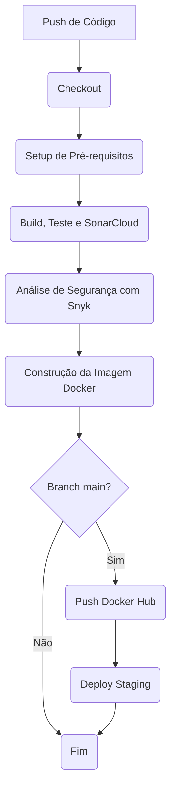

### Tecnologias Utilizadas e Justificativas

1. **GitHub Actions**
   - Plataforma nativa do GitHub para CI/CD
   - Integração perfeita com o repositório
   - Suporte a containers e runners auto-hospedados
   - Marketplace rico em ações pré-configuradas

2. **.NET 9.0**
   - Framework moderna
   - Suporte a containers nativo
   - Ferramentas para testes e cobertura de código

3. **Docker**
   - Containerização para garantir consistência entre ambientes
   - Multi-stage builds para otimizar tamanho da imagem
   - Facilidade de deploy em diferentes ambientes

4. **SonarCloud**
   - Análise contínua da qualidade do código
   - Detecção de bugs e vulnerabilidades
   - Métricas de cobertura de código
   - Integração nativa com GitHub

5. **Snyk**
   - Análise de vulnerabilidades nas dependências
   - Monitorização contínua de segurança
   - Integração com Docker para análise de imagens

6. **Docker Hub**
   - Registo de containers confiável
   - Integração com GitHub Actions
   - Suporte a autenticação segura

7. **SSH Gateway**
   - Acesso seguro ao ambiente de staging
   - Suporte a autenticação por chave
   - Configuração flexível para diferentes ambientes

## Fases da Pipeline

A pipeline é dividida nas seguintes fases principais, executadas sequencialmente:

### 1. Checkout do Código

Esta é a primeira fase, onde o código mais recente do repositório é clonado para o ambiente do runner.

*   **Objetivo:** Obter a versão mais recente do código-fonte para as etapas subsequentes da pipeline.
*   **Passos:**
    1.  Utilização da ação `actions/checkout@v3` para clonar o repositório.
*   **Visualização:**
    
    

### 2. Setup de Pré-requisitos

Esta fase garante que o ambiente de execução do GitHub Actions runner esteja pronto para construir e testar a aplicação, instalando as ferramentas necessárias.

*   **Objetivo:** Instalar as ferramentas necessárias, como o .NET SDK e o ReportGenerator.
*   **Passos:**
    1.  Instalação do .NET SDK na versão especificada (`${{ env.DOTNET_VERSION }}`) utilizando `actions/setup-dotnet@v3`.
    2.  Instalação global da ferramenta ReportGenerator (`dotnet tool install -g dotnet-reportgenerator-globaltool`) para processar relatórios de cobertura de código.
*   **Visualização:**
    
    

### 3. Build, Teste e Análise com SonarCloud

Esta fase é responsável por compilar o código, executar os testes unitários com cobertura de código e realizar análises de qualidade e segurança estática com SonarCloud.

*   **Objetivo:** Verificar a integridade e qualidade do código, garantindo que as funcionalidades existentes não foram quebradas pelos testes e realizar a análise estática com o SonarCloud.

#### 3.1 Restauração e ‘Build’

Esta subfase foca na preparação do projeto, restaurando dependências e compilando o código.

*   **Objetivo:** Garantir que todas as dependências do projeto estão disponíveis e que o código fonte pode ser compilado com sucesso.
*   **Passos:**
    1.  Restauração das dependências do projeto (`dotnet restore AMAP/AMAP.sln`).
    2.  Construção do projeto (`dotnet build AMAP/AMAP.sln --no-restore`).
*   **Visualização:**

    

    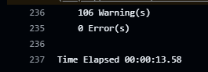

#### 3.2 Testes Unitários

Nesta subfase, os testes unitários são executados e a cobertura de código é reportada.

*   **Objetivo:** Verificar se as funcionalidades individuais da aplicação funcionam como esperado e medir a percentagem de código coberto pelos testes.
*   **Passos:**
    1.  Execução dos testes unitários com coleta de cobertura de código (`dotnet test AMAP/AMAP.sln --no-build --collect:"XPlat Code Coverage"`).
    2.  Geração do relatório de cobertura no formato OpenCover (`reportgenerator`).
*   **Visualização:**

    
    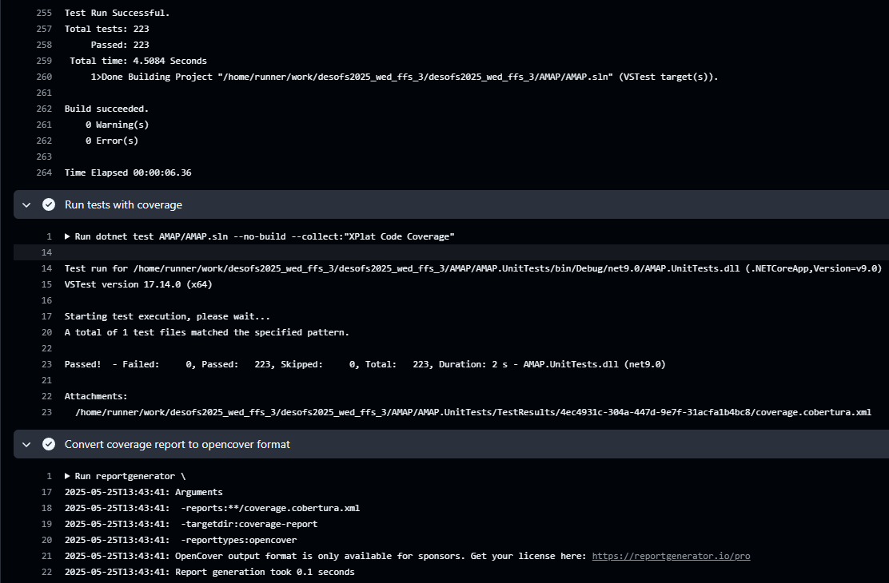

#### 3.3 Análise com SonarCloud

Esta subfase integra o SonarCloud para realizar a análise estática do código.

*   **Objetivo:** Identificar e reportar bugs, code smells, vulnerabilidades e hotspots de segurança no código.
*   **Passos:**
    1.  Configuração e execução da análise do SonarCloud para análise de código, cobertura e segurança.
*   **Visualização:**
    
    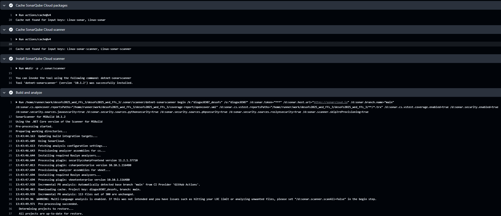
    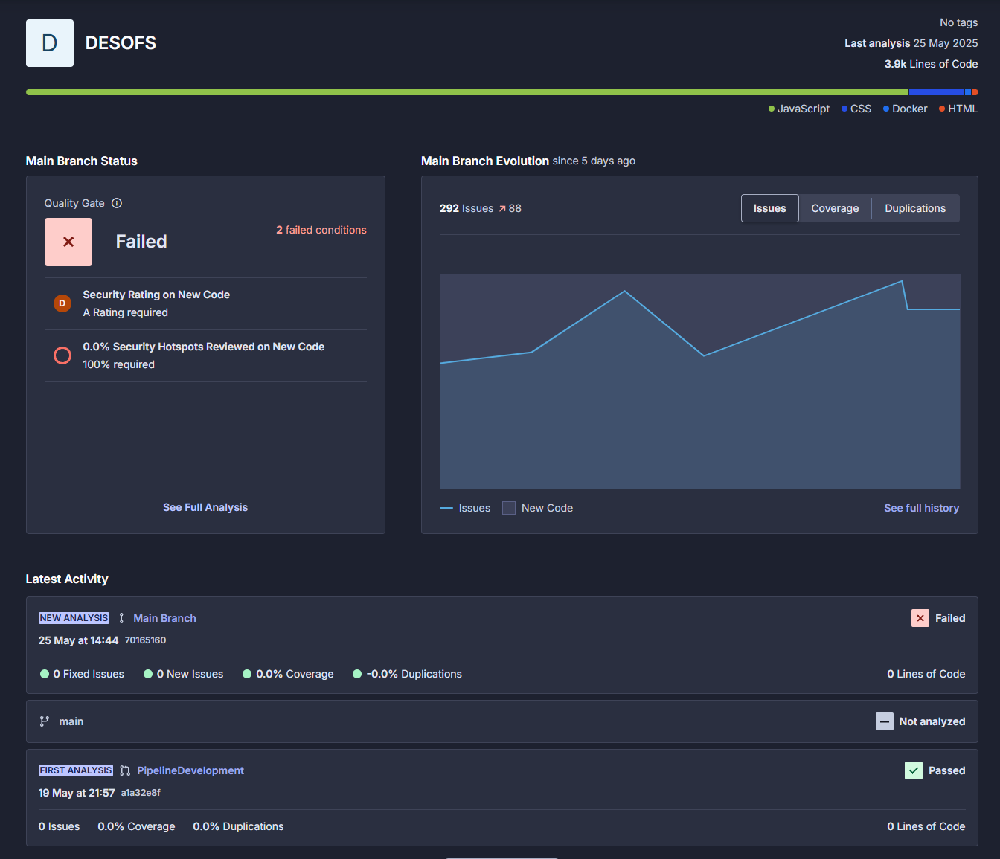
    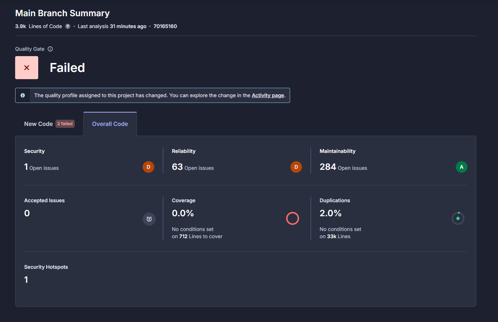

### 4. Análise de Segurança com Snyk

Esta fase executa a análise de segurança do código e das dependências utilizando o Snyk, verificando vulnerabilidades conhecidas.

*   **Objetivo:** Identificar vulnerabilidades conhecidas no código e nas bibliotecas utilizadas.
*   **Passos:**
    1.  Instalação do Snyk CLI (se necessário).
    2.  Execução da análise do Snyk no projeto (por exemplo, `snyk test`).
*   **Visualização:**

    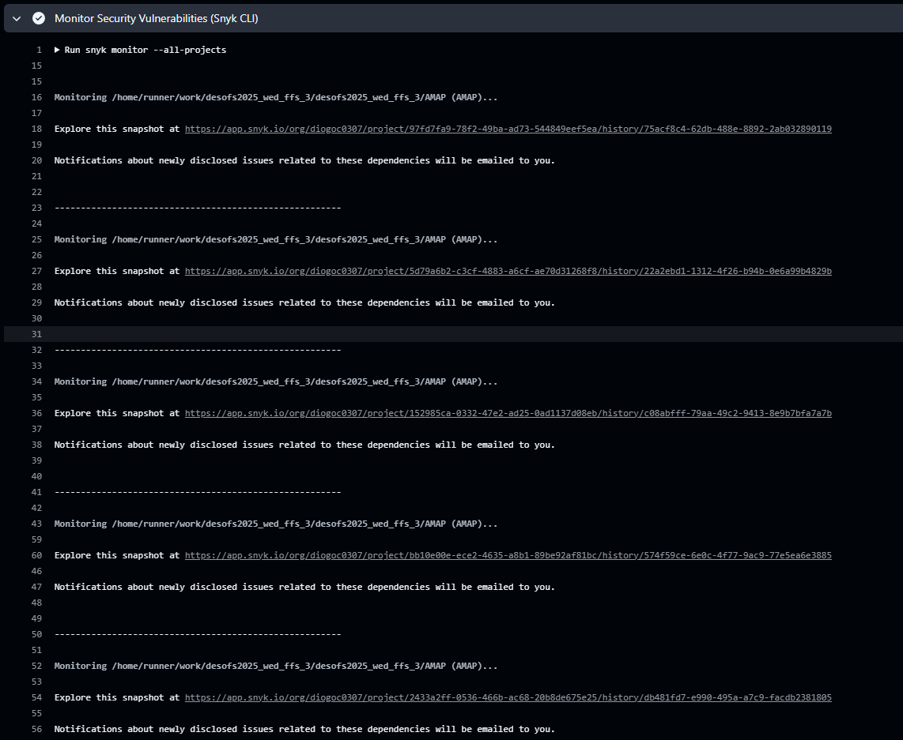
    

### 5. Análise de Dependências (SCA) com OWASP Dependency Check

Esta fase utiliza o OWASP Dependency Check para analisar as dependências do projeto na tentativa de encontrar vulnerabilidades conhecidas.

*   **Objetivo:** Identificar componentes de ‘software’ com vulnerabilidades de segurança conhecidas e gerar relatórios detalhados.
*   **Passos:**
    1.  Execução da ação `dependency-check/Dependency-Check_Action` no projeto.
    2.  Geração de relatórios com as vulnerabilidades encontradas.
*   **Visualização:**

    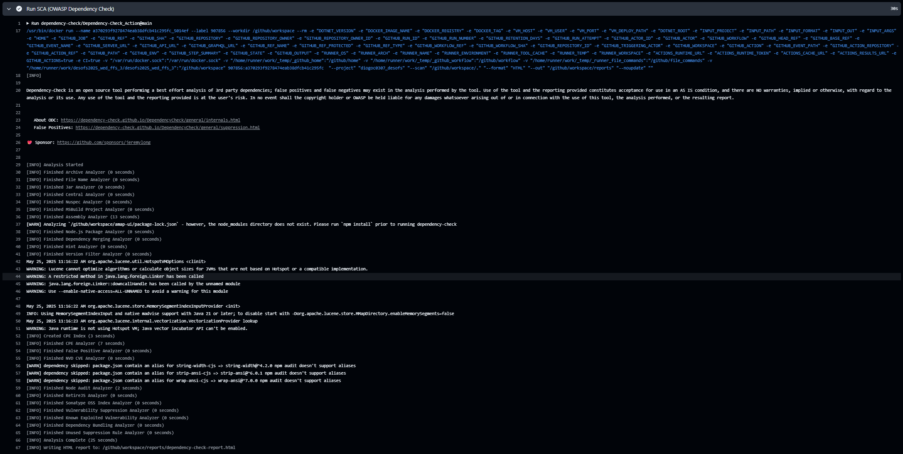

### 6. Construção da Imagem Docker

Nesta fase, a aplicação é empacotada numa imagem Docker, pronta para ser executada em qualquer ambiente com Docker.

*   **Objetivo:** Criar um container leve e portátil contendo a aplicação pronta para ser executada em qualquer ambiente com Docker.
*   **Passos:**
    1.  Configuração do ambiente Docker buildx.
    2.  Construção da imagem Docker usando o `Dockerfile`.

### 7. Push da Imagem Docker (Apenas na main branch)

Esta fase envia a imagem Docker construída para um registro de containers (Docker Hub), disponibilizando-a para implantação.

*   **Objetivo:** Disponibilizar a imagem Docker para ser utilizada em ambientes de implantação (como o staging).
*   **Pré-requisitos:** Configuração dos segredos `DOCKERHUB_USERNAME` e `DOCKERHUB_TOKEN` no GitHub.
*   **Passos:**
    1.  Login no Docker Hub.
    2.  Push da imagem Docker para o repositório configurado.
*   **Visualização:**

    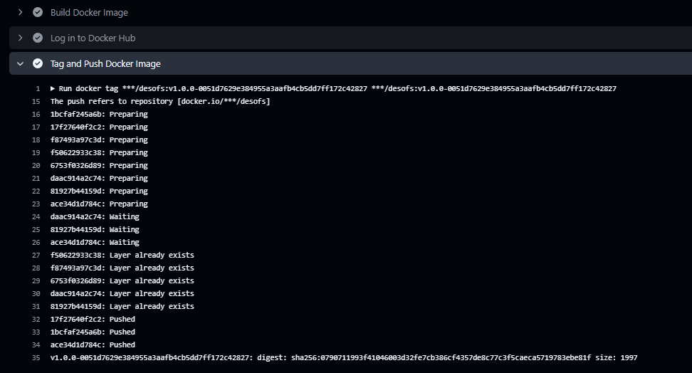
    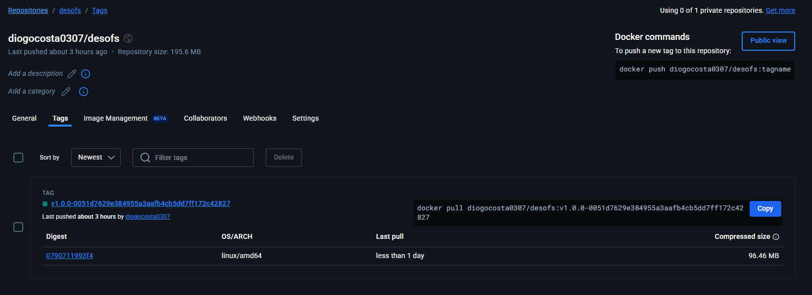

### 8. Implantação no Ambiente de Staging (Apenas na main branch)

Esta fase implanta a nova versão da aplicação no ambiente de staging, atualizando a aplicação rodando na máquina virtual de destino.

*   **Objetivo:** Atualizar a aplicação no ambiente de staging para testes e validação antes de uma possível implantação em produção.
*   **Pré-requisitos:** Configuração de acesso SSH à VM de staging via gateway, incluindo os segredos `SSH_PRIVATE_KEY`, `SSH_KNOWN_HOSTS`, `SSH_PASSPHRASE`, `VM_HOST`, `VM_PORT`, `VM_USER`, `VM_GATEWAY_HOST`, `VM_GATEWAY_PORT`, `VM_GATEWAY_USER`. O Docker e Docker Compose devem estar instalados na VM.
*   **Passos:**
    1.  Configuração do agente SSH para permitir a conexão segura.
    2.  Cópia do arquivo `docker-compose-staging.yml` para a VM via SCP, utilizando o gateway SSH.
    3.  Execução de comandos remotos na VM via SSH (utilizando o gateway) para:
        *   Navegar até o diretório da aplicação.
        *   Fazer pull da nova imagem Docker.
        *   Parar os containers Docker em execução (`docker compose down`).
        *   Iniciar os novos containers com a nova imagem (`docker compose up -d`).
    4.  Output do URL de acesso ao ambiente de staging (local da VM, acessível via rede ISEP/VPN).
*   **Visualização:**

    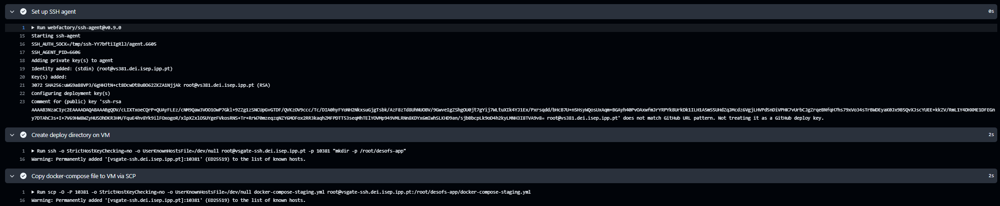
    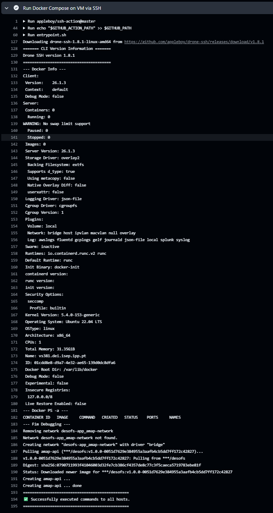

## Gestão de Dependências

### Análise e Instalação

1. **Verificação de Dependências**
   - Análise automática de pacotes NuGet
   - Verificação de versões compatíveis
   - Detecção de conflitos de dependências

2. **Instalação Segura**
   - Restauração de pacotes via `dotnet restore`
   - Verificação da integridade dos pacotes
   - Cache das dependências para builds mais rápidas

3. **Monitorização de Segurança**
   - Integração com Snyk para análise de vulnerabilidades
   - Verificação de licenças de pacotes
   - Alertas automáticos para dependências desatualizadas

## Análise de Segurança

O Snyk é integrado à pipeline para fornecer uma camada adicional de segurança, focando na análise de código e containers:

1. **Análise de Código (SAST - Static Application Security Testing)**
   - Detecção de problemas de segurança
   - Verificação de boas práticas
   - Sugestões de correção

3. **Análise de Containers**
   - Verificação de vulnerabilidades em imagens base
   - Recomendações de atualizações
   - Monitorização de camadas Docker

## Relatórios Gerados

A pipeline gera diversos relatórios para análise:

1. **Relatórios de Testes**
   - Resultados de testes unitários
   - Cobertura de código
   - Tempo de execução dos testes

2. **Relatórios de Qualidade**
   - Métricas do SonarCloud
   - Code smells e bugs
   - Duplicação de código
   - Complexidade ciclomática

3. **Relatórios de Segurança**
   - Vulnerabilidades do Snyk (código e containers)
   - Hotspots de segurança do SonarCloud
   - Dependências desatualizadas
   - **Vulnerabilidades de Dependências (OWASP Dependency Check)**

4. **Relatórios de Build**
   - Logs de compilação
   - Tempo de build
   - Uso de recursos

5. **Relatórios de Deploy**
   - Status da implantação
   - Logs de containers
   - Métricas de performance

### Exemplos de Relatórios:

- [dependency-check-report.html](dependency-check-report.html)
- [coverage-report.html](coverage-report.html)

## Configuração de Segredos

Para que a pipeline funcione corretamente, diversos segredos precisam de ser configurados no repositório do GitHub. Estes incluem credenciais para o Docker Hub e acesso SSH à máquina virtual de staging.

*   `DOCKERHUB_USERNAME`: O nome de utilizador no Docker Hub.
*   `DOCKERHUB_TOKEN`: Um Personal Access Token do Docker Hub com permissões de push.
*   `SSH_PRIVATE_KEY`: A chave privada SSH para autenticação na VM de staging.
*   `SSH_KNOWN_HOSTS`: A host key da VM de staging para verificar a autenticidade do servidor.
*   `SSH_PASSPHRASE`: A senha da chave privada SSH.
*   `VM_HOST`: O hostname ou endereço IP da VM de staging (resolvível dentro da rede ISEP/VPN).
*   `VM_PORT`: A porta SSH da VM de staging.
*   `VM_USER`: O utilizador SSH para login na VM de staging.
*   `VM_GATEWAY_HOST`: O hostname ou endereço IP do servidor gateway SSH.
*   `VM_GATEWAY_PORT`: A porta SSH do servidor gateway.
*   `VM_GATEWAY_USER`: O utilizador SSH para login no servidor gateway.