> # Desenvolvimento e Testes - Sistema AMAP (Fase 2 - Sprint 1)

|  |  |
|:------------------------------------:|:----------------------------------------:|

**Desenvolvimento de Software Seguros**  
**Mestrado em Engenharia Informática - 2024/2025 **  

**Professores:** 
Paulo Baltarejo de Sousa (T),
Joana Santos (PL),
Cláudio Maia (TP)

**Autores: **
Diana Marques 1240445, 
Diogo Costa 1211514, 
Pedro Costa 1211439, 
Pedro Vilarinho 1211149, 
Tiago Tavares 1240494

**Porto, 2025-05-25**

---

# Índice

[TOC]

---

# Introdução

Este documento descreve o trabalho realizado no Sprint 1 da Fase 2 do projeto AMAP, com foco na integração de práticas de desenvolvimento seguro ao longo de todo o ciclo de vida do software. Nesta fase, a equipa centrou-se na mitigação das principais ameaças identificadas na Fase 1, reforçando a segurança das funcionalidades críticas da aplicação.

Adotou-se uma abordagem DevSecOps, com uma **pipeline CI/CD automatizada que inclui análise estática (SonarQube), verificação de dependências (OWASP Dependency Check, Snyk) e testes de segurança. A nova **arquitetura em camadas foi definida para suportar estas práticas, promovendo manutenibilidade, rastreabilidade e controlo de acesso mais eficazes.

Foram também aplicadas boas práticas de desenvolvimento, convenções de nomenclatura e estruturação do código, bem como realizadas **auditorias de segurança, **testes unitários com foco em permissões e cobertura superior a 78%. A avaliação com base no OWASP ASVS permitiu validar as medidas implementadas, garantindo conformidade com requisitos de segurança reconhecidos.

Este relatório detalha as decisões técnicas, a **implementação e os resultados obtidos, servindo como evidência da evolução do projeto rumo a um sistema **robusto e seguro.

---

# Desenvolvimento Seguro

## Funcionalidade Desenvolvida

Na Fase 1 foram identificadas várias ameaças, das quais selecionámos 15 como prioritárias, com o objetivo de desenvolver código que permita mitigar essas ameaças. De seguida, apresenta-se a descrição de algumas das medidas implementadas.

### 1. Repúdio - Negação de ter realizado subscrição (4.3 R)

Esta seção aborda as mitigações implementadas para a ameaça de um co-produtor negar que realizou uma subscrição.

**Mitigações Implementadas:**

*   **Termos e condições explícitos:** A aceitação dos termos é uma etapa obrigatória no fluxo de subscrição (`/api/subscription/{id}/accept-terms`).
*   **Confirmação por email obrigatória:** A subscrição só se torna ativa após a confirmação do email pelo co-produtor, utilizando um token único (`/api/Subscription/confirm`).
*   **Assinaturas digitais básicas:** O campo `DigitalSignature` existe no modelo `Subscription`, embora a descrição detalhada do seu uso no fluxo de repúdio possa ser adicionada no futuro, se aplicável.
*   **Comprovativo de subscrição:** A criação bem-sucedida de uma subscrição (`POST /api/subscription`) e a possibilidade de a obter por ID (`GET /api/subscription/{id}`) servem como registo da subscrição.
*   **Registos de auditoria detalhados:** Campos como `TermsAcceptedAt` e `EmailConfirmedAt` no modelo `Subscription` registam datas e horas importantes das ações do co-produtor, servindo como evidência.

<u>**1.1 Criação de Assinatura**</u>

**Endpoint:** 
`POST /api/subscription`

**Descrição:** 
Cria uma nova assinatura, gerando um token de confirmação, enviando email ao co-produtor e inicializando campos de repúdio.

**Parâmetros:**  
```json
{
    "productOfferId": 1,
    "expectedQuantity": 5,
    "paymentType": "Money"
}
```

**Resposta:**  
```json
{
    "id": 2,
    "coProducerId": "1cc4c021-19e7-49dd-aeb0-e31a8f382f66",
    "productOfferId": 1,
    "expectedQuantity": 5,
    "paymentType": "Money",
    "termsAccepted": false,
    "termsAcceptedAt": "2025-05-25T00:28:12.5111303Z",
    "emailConfirmed": false,
    "emailConfirmedAt": null,
    "confirmationToken": "vKeAQGXwMvpeim/crxxr5+oWy/Fl86BGETYfctNpLPQ=",
    "digitalSignature": "sCuRfy3NhmSc0bjjkCw9JKX/Xpl0INqPUex20s/iqi0="
}
```

---

<u>**Confirmação de Email**</u>

**Endpoint:** 
`POST /api/Subscription/confirm`

**Descrição:** 
Confirma o email do co-produtor através do token gerado na criação da assinatura.

**Como testar:**  
1. Copie o token da resposta da criação.
2. Faça POST para `/api/Subscription/confirm` com o token no corpo.

---

<u>**Aceitação de Termos e Condições**</u>

**Endpoint:** 
`POST /api/subscription/{id}/accept-terms`

**Descrição:** 
Permite ao co-produtor aceitar os termos, registando data/hora e assinatura digital.

---

<u>**Modelo de Dados: Subscription**</u>

```csharp
public class Subscription
{
    public int Id { get; set; }
    public string? CoProducerId { get; set; }
    public int ProductOfferId { get; set; }
    public int ExpectedQuantity { get; set; }
    public PaymentType PaymentType { get; set; }
    [Required]
    public bool TermsAccepted { get; set; }
    [Required]
    public DateTime TermsAcceptedAt { get; set; }
    [Required]
    public bool EmailConfirmed { get; set; }
    public DateTime? EmailConfirmedAt { get; set; }
    public string? ConfirmationToken { get; set; }
    public string? DigitalSignature { get; set; }
}
```

---

<u>**Fluxo de Repúdio de Subscrição**</u>

1. Criação da assinatura (gera token, envia email, inicializa campos)
2. Confirmação de email (valida token, marca como confirmado)
3. Aceitação de termos (regista data/hora e assinatura digital)

---

### 2.1. Validação de Dados de Entrada (3.1 B) - 7.5 ALTO

**<u>1 - Mitigação Implementada: Validação Robusta de Dados de Entrada</u>**
Esta mitigação visa garantir que todos os dados recebidos pela aplicação são validados de forma rigorosa antes de serem processados, prevenindo a injeção de dados maliciosos e garantindo a integridade dos dados armazenados.

**Situação Inicial**
A aplicação AMAP inicialmente possuía validações básicas nos modelos de dados, mas carecia de uma abordagem sistemática e abrangente para validação de entrada em todos os pontos de acesso da API.

**Ações Realizadas**
Foi implementado um sistema robusto de validação de dados que inclui:

1. Validação de modelos através de Data Annotations
2. Validação de tipos de dados e enumerações
3. Verificações de autorização antes do processamento de dados
4. Validação de regras de negócio específicas

**Exemplo de Código** (`AMAP.Models/Models/ViewModel/RegisterViewModel.cs`):

```c#
public class RegisterViewModel
{
    [Required]
    [Display(Name = "Name")]
    public string Name { get; set; }

    [Required]
    [EmailAddress]
    [Display(Name = "Email")]
    public string Email { get; set; }

    [Required]
    [StringLength(128, ErrorMessage = "The {0} must be at least {2} characters long.", MinimumLength = 12)]
    [DataType(DataType.Password)]
    [Display(Name = "Password")]
    public string Password { get; set; }

    [DataType(DataType.Password)]
    [Display(Name = "Confirm password")]
    [Compare("Password", ErrorMessage = "The password and confirmation password do not match.")]
    public string ConfirmPassword { get; set; }

    [Required]
    [Display(Name = "User Type")]
    public UserType UserType { get; set; }
}
```

Além disso, foram implementadas validações adicionais nos componentes de negócio para garantir a integridade dos dados:

```c#
public Subscription CreateSubscription(Subscription subscription, string coProducerId)
{
    if (subscription == null)
    {
        throw new ArgumentException("Invalid data.");
    }

    if (string.IsNullOrEmpty(coProducerId))
    {
        throw new UnauthorizedAccessException("Invalid CoProducer.");
    }

    if (subscription.ExpectedQuantity <= 0)
    {
        throw new ArgumentException("Quantity must be greater than zero.");
    }

    if (!Enum.IsDefined(typeof(PaymentType), subscription.PaymentType) || subscription.PaymentType == 0)
    {
        throw new ArgumentException("Invalid payment type.");
    }

    // Validações adicionais...
}
```

Esta implementação garante que:

1. Todos os campos obrigatórios são preenchidos
2. Os dados seguem os formatos esperados (email, password, etc.)
3. Os valores numéricos estão dentro dos limites aceitáveis
4. As enumerações contêm apenas valores válidos
5. As regras de negócio são respeitadas antes do processamento dos dados

A validação é realizada em múltiplas camadas:

1. **Camada de Modelo**: Através de Data Annotations
2. **Camada de Controller**: Verificação do ModelState
3. **Camada de Negócio**: Validações específicas das regras de negócio
4. **Camada de Dados**: Constraints do banco de dados

Cada falha de validação é adequadamente registada e retorna mensagens de erro claras e específicas para o utilizador, sem expor detalhes sensíveis da implementação.

---

### 2.2. Falsificação da identidade de um Gestor (4.1 S) - 8.0 ALTO

**<u>1 - Mitigação Implementada: Sistema Multi-Camada de Proteção de Identidade</u>**
Esta mitigação implementa múltiplas camadas de segurança para proteger a identidade dos gestores, incluindo autenticação multi-fator obrigatória, monitorização contínua e notificações de segurança.

**Situação Inicial**
A aplicação AMAP possuía apenas autenticação básica por password para todos os utilizadores, sem distinção para contas de gestores, tornando-as vulneráveis a ataques de falsificação de identidade.

**Ações Realizadas**

1. **Autenticação Multi-Fator (MFA) Obrigatória para Gestores**
   - Implementação de MFA baseado em TOTP (Time-based One-Time Password)
   - Verificação obrigatória em cada nova sessão
   - Notificação automática quando um fator de autenticação é alterado
   - Revalidação obrigatória se o MFA/OTP for comprometido
   - Utilização de geradores OTP seguros e confiáveis
   - Verificação de que códigos de acesso são utilizados apenas uma vez

**Exemplo de Implementação MFA** (`AMAP_API/Controllers/TwoFactorAuthController.cs`):
```c#
[HttpPost("verify")]
[Authorize]
public async Task<IActionResult> VerifyMfa([FromBody] VerifyMfaViewModel model)
{
    var user = await _userManager.GetUserAsync(User);
    if (user == null)
        return NotFound(new { message = "User not found." });

    // Verificar se o código já foi utilizado
    if (await _mfaService.IsCodeUsed(user.Id, model.VerificationCode))
        return BadRequest(new { message = "This code has already been used." });

    // Verificar o código
    var twoFactorAuthenticator = new TwoFactorAuthenticator();
    var isCodeValid = twoFactorAuthenticator.ValidateTwoFactorPIN(
        user.TwoFactorSecretKey,
        model.VerificationCode);

    if (!isCodeValid)
    {
        _logger.LogWarning("Invalid MFA code attempt for user {UserId}", user.Id);
        return BadRequest(new { message = "Invalid verification code." });
    }

    // Registrar o código como utilizado
    await _mfaService.MarkCodeAsUsed(user.Id, model.VerificationCode);
    
    // Notificar sobre verificação bem-sucedida
    await _emailSender.SendEmailAsync(
        user.Email,
        "MFA Verification Successful",
        "Your account was just accessed using MFA verification.");

    return Ok(new { message = "MFA verification successful." });
}
```

2. **Tempo de Sessão Reduzido**
   - Cookie de autenticação expira após 30 minutos de inatividade
   - Suporte a expiração configurável para tokens JWT
   - Logout invalida a sessão automaticamente
   - Tokens de sessão podem ser revogados manualmente
   - Implementação de sliding expiration para renovação segura

**Exemplo de Implementação de Sessão** (`Program.cs` e `SessionManager.cs`):
```c#
// Configuração de cookies e sessão
builder.Services.ConfigureApplicationCookie(options =>
{
    options.SlidingExpiration = true;
    options.ExpireTimeSpan = TimeSpan.FromMinutes(30);
    options.Cookie.SecurePolicy = CookieSecurePolicy.Always;
    options.Cookie.SameSite = SameSiteMode.Strict;
    options.Cookie.HttpOnly = true;

    options.Events = new CookieAuthenticationEvents
    {
        OnValidatePrincipal = async context =>
        {
            var userId = context.Principal.FindFirstValue(ClaimTypes.NameIdentifier);
            var sessionValid = await sessionManager.ValidateSession(userId);
            if (!sessionValid)
            {
                context.RejectPrincipal();
                await context.HttpContext.SignOutAsync();
            }
        }
    };
});

// Implementação de revogação de sessão
public class SessionManager
{
    private readonly IDistributedCache _cache;
    
    public async Task RevokeSession(string userId)
    {
        var key = $"session_revoked_{userId}";
        await _cache.SetStringAsync(key, DateTime.UtcNow.ToString(), new DistributedCacheEntryOptions
        {
            AbsoluteExpirationRelativeToNow = TimeSpan.FromDays(7)
        });
    }

    public async Task<bool> ValidateSession(string userId)
    {
        var key = $"session_revoked_{userId}";
        var revokedAt = await _cache.GetStringAsync(key);
        return string.IsNullOrEmpty(revokedAt);
    }
}
```

3. **Logs de Autenticação Detalhados**
   - Registo de todas as decisões de autenticação (sucesso e falha)
   - Monitorização de tentativas de acesso
   - Rastreamento de alterações em configurações de MFA
   - Histórico completo de sessões ativas

**Exemplo de Implementação de Logs** (`SecurityMonitoringService.cs`):
```c#
public class SecurityMonitoringService
{
    private readonly ILogger<SecurityMonitoringService> _logger;
    private readonly ConcurrentDictionary<string, List<AuthActivity>> _userActivities;
    private readonly EmailSender _emailSender;

    public async Task LogAuthenticationActivity(string userId, string ipAddress, string userAgent, AuthActivityType activityType)
    {
        var activity = new AuthActivity
        {
            Timestamp = DateTime.UtcNow,
            IpAddress = ipAddress,
            UserAgent = userAgent,
            ActivityType = activityType
        };

        _userActivities.AddOrUpdate(
            userId,
            new List<AuthActivity> { activity },
            (key, existingList) =>
            {
                existingList.Add(activity);
                return existingList;
            });

        _logger.LogInformation(
            "Authentication activity: User={UserId}, Type={ActivityType}, IP={IpAddress}",
            userId, activityType, ipAddress);

        await DetectSuspiciousPatterns(userId);
    }

    private async Task DetectSuspiciousPatterns(string userId)
    {
        var recentActivities = _userActivities[userId]
            .Where(a => a.Timestamp > DateTime.UtcNow.AddMinutes(-30))
            .ToList();

        if (recentActivities.Count > 10)
        {
            _logger.LogWarning("Suspicious activity detected for user {UserId}", userId);
            await SendSecurityAlert(userId, "Unusual account activity detected");
        }
    }
}
```

4. **Notificações de Segurança**
   - Notificação automática para novos logins em dispositivos desconhecidos
   - Alertas em tempo real para alterações de autenticação
   - Utilização de APIs seguras para notificações (email)
   - Avisos de tentativas de acesso suspeitas

**Exemplo de Implementação de Notificações** (`SecurityNotificationService.cs`):
```c#
public class SecurityNotificationService
{
    private readonly EmailSender _emailSender;
    private readonly ILogger<SecurityNotificationService> _logger;
    private readonly DeviceTrackingService _deviceTracking;

    public async Task NotifyNewDeviceLogin(AppUser user, string ipAddress, string userAgent)
    {
        var isKnownDevice = await _deviceTracking.IsKnownDevice(user.Id, ipAddress, userAgent);
        if (!isKnownDevice)
        {
            var location = await _geoLocationService.GetLocation(ipAddress);
            var emailBody = $@"
                <h2>Novo Acesso Detectado</h2>
                <p>Olá {user.Name},</p>
                <p>Detectamos um acesso à sua conta a partir de um novo dispositivo:</p>
                <ul>
                    <li>Data/Hora: {DateTime.UtcNow}</li>
                    <li>Localização: {location}</li>
                    <li>Dispositivo: {userAgent}</li>
                </ul>
                <p>Se não foi você, por favor contacte-nos imediatamente.</p>";

            await _emailSender.SendEmailAsync(user.Email, "Novo Acesso Detectado", emailBody);
            await _deviceTracking.TrackNewDevice(user.Id, ipAddress, userAgent);
        }
    }

    public async Task NotifyMfaChange(AppUser user, MfaChangeType changeType)
    {
        var subject = $"Alteração nas Configurações de MFA";
        var body = $@"
            <h2>Alteração na Autenticação Multi-Fator</h2>
            <p>Olá {user.Name},</p>
            <p>As configurações de MFA da sua conta foram {changeType}.</p>
            <p>Se não foi você quem fez esta alteração, por favor contacte-nos imediatamente.</p>";

        await _emailSender.SendEmailAsync(user.Email, subject, body);
        _logger.LogInformation("MFA change notification sent to user {UserId}", user.Id);
    }
}
```

5. **Bloqueio Progressivo**
   - Monitorização de atividades incomuns
   - Bloqueio progressivo após falhas de login:
     - 5 falhas: bloqueio por 15 minutos
     - 10 falhas: bloqueio por 30 minutos
     - 15 falhas: bloqueio por 60 minutos

**Exemplo de Implementação de Bloqueio** (`AccountLockoutService.cs`):
```c#
public class AccountLockoutService
{
    private readonly UserManager<AppUser> _userManager;
    private readonly ILogger<AccountLockoutService> _logger;
    private readonly SecurityNotificationService _notificationService;

    public async Task<(bool IsLocked, TimeSpan? LockoutDuration)> HandleFailedLoginAttempt(AppUser user)
    {
        await _userManager.AccessFailedAsync(user);
        int failedAttempts = await _userManager.GetAccessFailedCountAsync(user);
        
        TimeSpan lockoutDuration = TimeSpan.Zero;
        if (failedAttempts >= 5 && failedAttempts < 10)
        {
            lockoutDuration = TimeSpan.FromMinutes(15);
        }
        else if (failedAttempts >= 10 && failedAttempts < 15)
        {
            lockoutDuration = TimeSpan.FromMinutes(30);
        }
        else if (failedAttempts >= 15)
        {
            lockoutDuration = TimeSpan.FromMinutes(60);
        }

        if (lockoutDuration > TimeSpan.Zero)
        {
            await _userManager.SetLockoutEndDateAsync(user, 
                DateTimeOffset.UtcNow.Add(lockoutDuration));
            
            _logger.LogWarning(
                "User {UserId} locked out for {Duration} minutes after {FailedAttempts} failed attempts",
                user.Id, lockoutDuration.TotalMinutes, failedAttempts);

            await _notificationService.NotifyAccountLockout(user, lockoutDuration);
            return (true, lockoutDuration);
        }

        return (false, null);
    }

    public async Task ResetFailedAttempts(AppUser user)
    {
        await _userManager.ResetAccessFailedCountAsync(user);
        await _userManager.SetLockoutEndDateAsync(user, null);
    }
}
```

---

### 3. Negação de ações administrativas realizadas (4.1 R) - 8.0 ALTO

<u>**1 -** **Mitigação Implementada:** **Rastreabilidade de Ações**</u> 
Esta mitigação visa criar um registo detalhado e inalterável de todas as ações administrativas realizadas no sistema, permitindo verificar quem fez o quê e quando, evitando assim a negação de responsabilidade por ações realizadas.

**Situação Inicial**
Inicialmente, a aplicação AMAP não possuía um sistema robusto para rastrear ações realizadas por utilizadores, especialmente utilizadores administrativos. Os logs eram básicos e não capturavam detalhes suficientes sobre as operações, dificultando a atribuição de responsabilidade por ações realizadas no sistema.

**Ações Realizadas** 
Foi implementado um sistema abrangente de logging utilizando o mecanismo ILogger da Microsoft, que regista detalhadamente todas as ações administrativas em todos os componentes de negócio. O sistema atual captura:

1.	Quem realizou a ação (ID e tipo do utilizador)
2.	Qual ação foi realizada (criação, modificação, exclusão)
3.	Sobre quais dados a ação foi realizada (IDs e informações relevantes)
4.	Quando a ação foi realizada (timestamp preciso)
5.	Resultado da ação (sucesso ou falha, com motivo detalhado)

**Exemplo de Código** (`AMAP.Business/Components/ProductBc.cs`): 

```c#
public void DeleteProduct(int id, string producerId)
{
    if (id <= 0)
        throw new ArgumentException("Invalid product id.", nameof(id));

    if (string.IsNullOrEmpty(producerId))
        throw new ArgumentException("Producer not authenticated.", nameof(producerId));

    var product = _unitOfWork.Product.Get(p => p.Id == id && p.ProducerId == producerId && !p.IsDeleted);

    if (product == null)
        throw new KeyNotFoundException("Product not found or you are not authorized to delete it.");

    // Log de deleção de produto sensível
    _logger.LogInformation("Product deletion initiated - ID: {ProductId}, Name: {ProductName}, Producer: {ProducerId} at {Time}",
        product.Id, product.Name, producerId, DateTime.UtcNow);

    var compositesToDelete = _unitOfWork.Composite.GetAll(c => c.ProductId == id);
    if (compositesToDelete.Any())
    {
        _unitOfWork.Composite.RemoveRange(compositesToDelete);
        _unitOfWork.Save();
    }

    product.IsDeleted = true;
    _unitOfWork.Product.Update(product);
    _unitOfWork.Save();

    // Log após deleção concluída
    _logger.LogInformation("Product marked as deleted - ID: {ProductId}, Producer: {ProducerId} at {Time}",
        id, producerId, DateTime.UtcNow);
}
```

A implementação inclui logs estratégicos nos pontos de entrada e saída de operações críticas, especialmente aquelas que envolvem modificações importantes no sistema. Os logs são armazenados em arquivos estruturados, incluindo timestamps precisos, e são protegidos contra modificação não autorizada.

A configuração do sistema de logs foi realizada no Program.cs:

```c#
// Configure logging
builder.Logging.ClearProviders();
builder.Logging.AddConsole();
builder.Logging.AddDebug();
builder.Logging.AddEventSourceLogger();

// Configure logging levels
builder.Logging.AddFilter("Microsoft", LogLevel.Warning);
builder.Logging.AddFilter("System", LogLevel.Warning);
builder.Logging.AddFilter("AMAP.Api.Controllers.AccountController", LogLevel.Information);
builder.Logging.AddFilter("AMAP.Business.Components", LogLevel.Information);
```


<u>**2 -** **Mitigação Implementada: Relatórios automáticos**</u> (baseados nas ações realizadas)
Esta mitigação proporciona a geração sistemática de relatórios que consolidam e apresentam as ações administrativas realizadas no sistema, facilitando a supervisão e criando registos formais de atividades que podem ser revisados por auditoria.

**Situação Inicial** 
A aplicação AMAP não possuía um mecanismo para gerar relatórios consolidados de ações administrativas. Embora existissem logs, não havia uma forma estruturada de extrair, organizar e apresentar essas informações em formato de relatório para análise e auditoria.

**Ações Realizadas** 
Foi implementado um sistema de geração de relatórios que utiliza os logs detalhados para criar documentos estruturados sobre ações administrativas. O sistema:

1.	Extrai dados dos logs sobre ações administrativas
2.	Organiza as informações por tipo de ação, utilizador, e período de tempo
3.	Gera relatórios em formato textual estruturado que podem ser exportados
4.	Mantém um histórico de relatórios gerados para consulta futura

**Exemplo de Código** (`AMAP.Business/Components/ProductBc.cs`):

```c#
public (byte[] FileContent, string FileName, string ContentType) ExportProductsToFile(string producerId, string contentRootPath)
{
    if (string.IsNullOrEmpty(producerId))
        throw new ArgumentException("Producer ID cannot be empty.", nameof(producerId));

    var producer = _unitOfWork.AppUser.Get(p => p.Id == producerId);
    if (producer == null)
        throw new KeyNotFoundException("Producer not found.");

    // Log tentativa de exportação
    _logger.LogInformation("Product export initiated - Producer: {ProducerId}, ProducerName: {ProducerName} at {Time}",
        producerId, producer.Name, DateTime.UtcNow);

    var products = _unitOfWork.Product.GetAll(p => p.ProducerId == producerId && !p.IsDeleted).ToList();

    if (products == null || !products.Any())
        throw new InvalidOperationException("No products found to export.");

    // Create CSV content with ; separator
    var sb = new StringBuilder();
    sb.AppendLine("Name;Description;Photo;ReferencePrice;DeliveryUnits");

    foreach (var product in products)
    {
        sb.AppendLine($"{EscapeTxt(product.Name)};{EscapeTxt(product.Description)};{product.Photo};{product.ReferencePrice.ToString(CultureInfo.InvariantCulture)};{product.DeliveryUnits}");
    }

    // Clean producer name for filename
    var rawName = string.IsNullOrWhiteSpace(producer.Name) ? "unknown" : producer.Name;
    var cleanName = RemoveInvalidFileNameChars(rawName.Replace(" ", "_"));

    var fileName = $"products_{cleanName}.txt";
    var contentType = "text/plain";
    var fileBytes = Encoding.UTF8.GetBytes(sb.ToString());

    // Save file to folder
    var exportPath = Path.Combine(contentRootPath, "ExportedProducts");
    Directory.CreateDirectory(exportPath);
    var fullPath = Path.Combine(exportPath, fileName);
    File.WriteAllBytes(fullPath, fileBytes);

    // Log sucesso na exportação
    _logger.LogInformation("Product export completed - Producer: {ProducerId}, ProductCount: {Count}, FileName: {FileName} at {Time}",
        producerId, products.Count, fileName, DateTime.UtcNow);

    return (fileBytes, fileName, contentType);
}
```

Os relatórios gerados capturam todas as ações administrativas importantes, incluindo:

- Criação, atualização e exclusão de produtos
- Alterações em ofertas de produtos
- Gestão de utilizadores e alteração de papéis/permissões
- Alterações de senhas e dados de autenticação
- Operações relacionadas com pagamentos

Estes relatórios fornecem uma trilha clara de auditoria que torna impossível a negação de ações administrativas realizadas, pois cada ação é documentada com detalhes suficientes para identificar quem a realizou, quando, e o que foi feito.
A implementação destas mitigações garante que todas as ações administrativas realizadas no sistema AMAP são devidamente registadas e podem ser auditadas, reduzindo significativamente o risco de negação de responsabilidade por ações realizadas.

---

### 5. Negação de ter realizado um pagamento (1.6 R)

Esta seção detalha as mitigações implementadas para a ameaça de um co-produtor negar que realizou um pagamento.

**Mitigações Implementadas:**

*   **Comprovativo detalhado de intenção de pagamento:** A criação do registo de pagamento (`POST /api/payment`) na aplicação serve como um comprovativo da intenção de pagamento e seus detalhes.
*   **Registo seguro do método de pagamento:** O método de pagamento (`PaymentMethod`) é registado no modelo `Payment`.
*   **Interface para confirmação manual por parte do Gestor (Validado por Produtor):** O endpoint `/api/payment/{id}/validate`, acessível a utilizadores com o papel `Producer`, permite a validação manual do pagamento, servindo como uma forma de confirmação secundária.
*   **Histórico de verificações de pagamento:** A entidade `PaymentValidationHistory` regista cada validação bem-sucedida, fornecendo um histórico claro de quem validou o pagamento e quando.

**<u>2.1 Criação de Pagamento</u>**

**Endpoint:** 
`POST /api/payment`

**Descrição:** 
Cria um pagamento, registando o método de pagamento (`Money`, `MBway`, `BankTransfer`) e inicializando o campo `Validated` como `false`. 
Campos `ValidationDate` e `ValidatedByProducerId` começam nulos.

**<u>2.2 Validação de Pagamento</u>**

**Endpoint:** 
`PUT /api/payment/{id}/validate`

**Descrição:** 
Permite a um Produtor validar um pagamento:

- Só pode ser feito por utilizadores com role `Producer`
- Marca `Validated` como `true`
- Regista data/hora da validação e o ID do Produtor

**Como testar:**  
1. Crie um pagamento (token de CoProducer)
2. Obtenha o ID do pagamento
3. Autentique-se como Producer
4. Faça PUT para `/api/payment/{id}/validate` com token de Producer

**Respostas possíveis:**  
- 200 OK: Pagamento validado
- 404 Not Found: Pagamento não encontrado
- 401/403: Não autorizado
- 400: Já validado

<u>**Gestão de Pagamentos (Manager)**</u>

**Endpoint de Atualização:** 
`PUT /api/payment/{id}`

**Descrição:** 
Permite a um Manager atualizar um pagamento existente:

- Só pode ser feito por utilizadores com role `Manager`
- Atualiza método de pagamento, valor pago e estado de validação
- Mantém o histórico de validações intacto

**Payload de Atualização:**
```json
{
    "paymentMethod": "MBway",
    "amountPaid": 55.00,
}
```

**Endpoint de Remoção:** 
`DELETE /api/payment/{id}`

**Descrição:** 
Permite a um Manager remover um pagamento:

- Só pode ser feito por utilizadores com role `Manager`
- Remove permanentemente o pagamento do sistema

**Como testar a gestão:**
1. Autentique-se como Manager
2. Para atualizar: PUT para `/api/payment/{id}` com o payload acima
3. Para remover: DELETE para `/api/payment/{id}`

**Respostas possíveis:**
- 200 OK: Operação realizada com sucesso
- 404 Not Found: Pagamento não encontrado ou permissões não são suficientes
- 401/403: Não autorizado
- 400: Não pode remover um pagamento que já foi validado

<u>**Modelo de Dados: Payment**</u>

```csharp
public class Payment
{
    public int Id { get; set; }
    public string? CoProducerId { get; set; }
    public int SubscriptionId { get; set; }
    public PaymentType PaymentMethod { get; set; }
    public bool Validated { get; set; }
    public DateTime? ValidationDate { get; set; }
    public string? ValidatedByProducerId { get; set; }
}
```

---

### 7.1. Monitorização de Segurança (3.1 G) - 7.2 ALTO

**<u>1 - Mitigação Implementada: Sistema de Monitorização e Registo de Eventos de Segurança</u>**
Esta mitigação visa implementar um sistema abrangente de monitorização e registo de eventos de segurança, permitindo a deteção, investigação e resposta a incidentes de segurança em tempo útil.

**Situação Inicial**
A aplicação AMAP possuía apenas registos básicos de erros e não mantinha um histórico detalhado de eventos de segurança, dificultando a deteção e investigação de potenciais incidentes de segurança.

**Ações Realizadas**
Foi implementado um sistema completo de monitorização de segurança que inclui:

1. Registo detalhado de eventos de segurança
2. Monitorização de tentativas de acesso falhadas
3. Registo de alterações em dados sensíveis
4. Notificações de eventos críticos de segurança

**Exemplo de Código** (`AMAP.Entities.Utilities/AccountLockoutService.cs`):

```c#
public class AccountLockoutService
{
    private readonly UserManager<AppUser> _userManager;
    private readonly ILogger<AccountLockoutService> _logger;

    public async Task<(bool IsLocked, TimeSpan? LockoutDuration, int FailedAttempts)> HandleFailedLoginAttemptAsync(AppUser user)
    {
        if (user == null)
            return (false, null, 0);

        await _userManager.AccessFailedAsync(user);
        int failedAttempts = await _userManager.GetAccessFailedCountAsync(user);
        
        // Implementação de bloqueio progressivo baseado no número de tentativas falhadas
        if (failedAttempts >= 5 && failedAttempts < 10)
        {
            // Após 5 falhas: bloqueio de 15 minutos
            _logger.LogWarning("User {UserId} locked out for 15 minutes after {FailedAttempts} failed login attempts", 
                user.Id, failedAttempts);
        }
        else if (failedAttempts >= 10 && failedAttempts < 15)
        {
            // Após 10 falhas: bloqueio de 30 minutos
            await _userManager.SetLockoutEndDateAsync(user, DateTimeOffset.UtcNow.AddMinutes(30));
            _logger.LogWarning("User {UserId} locked out for 30 minutes after {FailedAttempts} failed login attempts", 
                user.Id, failedAttempts);
        }
        else if (failedAttempts >= 15)
        {
            // Após 15 falhas: bloqueio de 60 minutos
            await _userManager.SetLockoutEndDateAsync(user, DateTimeOffset.UtcNow.AddMinutes(60));
            _logger.LogWarning("User {UserId} locked out for 60 minutes after {FailedAttempts} failed login attempts", 
                user.Id, failedAttempts);
        }

        // Verificar estado atual do bloqueio
        DateTimeOffset? lockoutEnd = await _userManager.GetLockoutEndDateAsync(user);
        bool isLocked = lockoutEnd.HasValue && lockoutEnd.Value > DateTimeOffset.UtcNow;
        
        TimeSpan? lockoutDuration = null;
        if (isLocked && lockoutEnd.HasValue)
        {
            lockoutDuration = lockoutEnd.Value - DateTimeOffset.UtcNow;
        }

        return (isLocked, lockoutDuration, failedAttempts);
    }
}
```

Além disso, foi implementado um sistema de registo de operações sensíveis em todos os componentes de negócio:

```c#
public class ProductOfferBc : IProductOfferBc
{
    private readonly ILogger<ProductOfferBc> _logger;

    public ProductOffer CreateProductOffer(ProductOffer productOffer, string producerId)
    {
        // Log no início da criação da oferta
        _logger.LogInformation("Product offer creation initiated - ProductId: {ProductId}, ProducerId: {ProducerId}, SubscriptionPeriodId: {SubscriptionPeriodId} at {Time}",
            productOffer.ProductId, producerId, productOffer.SubscriptionPeriodId, DateTime.UtcNow);

        // Verificações de segurança e validações
        if (product.ProducerId != producerId)
        {
            _logger.LogWarning("Product offer creation failed - Unauthorized access - RequestingProducerId: {RequestingProducerId}, OwnerProducerId: {OwnerProducerId} at {Time}",
                producerId, product.ProducerId, DateTime.UtcNow);
            throw new UnauthorizedAccessException("You are not allowed to create offers for this product.");
        }

        // Processamento da oferta...
    }
}
```

O sistema de monitorização implementado garante:

1. **Deteção de Ataques**:
   - Monitorização de tentativas de login falhadas
   - Deteção de tentativas de acesso não autorizado
   - Identificação de padrões suspeitos de comportamento

2. **Rastreabilidade**:
   - Registo detalhado de todas as operações sensíveis
   - Identificação do utilizador que realizou cada operação
   - Timestamp preciso de cada evento

3. **Notificações**:
   - Alertas em tempo real para eventos críticos
   - Notificações por email para alterações sensíveis
   - Relatórios periódicos de atividade suspeita

4. **Investigação**:
   - Logs estruturados para facilitar análise
   - Correlação de eventos relacionados
   - Histórico completo de ações por utilizador

Os logs são armazenados de forma segura e incluem informações contextuais importantes sem expor dados sensíveis, permitindo uma investigação eficaz de incidentes de segurança.

---

### 7.2. Falsificação de identidade para obter acesso não autorizado (4.2 S) - 7.2 ALTO

**<u>1 - Mitigação Implementada: Sistema Abrangente de Proteção de Identidade</u>**
Esta mitigação visa implementar um conjunto completo de medidas de segurança para prevenir a falsificação de identidade e acesso não autorizado, incluindo políticas robustas de senha, limitação de tentativas de acesso e monitorização contínua.

**Situação Inicial**
A aplicação AMAP possuía mecanismos básicos de autenticação, mas carecia de políticas robustas de senha, verificação de email no registo e deteção de comportamentos suspeitos.

**Ações Realizadas**
Foi implementado um sistema completo de proteção que inclui:

1. Políticas rigorosas de senha
2. Limitação de tentativas de login
3. Verificação obrigatória de email
4. Deteção de comportamentos suspeitos
5. Notificações de segurança em tempo real

**Exemplo de Código** (`Program.cs`):

```c#
// Configuração do Identity com políticas de senha robustas
builder.Services.AddIdentity<AppUser, IdentityRole>(options => 
{
    // Requisitos mínimos de senha
    options.Password.RequiredLength = 12;
    options.Password.RequireDigit = true;
    options.Password.RequireLowercase = true;
    options.Password.RequireUppercase = true;
    options.Password.RequireNonAlphanumeric = true;
    
    // Configuração de bloqueio progressivo
    options.Lockout.DefaultLockoutTimeSpan = TimeSpan.FromMinutes(15);
    options.Lockout.MaxFailedAccessAttempts = 5;
    options.Lockout.AllowedForNewUsers = true;
    
    options.User.RequireUniqueEmail = true;
})
.AddPasswordValidator<CustomPasswordValidator<AppUser>>();
```

Implementação do serviço de bloqueio de conta (`AccountLockoutService.cs`):

```c#
public async Task<(bool IsLocked, TimeSpan? LockoutDuration, int FailedAttempts)> HandleFailedLoginAttemptAsync(AppUser user)
{
    if (user == null)
        return (false, null, 0);

    await _userManager.AccessFailedAsync(user);
    int failedAttempts = await _userManager.GetAccessFailedCountAsync(user);
    
    // Implementação de bloqueio progressivo
    if (failedAttempts >= 5 && failedAttempts < 10)
    {
        // Após 5 falhas: bloqueio de 15 minutos
        _logger.LogWarning("User {UserId} locked out for 15 minutes after {FailedAttempts} failed login attempts", 
            user.Id, failedAttempts);
    }
    else if (failedAttempts >= 10 && failedAttempts < 15)
    {
        // Após 10 falhas: bloqueio de 30 minutos
        await _userManager.SetLockoutEndDateAsync(user, DateTimeOffset.UtcNow.AddMinutes(30));
        _logger.LogWarning("User {UserId} locked out for 30 minutes after {FailedAttempts} failed login attempts", 
            user.Id, failedAttempts);
    }
    else if (failedAttempts >= 15)
    {
        // Após 15 falhas: bloqueio de 60 minutos
        await _userManager.SetLockoutEndDateAsync(user, DateTimeOffset.UtcNow.AddMinutes(60));
        _logger.LogWarning("User {UserId} locked out for 60 minutes after {FailedAttempts} failed login attempts", 
            user.Id, failedAttempts);
    }

    // Verificar estado atual do bloqueio
    DateTimeOffset? lockoutEnd = await _userManager.GetLockoutEndDateAsync(user);
    bool isLocked = lockoutEnd.HasValue && lockoutEnd.Value > DateTimeOffset.UtcNow;
    
    TimeSpan? lockoutDuration = null;
    if (isLocked && lockoutEnd.HasValue)
    {
        lockoutDuration = lockoutEnd.Value - DateTimeOffset.UtcNow;
    }

    return (isLocked, lockoutDuration, failedAttempts);
}
```

O sistema implementado garante:

1. **Políticas de Senha Robustas**:
   - Mínimo de 12 caracteres
   - Combinação obrigatória de maiúsculas, minúsculas, números e símbolos
   - Validação de senhas fracas ou comprometidas
   - Expiração periódica de senhas

2. **Limitação de Tentativas de Login**:
   - Bloqueio progressivo após falhas (15/30/60 minutos)
   - Monitorização de tentativas simultâneas
   - Registo detalhado de tentativas falhadas
   - Notificações de bloqueio de conta

3. **Verificação de Email**:
   - Confirmação obrigatória no registo
   - Revalidação após alterações sensíveis
   - Notificações de alterações de credenciais
   - Proteção contra emails inválidos

4. **Deteção de Comportamentos Suspeitos**:
   - Monitorização de padrões de acesso
   - Deteção de IPs suspeitos
   - Análise de tentativas repetidas
   - Alertas de atividade anormal

5. **Sistema de Notificações**:
   - Alertas em tempo real de novos logins
   - Notificações de alterações de senha
   - Avisos de tentativas suspeitas
   - Comunicação de bloqueios de conta

O sistema é reforçado por logs detalhados e monitorização contínua, permitindo a deteção e resposta rápida a tentativas de acesso não autorizado. 

---

### 8. Modificação das credenciais ou tokens durante a transmissão (2.1 T) - 8.0 ALTO

<u>**1 -** **Mitigação Implementada:** **HTTPS obrigatório**</u>

Esta mitigação visa garantir que todas as comunicações entre o cliente (navegador, aplicação frontend) e a API sejam encriptadas. Ao forçar o uso de HTTPS, evita-se que dados sensíveis, como credenciais e tokens de autenticação, sejam intercetados por atacantes durante a sua transmissão na rede.

**Implementação:** Inicialmente, a aplicação **AMAP** não possuía qualquer mecanismo para forçar o uso de HTTPS, deixando as comunicações vulneráveis a ataques de interceção e modificação.  

**Situação Inicial** 
Inicialmente, a aplicação **AMAP** já utilizava o middleware `UseHttpsRedirection()` para redirecionar requisições HTTP para HTTPS. No entanto, faltava uma política mais robusta para garantir que as conexões futuras fossem sempre seguras e prevenir ataques de *downgrade* de protocolo.

**Ações Realizadas** 
Para reforçar a mitigação da ameaça de modificação durante a transmissão e assegurar que os clientes priorizam sempre conexões seguras, foi adicionado o middleware `UseHsts()` (*HTTP Strict Transport Security*) ao pipeline de requisições. 
Este middleware instrui os navegadores compatíveis a estabelecerem sempre ligações seguras com a aplicação no futuro, mesmo quando o utilizador tenta aceder via HTTP ou através de um link não seguro.

**Exemplo de Código (`AMAP_API/Program.cs`)**
A configuração dos middlewares no pipeline de requisição foi atualizada da seguinte forma:

```c#
// Configure the HTTP request pipeline.
if (app.Environment.IsDevelopment())
{
    app.UseSwagger();
    app.UseSwaggerUI();
}
app.UseCors("AllowFrontend");
app.UseHttpsRedirection();
app.UseHsts(); // <-- Linha adicionada

app.UseAuthentication();
```


<u>**2 -** **Mitigação Implementada: Configuração segura de cookies de autenticação**</u>

Esta mitigação centra-se na proteção do cookie de sessão, que atua como o token de autenticação na abordagem baseada em cookies utilizada pela aplicação **AMAP**. 
Proteger o cookie durante a transmissão e contra acessos não autorizados no cliente é essencial para prevenir o roubo de sessão e outros ataques.

**Situação em ASP.NET Core (Autenticação por Cookies) **
A aplicação **AMAP** utiliza autenticação baseada em cookies provida pelo **ASP.NET Core Identity**. 
A segurança do cookie de sessão é configurada através do serviço `ConfigureApplicationCookie`.

**Ações Realizadas**
A configuração existente na aplicação já inclui medidas importantes para proteger o cookie de autenticação, especialmente em ambientes de produção:

- `HttpOnly = true`: O cookie é configurado com a flag `HttpOnly`, prevenindo que scripts no lado do cliente (como JavaScript) acedam ao valor do cookie. Esta é uma defesa eficaz contra ataques de *Cross-Site Scripting* (XSS) que visam roubar cookies de sessão.

- `SecurePolicy = CookieSecurePolicy.Always` (em produção): Em ambientes de produção, o cookie é configurado com `SecurePolicy.Always`, garantindo que seja enviado pelo navegador apenas através de conexões HTTPS. Combinado com o redirecionamento obrigatório para HTTPS, assegura-se que o cookie nunca seja transmitido em texto claro.

- `SameSite = SameSiteMode.Strict` (em produção): Em ambientes de produção, o atributo `SameSite` é definido como `Strict`. Isto instrui o navegador a enviar o cookie apenas em requisições originadas do mesmo site, fornecendo uma forte mitigação contra ataques de *Cross-Site Request Forgery* (CSRF).

**Exemplo de Código (`AMAP_API/Program.cs`) **
As configurações de segurança para o cookie de autenticação estão presentes no ficheiro `Program.cs`:

```c#
// Configurao do cookie de autenticao
builder.Services.ConfigureApplicationCookie(options =>
{
    options.LoginPath = "/api/account/login";
    options.LogoutPath = "/api/account/logout";
    options.SlidingExpiration = true;
    
    options.Cookie.HttpOnly = true; // <-- Configurado 
    options.Cookie.IsEssential = true;
    
	if (builder.Environment.IsDevelopment())
	{
    	options.Cookie.SecurePolicy = CookieSecurePolicy.None; // Permitir HTTP
    	options.Cookie.SameSite = SameSiteMode.None; // Permitir cross-origin
	}
	else
	{
    	options.Cookie.SecurePolicy = CookieSecurePolicy.Always; // Apenas HTTPS // <-- Configurado para produção
    	options.Cookie.SameSite = SameSiteMode.Strict; // Mais seguro // <-- Configurado para produção
	}

	options.Events.OnRedirectToLogin = context =>
	{
    	context.Response.StatusCode = 401;
    	return Task.CompletedTask;
	};
});
```

---

### 9.1. Controlo de Acesso a Dados (3.1 I) - 7.8 ALTO

**<u>1 - Mitigação Implementada: Controlo de Acesso Baseado em Funções e Propriedade</u>**
Esta mitigação visa implementar um sistema robusto de controlo de acesso que garante que os utilizadores só possam aceder aos dados para os quais têm autorização explícita, baseado nas suas funções e propriedade dos dados.

**Situação Inicial**
A aplicação AMAP possuía um sistema básico de roles (Manager, Producer, CoProducer), mas carecia de verificações granulares de propriedade de dados e controlo de acesso a nível de registo.

**Ações Realizadas**
Foi implementado um sistema abrangente de controlo de acesso que inclui:

1. Verificação de roles em todas as operações
2. Validação de propriedade de dados
3. Filtragem automática de dados baseada no contexto do utilizador
4. Registo detalhado de tentativas de acesso não autorizado

**Exemplo de Código** (`AMAP.Business/Components/DeliveryBc.cs`):

```c#
public class DeliveryBc : IDeliveryBc
{
    private readonly IUnitOfWork _unitOfWork;
    private readonly ILogger<DeliveryBc> _logger;

    public void UpdateDeliveredQuantity(int subscriptionId, int deliveredQuantity, string currentProducerId)
    {
        // Validação inicial dos dados
        if (deliveredQuantity < 0)
        {
            _logger.LogWarning("Delivery update failed - Negative quantity - SubscriptionId: {SubscriptionId}, Quantity: {Quantity}, ProducerId: {ProducerId} at {Time}",
                subscriptionId, deliveredQuantity, currentProducerId, DateTime.UtcNow);
            throw new ArgumentException("Delivered quantity cannot be negative.");
        }

        var subscription = _unitOfWork.Subscription.Get(
            s => s.Id == subscriptionId,
            includeProperties: "ProductOffer.Product"
        );

        // Verificação de propriedade e autorização
        if (subscription.ProductOffer == null ||
            subscription.ProductOffer.Product.ProducerId != currentProducerId)
        {
            _logger.LogWarning("Delivery update failed - Unauthorized access - RequestingProducerId: {RequestingProducerId}, OwnerProducerId: {OwnerProducerId}, SubscriptionId: {SubscriptionId} at {Time}",
                currentProducerId, subscription.ProductOffer?.Product.ProducerId, subscriptionId, DateTime.UtcNow);
            throw new UnauthorizedAccessException("You are not allowed to update this subscription.");
        }

        // Processamento da atualização após validação...
    }
}
```

Além disso, foram implementadas verificações de autorização nos controladores:

```c#
[HttpPut("{id}/validate")]
[Authorize(Roles = nameof(UserType.Producer))]
public IActionResult ValidatePayment(int id)
{
    try
    {
        var payment = _unitOfWork.Payment.Get(p => p.Id == id);
        if (payment == null)
        {
            return NotFound($"Payment with ID {id} not found.");
        }

        var producerId = User.FindFirst(ClaimTypes.NameIdentifier)?.Value;
        if (string.IsNullOrEmpty(producerId))
        {
            return Unauthorized("User identity not found or invalid.");
        }

        // Verificação de propriedade do pagamento
        var historyEntry = new PaymentValidationHistory
        {
            PaymentId = payment.Id,
            ProducerId = producerId,
            ValidationTimestamp = DateTime.UtcNow
        };

        _unitOfWork.PaymentValidationHistory.Add(historyEntry);
        
        // Atualização do estado do pagamento
        payment.Validated = true;
        payment.ValidationDate = DateTime.UtcNow;
        payment.ValidatedByProducerId = producerId;
    }
    catch (UnauthorizedAccessException)
    {
        return new ObjectResult("Forbidden") { StatusCode = 403 };
    }
}
```

O sistema de controlo de acesso implementado garante:

1. **Segregação de Funções**:
   - Managers têm acesso administrativo
   - Produtores só podem gerir seus próprios produtos e ofertas
   - Co-produtores só podem aceder às suas próprias subscrições

2. **Verificação de Propriedade**:
   - Validação da propriedade de recursos antes de qualquer operação
   - Verificação de relações entre entidades para garantir acesso apropriado
   - Prevenção de acesso não autorizado a dados de outros utilizadores

3. **Filtragem Automática**:
   - Dados filtrados automaticamente com base no contexto do utilizador
   - Queries adaptadas para retornar apenas dados autorizados
   - Prevenção de exposição acidental de dados sensíveis

4. **Auditoria**:
   - Registo de todas as tentativas de acesso
   - Documentação de decisões de autorização
   - Rastreamento de alterações em dados sensíveis

O controlo de acesso é aplicado de forma consistente em todas as camadas da aplicação, desde a interface do utilizador até à camada de dados, garantindo que não existam lacunas na segurança dos dados.

---

### 9.2. Falsificação de identidade para contornar autenticação (5.2 S) - 7.8 ALTO

**<u>1 - Mitigação Implementada: Sistema Robusto de Autenticação e Controlo de Acesso</u>**
Esta mitigação visa implementar um sistema abrangente de autenticação e controlo de acesso que previne tentativas de bypass e garante que apenas utilizadores autenticados possam aceder a recursos protegidos.

**Situação Inicial**
A aplicação AMAP possuía mecanismos básicos de autenticação, mas necessitava de melhorias na validação de tokens, gestão de sessões e monitorização de tentativas de bypass.

**Ações Realizadas**
Foi implementado um sistema completo de proteção que inclui:

1. Filtros de autenticação consistentes
2. Verificação rigorosa de claims no JWT
3. Cookies seguros com flags apropriadas
4. Invalidação de sessão após alterações sensíveis
5. Monitorização contínua de tokens

**Exemplo de Código** (`Program.cs`):

```c#
// Configuração de cookies de autenticação
builder.Services.ConfigureApplicationCookie(options =>
{
    options.LoginPath = "/api/account/login";
    options.LogoutPath = "/api/account/logout";
    options.SlidingExpiration = true;
    options.ExpireTimeSpan = TimeSpan.FromMinutes(30);

    options.Cookie.SecurePolicy = CookieSecurePolicy.Always;
    options.Cookie.HttpOnly = true;
    options.Cookie.SameSite = SameSiteMode.Strict;

    options.Events.OnRedirectToLogin = context =>
    {
        context.Response.StatusCode = 401;
        return Task.CompletedTask;
    };
});

// Configuração de autorização
builder.Services.AddAuthorization(options =>
{
    options.AddPolicy("Manager", policy => policy.RequireRole("Manager"));
    options.AddPolicy("Producer", policy => policy.RequireRole("Producer"));
    options.AddPolicy("CoProducer", policy => policy.RequireRole("CoProducer"));
});
```

Implementação de middleware de autenticação MFA (`MfaMiddleware.cs`):

```c#
public class MfaMiddleware
{
    private readonly RequestDelegate _next;
    private readonly ILogger<MfaMiddleware> _logger;
    private readonly HashSet<string> _excludedEndpoints;

    public async Task InvokeAsync(HttpContext context, UserManager<AppUser> userManager)
    {
        if (!context.User.Identity.IsAuthenticated || 
            _excludedEndpoints.Any(endpoint => context.Request.Path.StartsWithSegments(endpoint)))
        {
            await _next(context);
            return;
        }

        // Verificar se o utilizador é um Gestor
        if (context.User.IsInRole("Manager"))
        {
            var userId = context.User.FindFirstValue(ClaimTypes.NameIdentifier);
            if (userId != null)
            {
                var user = await userManager.FindByIdAsync(userId);
                if (user != null)
                {
                    // Verificar MFA
                    if (user.TwoFactorSetupRequired || 
                        (user.TwoFactorEnabled && context.Session.GetString("MfaVerified") != "true"))
                    {
                        _logger.LogWarning("Manager access attempt without MFA verification: {UserId}", userId);
                        
                        context.Response.StatusCode = 403;
                        context.Response.ContentType = "application/json";
                        
                        var responseMessage = user.TwoFactorSetupRequired
                            ? "{\"message\":\"MFA setup required\",\"requiresMfaSetup\":true}"
                            : "{\"message\":\"MFA verification required\",\"requiresMfa\":true}";
                        
                        await context.Response.WriteAsync(responseMessage);
                        return;
                    }
                }
            }
        }

        await _next(context);
    }
}
```

O sistema implementado garante:

1. **Filtros de Autenticação**:
   - Verificação consistente em todas as rotas protegidas
   - Middleware personalizado para validação MFA
   - Proteção contra acesso direto a endpoints
   - Validação de roles e permissões

2. **Gestão de Tokens**:
   - Verificação rigorosa de claims JWT
   - Expiração automática após 30 minutos
   - Renovação segura de tokens
   - Revogação em caso de comprometimento

3. **Segurança de Cookies**:
   - Flag HttpOnly ativada
   - Flag Secure para HTTPS
   - SameSite Strict para proteção CSRF
   - Expiração controlada de sessões

4. **Invalidação de Sessão**:
   - Logout forçado após alteração de senha
   - Renovação de tokens após mudanças sensíveis
   - Limpeza de cookies e dados de sessão
   - Notificação de sessões encerradas

5. **Monitorização de Segurança**:
   - Registo de todas as tentativas de autenticação
   - Deteção de tokens inválidos ou expirados
   - Alertas de tentativas de bypass
   - Análise de padrões suspeitos

O sistema é complementado por logs detalhados e monitorização em tempo real, permitindo a deteção e resposta imediata a tentativas de contornar a autenticação. 

---

### 10. Interceção de credenciais durante a transmissão (2.1 I) - 7.8 ALTO

<u>**1 -** **Mitigação Implementada: Expiração rápida de credenciais temporárias**</u>

Esta mitigação tem como objetivo **limitar a validade temporal de credenciais temporárias** geradas para usos pontuais e específicos, como:

- Redefinição de palavra-passe;
- Confirmação de endereço de e-mail;
- Outros tipos de **tokens temporários** emitidos pela aplicação.

Ao definir um tempo de expiração curto para estas credenciais, **reduz-se significativamente a janela de oportunidade** para que um atacante as intercepte durante a transmissão (mesmo em comunicações HTTPS) ou as utilize caso as obtenha por outros meios.

**Implementação**

A aplicação AMAP, por utilizar o ASP.NET Core Identity para a gestão de identidades e autenticação, beneficia-se dos provedores de tokens padrão (DefaultTokenProviders) incluídos no framework. Estes provedores são responsáveis por gerar os tokens utilizados em funcionalidades como redefinição de senha ou confirmação de e-mail. Por defeito, o ASP.NET Core Identity configura um tempo de vida para estes tokens (geralmente 24 horas).

A implementação desta mitigação no AMAP consiste em utilizar este mecanismo padrão do framework. Atualmente, a aplicação utiliza a configuração padrão de tempo de vida fornecida pelo AddDefaultTokenProviders().

Caso seja identificado um requisito de segurança que exija um tempo de vida ainda mais curto para estes tokens temporários, o ASP.NET Core Identity permite configurar essa validade explicitamente.

**Exemplo de Código (Configuração - Opcional):**
A configuração para ajustar o tempo de vida dos tokens temporários seria adicionada na inicialização dos serviços no Program.cs. O exemplo abaixo define a expiração para 1 hora:

```c#
// ... existing code ...

// Configurao do cookie de autenticao
builder.Services.ConfigureApplicationCookie(options =>
{
    // ... configurações do cookie ...
});

// Configuração do tempo de vida para tokens temporários do Identity
builder.Services.Configure<DataProtectionTokenProviderOptions>(options =>
{
    options.TokenLifespan = TimeSpan.FromHours(1); // Define o tempo de vida para 1 hora
});


// Configurao das roles de autorizao
// ... existing code ...
```
});

---

### 11. Acesso a informações sensíveis do utilizador (3.1 I) - 7.8 ALTO

**<u>1 - Mitigação Implementada: Logs de acesso a dados sensíveis</u>**
Esta mitigação visa registar todas as operações realizadas sobre dados sensíveis dos utilizadores, possibilitando a deteção de acessos não autorizados e fornecendo uma trilha de auditoria para investigações de segurança. Os logs registam quem acedeu aos dados, quais dados foram acedidos, quando o acesso ocorreu e as ações realizadas.

**Situação Inicial**
Inicialmente, a aplicação AMAP não possuía um sistema de logs adequado para registar o acesso a dados sensíveis. Operações críticas como consulta de pagamentos, informações financeiras de produtores e co-produtores, e detalhes de subscrições eram realizadas sem qualquer registo de auditoria.

***Ações Realizadas***
Foi implementado um sistema abrangente de logs utilizando o ILogger da Microsoft para registar todas as operações sensíveis em todos os componentes de negócio. Foram adicionados logs estratégicos que capturam:

1.	O início e conclusão de cada operação sensível
2.	Detalhes sobre os dados acedidos (IDs, valores financeiros)
3.	Identificação do utilizador que realizou a operação
4.	Timestamp preciso de cada acesso

**Exemplo de Código** (`AMAP.Business/Components/PaymentsInfoBc.cs`):

```c#
public Dictionary<string, Tuple<AppUser, Dictionary<int, Tuple<Subscription, IEnumerable<Payment>>>>> GetProducerPayments()
{
    _logger.LogInformation("Accessing producer payments data at {Time}", DateTime.UtcNow);

    var producers = _unitOfWork.AppUser.GetAll(u => u.UserType.Equals(UserType.Producer));

    _logger.LogInformation("Retrieved {ProducerCount} producers for payment information at {Time}",
        producers.Count(), DateTime.UtcNow);

    foreach (var producer in producers)
    {
        _logger.LogInformation("Processing payment data for producer - Id: {ProducerId}, Name: {ProducerName} at {Time}",
            producer.Id, producer.Name, DateTime.UtcNow);

        // processamento dos dados do produtor
    }

    _logger.LogInformation("Completed retrieving producer payments data - ProducerCount: {ProducerCount} at {Time}",
        result.Count, DateTime.UtcNow);

    return result;
}
```

A configuração dos logs foi realizada no Program.cs, estabelecendo filtros específicos para os componentes de negócio e definindo níveis de log apropriados para capturar informações sensíveis:
```c#
// Configuração dos logs no Program.cs
builder.Logging.AddFilter("AMAP.Business.Components", LogLevel.Information);
```

Esta implementação permite a auditoria completa de todas as operações que envolvem dados sensíveis na aplicação, facilitando a detecção e investigação de acessos potencialmente maliciosos.


<u>**2 - Mitigação Implementada: Acesso baseado na necessidade**</u>
Esta mitigação garante que os utilizadores só possam acessar os dados de que realmente necessitam para realizar suas funções, limitando o acesso a informações sensíveis apenas aos utilizadores autorizados com base em suas funções e responsabilidades no sistema.

**Situação Inicial**
Inicialmente, a aplicação AMAP já possuía um sistema básico de autorização baseado em roles (Manager, Producer, CoProducer), mas faltava uma verificação mais granular para garantir que utilizadores só pudessem acessar seus próprios dados ou dados para os quais tinham autorização específica.

**Ações Realizadas**
Foi implementada uma camada adicional de verificações de autorização em cada componente de negócio, que valida não apenas a role do utilizador, mas também se o utilizador tem permissão específica para acessar o recurso solicitado. Estas verificações garantem que:

1.	Produtores só podem acessar seus próprios produtos
2.	Co-produtores só podem acessar suas próprias subscrições e pagamentos
3.	A tentativa de acesso não autorizado é registada nos logs e resulta em exceções apropriadas

**Exemplo de Código** (`AMAP.Business/Components/PaymentBc.cs`): 

```c#
public Payment CreatePayment(Payment payment, string currentCoProducerId)
{
    if (payment is null)
        throw new ArgumentNullException(nameof(payment), "Invalid payment data.");

    if (string.IsNullOrEmpty(currentCoProducerId))
        throw new ArgumentException("CoProducer ID is required.", nameof(currentCoProducerId));

    var subscription = _unitOfWork.Subscription.Get(s => s.Id == payment.SubscriptionId);
    if (subscription is null)
    {
        _logger.LogWarning("Payment creation failed - Subscription not found - SubscriptionId: {SubscriptionId}, CoProducerId: {CoProducerId} at {Time}",
            payment.SubscriptionId, currentCoProducerId, DateTime.UtcNow);
        throw new KeyNotFoundException($"Subscription with ID {payment.SubscriptionId} not found.");
    }

    if (subscription.CoProducerId != currentCoProducerId)
    {
        _logger.LogWarning("Payment creation failed - Unauthorized access - RequestingCoProducerId: {RequestingCoProducerId}, SubscriptionOwnerId: {SubscriptionOwnerId}, SubscriptionId: {SubscriptionId} at {Time}",
            currentCoProducerId, subscription.CoProducerId, payment.SubscriptionId, DateTime.UtcNow);
        throw new UnauthorizedAccessException("You can only make payments for your own subscriptions.");
    }

    // Restante do código para processamento do pagamento
}
```

No exemplo acima, além de verificar se o utilizador tem a role de co-produtor, o sistema também verifica se esse co-produtor específico é o dono da subscrição para a qual está tentando fazer um pagamento, garantindo acesso estritamente baseado na necessidade.

<u>**3 - Mitigação Implementada: Filtragem de dados por tipo de utilizador**</u>
Esta mitigação garante que os dados exibidos ou manipulados sejam automaticamente filtrados com base no tipo do utilizador que faz a requisição, reduzindo a exposição de informações sensíveis desnecessárias e simplificando o controle de acesso.

**Situação Inicial**
A aplicação AMAP já possuía um modelo de dados com relações entre entidades, mas não implementava consistentemente filtros automáticos para limitar os dados retornados com base no tipo ou identidade do utilizador.

**Ações Realizadas**
Foram implementados filtros sistemáticos nos métodos de consulta de todos os componentes de negócio para garantir que os resultados sejam automaticamente limitados aos dados pertinentes ao utilizador atual. Essa implementação inclui:

1.	Filtros explícitos de consulta baseados no ID do utilizador atual
2.	Verificações de autorização antes de retornar dados sensíveis
3.	Log detalhado de todas as operações de filtragem para auditoria

**Exemplo de Código** (`AMAP.Business/Components/ProductBc.cs`): 

```c#
// Em ProductBc.cs - Produtores só veem seus próprios produtos
var products = _unitOfWork.Product.GetAll(p => p.ProducerId == producerId && !p.IsDeleted).ToList();

// Em PaymentBc.cs - Verificação de autorização baseada no tipo de utilizador
bool isAuthorized = userRole == "Manager" || 
    (userRole == "CoProducer" && subscription.CoProducerId == currentUserId) ||
    (userRole == "Producer" && subscription.ProductOffer?.Product?.ProducerId == currentUserId);

if (!isAuthorized)
{
    _logger.LogWarning("Payment data access denied - Unauthorized user - SubscriptionId: {SubscriptionId}, UserId: {UserId}, Role: {Role} at {Time}",
        subscriptionId, currentUserId, userRole, DateTime.UtcNow);
    throw new UnauthorizedAccessException("You are not authorized to view these payments.");
}
```

Além disso, foram implementados filtros a nível de entidade no contexto do banco de dados (AppDbContext) para garantir que os dados já sejam filtrados na camada de acesso a dados:

```c#
// Em AppDbContext.cs - Filtros globais para entidades
modelBuilder.Entity<Product>()
    .HasQueryFilter(p => !p.IsDeleted);

modelBuilder.Entity<Subscription>()
    .HasQueryFilter(s => s.ProductOffer == null || !s.ProductOffer.Product.IsDeleted);
```

Estes filtros garantem que, independentemente de como os dados são consultados, utilizadores só tenham acesso aos dados relevantes ao seu papel no sistema, reduzindo drasticamente o risco de exposição não intencional de informações sensíveis.


**<u>4 - Mitigação Parcialmente Implementada: Mascaramento de dados nas interfaces</u>**
Esta mitigação visa ocultar ou simplificar informações sensíveis quando exibidas nas interfaces do utilizador, exibindo apenas os dados necessários para a função específica sendo realizada e protegendo detalhes confidenciais mesmo de utilizadores autorizados.

**Situação Inicial**
A aplicação AMAP retornava dados completos das entidades em várias APIs, potencialmente expondo informações sensíveis desnecessárias para as operações em curso. Não havia uma estratégia consistente de mascaramento ou filtragem de dados sensíveis nas respostas das APIs.

**Ações Realizadas**
Foi implementada uma abordagem parcial de mascaramento de dados através do uso de DTOs (Data Transfer Objects) em alguns componentes da aplicação, particularmente no CatalogBc. Esta abordagem:

1.	Transforma entidades do domínio em objetos DTO antes de retorná-los nas APIs
2.	Inclui apenas os campos necessários para cada caso de uso específico
3.	Evita a exposição direta de IDs, chaves estrangeiras e detalhes técnicos desnecessários

**Exemplo de Código** (`AMAP.Business/Components/CatalogBc.cs`): 

```c#
// Em CatalogBc.cs - Uso de DTOs para limitar dados expostos
var productDto = new ProductDto
{
    Name = product.Name,
    Description = product.Description,
    Photo = product.Photo,
    ReferencePrice = product.ReferencePrice,
    DeliveryUnits = product.DeliveryUnits,
    Type = composites != null && composites.Any() ? "Composite" : "Simple",
    Composites = new List<ProductComposeDto>()
};
```

***Limitações da Implementação Atual***
Esta implementação é considerada parcial porque:

1.	Nem todos os componentes de negócio utilizam consistentemente DTOs para mascarar dados sensíveis
2.	Não há mascaramento específico para dados altamente sensíveis como informações financeiras (valores parciais poderiam ser mostrados)
3.	Não existe uma política ou estratégia global de mascaramento de dados na aplicação

***Próximos Passos para Implementação Completa***
Para uma implementação completa, seria necessário:

1.	Criar DTOs para todas as entidades com informações sensíveis
2.	Implementar técnicas de mascaramento específicas para dados altamente sensíveis (ex: mascarar parte dos valores financeiros)
3.	Desenvolver uma política consistente de mascaramento de dados em toda a aplicação
4.	Implementar validação dos dados retornados para garantir que informações sensíveis não sejam acidentalmente expostas

A implementação parcial atual já oferece alguma proteção contra exposição desnecessária de dados sensíveis, mas uma abordagem mais abrangente e consistente é recomendada para mitigar completamente esta ameaça.

---

### 14. Exposição não autorizada de dados sensíveis (5.1 I) - 7.6 ALTO

**<u>1 - Mitigação Parcialmente Implementada: Criptografia em trânsito e em repouso</u>**
Esta mitigação visa proteger os dados sensíveis através de criptografia, tanto quando estão sendo transmitidos pela rede (em trânsito) quanto quando estão armazenados em bases de dados (em repouso), evitando que possam ser interceptados ou acessados por terceiros não autorizados.

**Situação Inicial**
Inicialmente, a aplicação AMAP apresentava uma configuração básica de segurança para transmissão de dados, mas sem uma estratégia abrangente de criptografia. Os dados sensíveis como informações de pagamentos, dados de produtores e co-produtores, eram transmitidos e armazenados sem proteção criptográfica adequada.

**Ações Realizadas**
Foi implementada uma camada de proteção para dados em trânsito através da configuração adequada de HTTPS e cookies seguros em ambiente de produção. Estas implementações incluem:

1.	Configuração de redirecionamento HTTPS obrigatório
2.	Configuração de cookies seguros em ambiente de produção
3.	Definição de políticas de segurança adequadas para cookies

**Exemplo de Código (`AMAP_API/Program.cs`)**:

```c#
// Configuração do cookie de autenticação
builder.Services.ConfigureApplicationCookie(options =>
{
    options.LoginPath = "/api/account/login";
    options.LogoutPath = "/api/account/logout";
    options.SlidingExpiration = true;

    if (builder.Environment.IsDevelopment())
    {
        options.Cookie.SecurePolicy = CookieSecurePolicy.None; // Permitir HTTP
        options.Cookie.SameSite = SameSiteMode.None; // Permitir cross-origin
    }
    else
    {
        options.Cookie.SecurePolicy = CookieSecurePolicy.Always; // Apenas HTTPS
        options.Cookie.SameSite = SameSiteMode.Strict; // Mais seguro
    }
});

// No pipeline HTTP
app.UseHttpsRedirection(); // Força redirecionamento para HTTPS
```

**Limitações da Implementação Atual**
Esta implementação é considerada parcial porque, embora proteja os dados durante a transmissão através de HTTPS, não implementa criptografia para dados em repouso na base de dados, especialmente para informações altamente sensíveis como dados de pagamentos e detalhes financeiros.

**Próximos Passos para Implementação Completa**
Para uma implementação completa seria necessário:

1.	Implementar criptografia para dados sensíveis armazenados no banco de dados
2.	Utilizar o Data Protection API do ASP.NET Core para proteger dados sensíveis
3.	Estabelecer um sistema seguro de gerenciamento de chaves de criptografia
4.	Implementar criptografia para arquivos temporários e logs que possam conter dados sensíveis

<u>**2 - Mitigação Implementada: Controlo de acesso detalhado**</u>
Esta mitigação garante que apenas utilizadores autorizados possam acessar dados específicos, com verificações detalhadas tanto a nível de role quanto a nível de propriedade dos recursos, criando uma camada robusta de proteção contra acesso não autorizado.

**Situação Inicial**
A aplicação AMAP já possuía um sistema básico de autorização baseado em roles (Manager, Producer, CoProducer), mas as verificações de propriedade de recursos não eram consistentes em todos os componentes.

***A****ções Realizadas***
Foi implementado um sistema abrangente de controlo de acesso que verifica não apenas as roles dos utilizadores, mas também a propriedade dos recursos em todos os componentes de negócio da aplicação. Estas implementações incluem:

1.	Autorização baseada em roles nos controllers via atributos
2.	Verificações de propriedade de recursos nos business components
3.	Verificações granulares em cada operação de acesso a dados sensíveis

**Exemplo de Código (`AMAP_API/Controllers/SubscriptionController.cs`)**:

```c#
[ApiController]
[Route("api/[controller]")]
[Authorize(Roles = nameof(UserType.CoProducer))]  // Verifica o papel do utilizador
public class SubscriptionController : ControllerBase
{
    // Métodos do controller...
    
    [HttpGet]
    public IActionResult GetSubscriptionsByCoProducer()
    {
        // Obtém o ID do utilizador autenticado
        var coProducerId = User.Claims.FirstOrDefault(c => c.Type.Equals(ClaimTypes.NameIdentifier))?.Value;
        
        // Verifica se o utilizador está autenticado corretamente
        if (coProducerId == null)
        {
            return Unauthorized("Invalid CoProducer.");
        }
        
        // Obtém apenas as subscrições deste co-produtor específico
        var subscriptions = _subscriptionBc.GetSubscriptionsByCoProducer(coProducerId);
        
        // Resto do método...
    }
}
```

***Exemplo de Código (`AMAP.Business/Components/PaymentBc.cs`):***

```c#
public Payment CreatePayment(Payment payment, string currentCoProducerId)
{
    // Verificações iniciais de validação...

    // Verifica se o pagamento pertence a uma subscrição existente
    var subscription = _unitOfWork.Subscription.Get(s => s.Id == payment.SubscriptionId);
    if (subscription is null)
    {
        _logger.LogWarning("Payment creation failed - Subscription not found - SubscriptionId: {SubscriptionId}, CoProducerId: {CoProducerId} at {Time}",
            payment.SubscriptionId, currentCoProducerId, DateTime.UtcNow);
        throw new KeyNotFoundException($"Subscription with ID {payment.SubscriptionId} not found.");
    }

    // Verifica se o co-produtor é o dono desta subscrição
    if (subscription.CoProducerId != currentCoProducerId)
    {
        _logger.LogWarning("Payment creation failed - Unauthorized access - RequestingCoProducerId: {RequestingCoProducerId}, SubscriptionOwnerId: {SubscriptionOwnerId}, SubscriptionId: {SubscriptionId} at {Time}",
            currentCoProducerId, subscription.CoProducerId, payment.SubscriptionId, DateTime.UtcNow);
        throw new UnauthorizedAccessException("You can only make payments for your own subscriptions.");
    }

    // Processamento do pagamento após verificações de segurança...
}
```

Esta implementação proporciona um controlo de acesso em múltiplas camadas, garantindo que os utilizadores só possam acessar os dados para os quais têm autorização específica, reduzindo significativamente o risco de exposição não autorizada de dados sensíveis.

**<u>3 - Mitigação Implementada: Filtragem de dados nas respostas da API</u>**
Esta mitigação garante que as APIs retornem apenas os dados estritamente necessários para cada operação, eliminando informações sensíveis desnecessárias das respostas e reduzindo a superfície de exposição de dados.

**Situação Inicial**
A aplicação AMAP originalmente retornava entidades completas em várias operações de API, potencialmente expondo dados sensíveis ou desnecessários para o cliente.

***A****ções Realizadas***
Foi implementado um sistema de Data Transfer Objects (DTOs) para todas as entidades principais da aplicação, garantindo que apenas os dados necessários para cada operação sejam retornados nas respostas da API. Estas implementações incluem:

1.	Criação de classes DTO para todas as entidades principais
2.	Mapeamento consistente entre entidades de domínio e DTOs
3.	Uso de DTOs em todas as respostas de API para limitar dados expostos

**Exemplo de Código (`AMAP_API/Controllers/SubscriptionController.cs`)**:

```c#
[HttpGet("{id}")]
public IActionResult GetSubscriptionById(int id)
{
    try
    {
        var subscription = _subscriptionBc.GetSubscriptionById(id);
        if (subscription == null)
            return NotFound("Subscription not found.");

        // Mapeia para DTO para evitar expor dados desnecessários
        var dto = new SubscriptionDto
        {
            ProductOfferId = subscription.ProductOfferId,
            ExpectedQuantity = subscription.ExpectedQuantity,
            PaymentType = subscription.PaymentType
        };

        return Ok(dto);
    }
    catch (ArgumentException ex)
    {
        return BadRequest(ex.Message);
    }
}
```

***Exemplo de Código (`AMAP.Business/Components/CatalogBc.cs`):***

```c#
public async Task<List<CatalogDto>> GetCatalogByProducer(string producerId)
{
    // Lógica de negócio para obter produtos...

    // Criação do DTO para retorno seguro
    var producerCatalog = new CatalogDto
    {
        ProducerName = producer.Name
    };

    foreach (var product in products)
    {
        // Mapeia apenas os dados necessários, excluindo informações sensíveis
        var productDto = new ProductDto
        {
            Name = product.Name,
            Description = product.Description,
            Photo = product.Photo,
            ReferencePrice = product.ReferencePrice,
            DeliveryUnits = product.DeliveryUnits,
            Type = composites != null && composites.Any() ? "Composite" : "Simple",
            Composites = new List<ProductComposeDto>()
        };

        // Adiciona subprodutos se necessário...
        
        producerCatalog.Products.Add(productDto);
    }

    // Retorna apenas o DTO, não as entidades completas
    return new List<CatalogDto> { producerCatalog };
}
```

Esta implementação garante que os dados sensíveis ou desnecessários nunca sejam expostos nas respostas das APIs, mesmo que existam nas entidades do domínio, reduzindo significativamente o risco de exposição inadvertida de informações sensíveis.

**<u>4 - Mitigação Implementada: Logging seguro</u>**
Esta mitigação visa registar detalhadamente todas as operações realizadas sobre dados sensíveis, mantendo uma trilha de auditoria clara enquanto evita registar os próprios dados sensíveis nos logs, permitindo a detecção de atividades suspeitas sem comprometer a segurança das informações.

**Situação Inicial**
A aplicação AMAP não possuía uma estratégia de logging consistente e segura, especialmente para operações que envolviam dados sensíveis como informações financeiras e detalhes de pagamento.

***A****ções Realizadas***
Foi implementado um sistema abrangente de logging utilizando ILogger da Microsoft para registar de forma segura todas as operações sensíveis nos componentes de negócio. Estas implementações incluem:

1.	Registro do início e conclusão de todas as operações sensíveis
2.	Logs estruturados com identificadores mas sem dados sensíveis completos
3.	Filtros de logging configurados para capturar apenas informações relevantes
4.	Logs detalhados de tentativas de acesso não autorizado

***Exemplo de Código (`AMAP.Business/Components/DeliveryBc.cs`):***

```c#
public void UpdateDeliveredQuantity(int subscriptionId, int deliveredQuantity, string currentProducerId)
{
    // Log de início da operação
    _logger.LogInformation("Delivery quantity update initiated - SubscriptionId: {SubscriptionId}, Quantity: {Quantity}, ProducerId: {ProducerId} at {Time}",
        subscriptionId, deliveredQuantity, currentProducerId, DateTime.UtcNow);

    // Obter subscrição com validações...
    var subscription = _unitOfWork.Subscription.Get(
        s => s.Id == subscriptionId,
        includeProperties: "ProductOffer.Product"
    );

    // Verificação de autorização...
    if (subscription.ProductOffer == null ||
        subscription.ProductOffer.Product.ProducerId != currentProducerId)
    {
        // Log de tentativa de acesso não autorizado
        _logger.LogWarning("Delivery update failed - Unauthorized access - RequestingProducerId: {RequestingProducerId}, OwnerProducerId: {OwnerProducerId}, SubscriptionId: {SubscriptionId} at {Time}",
            currentProducerId, subscription.ProductOffer?.Product.ProducerId, subscriptionId, DateTime.UtcNow);
        throw new UnauthorizedAccessException("You are not allowed to update this subscription.");
    }

    // Execução da operação...

    // Log de conclusão da operação
    _logger.LogInformation("Delivery quantity updated successfully - SubscriptionId: {SubscriptionId}, Quantity: {Quantity}, ProducerId: {ProducerId} at {Time}",
        subscriptionId, deliveredQuantity, currentProducerId, DateTime.UtcNow);
}
```

****Exemplo de Código (`AMAP_API/Program.cs`):***

```c#
// Configuração de logging
builder.Logging.ClearProviders();
builder.Logging.AddConsole();
builder.Logging.AddDebug();
builder.Logging.AddEventSourceLogger();

// Configuração dos níveis de log
builder.Logging.AddFilter("Microsoft", LogLevel.Warning);
builder.Logging.AddFilter("System", LogLevel.Warning);
builder.Logging.AddFilter("AMAP.Api.Controllers.AccountController", LogLevel.Information);
builder.Logging.AddFilter("AMAP.Business.Components", LogLevel.Information);
```

Esta implementação proporciona uma trilha de auditoria detalhada de todas as operações envolvendo dados sensíveis, facilitando a detecção de atividades suspeitas, enquanto evita registar os próprios dados sensíveis nos logs.

**<u>5 - Mitigação Parcialmente Implementada: Política de "need-to-know"</u>**
Esta mitigação limita o acesso a dados sensíveis apenas às pessoas que realmente precisam deles para realizar suas funções específicas, implementando um princípio de privilégio mínimo tanto a nível de design quanto de implementação de código.

**Situação Inicial**
A aplicação AMAP possuía controles básicos de autorização baseados em roles, mas faltava uma abordagem sistemática para garantir que os dados fossem filtrados consistentemente com base no princípio do "need-to-know" em todas as camadas da aplicação.

**Ações Realizadas**
Foi implementada uma abordagem parcial de filtragem automática de dados através de query filters no Entity Framework Core, combinada com verificações de autorização nos business components. Estas implementações incluem:

1.	Filtros globais de consulta no contexto do banco de dados
2.	Verificações de autorização granulares nos componentes de negócio
3.	Separação clara de dados por tipo de utilizador

**Exemplo de Código (AMAP.DataAccess.Data/AppDbContext.cs)**

```c#
protected override void OnModelCreating(ModelBuilder modelBuilder)
{
    base.OnModelCreating(modelBuilder);

    // Filtro global para ignorar produtos deletados
    modelBuilder.Entity<Product>()
        .HasQueryFilter(p => !p.IsDeleted);

    // Filtro global para ProductImage
    modelBuilder.Entity<ProductImage>()
        .HasQueryFilter(pi => !pi.Product.IsDeleted);

    // Filtro para Composite
    modelBuilder.Entity<Composite>()
        .HasQueryFilter(c => !c.Product.IsDeleted && !c.SubProduct.IsDeleted);

    // Filtro para ProductOffer
    modelBuilder.Entity<ProductOffer>()
        .HasQueryFilter(po => !po.Product.IsDeleted);

    // Filtro global para Subscription
    modelBuilder.Entity<Subscription>()
        .HasQueryFilter(s => s.ProductOffer == null || !s.ProductOffer.Product.IsDeleted);

    // Filtro para Delivery
    modelBuilder.Entity<Delivery>()
        .HasQueryFilter(d => d.Subscription == null ||
            (d.Subscription.ProductOffer == null ||
            !d.Subscription.ProductOffer.Product.IsDeleted));

    // Filtro para Payment
    modelBuilder.Entity<Payment>()
        .HasQueryFilter(p => p.Subscription == null || !p.Subscription.ProductOffer.Product.IsDeleted);
}
```

**Limitações da Implementação Atual**
Esta implementação é considerada parcial porque:

1.	Embora existam filtros automáticos para dados excluídos, ainda não há um sistema abrangente para filtrar dados com base no utilizador atual
2.	Alguns componentes de negócio poderiam implementar verificações mais granulares do princípio "need-to-know"
3.	Não existe uma política formal documentada para determinar quais dados cada tipo de utilizador deve acessar

**Próximos Passos para Implementação Completa**
Para uma implementação completa seria necessário:

1.	Expandir os filtros globais para incluir filtros baseados no utilizador atual
2.	Implementar verificações sistemáticas de "need-to-know" em todas as consultas de dados
3.	Desenvolver e documentar uma política formal definindo quais dados cada tipo de utilizador precisa acessar
4.	Implementar testes automatizados para verificar se os filtros estão funcionando corretamente

A implementação parcial atual já oferece proteção significativa contra exposição não autorizada de dados sensíveis, mas uma abordagem mais sistemática seria benéfica para mitigar completamente esta ameaça.

### 15. Integridade - Alteração não autorizada de registos de pagamentos (3.3 T)

Esta seção descreve as mitigações implementadas para prevenir a alteração não autorizada dos registos de pagamento.

**Mitigações Implementadas:**

*   **Segregação de funções:** O acesso e as permissões para operações de pagamento (criação, validação, gestão) são baseados nos papéis do utilizador (`CoProducer`, `Producer`, `Manager`).
*   **Logs imutáveis de verificação:** A entidade `PaymentValidationHistory` atua como um registo imutável de cada evento de validação, fornecendo uma trilha de auditoria confiável.
*   **Histórico de verificações:** A entidade `PaymentValidationHistory` mantém um histórico de quem validou o pagamento e quando.
*   **Aprovação:** O processo de validação por um `Producer` (`PUT /api/payment/{id}/validate`), distinto da criação do pagamento pelo `CoProducer`, serve como uma forma de aprovação secundária e rastreável.

**<u>Histórico de Validações de Pagamento</u>**

**Entidade:**  
`PaymentValidationHistory`

**Descrição:**  
Regista cada evento de validação de pagamento:

- Uma entrada por validação bem-sucedida
- Inclui ID do pagamento, ID do Produtor e timestamp
- Garante trilha de auditoria e integridade

**<u>Modelo: PaymentValidationHistory</u>**

```csharp
public class PaymentValidationHistory
{
    public int Id { get; set; }
    [Required]
    public int PaymentId { get; set; }
    [ForeignKey("PaymentId")]
    public Payment Payment { get; set; }
    [Required]
    public string? ProducerId { get; set; } // Stores the Producer's user ID (string GUID)
    [Required]
    public DateTime ValidationTimestamp { get; set; }
}
```

---

**<u>Segurança e Implementação</u>**

- Tokens de confirmação são únicos e de uso único
- Assinaturas digitais para aceitação de termos
- Datas/horas em UTC
- Validação e sanitização de campos sensíveis
- Entity Framework Core para persistência
- Migrações automáticas
- Tratamento de exceções e logs de auditoria

---

<u>**Configuração de Email**</u>

```json
"MailSettings": {
    "Host": "smtp.mailtrap.io",
    "Port": 2525,
    "Username": "392da75e956865",
    "Password": "sua-senha",
    "FromEmail": "noreply@amap.com",
    "FromName": "AMAP Notifications"
}
```

---

## Nova arquitetura em camadas

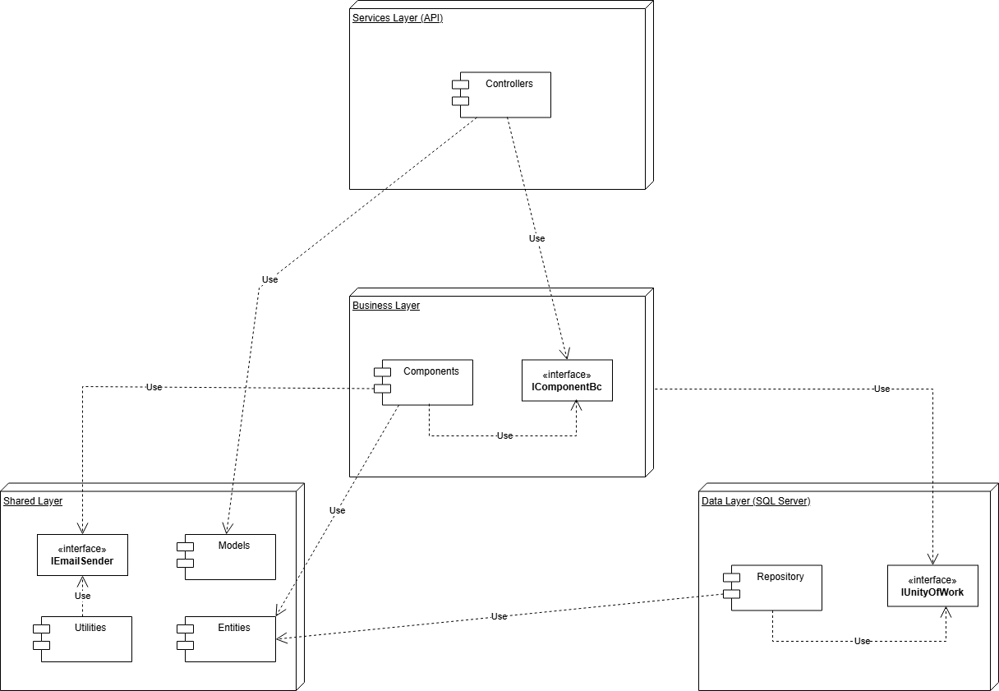

A implementação da nova camada Business na arquitetura do sistema AMAP representa uma evolução significativa no design do software. Esta reestruturação arquitetural traz benefícios substanciais em termos de organização, manutenibilidade e escalabilidade.

### O Que Mudou na Arquitetura?

Anteriormente, a arquitetura tinha uma estrutura mais tradicional de três camadas (API, Dados e Partilhada). A nova arquitetura introduz uma camada Business dedicada, criando um sistema de quatro camadas bem definidas:
1.	Camada API (Controllers): Controladores mais leves e focados em tratamento de requisições HTTP e respostas com DTOs
2.	Camada Business: Nova camada com toda a lógica de negócio
3.	Camada de Dados: Repositórios e acesso ao banco de dados
4.	Camada Partilhada: Entidades, DTOs e utilitários

**Camada de Negócio (Business)**

•	Responsabilidade: implementar toda a lógica de negócio e validações da aplicação
•	Componentes principais:
•	Components (BC): implementações concretas dos serviços de negócio (ProductBc, PaymentBc, etc.)
•	Interfaces: contratos que definem os serviços de negócio (IProductBc, IPaymentBc, etc.)
•	Validação: regras de validação de dados e operações comerciais antes do acesso à camada de dados
•	Logging: registo detalhado de operações críticas e monitorização de segurança
•	Tratamento de Exceções: encapsulamento de exceções específicas de domínio

**DTOs na Camada Shared**

Uma das principais melhorias foi a adição de uma estrutura organizada de DTOs (Data Transfer Objects) na pasta Models da camada Shared. Estes DTOs:
•	Fornecem uma separação clara entre entidades de domínio e objetos de transferência de dados
•	São especializados para diferentes contextos de API (PaymentInfoDto, ProductDto, etc.)
•	Melhoram a segurança ao expor apenas os dados necessários para cada operação
•	Facilitam a evolução da API sem impactar o modelo de domínio
•	Simplificam a serialização/deserialização de dados nas respostas HTTP

### Principais Benefícios da Nova Arquitetura

•	Separação clara de responsabilidades: Os controladores agora apenas gerem requisições HTTP e utilizam DTOs para respostas, enquanto a lógica de negócio fica isolada na camada Business
•	Código mais organizado: Cada componente de negócio é especializado em um domínio específico
•	Testabilidade aprimorada: As interfaces facilitam a criação de testes unitários com mock objects
•	Manutenção simplificada: Alterações de regras de negócio ficam isoladas em componentes específicos
•	Reutilização de código: Componentes de negócio podem ser compartilhados entre diferentes controladores
•	Tratamento robusto de exceções: Implementação de try-catch nos controladores para garantir respostas adequadas aos clientes

### Como Funciona na Prática

Quando um utilizador faz uma requisição, o fluxo agora é:
1.	O cliente envia uma requisição HTTP para um endpoint da API
2.	O controlador correspondente processa a requisição e delega a lógica de negócio para a camada Business
3.	A camada Business executa validações e regras de negócio, utilizando serviços adequados
4.	A camada Business requisita operações de dados à camada Data através da interface IUnitOfWork
5.	O Unit of Work coordena, se necessário, transações atómicas entre múltiplas alterações
6.	Os serviços auxiliares (por exemplo, EmailSender) executam tarefas complementares
7.	A camada Business devolve resultados para o controlador
8.	O controlador transforma os dados em DTOs apropriados e devolve uma resposta HTTP padronizada

Esta abordagem em camadas claramente definidas, com responsabilidades bem segregadas e uso adequado de DTOs, torna o sistema mais resiliente, adaptável e mais fácil de manter ao longo do tempo.

- Demonstração da automação implementada (capturas de ecrã, fluxos)  
- Relação entre as funcionalidades desenvolvidas e os requisitos de segurança identificados na Fase 1  

---

## Boas Práticas de Desenvolvimento Adotadas

### Regras de Nomenclatura da Solução AMAP

#### Classes e Interfaces

- **Classes**: Utilizam o estilo *PascalCase* com nomes descritivos que refletem a função ou entidade que representam:
  - **Entidades**: `Product`, `AppUser`, `Subscription`, `Payment`
  - **Controladores**: `CatalogController`, `PaymentController` (sufixo `"Controller"`)
  - **Camada de negócio**: `ProductBc`, `CatalogBc`, `PaymentBc` (sufixo `"Bc"` para *Business Component*)
  - **Repositórios**: `ProductRepository`, `CompositeRepository` (sufixo `"Repository"`)

- **Interfaces**: Utilizam o prefixo `"I"` seguido do nome em *PascalCase*:
  - `IProductBc`, `ICatalogBc` (interfaces da camada de negócio)
  - `IProductRepository`, `IUnitOfWork` (interfaces da camada de dados)
  - `IDbInitializer` (interfaces de componentes de infraestrutura)

#### Variáveis e Campos

- **Campos privados**: Utilizam o prefixo underscore (`_`) seguido por *camelCase*:
  - `_unitOfWork`, `_logger`, `_productBc`, `_catalogBc`

- **Parâmetros de método**: Utilizam *camelCase*:
  - `producerId`, `subscription`, `nonExistingId`, `coProducerId`

- **Variáveis locais**: Utilizam *camelCase*:
  - `existingProduct`, `compositeProduct`, `invalidId`, `result`

- **Propriedades das Classes**: Utilizam *PascalCase*:
  - `Name`, `DeliveryUnits`, `ReferencePrice`

#### DTOs (Objetos de Transferência de Dados)

- **Classes DTO**: Utilizam o sufixo `"Dto"` em *PascalCase*:
  - `CatalogDto`, `ProductDto`, `ProductComposeDto`
  - Organizados em *namespaces* apropriados (`AMAP.Entities.Models.DTO.Product`)

- **Propriedades de DTOs**: Utilizam *PascalCase*:
  - `ProducerName`, `Products`, `ReferencePrice`, `DeliveryUnits`

#### ViewModels

- **Classes ViewModel**: Utilizam o sufixo `"ViewModel"` em *PascalCase*:
  - `LoginViewModel`, `RegisterViewModel`
  - Organizados num *namespace* específico (`AMAP.Entities.Models.ViewModel`)

- **Propriedades de ViewModels**: Utilizam *PascalCase*:
  - `Email`, `Password`, `RememberMe`, `Name`

#### Métodos

- **Métodos públicos**: Utilizam *PascalCase* com nomes descritivos, geralmente iniciando com um verbo:
  - `GetProduct`, `CreateProduct`, `UpdateProduct`, `DeleteProduct`
  - `GetAllCatalogs`, `GetCatalogByProducer`
  - `CreateSubscription`, `GetSubscriptionById`

- **Métodos privados**: Utilizam *PascalCase*, geralmente com nomes que descrevem a sua função auxiliar:
  - `EscapeTxt`, `RemoveInvalidFileNameChars`

#### Constantes e Enumerações

- **Constantes**: Quando declaradas como campos, utilizam *PascalCase*:
  - `MaxLinesToProcess`

- **Enumerações**: Utilizam *PascalCase* para o nome da enumeração e dos seus valores:
  - `UserType` (enumeração): `Manager`, `Producer`, `CoProducer`
  - `PaymentType` (enumeração): `Money`, `BankTransfer`, `MBway`

#### Organização de Pastas e Namespaces

A solução AMAP segue uma arquitetura em camadas claramente definida, com cada projeto focado em responsabilidades específicas:

##### 1. `AMAP.Entities` (Modelos)

- **Entities**: Classes que representam as entidades principais do domínio
  - `Product.cs`, `AppUser.cs`, `Subscription.cs`, `Payment.cs`, `Composite.cs`

- **Models/DTO**: Objetos de Transferência de Dados para comunicação entre camadas
  - `DTO/Catalog`: `CatalogDto.cs`
  - `DTO/Product`: `ProductDto.cs`, `ProductComposeDto.cs`

- **Models/ViewModel**: Objetos usados para comunicação com a interface de utilizador
  - `LoginViewModel.cs`, `RegisterViewModel.cs`

- **Utilities**: Classes utilitárias e enumerações
  - `EmailSender.cs`: Serviço para envio de emails
  - `UserType.cs`, `PaymentType.cs`: Enumerações do sistema
  - Helpers e extensões para funcionalidades comuns

##### 2. `AMAP.DataAccess`

- **Data**: Configurações da base de dados e contexto
  - `AppDbContext.cs`: Classe de contexto do Entity Framework

- **DbInitializer**: Classes para inicialização e povoamento da base de dados (*seeding*)
  - `DbInitializer.cs`, `IDbInitializer.cs`

- **Repository**: Implementações concretas dos repositórios
  - `ProductRepository.cs`, `PaymentRepository.cs`, etc.

- **Repository/IRepository**: Interfaces dos repositórios
  - `IProductRepository.cs`, `IPaymentRepository.cs`
  - `IUnitOfWork.cs`: Interface para o padrão *Unit of Work*

##### 3. `AMAP.Business`

- **Interfaces**: Interfaces para os componentes da camada de negócio
  - `IProductBc.cs`, `ICatalogBc.cs`, `IPaymentBc.cs`

- **Components**: Implementações dos componentes da camada de negócio
  - `ProductBc.cs`, `CatalogBc.cs`, `PaymentBc.cs`
  - `PaymentsInfoBc.cs`, `SubscriptionPeriodBc.cs`

##### 4. `AMAP_API`

- **Controllers**: Controladores da API REST
  - `CatalogController.cs`, `ProductController.cs`, `AccountController.cs`
  - `BaseController.cs`: Classe base para os controladores

- **Middlewares**: Componentes de *middleware* personalizados

- **Configurations**: Ficheiros de configuração específicos
  - Configurações de autenticação, CORS e registo de logs

- **Logs**: Diretório para armazenamento dos registos do sistema
  - Ficheiros de log organizados por data (ex.: `security-{Data}.txt`)
  - Registo de operações, erros e informações de segurança

- **ProductsUpload**: Pasta para armazenamento de ficheiros de produtos importados
  - Ficheiros de texto com dados de produtos a importar
  - Nomes de ficheiros com prefixo GUID para garantir unicidade

- **ExportedProducts**: Diretório contendo ficheiros exportados do sistema
  - Ficheiros de texto com dados de produtos exportados
  - Nomes baseados no produtor que realizou a exportação

##### 5. `AMAP.UnitTests`

- **Business**: Testes unitários da camada de negócio
  - `ProductBcTests.cs`, `CatalogBcTests.cs`, `PaymentBcTests.cs`

- **Business/Mock**: Classes de *mock* para componentes da camada de negócio
  - `MockProductBc.cs`, `MockCatalogBc.cs`, `MockPaymentBc.cs`

- **Repository/Mock**: Classes de *mock* para repositórios
  - `MockProductRepository.cs`, `MockCatalogRepository.cs`

- **Services**: Testes para serviços e controladores
  - `PaymentControllerTests.cs`, `AccountControllerTests.cs`

#### Convenções Gerais

- Utilização consistente da língua inglesa em toda a nomeação no código.
- Nomes descritivos e significativos que transmitam claramente o seu propósito e função.
- Evita-se o uso de abreviações obscuras, privilegiando a clareza em detrimento da brevidade.
- Consistência na nomeação de operações semelhantes em diferentes componentes.
- Uso de atributos de validação e anotações para enriquecer as propriedades.

---

### Revisões e Auditorias de Segurança

#### Revisões de código
##### Processos e workflows estabelecidos  

Para gerir o desenvolvimento colaborativo e garantir a qualidade do código, foi adotado um processo simplificado de revisão utilizando apenas recursos gratuitos do GitHub. O grupo definiu uma convenção clara para as branches, organizando o trabalho da seguinte forma:

- **main**: branch principal com código estável e pronto para produção.  
- **feature/nome**: branches para desenvolvimento de novas funcionalidades.  
- **fix/nome**: branches destinadas a correções de bugs.  
- **security/nome**: branches para correções relacionadas com segurança.

O fluxo de trabalho baseia-se na criação de branches a partir da main, com commits pequenos e frequentes para facilitar o acompanhamento das alterações. Ao concluir o desenvolvimento, a branch é enviada (push) para o repositório remoto.

##### Comunicação e Revisão

A comunicação para revisão é feita diretamente pelo chat do grupo, onde o autor informa rapidamente sobre a criação da branch ou do Pull Request (PR), incluindo uma breve descrição (2-3 linhas) das alterações implementadas. Durante o processo de revisão, os comentários são realizados nos commits, PRs ou issues do GitHub, permitindo discussões e feedback ágeis e transparentes entre os membros.

A revisão é realizada diretamente na plataforma GitHub, utilizando os seus recursos de comentários para apontar eventuais problemas ou melhorias. Este processo simples evita o uso de documentos formais, acelerando a comunicação.

##### Critérios e Checklist Simplificado de Segurança

Para garantir a qualidade e segurança do código, utilizamos uma checklist mental rápida, que contempla os seguintes pontos principais:

- **Validação de Entrada**: verificar se as entradas do utilizador são validadas quanto a tipo, tamanho e formato.  
- **Segurança**: assegurar que não há dados sensíveis hardcoded e que são prevenidos ataques comuns como SQL injection, XSS e CSRF.  
- **Qualidade do Código**: código claro, legível e livre de erros graves.  
- **Testes**: validação mínima para assegurar que as alterações não comprometem funcionalidades.

##### Processo de Pull Request, Merge e Comunicação Final

Após a revisão, o autor cria um Pull Request para integrar as alterações na branch main. A descrição do PR é simples, informando que as alterações foram feitas conforme combinado e que a revisão está pendente.

O revisor aprova o PR diretamente na plataforma, via comentário ou aprovação. Após a aprovação, o responsável pela main realiza o merge e informa a equipa pelo chat, indicando que a integração foi concluída e que a branch pode ser removida.

##### Métricas de Qualidade

Durante o desenvolvimento, foram realizadas várias revisões de código que resultaram na identificação e correção de issues relacionadas principalmente com validação de entrada e melhorias na legibilidade do código. A comunicação rápida e o processo simplificado permitiram uma resolução eficiente das questões encontradas, contribuindo para a melhoria contínua da qualidade do software.

---

#### Análise Estática de Código (SAST)

A análise estática de código (SAST) é uma prática fundamental no nosso processo de Desenvolvimento de Software Seguro (SSDLC). Para este fim, utilizamos o **SonarQube Cloud**, que nos permite identificar e gerir de forma proativa:

- Bugs e vulnerabilidades de segurança  
- *Code smells* (problemas de manutenibilidade)  
- Cobertura de código por testes  
- Qualidade geral do código  
- Consistência e conformidade com os padrões de codificação estabelecidos  

##### Automação no Pipeline CI/CD

A análise estática está totalmente automatizada como parte do pipeline de Integração Contínua e Entrega Contínua (CI/CD), implementado com **GitHub Actions** através do ficheiro `.github/workflows/main.yml`. Esta automação assegura que todas as alterações no código sejam automaticamente validadas quanto à sua segurança e qualidade antes de serem integradas ou implantadas.

As principais etapas deste processo incluem:

- **Checkout do Código**: Clonagem do repositório no ambiente de execução do pipeline.  

- **Configuração do .NET**: Instalação do SDK do .NET necessário para o projeto.  

- **Restauração de Dependências**: Obtenção das bibliotecas requeridas.  

- **Compilação do Projeto**: Construção do código-fonte.  

- **Execução de Testes com Cobertura**: Execução dos testes unitários e geração do relatório de cobertura de código no formato Cobertura.  

- **Instalação e Configuração do SonarQube Scanner**: Gestão de cache e instalação do scanner do SonarQube.  

  ```c#
  - name: Cache SonarQube Cloud packages
    uses: actions/cache@v4
    with:
      path: ~\sonar\cache
      key: ${{ runner.os }}-sonar
      restore-keys: ${{ runner.os }}-sonar
  
  - name: Cache SonarQube Cloud scanner
    id: cache-sonar-scanner
    uses: actions/cache@v4
    with:
      path: .\.sonar\scanner
      key: ${{ runner.os }}-sonar-scanner
      restore-keys: ${{ runner.os }}-sonar-scanner
  
  - name: Install SonarQube Cloud scanner
    if: steps.cache-sonar-scanner.outputs.cache-hit != 'true'
    run: |
      mkdir -p ./.sonar/scanner
      dotnet tool update dotnet-sonarscanner --tool-path ./.sonar/scanner
  ```

- **Preparação do Relatório de Cobertura para o SonarQube**: Apesar dos testes gerarem relatórios no formato *Cobertura*, o SonarQube interpreta melhor o formato **OpenCover** para projetos .NET. Para isso, utilizamos a ferramenta **reportgenerator** que converte os relatórios para o formato adequado.  

  ```c#
  - name: Install ReportGenerator tool
    run: dotnet tool install -g dotnet-reportgenerator-globaltool
  
  - name: Convert coverage report to opencover format
    run: |
      reportgenerator \
        -reports:**/coverage.cobertura.xml \
        -targetdir:coverage-report \
        -reporttypes:opencover
  ```

- **Execução da Análise SonarQube**: O scanner é utilizado para iniciar a análise (`begin`), o projeto é recompilado (`dotnet build`) para permitir a inspeção do código, e a análise é finalizada (`end`), com os resultados enviados para o SonarCloud.

  ```c#
  - name: Build and analyze
    env:
      SONAR_TOKEN: ${{ secrets.SONAR_TOKEN }} # Utiliza um segredo do GitHub para a autenticação
    run: |
      ${{ github.workspace }}/.sonar/scanner/dotnet-sonarscanner begin /k:"diogoc0307_desofs" /o:"diogoc0307" /d:sonar.token="${{ secrets.SONAR_TOKEN }}" /d:sonar.host.url="https://sonarcloud.io" /d:sonar.branch.name="main" /d:sonar.cs.opencover.reportsPaths="${{ github.workspace }}/coverage-report/opencover.xml" /d:sonar.cs.vstest.reportsPaths="${{ github.workspace }}/**/*.trx" /d:sonar.cs.vstest.coverage.enabled=true /d:sonar.security.enabled=true /d:sonar.security.sources.javasecurity=true /d:sonar.security.sources.pythonsecurity=true /d:sonar.security.sources.phpsecurity=true /d:sonar.security.sources.roslynsecurity=true /d:sonar.scanner.skipJreProvisioning=true
      dotnet build AMAP/AMAP.sln
      ${{ github.workspace }}/.sonar/scanner/dotnet-sonarscanner end /d:sonar.token="${{ secrets.SONAR_TOKEN }}"
  ```

Esta integração automatizada assegura que a análise estática é uma etapa obrigatória antes da integração de novas funcionalidades e da respetiva disponibilização em produção.

##### Estado Atual da Análise no SonarCloud

Com base na análise mais recente disponível no **SonarCloud**, o projeto apresenta o seguinte perfil de qualidade:

- **Segurança**: 6 vulnerabilidade (Grau A).  
- **Confiabilidade**: 10*issues* (Grau C) — identificadas situações com comportamento potencialmente incorreto.  
- **Manutenibilidade**: 291 *issues* (Grau A) — embora existam vários *code smells*, a manutenibilidade é considerada boa.  
- **Cobertura de Código**: **78,06%** — valor obtido diretamente através do **Visual Studio Enterprise**. Contudo, o **SonarCloud ainda não está a refletir corretamente esta métrica**, possivelmente devido à configuração do ficheiro de cobertura.  
- **Código Duplicado**: 2,8% — um valor relativamente baixo.  
- **Security Hotspots**: 2 fragmento de código que requer revisão manual para verificar se constitui ou não uma vulnerabilidade real.

Este panorama oferece uma visão clara sobre a qualidade e segurança do código, permitindo priorizar as áreas que mais necessitam de atenção.

##### Configurações de Segurança da Análise

A análise efetuada pelo SonarQube encontra-se configurada com diversas opções de segurança que garantem uma verificação rigorosa, nomeadamente:

- `sonar.security.enabled=true`: ativa a análise de segurança.  
- Configurações adicionais como `sonar.security.sources.cs.security=true` (para projetos .NET) permitem a análise específica de fontes potencialmente inseguras nas respetivas linguagens.

##### Métricas Avaliadas

O SonarQube avalia continuamente diversas métricas essenciais para a saúde do projeto:

- **Qualidade do Código**: deteção de *code smells*, bugs, vulnerabilidades e duplicações.  
- **Confiabilidade**: probabilidade de ocorrência de erros em tempo de execução.  
- **Manutenibilidade**: facilidade de compreender, modificar e manter o código.  
- **Segurança**: identificação de más práticas e vulnerabilidades conhecidas.  
- **Cobertura de Código**: análise da proporção de código testado — embora já esteja nos 78,06%, o SonarCloud ainda não apresenta este valor corretamente devido a uma questão de configuração.

##### Acesso aos Resultados

Os resultados detalhados da análise estática estão disponíveis publicamente através da plataforma SonarCloud:

🔗 [Link para o Projeto no SonarCloud](https://sonarcloud.io/project/overview?id=diogoc0307_desofs)

##### Manutenção e Melhoria Contínua

Para assegurar a eficácia contínua da análise estática de código:

- O scanner e as regras de análise são regularmente atualizados.  
- As configurações são revistas e adaptadas com a evolução do projeto.  
- Os resultados são monitorizados com frequência e as *issues* (bugs, vulnerabilidades e *code smells*) são triadas e resolvidas por ordem de prioridade.  
- Estamos a investigar e ajustar a configuração do pipeline para garantir que a cobertura de testes seja corretamente interpretada e refletida no SonarCloud.

---

#### Análise Dinâmica e Interativa de Código

 ##### DAST (Dynamic Application Security Testing)

A análise dinâmica de segurança foi implementada com recurso ao **Snyk**, integrado na pipeline (`main.yml`). Esta ferramenta permite:

- Realizar testes dinâmicos de segurança à aplicação;
- Detetar vulnerabilidades em dependências;
- Avaliar a aplicação em tempo de execução (runtime).

##### IAST (Interactive Application Security Testing)

A componente interativa foi assegurada pelo **SonarCloud**, também aplicada via `main.yml`. Esta solução oferece:

- Análise contínua durante o processo de build;
- Detecção de vulnerabilidades em tempo real;
- Verificações interativas durante a execução do código.

##### Sugestões para Evolução

Para reforçar ainda mais a componente de segurança, estão a ser consideradas as seguintes melhorias para o próximo sprint:

**DAST**

- Integrar o **OWASP ZAP** na pipeline;
- Incluir varredura automática de APIs;
- Adicionar testes de penetração automatizados.

**IAST**

- Explorar ferramentas adicionais como o **Contrast Security**;
- Aprofundar a análise em runtime;
- Implementar monitorização contínua do comportamento da aplicação.

Estas propostas foram discutidas pela equipa e serão avaliadas com vista à sua inclusão nas próximas iterações do projeto.

---

#### Análise de Composição de Software (SCA)

A Análise de Composição de Software (SCA) é um processo automatizado que visa identificar e gerir componentes de código aberto e bibliotecas de terceiros utilizados no projeto. A utilização destes componentes pode introduzir vulnerabilidades conhecidas e riscos legais associados a licenças.

O objetivo da SCA no pipeline CI/CD é:

- Gerar um inventário dos componentes de terceiros (Software Bill of Materials - SBOM);
- Detetar vulnerabilidades de segurança conhecidas (CVEs);
- Apoiar a gestão de riscos de licenciamento.

Para este efeito, foram integradas duas ferramentas no pipeline: **OWASP Dependency Check** e **Snyk**.

##### Automação no Pipeline CI/CD

A análise de composição é automatizada através do ficheiro `.github/workflows/main.yml`, garantindo que cada alteração ao código verifica também as dependências utilizadas.

##### OWASP Dependency Check

O *OWASP Dependency Check* é uma ferramenta de código aberto que identifica vulnerabilidades conhecidas em dependências. Apesar de eficaz, está sujeita a falsos positivos/negativos.

No pipeline, esta ferramenta:

- Analisa as dependências do projeto .NET;
- Gera um relatório em HTML com os resultados;
- Publica esse relatório como artefacto no GitHub Actions.

**Resumo da última análise**:

- 356 dependências analisadas (232 únicas);
- 3 bibliotecas vulneráveis encontradas:
  - `Azure.Core.dll`: severidade **crítica**;
  - `Azure.Identity.dll`: severidade **alta**;
  - `System.ClientModel.dll`: severidade **crítica**.

O relatório detalhado, disponível como artefacto no pipeline, inclui os CVEs detetados e recomendações de mitigação.

##### Snyk

O Snyk é uma plataforma de segurança orientada para desenvolvedores, que permite detetar e corrigir vulnerabilidades em código, dependências, contentores e infraestrutura como código. No nosso pipeline, foi utilizado o Snyk CLI para realizar a análise das dependências.

A integração com o Snyk envolveu os seguintes passos:

- **Instalação do Snyk CLI** 
  Foi utilizada uma *GitHub Action* oficial do Snyk para configurar automaticamente o ambiente com o Snyk CLI.  

```c#
    - name: Install Snyk CLI
  uses: snyk/actions/setup@master # Action para configurar o Snyk CLI
```

- **Monitorização de Vulnerabilidades** 
  Um comando foi executado para enviar um *snapshot* das dependências do projeto para a plataforma Snyk, permitindo a monitorização contínua e a receção de alertas sobre novas vulnerabilidades.

```c#
- name: Monitor Security Vulnerabilities (Snyk CLI)
  working-directory: AMAP/ # Executa o comando no diretório do projeto AMAP
  env:
    SNYK_TOKEN: ${{ secrets.SNYK_TOKEN }} # Utiliza um segredo do GitHub para autenticação com Snyk
  run: snyk monitor --all-projects # Monitora todas as sub-projetos encontrados no diretório
```

- **Teste de Segurança** 
  Através deste comando, foi feita uma varredura de segurança que termina o passo do pipeline caso sejam detetadas vulnerabilidades com severidade alta ou crítica, funcionando assim como uma espécie de *quality gate* de segurança.

```c#
- name: Run Security Scan (Snyk CLI)
  working-directory: AMAP/ # Executa o comando no diretório do projeto AMAP
  env:
    SNYK_TOKEN: ${{ secrets.SNYK_TOKEN }} # Utiliza um segredo do GitHub para autenticação com Snyk
  run: snyk test --severity-threshold=high --all-projects # Testa todas as sub-projetos e falha se encontrar vulnerabilidades de severidade alta ou superior
```

- **Resultados do Snyk** 
  Os resultados detalhados dos comandos `snyk monitor` e `snyk test` são enviados para a plataforma Snyk. No entanto, devido ao limite de testes de código aberto atingido na conta utilizada, a plataforma apresenta apenas as dependências detetadas (118 no total), mas não exibe as vulnerabilidades conhecidas associadas (0 listadas). 
  A visualização completa das vulnerabilidades exige a atualização da conta Snyk.

**Links úteis:**

- Convite para a organização: [Aceitar convite](https://app.snyk.io/invite/link/accept?invite=f36e349a-03a1-4869-a311-e7dbb32af557)
- Projetos no Snyk: [Ver projetos](https://app.snyk.io/org/diogoc0307/projects)

##### Porquê utilizar duas ferramentas?

Apesar de ambas servirem para identificar vulnerabilidades, **OWASP Dependency Check** e **Snyk** têm bases de dados e abordagens distintas. Ao usar as duas ferramentas em conjunto, aumentamos a cobertura e fiabilidade da análise.

Esta redundância faz parte da boa prática de segurança em profundidade, ao garantir que falhas não detectadas por uma ferramenta possam ser captadas pela outra.

---

# Compilação e Testes

## Inventário de Componentes

Complementarmente à análise automatizada, realizamos verificações manuais utilizando o .NET CLI para obter um inventário detalhado das dependências e verificar a existência de vulnerabilidades conhecidas reportadas pelo próprio ecossistema .NET/NuGet.

### Bibliotecas e Frameworks

Durante o Sprint 1 foi realizada a tarefa de identificação e avaliação dos componentes externos utilizados no sistema, com foco na gestão segura de dependências e conformidade com as boas práticas definidas pela OWASP (nomeadamente ASVS V1.1.1 e V14.2.1).

A identificação dos componentes utilizados em cada projeto (.NET) foi feita utilizando o comando:

```bash
dotnet list package
```

Durante o processo de build, foi usado um comando para listar todos os pacotes NuGet utilizados em cada projeto da solução. A análise manual revelou as seguintes bibliotecas e respetivas versões:

- AMAP.Api
  - `Microsoft.AspNetCore.Authentication.JwtBearer` — **9.0.4**
  - `Microsoft.AspNetCore.Cors` — **2.2.0**
  - `Microsoft.AspNetCore.Identity.EntityFrameworkCore` — **9.0.4**
  - `Microsoft.EntityFrameworkCore` — **9.0.4**
  - `Microsoft.EntityFrameworkCore.Design` — **9.0.4**
  - `Microsoft.EntityFrameworkCore.SqlServer` — **9.0.4**
  - `Microsoft.EntityFrameworkCore.Tools` — **9.0.4**
  - `Newtonsoft.Json` — **13.0.3**
  - `Serilog.Extensions.Logging.File` — **3.0.0**
  - `Swashbuckle.AspNetCore` — **6.6.2**
- AMAP.DataAccess
  - `Microsoft.AspNetCore.Authentication.JwtBearer` — **9.0.4**
  - `Microsoft.AspNetCore.Identity.EntityFrameworkCore` — **9.0.4**
  - `Microsoft.EntityFrameworkCore` — **9.0.4**
  - `Microsoft.EntityFrameworkCore.SqlServer` — **9.0.4**
  - `Microsoft.EntityFrameworkCore.Tools` — **9.0.4**

- AMAP.Entities
  - `Microsoft.AspNetCore.Authentication.JwtBearer` — **8.0.11**
  - `Microsoft.AspNetCore.Identity.EntityFrameworkCore` — **8.0.11**

- AMAP.Business
  - *Nenhum pacote NuGet encontrado.*

- AMAP.UnitTests
  - **coverlet.collector**: `6.0.4`
  - **Microsoft.NET.Test.Sdk**: `17.14.0`
  - **NSubstitute**: `5.3.0`
  - **xunit**: `2.9.3`
  - **xunit.runner.visualstudio**: `3.1.0`

### Verificação de Vulnerabilidades com .NET CLI

A verificação inicial de vulnerabilidades conhecidas utilizando as fontes públicas integradas ao .NET CLI foi realizada com o comando:

```bash
dotnet list package --vulnerable
```
Esta verificação abrange os pacotes instalados e cruza-os com bases de dados públicas como a do NuGet.org. O resultado desta análise manual foi o seguinte:

> \> "O projeto fornecido AMAP.Api não tem nenhum pacote vulnerável, considerando as fontes atuais."
>
> \> "O projeto fornecido AMAP.DataAccess não tem nenhum pacote vulnerável, considerando as fontes atuais."
>
> \> "O projeto fornecido AMAP.Entities não tem nenhum pacote vulnerável, considerando as fontes atuais."
>
> \> "O projeto fornecido AMAP.Business não tem nenhum pacote vulnerável, considerando as fontes atuais."
>
> \> "O projeto fornecido AMAP.UnitTests não tem nenhum pacote vulnerável, considerando as fontes atuais."

Embora não tenham sido encontradas vulnerabilidades conhecidas através deste método, foram identificadas algumas dependências com versões desatualizadas ou depreciadas, como se pode verificar no inventário abaixo. 

Para complementar esta análise, recorreu-se também a ferramentas automáticas como o Dependency Check e o Snyk, que ajudaram a identificar vulnerabilidades que poderão não ser detetadas pelo comando `dotnet list package --vulnerable`.

###  Documentação e Plano de Ação

A documentação dos componentes foi organizada de acordo com os seguintes critérios:

- Nome do pacote e versão utilizada  
- Função no sistema  
- Estado da versão (atual/desatualizada/depreciada)  
- Existência de vulnerabilidades conhecidas  
- Plano de ação (atualizar, manter, substituir)  

Abaixo apresenta-se um inventário dos pacotes principais identificados manualmente, complementado com exemplos das versões mais recentes conhecidas no momento da análise. Esta verificação baseou-se na execução de comandos da .NET CLI e em fontes públicas de versões atualizadas.

| Pacote                                              | Versão Usada | Versão Mais Recente (exemplo) | Função no Sistema                         | Estado        | Ação Recomendada            |
| --------------------------------------------------- | ------------ | ----------------------------- | ----------------------------------------- | ------------- | --------------------------- |
| `Microsoft.AspNetCore.Authentication.JwtBearer`     | 9.0.4        | 9.0.5                         | Autenticação via JWT                      | Atual         | Monitorizar futuras versões |
| `Microsoft.AspNetCore.Cors`                         | 2.2.0        | 2.3.0                         | Suporte a CORS                            | Desatualizada | Atualizar                   |
| `Microsoft.AspNetCore.Identity.EntityFrameworkCore` | 9.0.4        | 9.0.5                         | Gestão de identidade com EF Core          | Atual         | Monitorizar futuras versões |
| `Microsoft.EntityFrameworkCore`                     | 9.0.4        | 9.0.5                         | ORM - Acesso a dados                      | Atual         | Atualizar                   |
| `Microsoft.EntityFrameworkCore.Design`              | 9.0.4        | 9.0.5                         | Ferramentas de scaffolding do EF Core     | Atual         | Atualizar                   |
| `Microsoft.EntityFrameworkCore.SqlServer`           | 9.0.4        | 9.0.5                         | Provider EF Core para SQL Server          | Atual         | Atualizar                   |
| `Microsoft.EntityFrameworkCore.Tools`               | 9.0.4        | 9.0.5                         | Ferramentas de linha de comandos (CLI)    | Atual         | Atualizar                   |
| `Newtonsoft.Json`                                   | 13.0.3       | 13.0.3                        | Serialização/Deserialização de JSON       | Depreciado    | Avaliar substituição        |
| `Serilog.Extensions.Logging.File`                   | 3.0.0        | 3.0.0                         | Logging para ficheiro (via Serilog)       | Atual         | Monitorizar futuras versões |
| `Swashbuckle.AspNetCore`                            | 6.6.2        | 8.1.1                         | Documentação Swagger/OpenAPI              | Desatualizada | Atualizar                   |
| `coverlet.collector`                                | 6.0.4        | 6.0.4                         | Recolha de cobertura de testes            | Atual         | Monitorizar futuras versões |
| `Microsoft.NET.Test.Sdk`                            | 17.14.0      | 17.14.0                       | SDK de suporte a testes .NET              | Atual         | Monitorizar futuras versões |
| `NSubstitute`                                       | 5.3.0        | 5.3.0                         | Framework de mocking                      | Atual         | Monitorizar futuras versões |
| `xunit`                                             | 2.9.3        | 2.9.3                         | Framework de testes unitários             | Atual         | Monitorizar futuras versões |
| `xunit.runner.visualstudio`                         | 3.1.0        | 3.1.0                         | Execução de testes xUnit no Visual Studio | Atual         | Monitorizar futuras versões |

Este inventário será mantido ao longo do próximo sprint como parte do processo de revisão contínua da segurança do projeto.


### Manutenção Contínua e Segurança

Este inventário será mantido e atualizado no âmbito do processo de revisão contínua da segurança do projeto. Serão utilizadas tanto ferramentas automáticas como verificações manuais para garantir a conformidade e detetar vulnerabilidades em tempo útil.

### Porquê Usar Ferramentas Diferentes?

A combinação de ferramentas automáticas de análise de componentes (como o OWASP Dependency Check e o Snyk) com comandos manuais da .NET CLI permite uma análise mais robusta. Cada ferramenta possui métodos próprios de deteção e bases de dados de vulnerabilidades diferentes.

Esta abordagem multifacetada segue as boas práticas recomendadas na área da segurança e proporciona uma visão mais completa dos riscos associados ao uso de software de terceiros no projeto.

---

## Planos e Execução de Testes de Segurança

### Testes unitários com foco em segurança

Os testes unitários desempenham um papel crucial no desenvolvimento de software ao garantir a qualidade, estabilidade e confiabilidade do código. Para a solução AMAP, foi desenvolvido um conjunto abrangente de testes unitários, organizados no projeto AMAP.UnitTests dentro da pasta "5 - Unit Tests". Este relatório detalha a abordagem e implementação destes testes.

#### Frameworks e Ferramentas Utilizados

**xUnit**
O framework xUnit foi escolhido para implementar os testes unitários devido à sua simplicidade, extensibilidade e integração com o ecossistema .NET. O xUnit suporta a execução de testes em paralelo, facilitando o processo de desenvolvimento e integração contínua. No AMAP, os testes são identificados pelo atributo [Fact], que designa um método como sendo um teste unitário.

**NSubstitute**
Para o isolamento de componentes e criação de objetos simulados, foi utilizado o NSubstitute, uma biblioteca moderna de mocking para .NET. O NSubstitute permite simular interfaces e classes, facilitando a verificação de comportamentos sem depender de implementações reais. Esta abordagem foi crucial para testar a camada de negócios sem necessidade de acesso a bancos de dados reais ou serviços externos.

#### Estrutura dos Testes

Os testes unitários do AMAP foram organizados para cobrir duas camadas principais:
1.	Camada de Business (Business Components): Testes voltados para a lógica de negócios, validando regras, comportamentos e fluxos de dados.
2.	Camada de Services (Controllers): Testes focados na validação dos controllers, assegurando o correto processamento de requisições e respostas.

#### Mock de Camadas

Um elemento fundamental na abordagem de testes foi a simulação de todas as dependências das diferentes camadas do sistema, com o objetivo de garantir isolamento completo e testes mais fiáveis. 

As principais simulações realizadas incluem:
- **Business Components:** Para testar os controladores de forma isolada, foram criadas versões simuladas dos componentes de negócio, como `MockProductBc`, `MockCatalogBc` e `MockPaymentBc`. Estas simulações permitiram validar a lógica da API sem dependência da implementação real da camada Business.
-  **Repositórios de Dados:** Todos os repositórios foram simulados, eliminando a necessidade de ligação a uma base de dados real durante os testes. Isto permitiu executar testes rápidos e previsíveis, sem efeitos colaterais.
-  **Serviços Externos:** Serviços auxiliares, como envio de e-mails ou notificações, foram substituídos por implementações simuladas, garantindo que os testes se focassem exclusivamente na lógica interna.
-   **Logging:** As funcionalidades de registo (log) também foram simuladas, evitando efeitos colaterais e garantindo o isolamento total dos componentes sob teste.

Por exemplo, a classe `MockProductRepository` demonstra como os repositórios foram simulados, oferecendo dados e comportamentos predefinidos:

```c#
public static IUnitOfWork GetMockUnitOfWork()
{
    var mockUnitOfWork = Substitute.For<IUnitOfWork>();

    // Set up Product repository
    var mockProductRepo = Substitute.For<IProductRepository>();
    SetupProductRepository(mockProductRepo);
    mockUnitOfWork.Product.Returns(mockProductRepo);

    // Set up Composite repository
    var mockCompositeRepo = Substitute.For<ICompositeRepository>();
    SetupCompositeRepository(mockCompositeRepo);
    mockUnitOfWork.Composite.Returns(mockCompositeRepo);

    // Set up AppUser repository
    var mockAppUserRepo = Substitute.For<IAppUserRepository>();
    SetupAppUserRepository(mockAppUserRepo);
    mockUnitOfWork.AppUser.Returns(mockAppUserRepo);

    return mockUnitOfWork;
}
```

#### Padrão AAA (Arrange-Act-Assert)

Todos os testes foram estruturados seguindo o padrão AAA, que proporciona clareza e consistência na organização dos testes:
1.	**Arrange:** Preparação do ambiente e dados necessários para o teste.
2.	**Act:** Execução da operação sendo testada.
3.	**Assert:** Verificação dos resultados esperados.

Exemplo do padrão AAA aplicado em um teste do ProductControllerTests:

```c#
[Fact]
public void GetProduct_ValidId_ReturnsOk()
{
    // Arrange
    var productId = 1;  

    // Act
    var result = _productController.GetProduct(productId);

    // Assert
    var actionResult = Assert.IsType<OkObjectResult>(result);
    Assert.Equal(200, actionResult.StatusCode);  
}
```

#### Cobertura de Cenários

Os testes unitários foram projetados para cobrir diversos cenários, incluindo:
1.	**Casos positivos:** Verificando o comportamento correto em situações esperadas.
2.	**Casos negativos:** Testando como o sistema reage a entradas inválidas ou situações excepcionais.
3.	**Condições de borda:** Testando o comportamento em situações limite.

Por exemplo, para o método `GetProduct()` da classe ProductBc, foram implementados testes que verificam:

• Recuperação de produtos válidos:

```c#
	[Fact]
	public void GetProduct_ValidId_ReturnsProduct()
	{
		// Arrange
		var productId = 1;

		// Act
		var result = _productBc.GetProduct(productId);

		// Assert
		Assert.NotNull(result);
		Assert.Equal(productId, result.Id);
		Assert.Equal("Carrots", result.Name);
		Assert.Equal("producer-1", result.ProducerId);
		Assert.Equal(2.50, result.ReferencePrice);
		Assert.False(result.IsDeleted);
	}
```

• Tratamento de IDs inválidos:

```c#
	[Fact]
	public void GetProduct_InvalidId_ThrowsArgumentException()
	{
		// Arrange
		var invalidId = 0;

		// Act & Assert
		var exception = Assert.Throws<ArgumentException>(() => _productBc.GetProduct(invalidId));
		Assert.Equal("Product ID must be greater than zero. (Parameter 'id')", exception.Message);
	}
```

• Comportamento com produtos inexistentes:

```c#
	[Fact]
	public void GetProduct_NonExistingId_ReturnsNull()
	{
		// Arrange
		var nonExistingId = 100;

		// Act
		var result = _productBc.GetProduct(nonExistingId);

		// Assert
		Assert.Null(result);
	}
```

• Tratamento de produtos marcados como excluídos:

```c#
	[Fact]
	public void GetProduct_DeletedProduct_ReturnsNull()
	{
		// Arrange
		var deletedProductId = 4;

		// Act
		var result = _productBc.GetProduct(deletedProductId);

		// Assert
		Assert.Null(result);
	}
```

• Carregamento correto de produtos compostos:

```c#
	[Fact]
	public void GetProduct_CompositeProduct_ReturnsProductWithComposites()
	{
		// Arrange
		var compositeProductId = 2;

		// Act
		var result = _productBc.GetProduct(compositeProductId);

		// Assert
		Assert.NotNull(result);
		Assert.Equal(compositeProductId, result.Id);
		Assert.Equal("Vegetable Box", result.Name);

		// Check composites
		Assert.NotNull(result.Composites);
		Assert.Single(result.Composites);

		var composite = result.Composites.First();
		Assert.Equal(1, composite.SubProductId);
		Assert.Equal(2, composite.Quantity);

		// Check that SubProduct is included
		Assert.NotNull(composite.SubProduct);
		Assert.Equal("Carrots", composite.SubProduct.Name);
	}
	
```

#### Teste de Segurança e Permissões

Parte significativa dos testes unitários focou em validar aspectos de segurança e permissões, garantindo que:

- Utilizadores só possam aceder ou modificar os seus próprios recursos
- Operações sensíveis incluam validações adequadas
- Erros sejam tratados apropriadamente sem expor informações sensíveis

#### Conclusão

A implementação abrangente de testes unitários na solução AMAP, utilizando xUnit e NSubstitute, contribuiu significativamente para a qualidade e robustez do sistema. A cobertura extensiva de testes nas camadas de negócio e serviços, seguindo o padrão AAA e com simulação completa de dependências, proporcionou um alto nível de confiança no código desenvolvido e facilitará a manutenção e evolução futura do sistema.

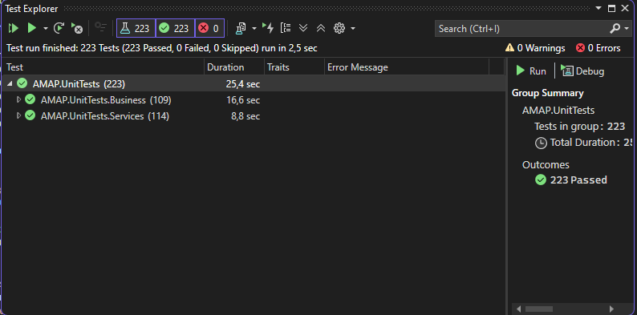

Todos os testes implementados foram concluídos com sucesso, alcançando uma cobertura de código de 78.06%. Esta taxa de cobertura é particularmente significativa, pois abrange as funcionalidades críticas e os fluxos de negócios essenciais da aplicação. A estratégia de testes unitários implementada na solução AMAP proporcionou:

- Maior confiabilidade do código através de verificação automatizada.
- Melhor documentação do comportamento esperado de cada componente.
- Facilitação de refatorações e melhorias no código existente.
- Redução de bugs através da detecção precoce de problemas.

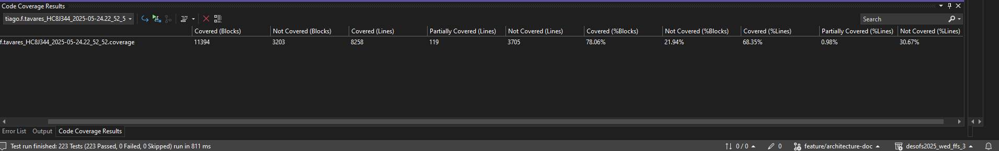

A combinação do xUnit e NSubstitute, junto com a abordagem estruturada seguindo o padrão AAA, resultou em um conjunto de testes robustos e eficazes que contribuíram significativamente para a manutenção e evolução segura da solução AMAP.

---

## Validação de Configurações e Verificação de Artefactos

Ao longo deste sprint, foram implementadas várias medidas para garantir que a aplicação mantém um nível elevado de segurança e rastreabilidade, desde a configuração até aos artefactos gerados.

### Validação de Configurações

Foram aplicadas boas práticas de segurança na configuração do ambiente, nomeadamente:

- **Hardening** do framework **.NET**;
- Configuração segura do **ASP.NET Core Identity**;
- Políticas de **CORS** restritivas para limitar o acesso apenas a origens confiáveis;
- Definição de **cookies seguros** em ambiente de produção;
- Ativação obrigatória do **HTTPS**.

Além disso, foi feita uma gestão segura das configurações sensíveis:

- Utilização de **GitHub Secrets** para armazenamento de credenciais;
- Separação clara entre configurações de **desenvolvimento** e **produção**;
- Validação automática das configurações críticas diretamente na pipeline.

### Verificação Automatizada

Para reforçar a segurança, foram integradas ferramentas de verificação automática:

- **SonarCloud** para validação de configurações de segurança e deteção de más práticas;
- **Snyk** para verificação de políticas de segurança e dependências vulneráveis;
- **OWASP Dependency Check** para análise detalhada de bibliotecas e pacotes utilizados.

### Verificação de Artefactos

A verificação dos artefactos gerados também foi tida em conta:

- Geração de **relatórios de cobertura de código**;
- Produção de relatórios de **análise de segurança** com SonarCloud, Snyk e OWASP;
- Registo e preservação dos **logs de build e deploy**.

**Cadeia de Custódia:**

Para garantir a integridade e rastreabilidade do processo, foram implementados:

- Registo automático de todas as etapas da pipeline via **GitHub Actions**;
- **Logs detalhados** de cada fase do ciclo de build e deploy;
- Rastreabilidade total de alterações através dos **commits**.

**Análise de Artefactos de Build:**

- Verificação das **imagens Docker** geradas;
- Validação dos **pacotes NuGet** utilizados no projeto;
- Análise de dependências e potenciais vulnerabilidades.

**Artefactos Gerados e Disponibilizados:**

Os seguintes artefactos são gerados e disponibilizados após cada execução da pipeline:

- Relatórios de cobertura de código em formato **HTML**;
- Relatórios de segurança consolidados;
- Logs completos de execução da pipeline;
- **Imagens Docker** assinadas e versionadas.

Estas práticas já se encontram integradas na nossa pipeline CI/CD e contribuem de forma significativa para a segurança, transparência e confiança no processo de entrega contínua.

---

# Automação da Pipeline DevSecOps

## Pipeline de CI/CD com GitHub Actions

Este documento descreve a pipeline de Integração Contínua e Implantação Contínua (CI/CD) configurada utilizando o GitHub Actions para o projeto AMAP. A pipeline automatiza os processos de construção, teste e implantação da aplicação sempre que há novas alterações no código. A pipeline é definida no ficheiro `.github/workflows/main.yml`.

## Visão Geral da Pipeline

A pipeline de CI/CD foi projetada para garantir qualidade, segurança e confiabilidade do código, seguindo as melhores práticas de desenvolvimento. A pipeline é executada automaticamente em cada push para qualquer branch, com etapas adicionais de implantação sendo executadas apenas na branch `main`.

## Fluxo da Pipeline

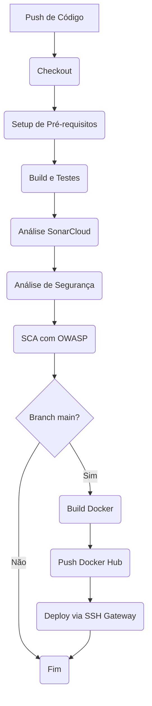

## Tecnologias Utilizadas e Justificações

1. **GitHub Actions**
   - Plataforma nativa do GitHub para CI/CD
   - Integração perfeita com o repositório
   - Suporte a containers e runners auto-hospedados
   - Marketplace rico em ações pré-configuradas

2. **.NET 9.0**
   - Framework moderna
   - Suporte a containers nativo
   - Ferramentas para testes e cobertura de código

3. **Docker**
   - Containerização para garantir consistência entre ambientes
   - Multi-stage builds para otimizar tamanho da imagem
   - Facilidade de deploy em diferentes ambientes

4. **SonarCloud**
   - Análise contínua da qualidade do código
   - Detecção de bugs e vulnerabilidades
   - Métricas de cobertura de código
   - Integração nativa com GitHub

5. **Snyk**
   - Análise de vulnerabilidades nas dependências
   - Monitorização contínua de segurança
   - Integração com Docker para análise de imagens

6. **Docker Hub**
   - Registo de containers confiável
   - Integração com GitHub Actions
   - Suporte a autenticação segura

7. **SSH Gateway**
   - Acesso seguro ao ambiente de staging
   - Suporte a autenticação por chave
   - Configuração flexível para diferentes ambientes

---

## Fases da Pipeline

A pipeline é dividida nas seguintes fases principais, executadas sequencialmente:

### 1. Checkout do Código

Esta é a primeira fase, onde o código mais recente do repositório é clonado para o ambiente do runner.

*   **Objetivo:** Obter a versão mais recente do código-fonte para as etapas subsequentes da pipeline.
*   **Passos:**
    1.  Utilização da ação `actions/checkout@v3` para clonar o repositório.
*   **Visualização:**
    
    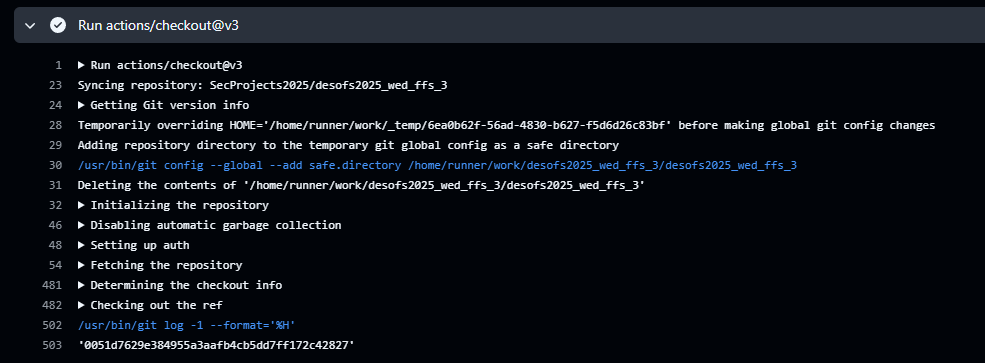

### 2. Setup de Pré-requisitos

Esta fase garante que o ambiente de execução do GitHub Actions runner esteja pronto para construir e testar a aplicação, instalando as ferramentas necessárias.

*   **Objetivo:** Instalar as ferramentas necessárias, como o .NET SDK e o ReportGenerator.
*   **Passos:**
    1.  Instalação do .NET SDK na versão especificada (`${{ env.DOTNET_VERSION }}`) utilizando `actions/setup-dotnet@v3`.
    2.  Instalação global da ferramenta ReportGenerator (`dotnet tool install -g dotnet-reportgenerator-globaltool`) para processar relatórios de cobertura de código.
*   **Visualização:**
    
    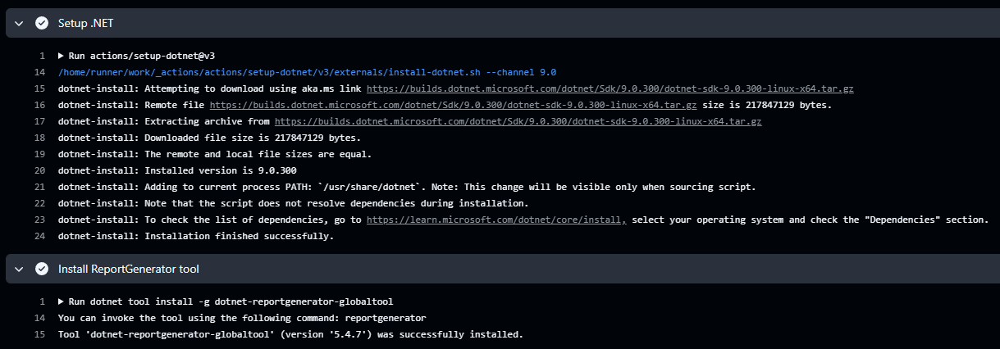

### 3. Build, Teste e Análise com SonarCloud

Esta fase é responsável por compilar o código, executar os testes unitários com cobertura de código e realizar análises de qualidade e segurança estática com SonarCloud.

*   **Objetivo:** Verificar a integridade e qualidade do código, garantindo que as funcionalidades existentes não foram quebradas pelos testes e realizar a análise estática com o SonarCloud.

#### 3.1 Restauração e ‘Build’

Esta subfase foca na preparação do projeto, restaurando dependências e compilando o código.

*   **Objetivo:** Garantir que todas as dependências do projeto estão disponíveis e que o código fonte pode ser compilado com sucesso.
*   **Passos:**
    1.  Restauração das dependências do projeto (`dotnet restore AMAP/AMAP.sln`).
    2.  Construção do projeto (`dotnet build AMAP/AMAP.sln --no-restore`).
*   **Visualização:**

    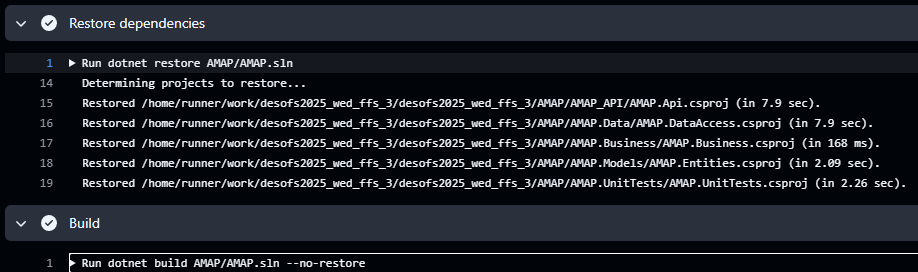

    

#### 3.2 Testes Unitários

Nesta subfase, os testes unitários são executados e a cobertura de código é reportada.

*   **Objetivo:** Verificar se as funcionalidades individuais da aplicação funcionam como esperado e medir a percentagem de código coberto pelos testes.
*   **Passos:**
    
    1.  Execução dos testes unitários com coleta de cobertura de código (`dotnet test AMAP/AMAP.sln --no-build --collect:"XPlat Code Coverage"`).
    2.  Geração do relatório de cobertura no formato OpenCover (`reportgenerator`).
*   **Visualização:**

    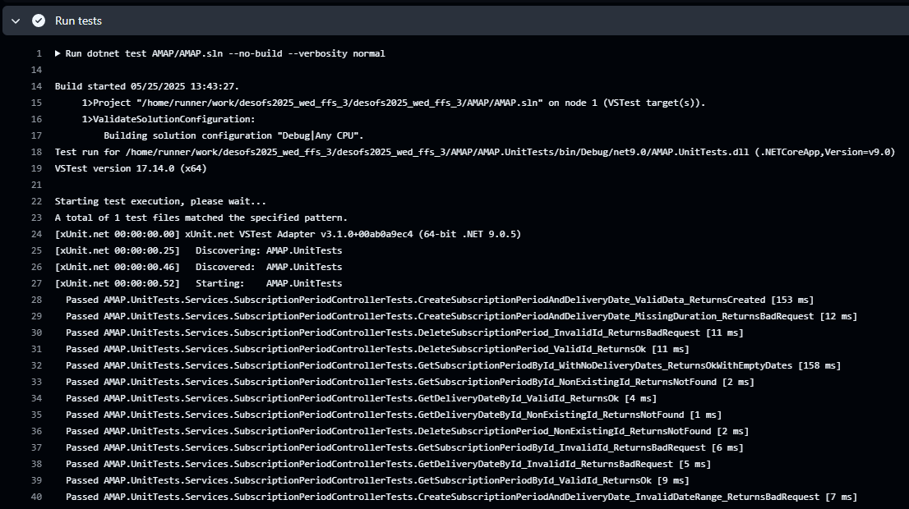
    

#### 3.3 Análise com SonarCloud

Esta subfase integra o SonarCloud para realizar a análise estática do código.

*   **Objetivo:** Identificar e reportar bugs, code smells, vulnerabilidades e hotspots de segurança no código.
*   **Passos:**
    1.  Configuração e execução da análise do SonarCloud para análise de código, cobertura e segurança.
*   **Visualização:**
    
    
    
    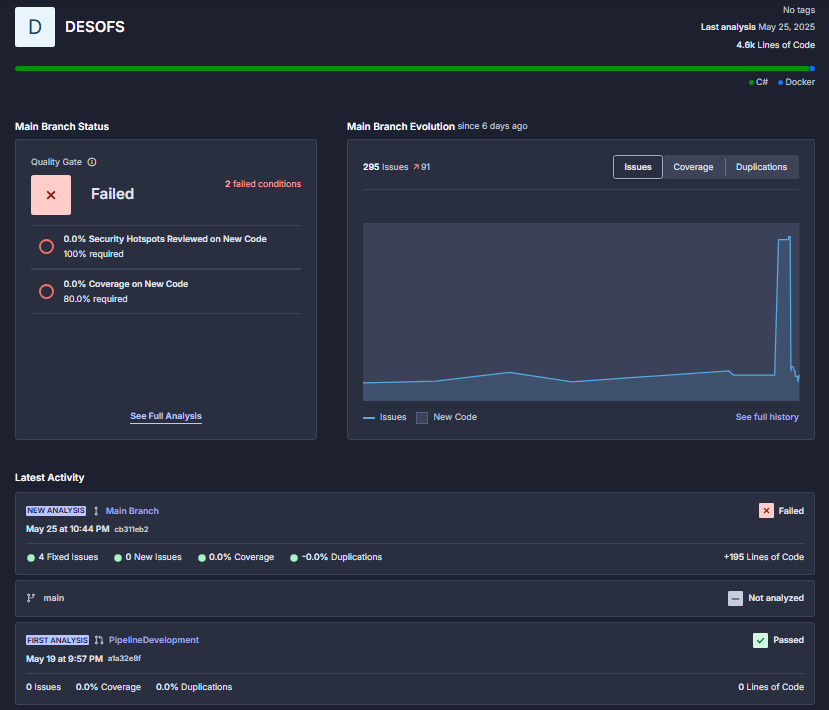
    
    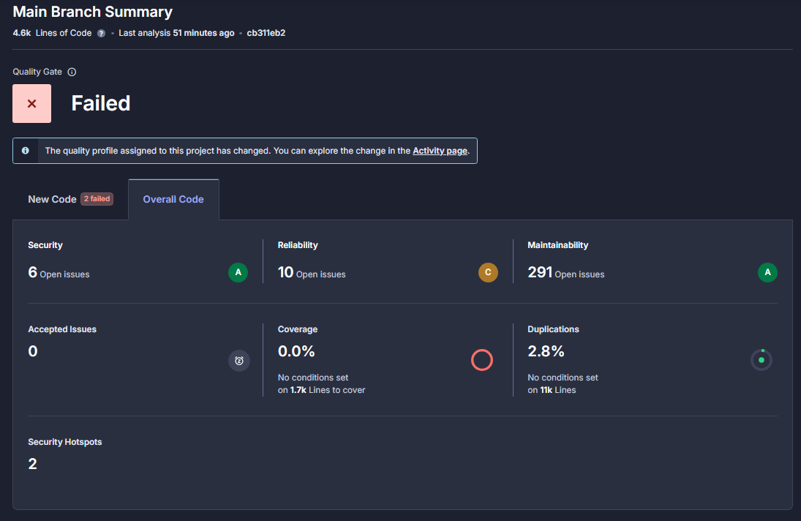

### 4. Análise de Segurança com Snyk

Esta fase executa a análise de segurança do código e das dependências utilizando o Snyk, verificando vulnerabilidades conhecidas.

*   **Objetivo:** Identificar vulnerabilidades conhecidas no código e nas bibliotecas utilizadas.
*   **Passos:**
    1.  Instalação do Snyk CLI (se necessário).
    2.  Execução da análise do Snyk no projeto (por exemplo, `snyk test`).
*   **Visualização:**

    
    
    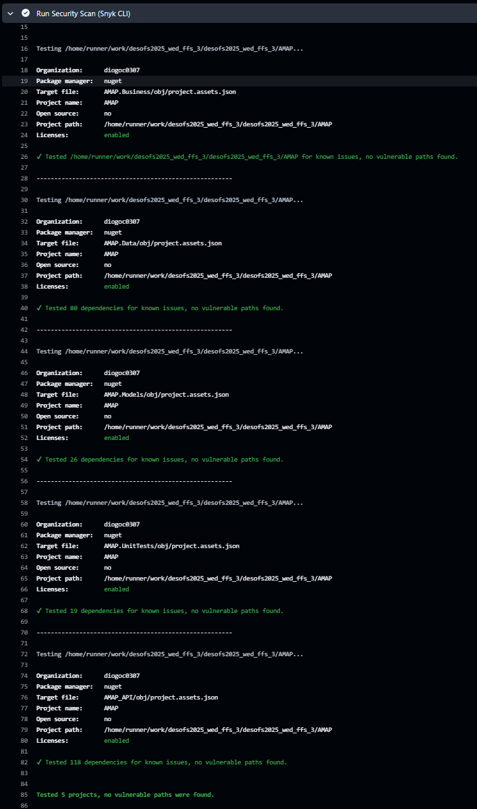

### 5. Análise de Dependências (SCA) com OWASP Dependency Check

Esta fase utiliza o OWASP Dependency Check para analisar as dependências do projeto na tentativa de encontrar vulnerabilidades conhecidas.

*   **Objetivo:** Identificar componentes de ‘software’ com vulnerabilidades de segurança conhecidas e gerar relatórios detalhados.
*   **Passos:**
    1.  Execução da ação `dependency-check/Dependency-Check_Action` no projeto.
    2.  Geração de relatórios com as vulnerabilidades encontradas.
*   **Visualização:**

    

### 6. Construção da Imagem Docker

Nesta fase, a aplicação é empacotada numa imagem Docker, pronta para ser executada em qualquer ambiente com Docker.

*   **Objetivo:** Criar um container leve e portátil contendo a aplicação pronta para ser executada em qualquer ambiente com Docker.
*   **Passos:**
    1.  Configuração do ambiente Docker buildx.
    2.  Construção da imagem Docker usando o `Dockerfile`.

### 7. Push da Imagem Docker (Apenas na main branch)

Esta fase envia a imagem Docker construída para um registro de containers (Docker Hub), disponibilizando-a para implantação.

*   **Objetivo:** Disponibilizar a imagem Docker para ser utilizada em ambientes de implantação (como o staging).
*   **Pré-requisitos:** Configuração dos segredos `DOCKERHUB_USERNAME` e `DOCKERHUB_TOKEN` no GitHub.
*   **Passos:**
    1.  Login no Docker Hub.
    2.  Push da imagem Docker para o repositório configurado.
*   **Visualização:**

    
    
    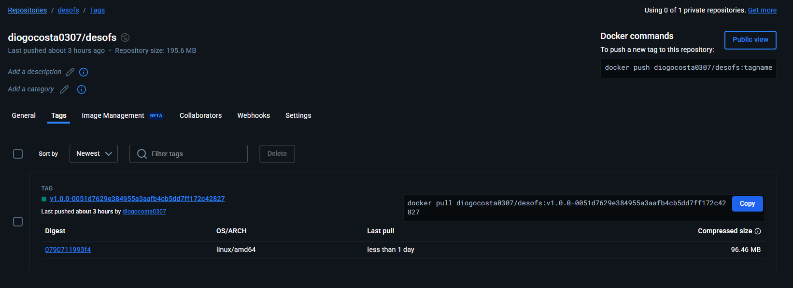

### 8. Implantação no Ambiente de Staging (Apenas na main branch)

Esta fase implanta a nova versão da aplicação no ambiente de staging, atualizando a aplicação rodando na máquina virtual de destino.

*   **Objetivo:** Atualizar a aplicação no ambiente de staging para testes e validação antes de uma possível implantação em produção.
*   **Pré-requisitos:** Configuração de acesso SSH à VM de staging via gateway, incluindo os segredos `SSH_PRIVATE_KEY`, `SSH_KNOWN_HOSTS`, `SSH_PASSPHRASE`, `VM_HOST`, `VM_PORT`, `VM_USER`, `VM_GATEWAY_HOST`, `VM_GATEWAY_PORT`, `VM_GATEWAY_USER`. O Docker e Docker Compose devem estar instalados na VM.
*   **Passos:**
    1.  Configuração do agente SSH para permitir a conexão segura.
    2.  Cópia do arquivo `docker-compose-staging.yml` para a VM via SCP, utilizando o gateway SSH.
    3.  Execução de comandos remotos na VM via SSH (utilizando o gateway) para:
        *   Navegar até o diretório da aplicação.
        *   Fazer pull da nova imagem Docker.
        *   Parar os containers Docker em execução (`docker compose down`).
        *   Iniciar os novos containers com a nova imagem (`docker compose up -d`).
    4.  Output do URL de acesso ao ambiente de staging (local da VM, acessível via rede ISEP/VPN).
*   **Visualização:**

    
    
    

## Gestão de Dependências

### Análise e Instalação

1. **Verificação de Dependências**
   - Análise automática de pacotes NuGet
   - Verificação de versões compatíveis
   - Detecção de conflitos de dependências

2. **Instalação Segura**
   - Restauração de pacotes via `dotnet restore`
   - Verificação da integridade dos pacotes
   - Cache das dependências para builds mais rápidas

3. **Monitorização de Segurança**
   - Integração com Snyk para análise de vulnerabilidades
   - Verificação de licenças de pacotes
   - Alertas automáticos para dependências desatualizadas

---

## Análise de Segurança

O Snyk é integrado à pipeline para fornecer uma camada adicional de segurança, focando na análise de código e containers:

1. **Análise de Código (SAST - Static Application Security Testing)**
   - Detecção de problemas de segurança
   - Verificação de boas práticas
   - Sugestões de correção

3. **Análise de Containers**
   - Verificação de vulnerabilidades em imagens base
   - Recomendações de atualizações
   - Monitorização de camadas Docker

## Relatórios Gerados

A pipeline gera diversos relatórios para análise:

1. **Relatórios de Testes**
   - Resultados de testes unitários
   - Cobertura de código
   - Tempo de execução dos testes
2. **Relatórios de Qualidade**
   - Métricas do SonarCloud
   - Code smells e bugs
   - Duplicação de código
   - Complexidade ciclomática
3. **Relatórios de Segurança**
   - Vulnerabilidades do Snyk (código e containers)
   - Hotspots de segurança do SonarCloud
   - Dependências desatualizadas
   - **Vulnerabilidades de Dependências (OWASP Dependency Check)**
4. **Relatórios de Build**
   - Logs de compilação
   - Tempo de build
   - Uso de recursos
5. **Relatórios de Deploy**
   - Status da implantação
   - Logs de containers
   - Métricas de performance
6. **Relatórios de Cobertura**
   - Relatórios HTML de cobertura de código
   - Disponibilizados como artefatos do GitHub Actions
   - Acessíveis através da interface do GitHub Actions

### Exemplos de Relatórios

- [dependency-check-report.html](dependency-check-report.html)
- [coverage-report.html](coverage-report.html)

## Configuração de Segredos

Para que a pipeline funcione corretamente, diversos segredos precisam de ser configurados no repositório do GitHub. Estes incluem credenciais para o Docker Hub e acesso SSH à máquina virtual de staging.

*   `DOCKERHUB_USERNAME`: O nome de utilizador no Docker Hub.
*   `DOCKERHUB_TOKEN`: Um Personal Access Token do Docker Hub com permissões de push.
*   `SSH_PRIVATE_KEY`: A chave privada SSH para autenticação na VM de staging.
*   `SSH_KNOWN_HOSTS`: A host key da VM de staging para verificar a autenticidade do servidor.
*   `SSH_PASSPHRASE`: A senha da chave privada SSH.
*   `SONAR_TOKEN`: Token de autenticação para o SonarCloud
*   `SNYK_TOKEN`: Token de autenticação para o Snyk
*   `VM_HOST`: O hostname ou endereço IP da VM de staging (resolvível dentro da rede ISEP/VPN).
*   `VM_PORT`: A porta SSH da VM de staging.
*   `VM_USER`: O utilizador SSH para login na VM de staging.
*   `VM_GATEWAY_HOST`: O hostname ou endereço IP do servidor gateway SSH.
*   `VM_GATEWAY_PORT`: A porta SSH do servidor gateway.
*   `VM_GATEWAY_USER`: O utilizador SSH para login no servidor gateway.

---

# Avaliação com OWASP ASVS

## Implementação e Progresso

O projeto **AMAP** avançou significativamente na aplicação do **ASVS**, com enfoque nas seguintes categorias:

### Arquitetura, Design e Modelação de Ameaças

- Implementação de pipeline CI/CD com validações de segurança;
- Análise estática de código;
- Validação de configurações seguras.

**Requisitos pendentes:**

- Política de gestão de chaves segundo o NIST SP 800-57;
- Uso de key vaults e APIs seguras para proteção de segredos;
- Processo definido para substituição de chaves e re-encriptação de dados;
- Logging consistente e envio seguro para sistemas remotos;
- Validação automática de *deployments* cloud na pipeline.

### Autenticação e Gestão de Sessão

- Autenticação segura;
- Gestão de tokens;
- Proteção contra ataques comuns.

**Requisitos pendentes:**

- Encerramento de sessões após alteração de palavra-passe;
- Gestão e revogação de sessões ativas;
- Cookies com `__Host-` e configuração precisa do atributo `path`;
- Revogação de tokens OAuth;
- Gestão de sessões em CSPs e RPs.

### Controlo de Acesso

- Validação de permissões;
- Princípio do menor privilégio;
- Verificação de autorizações.

**Requisitos pendentes:**

- MFA em interfaces administrativas;
- Autorização adicional conforme o risco da aplicação.

### Criptografia de Dados Armazenados

- Encriptação de dados sensíveis;
- Algoritmos e gestão de chaves seguras.

**Requisitos pendentes:**

- Encriptação de dados regulados (PII, saúde, financeiros);
- Configuração segura de algoritmos e entropia;
- Prevenção de reutilização de nonces/IVs;
- Validação da integridade dos dados encriptados;
- Operações criptográficas em tempo constante.

### Outras Categorias

Embora com menor abrangência, foram também implementadas medidas de segurança relacionadas com outras categorias do ASVS, contribuindo para a melhoria global da robustez da aplicação.

## Rastreabilidade

A rastreabilidade foi garantida através de:

- Relatórios de cobertura;
- Análises estáticas automatizadas;

Para mais detalhe, está disponível uma **checklist ASVS em Excel**, com os requisitos avaliados e o respetivo estado de conformidade.

---

# Conclusão e Próximos Passos

Durante este sprint, foi implementada com sucesso uma pipeline **CI/CD** robusta para a solução **AMAP**, estabelecendo uma base sólida para um desenvolvimento contínuo e seguro. A automatização de todo o processo — desde o *build* até ao *deploy* — tem permitido entregas mais rápidas e fiáveis, ao mesmo tempo que mantemos elevados padrões de qualidade com o apoio de ferramentas como o **SonarCloud**, **Snyk** e **OWASP Dependency Check**.

Para o próximo sprint, o foco será reforçar a segurança da aplicação e avançar na implementação dos controlos definidos no **ASVS**. Apesar de já terem sido aplicadas várias medidas de segurança, reconhecemos que este é um processo contínuo e em constante evolução.

Plano de Ação:

- Mitigação de vulnerabilidades já identificadas  
- Reforço da proteção de dados através de mecanismos de encriptação  
- Integração de mais testes de segurança automatizados  
- Expansão da cobertura do ASVS

Estas iniciativas têm como objetivo não só reforçar a segurança da solução, como também promover uma cultura de segurança mais sólida no grupo. Com as práticas já implementadas e as melhorias planeadas, estamos confiantes de que conseguiremos alcançar um elevado nível de segurança e qualidade no desenvolvimento da solução.

---

# Referências

1. GitHub. (s.d.). *Documentação do GitHub Actions*. Disponível em: https://docs.github.com/actions
2. SonarCloud. (s.d.). *Documentação do SonarCloud*. Disponível em: https://docs.sonarcloud.io/
3. OWASP Foundation. (s.d.). *OWASP Dependency Check*. Disponível em: https://owasp.org/www-project-dependency-check/
4. Microsoft. (s.d.). *Documentação de Segurança do .NET*. Disponível em: https://learn.microsoft.com/pt-pt/dotnet/standard/security/
5. Check Point Software Technologies. (s.d.). [O que é SAST (Static Application Security Testing)](https://www.checkpoint.com/pt/cyber-hub/cloud-security/what-is-static-application-security-testing-sast/).
6. Check Point Software Technologies. (s.d.). [O que é DAST (Dynamic Application Security Testing)](https://www.checkpoint.com/pt/cyber-hub/cloud-security/what-is-dynamic-application-security-testing-dast/).
7. OWASP. (s.d.). [IAST – Interactive Application Security Testing](https://owasp.org/www-project-devsecops-guideline/latest/02c-Interactive-Application-Security-Testing).
8. Check Point Software Technologies. (s.d.). [O que é SCA (Software Composition Analysis)](https://www.checkpoint.com/pt/cyber-hub/cloud-security/what-is-software-composition-analysis-sca/).
9. Snyk. (s.d.). [Site oficial do Snyk](https://snyk.io/).
10. Check Point Software Technologies. (s.d.). [O que é uma DevSecOps Pipeline](https://www.checkpoint.com/pt/cyber-hub/cloud-security/devsecops/what-is-a-devsecops-pipeline/).
11. GitHub. (s.d.). [Utilização de Segredos no GitHub Actions](https://docs.github.com/en/actions/security-for-github-actions/security-guides/using-secrets-in-github-actions).
12. Microsoft. (s.d.). [Comando dotnet list package](https://learn.microsoft.com/en-us/dotnet/core/tools/dotnet-package-list).
13. OWASP Foundation. (2021). *OWASP Application Security Verification Standard (ASVS) 4.0*. Disponível em: [https://owasp.org/www-project-application-security-verification-standard/](https://owasp.org/www-project-application-security-verification-standard/)
14. OWASP Foundation. (2021). *OWASP Top 10: The Ten Most Critical Web Application Security Risks*. Disponível em: [https://owasp.org/www-project-top-ten/](https://owasp.org/www-project-top-ten/)
15. Microsoft. (2022). *Security Development Lifecycle (SDL)*. Disponível em: [https://www.microsoft.com/en-us/securityengineering/sdl](https://www.microsoft.com/en-us/securityengineering/sdl)
16. OWASP Foundation. (s.d.). *Threat Modeling Process*. Disponível em: [https://owasp.org/www-community/Threat_Modeling_Process](https://owasp.org/www-community/Threat_Modeling_Process)
17. OWASP Foundation. (s.d.). *Free for Open Source Application Security Tools*. Disponível em: [https://owasp.org/www-community/Free_for_Open_Source_Application_Security_Tools](https://owasp.org/www-community/Free_for_Open_Source_Application_Security_Tools)
18. TechTarget. (s.d.). *Data Flow Diagram (DFD)*. Disponível em: [https://www.techtarget.com/searchdatamanagement/definition/data-flow-diagram-DFD](https://www.techtarget.com/searchdatamanagement/definition/data-flow-diagram-DFD)
19. OWASP Foundation. (s.d.). *Abuse Case Cheat Sheet*. Disponível em: [https://cheatsheetseries.owasp.org/cheatsheets/Abuse_Case_Cheat_Sheet.html](https://cheatsheetseries.owasp.org/cheatsheets/Abuse_Case_Cheat_Sheet.html)
20. Documentos de apoio disponibilizados no Moodle da unidade curricular **Desenvolvimento de Software Seguro** (ISEP, 2024/2025).
