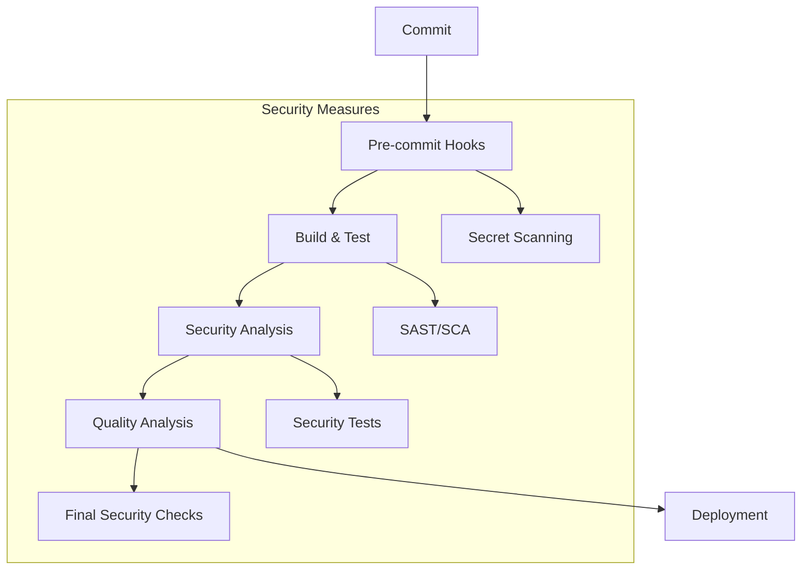

> # Desenvolvimento e Testes - Sistema AMAP (Fase 2 - Sprint 1)

|  |  |
|:------------------------------------:|:----------------------------------------:|

**Desenvolvimento de Software Seguros**  
**Mestrado em Engenharia Informática - 2024/2025 **  

**Professores:** 
Paulo Baltarejo de Sousa (T),
Joana Santos (PL),
Cláudio Maia (TP)

**Autores: **
Diana Marques 1240445, 
Diogo Costa 1211514, 
Pedro Costa 1211439, 
Pedro Vilarinho 1211149, 
Tiago Tavares 1240494

**Porto, 2025-05-25**

---

## 0. Índice

[TOC]

---

## 1. Introdução

- Contextualização do projeto no âmbito do desenvolvimento de software seguro  
- Objetivos específicos do Sprint 1 e sua relação com a modelação de ameaças da Fase 1  
- Metodologia DevSecOps adotada e justificação  
- Métricas de sucesso definidas para este sprint  

---

## 2. Desenvolvimento Seguro

### 2.1 Funcionalidade Desenvolvida

Na fase 1 foram identificadas varias ameacas em que selecionamos 15 prioritarias para desenvolcer codigo de forma a mitigar essas amecas.

#### 3. Negação de ações administrativas realizadas (4.1 R) - 8.0 ALTO

*Mitigação Implementada:* *Rastreabilidade de Ações* 
Esta mitigação visa criar um registo detalhado e inalterável de todas as ações administrativas realizadas no sistema, permitindo verificar quem fez o quê e quando, evitando assim a negação de responsabilidade por ações realizadas.

*Situação Inicial*
Inicialmente, a aplicação AMAP não possuía um sistema robusto para rastrear ações realizadas por utilizadores, especialmente utilizadores administrativos. Os logs eram básicos e não capturavam detalhes suficientes sobre as operações, dificultando a atribuição de responsabilidade por ações realizadas no sistema.

*Ações Realizadas* 
Foi implementado um sistema abrangente de logging utilizando o mecanismo ILogger da Microsoft, que regista detalhadamente todas as ações administrativas em todos os componentes de negócio. O sistema atual captura:
1.	Quem realizou a ação (ID e tipo do utilizador)
2.	Qual ação foi realizada (criação, modificação, exclusão)
3.	Sobre quais dados a ação foi realizada (IDs e informações relevantes)
4.	Quando a ação foi realizada (timestamp preciso)
5.	Resultado da ação (sucesso ou falha, com motivo detalhado)

*Exemplo de Código (AMAP.Business/Components/ProductBc.cs)*

```c#
public void DeleteProduct(int id, string producerId)
{
    if (id <= 0)
        throw new ArgumentException("Invalid product id.", nameof(id));

    if (string.IsNullOrEmpty(producerId))
        throw new ArgumentException("Producer not authenticated.", nameof(producerId));

    var product = _unitOfWork.Product.Get(p => p.Id == id && p.ProducerId == producerId && !p.IsDeleted);

    if (product == null)
        throw new KeyNotFoundException("Product not found or you are not authorized to delete it.");

    // Log de deleção de produto sensível
    _logger.LogInformation("Product deletion initiated - ID: {ProductId}, Name: {ProductName}, Producer: {ProducerId} at {Time}",
        product.Id, product.Name, producerId, DateTime.UtcNow);

    var compositesToDelete = _unitOfWork.Composite.GetAll(c => c.ProductId == id);
    if (compositesToDelete.Any())
    {
        _unitOfWork.Composite.RemoveRange(compositesToDelete);
        _unitOfWork.Save();
    }

    product.IsDeleted = true;
    _unitOfWork.Product.Update(product);
    _unitOfWork.Save();

    // Log após deleção concluída
    _logger.LogInformation("Product marked as deleted - ID: {ProductId}, Producer: {ProducerId} at {Time}",
        id, producerId, DateTime.UtcNow);
}
```

A implementação inclui logs estratégicos nos pontos de entrada e saída de operações críticas, especialmente aquelas que envolvem modificações importantes no sistema. Os logs são armazenados em arquivos estruturados, incluindo timestamps precisos, e são protegidos contra modificação não autorizada.

A configuração do sistema de logs foi realizada no Program.cs:

```c#
// Configure logging
builder.Logging.ClearProviders();
builder.Logging.AddConsole();
builder.Logging.AddDebug();
builder.Logging.AddEventSourceLogger();

// Configure logging levels
builder.Logging.AddFilter("Microsoft", LogLevel.Warning);
builder.Logging.AddFilter("System", LogLevel.Warning);
builder.Logging.AddFilter("AMAP.Api.Controllers.AccountController", LogLevel.Information);
builder.Logging.AddFilter("AMAP.Business.Components", LogLevel.Information);
```

*Mitigação Implementada:* *Relatórios automáticos (baseados nas ações realizadas)*
Esta mitigação proporciona a geração sistemática de relatórios que consolidam e apresentam as ações administrativas realizadas no sistema, facilitando a supervisão e criando registos formais de atividades que podem ser revisados por auditoria.

*Situação Inicial* 
A aplicação AMAP não possuía um mecanismo para gerar relatórios consolidados de ações administrativas. Embora existissem logs, não havia uma forma estruturada de extrair, organizar e apresentar essas informações em formato de relatório para análise e auditoria.

*Ações Realizadas* 
Foi implementado um sistema de geração de relatórios que utiliza os logs detalhados para criar documentos estruturados sobre ações administrativas. O sistema:
1.	Extrai dados dos logs sobre ações administrativas
2.	Organiza as informações por tipo de ação, utilizador, e período de tempo
3.	Gera relatórios em formato textual estruturado que podem ser exportados
4.	Mantém um histórico de relatórios gerados para consulta futura

*Exemplo de Código (AMAP.Business/Components/ProductBc.cs)*

```c#
public (byte[] FileContent, string FileName, string ContentType) ExportProductsToFile(string producerId, string contentRootPath)
{
    if (string.IsNullOrEmpty(producerId))
        throw new ArgumentException("Producer ID cannot be empty.", nameof(producerId));

    var producer = _unitOfWork.AppUser.Get(p => p.Id == producerId);
    if (producer == null)
        throw new KeyNotFoundException("Producer not found.");

    // Log tentativa de exportação
    _logger.LogInformation("Product export initiated - Producer: {ProducerId}, ProducerName: {ProducerName} at {Time}",
        producerId, producer.Name, DateTime.UtcNow);

    var products = _unitOfWork.Product.GetAll(p => p.ProducerId == producerId && !p.IsDeleted).ToList();

    if (products == null || !products.Any())
        throw new InvalidOperationException("No products found to export.");

    // Create CSV content with ; separator
    var sb = new StringBuilder();
    sb.AppendLine("Name;Description;Photo;ReferencePrice;DeliveryUnits");

    foreach (var product in products)
    {
        sb.AppendLine($"{EscapeTxt(product.Name)};{EscapeTxt(product.Description)};{product.Photo};{product.ReferencePrice.ToString(CultureInfo.InvariantCulture)};{product.DeliveryUnits}");
    }

    // Clean producer name for filename
    var rawName = string.IsNullOrWhiteSpace(producer.Name) ? "unknown" : producer.Name;
    var cleanName = RemoveInvalidFileNameChars(rawName.Replace(" ", "_"));

    var fileName = $"products_{cleanName}.txt";
    var contentType = "text/plain";
    var fileBytes = Encoding.UTF8.GetBytes(sb.ToString());

    // Save file to folder
    var exportPath = Path.Combine(contentRootPath, "ExportedProducts");
    Directory.CreateDirectory(exportPath);
    var fullPath = Path.Combine(exportPath, fileName);
    File.WriteAllBytes(fullPath, fileBytes);

    // Log sucesso na exportação
    _logger.LogInformation("Product export completed - Producer: {ProducerId}, ProductCount: {Count}, FileName: {FileName} at {Time}",
        producerId, products.Count, fileName, DateTime.UtcNow);

    return (fileBytes, fileName, contentType);
}
```

Os relatórios gerados capturam todas as ações administrativas importantes, incluindo:
•	Criação, atualização e exclusão de produtos
•	Alterações em ofertas de produtos
•	Gestão de utilizadores e alteração de papéis/permissões
•	Alterações de senhas e dados de autenticação
•	Operações relacionadas com pagamentos

Estes relatórios fornecem uma trilha clara de auditoria que torna impossível a negação de ações administrativas realizadas, pois cada ação é documentada com detalhes suficientes para identificar quem a realizou, quando, e o que foi feito.
A implementação destas mitigações garante que todas as ações administrativas realizadas no sistema AMAP são devidamente registadas e podem ser auditadas, reduzindo significativamente o risco de negação de responsabilidade por ações realizadas.

#### 8. Modificação das credenciais ou tokens durante a transmissão (2.1 T) - 8.0 ALTO

**Mitigação Implementada:** **HTTPS obrigatório**

Esta mitigação visa garantir que todas as comunicações entre o cliente (navegador, aplicação frontend) e a API sejam encriptadas. Ao forçar o uso de HTTPS, evita-se que dados sensíveis, como credenciais e tokens de autenticação, sejam intercetados por atacantes durante a sua transmissão na rede.

**Implementação:** Inicialmente, a aplicação **AMAP** não possuía qualquer mecanismo para forçar o uso de HTTPS, deixando as comunicações vulneráveis a ataques de interceção e modificação.  

**Situação Inicial** 
Inicialmente, a aplicação **AMAP** já utilizava o middleware `UseHttpsRedirection()` para redirecionar requisições HTTP para HTTPS. No entanto, faltava uma política mais robusta para garantir que as conexões futuras fossem sempre seguras e prevenir ataques de *downgrade* de protocolo.

**Ações Realizadas** 
Para reforçar a mitigação da ameaça de modificação durante a transmissão e assegurar que os clientes priorizam sempre conexões seguras, foi adicionado o middleware `UseHsts()` (*HTTP Strict Transport Security*) ao pipeline de requisições. 
Este middleware instrui os navegadores compatíveis a estabelecerem sempre ligações seguras com a aplicação no futuro, mesmo quando o utilizador tenta aceder via HTTP ou através de um link não seguro.

**Exemplo de Código (`AMAP_API/Program.cs`)**
A configuração dos middlewares no pipeline de requisição foi atualizada da seguinte forma:

```c#
// Configure the HTTP request pipeline.
if (app.Environment.IsDevelopment())
{
    app.UseSwagger();
    app.UseSwaggerUI();
}
app.UseCors("AllowFrontend");
app.UseHttpsRedirection();
app.UseHsts(); // <-- Linha adicionada

app.UseAuthentication();
```

**Mitigação Implementada: Configuração segura de cookies de autenticação**

Esta mitigação centra-se na proteção do cookie de sessão, que atua como o token de autenticação na abordagem baseada em cookies utilizada pela aplicação **AMAP**. 
Proteger o cookie durante a transmissão e contra acessos não autorizados no cliente é essencial para prevenir o roubo de sessão e outros ataques.

**Situação em ASP.NET Core (Autenticação por Cookies) **
A aplicação **AMAP** utiliza autenticação baseada em cookies provida pelo **ASP.NET Core Identity**. 
A segurança do cookie de sessão é configurada através do serviço `ConfigureApplicationCookie`.

**Ações Realizadas**
A configuração existente na aplicação já inclui medidas importantes para proteger o cookie de autenticação, especialmente em ambientes de produção:

- `HttpOnly = true`: O cookie é configurado com a flag `HttpOnly`, prevenindo que scripts no lado do cliente (como JavaScript) acedam ao valor do cookie. Esta é uma defesa eficaz contra ataques de *Cross-Site Scripting* (XSS) que visam roubar cookies de sessão.

- `SecurePolicy = CookieSecurePolicy.Always` (em produção): Em ambientes de produção, o cookie é configurado com `SecurePolicy.Always`, garantindo que seja enviado pelo navegador apenas através de conexões HTTPS. Combinado com o redirecionamento obrigatório para HTTPS, assegura-se que o cookie nunca seja transmitido em texto claro.

- `SameSite = SameSiteMode.Strict` (em produção): Em ambientes de produção, o atributo `SameSite` é definido como `Strict`. Isto instrui o navegador a enviar o cookie apenas em requisições originadas do mesmo site, fornecendo uma forte mitigação contra ataques de *Cross-Site Request Forgery* (CSRF).

**Exemplo de Código (`AMAP_API/Program.cs`) **
As configurações de segurança para o cookie de autenticação estão presentes no ficheiro `Program.cs`:

```c#
// Configurao do cookie de autenticao
builder.Services.ConfigureApplicationCookie(options =>
{
    options.LoginPath = "/api/account/login";
    options.LogoutPath = "/api/account/logout";
    options.SlidingExpiration = true;
    
    options.Cookie.HttpOnly = true; // <-- Configurado 
    options.Cookie.IsEssential = true;
    
	if (builder.Environment.IsDevelopment())
	{
    	options.Cookie.SecurePolicy = CookieSecurePolicy.None; // Permitir HTTP
    	options.Cookie.SameSite = SameSiteMode.None; // Permitir cross-origin
	}
	else
	{
    	options.Cookie.SecurePolicy = CookieSecurePolicy.Always; // Apenas HTTPS // <-- Configurado para produção
    	options.Cookie.SameSite = SameSiteMode.Strict; // Mais seguro // <-- Configurado para produção
	}

	options.Events.OnRedirectToLogin = context =>
	{
    	context.Response.StatusCode = 401;
    	return Task.CompletedTask;
	};
});
```
#### 10. Interceção de credenciais durante a transmissão (2.1 I) - 7.8 ALTO

**Mitigação Implementada: Expiração rápida de credenciais temporárias**

Esta mitigação tem como objetivo **limitar a validade temporal de credenciais temporárias** geradas para usos pontuais e específicos, como:

- Redefinição de palavra-passe;
- Confirmação de endereço de e-mail;
- Outros tipos de **tokens temporários** emitidos pela aplicação.

Ao definir um tempo de expiração curto para estas credenciais, **reduz-se significativamente a janela de oportunidade** para que um atacante as intercepte durante a transmissão (mesmo em comunicações HTTPS) ou as utilize caso as obtenha por outros meios.

**Implementação**

A aplicação AMAP, por utilizar o ASP.NET Core Identity para a gestão de identidades e autenticação, beneficia-se dos provedores de tokens padrão (DefaultTokenProviders) incluídos no framework. Estes provedores são responsáveis por gerar os tokens utilizados em funcionalidades como redefinição de senha ou confirmação de e-mail. Por defeito, o ASP.NET Core Identity configura um tempo de vida para estes tokens (geralmente 24 horas).

A implementação desta mitigação no AMAP consiste em utilizar este mecanismo padrão do framework. Atualmente, a aplicação utiliza a configuração padrão de tempo de vida fornecida pelo AddDefaultTokenProviders().

Caso seja identificado um requisito de segurança que exija um tempo de vida ainda mais curto para estes tokens temporários, o ASP.NET Core Identity permite configurar essa validade explicitamente.

**Exemplo de Código (Configuração - Opcional):**
A configuração para ajustar o tempo de vida dos tokens temporários seria adicionada na inicialização dos serviços no Program.cs. O exemplo abaixo define a expiração para 1 hora:

```c#
// ... existing code ...

// Configurao do cookie de autenticao
builder.Services.ConfigureApplicationCookie(options =>
{
    // ... configurações do cookie ...
});

// Configuração do tempo de vida para tokens temporários do Identity
builder.Services.Configure<DataProtectionTokenProviderOptions>(options =>
{
    options.TokenLifespan = TimeSpan.FromHours(1); // Define o tempo de vida para 1 hora
});


// Configurao das roles de autorizao
// ... existing code ...
```
});

#### 11. Acesso a informações sensíveis do utilizador (3.1 I) - 7.8 ALTO

*Mitigação Implementada:* *Logs de acesso a dados sensíveis*
Esta mitigação visa registar todas as operações realizadas sobre dados sensíveis dos utilizadores, possibilitando a deteção de acessos não autorizados e fornecendo uma trilha de auditoria para investigações de segurança. Os logs registam quem acedeu aos dados, quais dados foram acedidos, quando o acesso ocorreu e as ações realizadas.

*Situação Inicial*
Inicialmente, a aplicação AMAP não possuía um sistema de logs adequado para registar o acesso a dados sensíveis. Operações críticas como consulta de pagamentos, informações financeiras de produtores e co-produtores, e detalhes de subscrições eram realizadas sem qualquer registo de auditoria.

*Ações Realizadas*
Foi implementado um sistema abrangente de logs utilizando o ILogger da Microsoft para registar todas as operações sensíveis em todos os componentes de negócio. Foram adicionados logs estratégicos que capturam:
1.	O início e conclusão de cada operação sensível
2.	Detalhes sobre os dados acedidos (IDs, valores financeiros)
3.	Identificação do utilizador que realizou a operação
4.	Timestamp preciso de cada acesso

*Exemplo de Código (AMAP.Business/Components/PaymentsInfoBc.cs)*

```c#
public Dictionary<string, Tuple<AppUser, Dictionary<int, Tuple<Subscription, IEnumerable<Payment>>>>> GetProducerPayments()
{
    _logger.LogInformation("Accessing producer payments data at {Time}", DateTime.UtcNow);

    var producers = _unitOfWork.AppUser.GetAll(u => u.UserType.Equals(UserType.Producer));

    _logger.LogInformation("Retrieved {ProducerCount} producers for payment information at {Time}",
        producers.Count(), DateTime.UtcNow);

    foreach (var producer in producers)
    {
        _logger.LogInformation("Processing payment data for producer - Id: {ProducerId}, Name: {ProducerName} at {Time}",
            producer.Id, producer.Name, DateTime.UtcNow);

        // processamento dos dados do produtor
    }

    _logger.LogInformation("Completed retrieving producer payments data - ProducerCount: {ProducerCount} at {Time}",
        result.Count, DateTime.UtcNow);

    return result;
}
```

A configuração dos logs foi realizada no Program.cs, estabelecendo filtros específicos para os componentes de negócio e definindo níveis de log apropriados para capturar informações sensíveis:
```c#
// Configuração dos logs no Program.cs
builder.Logging.AddFilter("AMAP.Business.Components", LogLevel.Information);
```

Esta implementação permite a auditoria completa de todas as operações que envolvem dados sensíveis na aplicação, facilitando a detecção e investigação de acessos potencialmente maliciosos.

*Mitigação Implementada:* *Acesso baseado na necessidade*
Esta mitigação garante que os utilizadores só possam acessar os dados de que realmente necessitam para realizar suas funções, limitando o acesso a informações sensíveis apenas aos utilizadores autorizados com base em suas funções e responsabilidades no sistema.

*Situação Inicial*
Inicialmente, a aplicação AMAP já possuía um sistema básico de autorização baseado em roles (Manager, Producer, CoProducer), mas faltava uma verificação mais granular para garantir que utilizadores só pudessem acessar seus próprios dados ou dados para os quais tinham autorização específica.

*Ações Realizadas*
Foi implementada uma camada adicional de verificações de autorização em cada componente de negócio, que valida não apenas a role do utilizador, mas também se o utilizador tem permissão específica para acessar o recurso solicitado. Estas verificações garantem que:
1.	Produtores só podem acessar seus próprios produtos
2.	Co-produtores só podem acessar suas próprias subscrições e pagamentos
3.	A tentativa de acesso não autorizado é registada nos logs e resulta em exceções apropriadas

*Exemplo de Código (AMAP.Business/Components/PaymentBc.cs)*
```c#
public Payment CreatePayment(Payment payment, string currentCoProducerId)
{
    if (payment is null)
        throw new ArgumentNullException(nameof(payment), "Invalid payment data.");

    if (string.IsNullOrEmpty(currentCoProducerId))
        throw new ArgumentException("CoProducer ID is required.", nameof(currentCoProducerId));

    var subscription = _unitOfWork.Subscription.Get(s => s.Id == payment.SubscriptionId);
    if (subscription is null)
    {
        _logger.LogWarning("Payment creation failed - Subscription not found - SubscriptionId: {SubscriptionId}, CoProducerId: {CoProducerId} at {Time}",
            payment.SubscriptionId, currentCoProducerId, DateTime.UtcNow);
        throw new KeyNotFoundException($"Subscription with ID {payment.SubscriptionId} not found.");
    }

    if (subscription.CoProducerId != currentCoProducerId)
    {
        _logger.LogWarning("Payment creation failed - Unauthorized access - RequestingCoProducerId: {RequestingCoProducerId}, SubscriptionOwnerId: {SubscriptionOwnerId}, SubscriptionId: {SubscriptionId} at {Time}",
            currentCoProducerId, subscription.CoProducerId, payment.SubscriptionId, DateTime.UtcNow);
        throw new UnauthorizedAccessException("You can only make payments for your own subscriptions.");
    }

    // Restante do código para processamento do pagamento
}
```

No exemplo acima, além de verificar se o utilizador tem a role de co-produtor, o sistema também verifica se esse co-produtor específico é o dono da subscrição para a qual está tentando fazer um pagamento, garantindo acesso estritamente baseado na necessidade.

*Mitigação Implementada:* *Filtragem de dados por tipo de utilizador*
Esta mitigação garante que os dados exibidos ou manipulados sejam automaticamente filtrados com base no tipo do utilizador que faz a requisição, reduzindo a exposição de informações sensíveis desnecessárias e simplificando o controle de acesso.

*Situação Inicial*
A aplicação AMAP já possuía um modelo de dados com relações entre entidades, mas não implementava consistentemente filtros automáticos para limitar os dados retornados com base no tipo ou identidade do utilizador.

*Ações Realizadas*
Foram implementados filtros sistemáticos nos métodos de consulta de todos os componentes de negócio para garantir que os resultados sejam automaticamente limitados aos dados pertinentes ao utilizador atual. Essa implementação inclui:
1.	Filtros explícitos de consulta baseados no ID do utilizador atual
2.	Verificações de autorização antes de retornar dados sensíveis
3.	Log detalhado de todas as operações de filtragem para auditoria

*Exemplo de Código (AMAP.Business/Components/ProductBc.cs)*

```c#
// Em ProductBc.cs - Produtores só veem seus próprios produtos
var products = _unitOfWork.Product.GetAll(p => p.ProducerId == producerId && !p.IsDeleted).ToList();

// Em PaymentBc.cs - Verificação de autorização baseada no tipo de utilizador
bool isAuthorized = userRole == "Manager" || 
    (userRole == "CoProducer" && subscription.CoProducerId == currentUserId) ||
    (userRole == "Producer" && subscription.ProductOffer?.Product?.ProducerId == currentUserId);

if (!isAuthorized)
{
    _logger.LogWarning("Payment data access denied - Unauthorized user - SubscriptionId: {SubscriptionId}, UserId: {UserId}, Role: {Role} at {Time}",
        subscriptionId, currentUserId, userRole, DateTime.UtcNow);
    throw new UnauthorizedAccessException("You are not authorized to view these payments.");
}
```

Além disso, foram implementados filtros a nível de entidade no contexto do banco de dados (AppDbContext) para garantir que os dados já sejam filtrados na camada de acesso a dados:

```c#
// Em AppDbContext.cs - Filtros globais para entidades
modelBuilder.Entity<Product>()
    .HasQueryFilter(p => !p.IsDeleted);

modelBuilder.Entity<Subscription>()
    .HasQueryFilter(s => s.ProductOffer == null || !s.ProductOffer.Product.IsDeleted);
```
	
Estes filtros garantem que, independentemente de como os dados são consultados, utilizadores só tenham acesso aos dados relevantes ao seu papel no sistema, reduzindo drasticamente o risco de exposição não intencional de informações sensíveis.

*Mitigação Parcialmente Implementada:* *Mascaramento de dados nas interfaces*
Esta mitigação visa ocultar ou simplificar informações sensíveis quando exibidas nas interfaces do utilizador, exibindo apenas os dados necessários para a função específica sendo realizada e protegendo detalhes confidenciais mesmo de utilizadores autorizados.

*Situação Inicial*
A aplicação AMAP retornava dados completos das entidades em várias APIs, potencialmente expondo informações sensíveis desnecessárias para as operações em curso. Não havia uma estratégia consistente de mascaramento ou filtragem de dados sensíveis nas respostas das APIs.

*Ações Realizadas*
Foi implementada uma abordagem parcial de mascaramento de dados através do uso de DTOs (Data Transfer Objects) em alguns componentes da aplicação, particularmente no CatalogBc. Esta abordagem:
1.	Transforma entidades do domínio em objetos DTO antes de retorná-los nas APIs
2.	Inclui apenas os campos necessários para cada caso de uso específico
3.	Evita a exposição direta de IDs, chaves estrangeiras e detalhes técnicos desnecessários

*Exemplo de Código (AMAP.Business/Components/CatalogBc.cs)*

```c#
// Em CatalogBc.cs - Uso de DTOs para limitar dados expostos
var productDto = new ProductDto
{
    Name = product.Name,
    Description = product.Description,
    Photo = product.Photo,
    ReferencePrice = product.ReferencePrice,
    DeliveryUnits = product.DeliveryUnits,
    Type = composites != null && composites.Any() ? "Composite" : "Simple",
    Composites = new List<ProductComposeDto>()
};
```

*Limitações da Implementação Atual*
Esta implementação é considerada parcial porque:
1.	Nem todos os componentes de negócio utilizam consistentemente DTOs para mascarar dados sensíveis
2.	Não há mascaramento específico para dados altamente sensíveis como informações financeiras (valores parciais poderiam ser mostrados)
3.	Não existe uma política ou estratégia global de mascaramento de dados na aplicação

*Próximos Passos para Implementação Completa*
Para uma implementação completa, seria necessário:
1.	Criar DTOs para todas as entidades com informações sensíveis
2.	Implementar técnicas de mascaramento específicas para dados altamente sensíveis (ex: mascarar parte dos valores financeiros)
3.	Desenvolver uma política consistente de mascaramento de dados em toda a aplicação
4.	Implementar validação dos dados retornados para garantir que informações sensíveis não sejam acidentalmente expostas

A implementação parcial atual já oferece alguma proteção contra exposição desnecessária de dados sensíveis, mas uma abordagem mais abrangente e consistente é recomendada para mitigar completamente esta ameaça.

#### 14. Exposição não autorizada de dados sensíveis (5.1 I) - 7.6 ALTO

*Mitigação Parcialmente Implementada:* *Criptografia em trânsito e em repouso*
Esta mitigação visa proteger os dados sensíveis através de criptografia, tanto quando estão sendo transmitidos pela rede (em trânsito) quanto quando estão armazenados em bases de dados (em repouso), evitando que possam ser interceptados ou acessados por terceiros não autorizados.

*Situação Inicial*
Inicialmente, a aplicação AMAP apresentava uma configuração básica de segurança para transmissão de dados, mas sem uma estratégia abrangente de criptografia. Os dados sensíveis como informações de pagamentos, dados de produtores e co-produtores, eram transmitidos e armazenados sem proteção criptográfica adequada.

*Ações Realizadas*
Foi implementada uma camada de proteção para dados em trânsito através da configuração adequada de HTTPS e cookies seguros em ambiente de produção. Estas implementações incluem:
1.	Configuração de redirecionamento HTTPS obrigatório
2.	Configuração de cookies seguros em ambiente de produção
3.	Definição de políticas de segurança adequadas para cookies

*Exemplo de Código (AMAP_API/Program.cs)*

```c#
// Configuração do cookie de autenticação
builder.Services.ConfigureApplicationCookie(options =>
{
    options.LoginPath = "/api/account/login";
    options.LogoutPath = "/api/account/logout";
    options.SlidingExpiration = true;

    if (builder.Environment.IsDevelopment())
    {
        options.Cookie.SecurePolicy = CookieSecurePolicy.None; // Permitir HTTP
        options.Cookie.SameSite = SameSiteMode.None; // Permitir cross-origin
    }
    else
    {
        options.Cookie.SecurePolicy = CookieSecurePolicy.Always; // Apenas HTTPS
        options.Cookie.SameSite = SameSiteMode.Strict; // Mais seguro
    }
});

// No pipeline HTTP
app.UseHttpsRedirection(); // Força redirecionamento para HTTPS
```

*Limitações da Implementação Atual*
Esta implementação é considerada parcial porque, embora proteja os dados durante a transmissão através de HTTPS, não implementa criptografia para dados em repouso na base de dados, especialmente para informações altamente sensíveis como dados de pagamentos e detalhes financeiros.

*Próximos Passos para Implementação Completa*
Para uma implementação completa seria necessário:
1.	Implementar criptografia para dados sensíveis armazenados no banco de dados
2.	Utilizar o Data Protection API do ASP.NET Core para proteger dados sensíveis
3.	Estabelecer um sistema seguro de gerenciamento de chaves de criptografia
4.	Implementar criptografia para arquivos temporários e logs que possam conter dados sensíveis

*Mitigação Implementada:* *Controlo de acesso detalhado*
Esta mitigação garante que apenas utilizadores autorizados possam acessar dados específicos, com verificações detalhadas tanto a nível de role quanto a nível de propriedade dos recursos, criando uma camada robusta de proteção contra acesso não autorizado.

*Situação Inicial*
A aplicação AMAP já possuía um sistema básico de autorização baseado em roles (Manager, Producer, CoProducer), mas as verificações de propriedade de recursos não eram consistentes em todos os componentes.

*Ações Realizadas*
Foi implementado um sistema abrangente de controlo de acesso que verifica não apenas as roles dos utilizadores, mas também a propriedade dos recursos em todos os componentes de negócio da aplicação. Estas implementações incluem:
1.	Autorização baseada em roles nos controllers via atributos
2.	Verificações de propriedade de recursos nos business components
3.	Verificações granulares em cada operação de acesso a dados sensíveis

*Exemplo de Código (AMAP_API/Controllers/SubscriptionController.cs)*

```c#
[ApiController]
[Route("api/[controller]")]
[Authorize(Roles = nameof(UserType.CoProducer))]  // Verifica o papel do utilizador
public class SubscriptionController : ControllerBase
{
    // Métodos do controller...
    
    [HttpGet]
    public IActionResult GetSubscriptionsByCoProducer()
    {
        // Obtém o ID do utilizador autenticado
        var coProducerId = User.Claims.FirstOrDefault(c => c.Type.Equals(ClaimTypes.NameIdentifier))?.Value;
        
        // Verifica se o utilizador está autenticado corretamente
        if (coProducerId == null)
        {
            return Unauthorized("Invalid CoProducer.");
        }
        
        // Obtém apenas as subscrições deste co-produtor específico
        var subscriptions = _subscriptionBc.GetSubscriptionsByCoProducer(coProducerId);
        
        // Resto do método...
    }
}
```

*Exemplo de Código (AMAP.Business/Components/PaymentBc.cs)*

```c#
public Payment CreatePayment(Payment payment, string currentCoProducerId)
{
    // Verificações iniciais de validação...

    // Verifica se o pagamento pertence a uma subscrição existente
    var subscription = _unitOfWork.Subscription.Get(s => s.Id == payment.SubscriptionId);
    if (subscription is null)
    {
        _logger.LogWarning("Payment creation failed - Subscription not found - SubscriptionId: {SubscriptionId}, CoProducerId: {CoProducerId} at {Time}",
            payment.SubscriptionId, currentCoProducerId, DateTime.UtcNow);
        throw new KeyNotFoundException($"Subscription with ID {payment.SubscriptionId} not found.");
    }

    // Verifica se o co-produtor é o dono desta subscrição
    if (subscription.CoProducerId != currentCoProducerId)
    {
        _logger.LogWarning("Payment creation failed - Unauthorized access - RequestingCoProducerId: {RequestingCoProducerId}, SubscriptionOwnerId: {SubscriptionOwnerId}, SubscriptionId: {SubscriptionId} at {Time}",
            currentCoProducerId, subscription.CoProducerId, payment.SubscriptionId, DateTime.UtcNow);
        throw new UnauthorizedAccessException("You can only make payments for your own subscriptions.");
    }

    // Processamento do pagamento após verificações de segurança...
}
```

Esta implementação proporciona um controlo de acesso em múltiplas camadas, garantindo que os utilizadores só possam acessar os dados para os quais têm autorização específica, reduzindo significativamente o risco de exposição não autorizada de dados sensíveis.

*Mitigação Implementada: Filtragem de dados nas respostas da API*
Esta mitigação garante que as APIs retornem apenas os dados estritamente necessários para cada operação, eliminando informações sensíveis desnecessárias das respostas e reduzindo a superfície de exposição de dados.

*Situação Inicial*
A aplicação AMAP originalmente retornava entidades completas em várias operações de API, potencialmente expondo dados sensíveis ou desnecessários para o cliente.

*Ações Realizadas*
Foi implementado um sistema de Data Transfer Objects (DTOs) para todas as entidades principais da aplicação, garantindo que apenas os dados necessários para cada operação sejam retornados nas respostas da API. Estas implementações incluem:
1.	Criação de classes DTO para todas as entidades principais
2.	Mapeamento consistente entre entidades de domínio e DTOs
3.	Uso de DTOs em todas as respostas de API para limitar dados expostos

*Exemplo de Código (AMAP_API/Controllers/SubscriptionController.cs)*

```c#
[HttpGet("{id}")]
public IActionResult GetSubscriptionById(int id)
{
    try
    {
        var subscription = _subscriptionBc.GetSubscriptionById(id);
        if (subscription == null)
            return NotFound("Subscription not found.");

        // Mapeia para DTO para evitar expor dados desnecessários
        var dto = new SubscriptionDto
        {
            ProductOfferId = subscription.ProductOfferId,
            ExpectedQuantity = subscription.ExpectedQuantity,
            PaymentType = subscription.PaymentType
        };

        return Ok(dto);
    }
    catch (ArgumentException ex)
    {
        return BadRequest(ex.Message);
    }
}
```

*Exemplo de Código (AMAP.Business/Components/CatalogBc.cs)*

```c#
public async Task<List<CatalogDto>> GetCatalogByProducer(string producerId)
{
    // Lógica de negócio para obter produtos...

    // Criação do DTO para retorno seguro
    var producerCatalog = new CatalogDto
    {
        ProducerName = producer.Name
    };

    foreach (var product in products)
    {
        // Mapeia apenas os dados necessários, excluindo informações sensíveis
        var productDto = new ProductDto
        {
            Name = product.Name,
            Description = product.Description,
            Photo = product.Photo,
            ReferencePrice = product.ReferencePrice,
            DeliveryUnits = product.DeliveryUnits,
            Type = composites != null && composites.Any() ? "Composite" : "Simple",
            Composites = new List<ProductComposeDto>()
        };

        // Adiciona subprodutos se necessário...
        
        producerCatalog.Products.Add(productDto);
    }

    // Retorna apenas o DTO, não as entidades completas
    return new List<CatalogDto> { producerCatalog };
}
```

Esta implementação garante que os dados sensíveis ou desnecessários nunca sejam expostos nas respostas das APIs, mesmo que existam nas entidades do domínio, reduzindo significativamente o risco de exposição inadvertida de informações sensíveis.

*Mitigação Implementada:* *Logging seguro*
Esta mitigação visa registar detalhadamente todas as operações realizadas sobre dados sensíveis, mantendo uma trilha de auditoria clara enquanto evita registar os próprios dados sensíveis nos logs, permitindo a detecção de atividades suspeitas sem comprometer a segurança das informações.

*Situação Inicial*
A aplicação AMAP não possuía uma estratégia de logging consistente e segura, especialmente para operações que envolviam dados sensíveis como informações financeiras e detalhes de pagamento.

*Ações Realizadas*
Foi implementado um sistema abrangente de logging utilizando ILogger da Microsoft para registar de forma segura todas as operações sensíveis nos componentes de negócio. Estas implementações incluem:
1.	Registro do início e conclusão de todas as operações sensíveis
2.	Logs estruturados com identificadores mas sem dados sensíveis completos
3.	Filtros de logging configurados para capturar apenas informações relevantes
4.	Logs detalhados de tentativas de acesso não autorizado

*Exemplo de Código (AMAP.Business/Components/DeliveryBc.cs)*

```c#
public void UpdateDeliveredQuantity(int subscriptionId, int deliveredQuantity, string currentProducerId)
{
    // Log de início da operação
    _logger.LogInformation("Delivery quantity update initiated - SubscriptionId: {SubscriptionId}, Quantity: {Quantity}, ProducerId: {ProducerId} at {Time}",
        subscriptionId, deliveredQuantity, currentProducerId, DateTime.UtcNow);

    // Obter subscrição com validações...
    var subscription = _unitOfWork.Subscription.Get(
        s => s.Id == subscriptionId,
        includeProperties: "ProductOffer.Product"
    );

    // Verificação de autorização...
    if (subscription.ProductOffer == null ||
        subscription.ProductOffer.Product.ProducerId != currentProducerId)
    {
        // Log de tentativa de acesso não autorizado
        _logger.LogWarning("Delivery update failed - Unauthorized access - RequestingProducerId: {RequestingProducerId}, OwnerProducerId: {OwnerProducerId}, SubscriptionId: {SubscriptionId} at {Time}",
            currentProducerId, subscription.ProductOffer?.Product.ProducerId, subscriptionId, DateTime.UtcNow);
        throw new UnauthorizedAccessException("You are not allowed to update this subscription.");
    }

    // Execução da operação...

    // Log de conclusão da operação
    _logger.LogInformation("Delivery quantity updated successfully - SubscriptionId: {SubscriptionId}, Quantity: {Quantity}, ProducerId: {ProducerId} at {Time}",
        subscriptionId, deliveredQuantity, currentProducerId, DateTime.UtcNow);
}
```

*Exemplo de Código (AMAP_API/Program.cs)*

```c#
// Configuração de logging
builder.Logging.ClearProviders();
builder.Logging.AddConsole();
builder.Logging.AddDebug();
builder.Logging.AddEventSourceLogger();

// Configuração dos níveis de log
builder.Logging.AddFilter("Microsoft", LogLevel.Warning);
builder.Logging.AddFilter("System", LogLevel.Warning);
builder.Logging.AddFilter("AMAP.Api.Controllers.AccountController", LogLevel.Information);
builder.Logging.AddFilter("AMAP.Business.Components", LogLevel.Information);
```

Esta implementação proporciona uma trilha de auditoria detalhada de todas as operações envolvendo dados sensíveis, facilitando a detecção de atividades suspeitas, enquanto evita registar os próprios dados sensíveis nos logs.

*Mitigação Parcialmente Implementada:* *Política de "need-to-know"*
Esta mitigação limita o acesso a dados sensíveis apenas às pessoas que realmente precisam deles para realizar suas funções específicas, implementando um princípio de privilégio mínimo tanto a nível de design quanto de implementação de código.

*Situação Inicial*
A aplicação AMAP possuía controles básicos de autorização baseados em roles, mas faltava uma abordagem sistemática para garantir que os dados fossem filtrados consistentemente com base no princípio do "need-to-know" em todas as camadas da aplicação.

*Ações Realizadas*
Foi implementada uma abordagem parcial de filtragem automática de dados através de query filters no Entity Framework Core, combinada com verificações de autorização nos business components. Estas implementações incluem:
1.	Filtros globais de consulta no contexto do banco de dados
2.	Verificações de autorização granulares nos componentes de negócio
3.	Separação clara de dados por tipo de utilizador

*Exemplo de Código (AMAP.DataAccess.Data/AppDbContext.cs)*

```c#
protected override void OnModelCreating(ModelBuilder modelBuilder)
{
    base.OnModelCreating(modelBuilder);

    // Filtro global para ignorar produtos deletados
    modelBuilder.Entity<Product>()
        .HasQueryFilter(p => !p.IsDeleted);

    // Filtro global para ProductImage
    modelBuilder.Entity<ProductImage>()
        .HasQueryFilter(pi => !pi.Product.IsDeleted);

    // Filtro para Composite
    modelBuilder.Entity<Composite>()
        .HasQueryFilter(c => !c.Product.IsDeleted && !c.SubProduct.IsDeleted);

    // Filtro para ProductOffer
    modelBuilder.Entity<ProductOffer>()
        .HasQueryFilter(po => !po.Product.IsDeleted);

    // Filtro global para Subscription
    modelBuilder.Entity<Subscription>()
        .HasQueryFilter(s => s.ProductOffer == null || !s.ProductOffer.Product.IsDeleted);

    // Filtro para Delivery
    modelBuilder.Entity<Delivery>()
        .HasQueryFilter(d => d.Subscription == null ||
            (d.Subscription.ProductOffer == null ||
            !d.Subscription.ProductOffer.Product.IsDeleted));

    // Filtro para Payment
    modelBuilder.Entity<Payment>()
        .HasQueryFilter(p => p.Subscription == null || !p.Subscription.ProductOffer.Product.IsDeleted);
}
```

*Limitações da Implementação Atual*
Esta implementação é considerada parcial porque:
1.	Embora existam filtros automáticos para dados excluídos, ainda não há um sistema abrangente para filtrar dados com base no utilizador atual
2.	Alguns componentes de negócio poderiam implementar verificações mais granulares do princípio "need-to-know"
3.	Não existe uma política formal documentada para determinar quais dados cada tipo de utilizador deve acessar

*Próximos Passos para Implementação Completa*
Para uma implementação completa seria necessário:
1.	Expandir os filtros globais para incluir filtros baseados no utilizador atual
2.	Implementar verificações sistemáticas de "need-to-know" em todas as consultas de dados
3.	Desenvolver e documentar uma política formal definindo quais dados cada tipo de utilizador precisa acessar
4.	Implementar testes automatizados para verificar se os filtros estão funcionando corretamente

A implementação parcial atual já oferece proteção significativa contra exposição não autorizada de dados sensíveis, mas uma abordagem mais sistemática seria benéfica para mitigar completamente esta ameaça.

- Descrição detalhada das funcionalidades implementadas com foco em segurança  

#### Nova arquitetura em camadas


A implementação da nova camada Business na arquitetura do sistema AMAP representa uma evolução significativa no design do software. Esta reestruturação arquitetural traz benefícios substanciais em termos de organização, manutenibilidade e escalabilidade.

*O Que Mudou na Arquitetura*

Anteriormente, a arquitetura tinha uma estrutura mais tradicional de três camadas (API, Dados e Partilhada). A nova arquitetura introduz uma camada Business dedicada, criando um sistema de quatro camadas bem definidas:
1.	Camada API (Controllers): Controladores mais leves e focados em tratamento de requisições HTTP e respostas com DTOs
2.	Camada Business: Nova camada com toda a lógica de negócio
3.	Camada de Dados: Repositórios e acesso ao banco de dados
4.	Camada Partilhada: Entidades, DTOs e utilitários

*Camada de Negócio (Business)*

•	Responsabilidade: implementar toda a lógica de negócio e validações da aplicação
•	Componentes principais:
•	Components (BC): implementações concretas dos serviços de negócio (ProductBc, PaymentBc, etc.)
•	Interfaces: contratos que definem os serviços de negócio (IProductBc, IPaymentBc, etc.)
•	Validação: regras de validação de dados e operações comerciais antes do acesso à camada de dados
•	Logging: registo detalhado de operações críticas e monitorização de segurança
•	Tratamento de Exceções: encapsulamento de exceções específicas de domínio

*DTOs na Camada Shared*

Uma das principais melhorias foi a adição de uma estrutura organizada de DTOs (Data Transfer Objects) na pasta Models da camada Shared. Estes DTOs:
•	Fornecem uma separação clara entre entidades de domínio e objetos de transferência de dados
•	São especializados para diferentes contextos de API (PaymentInfoDto, ProductDto, etc.)
•	Melhoram a segurança ao expor apenas os dados necessários para cada operação
•	Facilitam a evolução da API sem impactar o modelo de domínio
•	Simplificam a serialização/deserialização de dados nas respostas HTTP

*Principais Benefícios da Nova Arquitetura*

•	Separação clara de responsabilidades: Os controladores agora apenas gerem requisições HTTP e utilizam DTOs para respostas, enquanto a lógica de negócio fica isolada na camada Business
•	Código mais organizado: Cada componente de negócio é especializado em um domínio específico
•	Testabilidade aprimorada: As interfaces facilitam a criação de testes unitários com mock objects
•	Manutenção simplificada: Alterações de regras de negócio ficam isoladas em componentes específicos
•	Reutilização de código: Componentes de negócio podem ser compartilhados entre diferentes controladores
•	Tratamento robusto de exceções: Implementação de try-catch nos controladores para garantir respostas adequadas aos clientes

*Como Funciona na Prática*

Quando um utilizador faz uma requisição, o fluxo agora é:
1.	O cliente envia uma requisição HTTP para um endpoint da API
2.	O controlador correspondente processa a requisição e delega a lógica de negócio para a camada Business
3.	A camada Business executa validações e regras de negócio, utilizando serviços adequados
4.	A camada Business requisita operações de dados à camada Data através da interface IUnitOfWork
5.	O Unit of Work coordena, se necessário, transações atómicas entre múltiplas alterações
6.	Os serviços auxiliares (por exemplo, EmailSender) executam tarefas complementares
7.	A camada Business devolve resultados para o controlador
8.	O controlador transforma os dados em DTOs apropriados e devolve uma resposta HTTP padronizada

Esta abordagem em camadas claramente definidas, com responsabilidades bem segregadas e uso adequado de DTOs, torna o sistema mais resiliente, adaptável e mais fácil de manter ao longo do tempo.

- Demonstração da automação implementada (capturas de ecrã, fluxos)  
- Relação entre as funcionalidades desenvolvidas e os requisitos de segurança identificados na Fase 1  

### 2.2 Boas Práticas de Desenvolvimento Adotadas

#### Validação de entradas
- Estratégias implementadas (whitelisting, parametrização, etc.)  
- Tecnologias/bibliotecas utilizadas  
- Exemplos de código relevantes  

#### Princípio do menor privilégio
- Implementação ao nível do código e infraestrutura  
- Segregação de funções e acessos  
- Gestão de permissões  

#### Tratamento de erros seguro
- Política de mensagens de erro implementada  
- Logging seguro  
- Estratégia de fallback  

#### Separação de responsabilidades
- Implementação de padrões de design seguros  
- Separação de lógica de negócio e validação  
- Centralização de controles de segurança  

#### Secure coding guidelines
- Guidelines específicas adotadas para a linguagem utilizada  
- Mecanismos de enforcement (linters, formatters)  

### 2.3 Revisões e Auditorias de Segurança

#### Revisões de código
##### Processos e workflows estabelecidos  

Para gerir o desenvolvimento colaborativo e garantir a qualidade do código, foi adotado um processo simplificado de revisão utilizando apenas recursos gratuitos do GitHub. O grupo definiu uma convenção clara para as branches, organizando o trabalho da seguinte forma:

- **main**: branch principal com código estável e pronto para produção.  
- **feature/nome**: branches para desenvolvimento de novas funcionalidades.  
- **fix/nome**: branches destinadas a correções de bugs.  
- **security/nome**: branches para correções relacionadas com segurança.

O fluxo de trabalho baseia-se na criação de branches a partir da main, com commits pequenos e frequentes para facilitar o acompanhamento das alterações. Ao concluir o desenvolvimento, a branch é enviada (push) para o repositório remoto.

##### Comunicação e Revisão

A comunicação para revisão é feita diretamente pelo chat do grupo, onde o autor informa rapidamente sobre a criação da branch ou do Pull Request (PR), incluindo uma breve descrição (2-3 linhas) das alterações implementadas. Durante o processo de revisão, os comentários são realizados nos commits, PRs ou issues do GitHub, permitindo discussões e feedback ágeis e transparentes entre os membros.

A revisão é realizada diretamente na plataforma GitHub, utilizando os seus recursos de comentários para apontar eventuais problemas ou melhorias. Este processo simples evita o uso de documentos formais, acelerando a comunicação.

##### Critérios e Checklist Simplificado de Segurança

Para garantir a qualidade e segurança do código, utilizamos uma checklist mental rápida, que contempla os seguintes pontos principais:

- **Validação de Entrada**: verificar se as entradas do utilizador são validadas quanto a tipo, tamanho e formato.  
- **Segurança**: assegurar que não há dados sensíveis hardcoded e que são prevenidos ataques comuns como SQL injection, XSS e CSRF.  
- **Qualidade do Código**: código claro, legível e livre de erros graves.  
- **Testes**: validação mínima para assegurar que as alterações não comprometem funcionalidades.

##### Processo de Pull Request, Merge e Comunicação Final

Após a revisão, o autor cria um Pull Request para integrar as alterações na branch main. A descrição do PR é simples, informando que as alterações foram feitas conforme combinado e que a revisão está pendente.

O revisor aprova o PR diretamente na plataforma, via comentário ou aprovação. Após a aprovação, o responsável pela main realiza o merge e informa a equipa pelo chat, indicando que a integração foi concluída e que a branch pode ser removida.

##### Métricas de Qualidade

Durante o desenvolvimento, foram realizadas várias revisões de código que resultaram na identificação e correção de issues relacionadas principalmente com validação de entrada e melhorias na legibilidade do código. A comunicação rápida e o processo simplificado permitiram uma resolução eficiente das questões encontradas, contribuindo para a melhoria contínua da qualidade do software.


- Exemplos de vulnerabilidades identificadas e mitigadas  

#### Análise Estática de Código (SAST)
- Ferramentas implementadas (SonarQube, Checkmarx, etc.)  
- Configuração e personalização das regras  
- Integrações na pipeline  
- Análise dos resultados com métricas  
- Gestão de falsos positivos  

#### Análise Dinâmica de Código (DAST)
- Ferramentas implementadas (OWASP ZAP, Burp Suite, etc.)  
- Configuração dos scanners  
- Testes realizados (autenticação, injeção, etc.)  
- Resultados e mitigações implementadas  

#### Análise Interativa de Código (IAST)
- Implementação e integração  
- Cobertura de código alcançada  
- Vulnerabilidades detectadas durante a execução  

#### Análise de Composição de Software (SCA)
- Ferramentas implementadas (OWASP Dependency-Check, Snyk, etc.)  
- Inventário completo de dependências  
- Vulnerabilidades identificadas em componentes de terceiros  
- Estratégia de atualização e mitigação  
- Políticas de gestão de licenças  

---

## 3. Compilação e Testes

### 3.1 Inventário de Componentes

Durante o Sprint 1 foi realizada a tarefa de identificação e avaliação dos componentes externos utilizados no sistema, com foco na gestão segura de dependências e conformidade com as boas práticas definidas pela OWASP (nomeadamente ASVS V1.1.1 e V14.2.1).

#### Bibliotecas e Frameworks

A identificação dos componentes foi feita utilizando o comando:

```bash
dotnet list package
```

Este comando permite listar todos os pacotes NuGet utilizados em cada projeto (`AMAP.Api`, `AMAP.DataAccess` e `AMAP.Entities`), bem como as versões efetivamente resolvidas durante o processo de build. A análise revelou o uso das seguintes bibliotecas principais:

- **Microsoft.AspNetCore.Authentication.JwtBearer** (v8.0.11)
- **Microsoft.AspNetCore.Cors** (v2.2.0 — versão desatualizada)
- **Microsoft.AspNetCore.Identity.EntityFrameworkCore** (v8.0.11)
- **Microsoft.AspNetCore.Mvc.Core** (v2.2.5 — versão desatualizada)
- **Microsoft.EntityFrameworkCore** e pacotes associados (v9.0.0)
- **Newtonsoft.Json** (v13.0.3 — versão desatualizada)
- **Swashbuckle.AspNetCore** (v6.6.2)

### 6.2 Verificação de Vulnerabilidades

A verificação de vulnerabilidades conhecidas foi realizada utilizando o comando:

```bash
dotnet list package --vulnerable
```
Esta verificação abrange todos os pacotes instalados, cruzando-os com bases de dados públicas de vulnerabilidades como a do NuGet.org. O resultado da análise foi o seguinte:

> "O projeto fornecido AMAP.Api não tem nenhum pacote vulnerável, considerando as fontes atuais."  
> "O projeto fornecido AMAP.DataAccess não tem nenhum pacote vulnerável, considerando as fontes atuais."  
> "O projeto fornecido AMAP.Entities não tem nenhum pacote vulnerável, considerando as fontes atuais."

Apesar da ausência de vulnerabilidades conhecidas, foram detetadas versões desatualizadas ou depreciadas, o que constitui um risco potencial em termos de manutenção e segurança futura.

### 6.3 Documentação e Plano de Ação

A documentação dos componentes foi organizada de acordo com os seguintes critérios:

- Nome do pacote e versão utilizada  
- Função no sistema  
- Estado da versão (atual/desatualizada/depreciada)  
- Existência de vulnerabilidades conhecidas  
- Plano de ação (atualizar, manter, substituir)  

A tabela seguinte apresenta um excerto do inventário:

| Componente                                      | Versão Utilizada | Versão Mais Recente | Função no Sistema                           | Estado       | Ação Recomendada          |
|------------------------------------------------|------------------|---------------------|--------------------------------------------|--------------|--------------------------|
| Microsoft.AspNetCore.Authentication.JwtBearer  | 8.0.11           | 9.0.5               | Autenticação via JWT                        | Atual        | Monitorar futuras versões |
| Microsoft.AspNetCore.Cors                       | 2.2.0            | 2.3.0               | Suporte a CORS                             | Desatualizada| Atualizar                |
| Microsoft.AspNetCore.Identity.EntityFrameworkCore | 8.0.11         | 9.0.5               | Gestão de identidade com EF Core            | Atual        | Monitorar futuras versões |
| Microsoft.AspNetCore.Mvc.Core                   | 2.2.5            | 2.3.0               | Lógica MVC                                 | Desatualizada| Atualizar                |
| Microsoft.EntityFrameworkCore                   | 9.0.0            | 9.0.5               | ORM - acesso a dados                        | Atual        | Atualizar                |
| Microsoft.EntityFrameworkCore.Design            | 9.0.0            | 9.0.5               | Ferramentas de scaffolding do EF Core      | Atual        | Atualizar                |
| Microsoft.EntityFrameworkCore.SqlServer         | 9.0.0            | 9.0.5               | Provider EF Core para SQL Server            | Atual        | Atualizar                |
| Microsoft.EntityFrameworkCore.Tools              | 9.0.0            | 9.0.5               | CLI e tooling EF Core                       | Atual        | Atualizar                |
| Newtonsoft.Json                                | 13.0.3           | 13.0.3 (última)      | Serialização/Deserialização de JSON         | Depreciada   | Avaliar substituição     |
| Swashbuckle.AspNetCore                         | 6.6.2            | 8.1.1               | Geração de documentação Swagger/OpenAPI     | Desatualizada| Atualizar                |

Este inventário será mantido ao longo do próximo sprint como parte do processo de revisão contínua da segurança do projeto.

### 3.2 Planos e Execução de Testes de Segurança

#### Metodologia de teste
- Abordagem estruturada (white/gray/black box)  
- Cobertura de teste alcançada  
- Frequência de execução  

#### Testes baseados em casos de abuso
- Derivação de casos de testes a partir da modelação de ameaças  
- Implementação automatizada  
- Resultados e feedback loop  

#### Testes unitários com foco em segurança
- Abordagem para testar características de segurança  
- Exemplos de testes importantes  

#### Fuzzing e testes de robustez
- Implementação e configuração  
- Casos de erro identificados  

#### Análise dinâmica de comportamento
- Monitorização em runtime  
- Detecção de anomalias  
- Técnicas de sandboxing implementadas  

### 3.3 Validação de Configurações e Verificação de Artefactos

#### Segurança nas configurações
- Hardening aplicado (servidor, base de dados, framework)  
- Gestão segura de configurações  
- Verificação automatizada de configurações seguras  

#### Verificação de artefactos
- Assinatura digital  
- Verificação de integridade  
- Chain of custody  
- Análise de artefactos de build  

---

## 4. Automação da Pipeline DevSecOps

### 4.1 Arquitetura e Implementação da Pipeline
- Diagrama completo da pipeline CI/CD  
- Justificação das ferramentas selecionadas  
- Infraestrutura como código (configuration as code)  

Esta secção descreve a pipeline de Integração Contínua e Entrega Contínua (CI/CD) implementada para o projeto AMAP utilizando o GitHub Actions. A pipeline foi concebida de acordo com os princípios DevSecOps, integrando práticas de segurança em todas as fases.
#### Diagrama completo da pipeline CI/CD



#### Justificação da Seleção de Ferramentas

##### Ferramentas de Build e Teste

- **GitHub Actions**: Integração nativa, marketplace extenso e configuração de workflows flexível.
- **SonarCloud**: Solução baseada na cloud para análise estática de código e avaliação da qualidade, incluindo métricas de segurança.

##### Ferramentas de Segurança

- **OWASP Dependency Check**: Ferramenta de referência para identificação de vulnerabilidades em bibliotecas e dependências.
- **Análise de Segurança do SonarCloud**: Funcionalidade integrada de análise estática (SAST).
- **GitHub Secret Scanning**:  Verificação automática da presença de segredos e credenciais no repositório.

##### Ferramentas de Teste

- **xUnit**: Framework de testes padrão para .NET.
- **Cobertura de Código**: Geração de relatórios de cobertura para monitorização da qualidade dos testes.

#### Infraestrutura como Código

A pipeline encontra-se definida através de ficheiros de workflow localizados no diretório `.github/workflows/`, permitindo uma abordagem de *configuration as code*:

- **Ficheiro principal**: `.github/workflows/main.yml`.
- **Gestão de segredos e variáveis**: Realizada nas definições do repositório GitHub.
- **Requisitos de infraestrutura**: Documentados diretamente nos workflows, assegurando reprodutibilidade e rastreabilidade.

### 4.2 Integração de Segurança em Cada Fase da Pipeline

A segurança foi incorporada de forma transversal ao longo de todas as fases da pipeline CI/CD, assegurando a conformidade com as boas práticas DevSecOps. Segue-se a descrição detalhada das medidas aplicadas em cada fase.

#### Fase de commit
##### *Pre-commit Hooks* e Controlo de Código:
- Aplicação de regras de proteção no *branch* principal (main).
- Revisões obrigatórias de pull requests.
- Verificação obrigatória do estado da pipeline antes de fazer merge.

##### Deteção de Segredos:
- Utilização da funcionalidade nativa de *Secret Scanning* do GitHub.
- Verificação adicional através da análise estática do SonarCloud.
- Implementação de políticas de rotação periódica de credenciais e tokens de acesso.

#### Fase de build
##### SAST (Testes Estáticos de Segurança de Aplicações):
- Análise estática do código fonte com SonarCloud, integrando verificações de vulnerabilidades comuns.
- Avaliação contínua da qualidade do código com base em métricas como cobertura, complexidade ciclomática e duplicação.
- Deteção de vulnerabilidades de segurança.

##### SCA (Análise de Composição de Software):
- Utilização do OWASP Dependency Check para inspeção de bibliotecas e dependências.
- Deteção automática de vulnerabilidades conhecidas (CVEs).
- Geração de relatórios com recomendações para atualização ou mitigação de riscos identificados.

#### Fase de teste
##### Testes de Segurança Automatizados:
- Requisitos de cobertura mínima de testes unitários.
- Execução de testes de integração e validação de fluxos críticos.
- Inclusão de testes de segurança automatizados como parte integrante da pipeline.

##### DAST/IAST:
- Execução de testes dinâmicos de segurança de aplicações (DAST), simulando interações reais com o sistema em tempo de execução.
- Utilização de técnicas de testes interativos (IAST) para análise de comportamento e deteção de falhas internas durante a execução.
- Automatização destas verificações sempre que possível, com alertas para vulnerabilidades críticas.
#### Fase de implantação
##### Validação de Configuração:
- Verificações específicas por ambiente.
- Verificação da configuração de segurança.
- Validação de controlo de acessos.

##### Verificações Finais de Segurança:
- Análise de segurança antes do deploy.
- Confirmação da integridade e segurança do ambiente de destino.
- Verificação dos controlos de acesso.

### 4.3 Métricas e Eficiência da Automação

A eficiência da pipeline CI/CD implementada foi avaliada com base em métricas de desempenho, indicadores de segurança e indicadores-chave de desempenho (KPIs), permitindo uma análise contínua e fundamentada da qualidade e segurança do processo.

#### Métricas de Desempenho
**Tempo de Execução:**
- Tempo médio de build: ~10 segundos.
- Execução de testes: ~10 segundos.
- Análise de segurança: ~1 minuto e 24 segundos.
- Tempo total da pipeline: ~2 minutos e 40 segundos.

Estas métricas refletem uma automação eficiente, com tempos de resposta adequados ao contexto de integração contínua e iteração frequente.

#### Métricas de Segurança

**Cobertura e Efetividade da Deteção de Vulnerabilidades:**

- **Cobertura SAST:** 100% da base de código analisada através do SonarCloud
- **SCA:** Verificação sistemática de dependências com deteção de CVEs relevantes
- **Testes de Segurança:** Métricas de cobertura indicam uma validação robusta de fluxos críticos

#### KPIs

##### Qualidade de Código:
- **Classificação de Manutenibilidade:** Avaliação contínua através do SonarCloud
- **Cobertura de Código:** Percentagem de linhas e caminhos de execução testados
- **Rácio de Dívida Técnica:** Indicador da complexidade e esforço necessário para melhorar a base de código

##### Segurança:
- **Número de Vulnerabilidades Identificadas:** Monitorização por categoria e gravidade
- **Tempo Médio de Resolução:** Intervalo entre deteção e correção das falhas
- **Cobertura de Testes de Segurança:** Percentagem da aplicação validada com testes específicos

#### 4.4 Melhoria Contínua

##### Ciclo de Feedback:
- **Geração de Relatórios Automáticos:** Resultados da pipeline disponibilizados em tempo real
- **Revisões Regulares de Segurança:** Avaliações periódicas das políticas e práticas aplicadas
- **Otimização de Desempenho:** Ajustes incrementais com base nos dados obtidos

##### Processo de Melhoria:
- **Monitorização Contínua:** Acompanhamento em tempo real de métricas críticas de desempenho e segurança
- **Atualização e Evolução de Ferramentas:** Incorporação de novas versões e substituição de ferramentas com base em benchmarks e necessidades emergentes
- **Integração de Lições Aprendidas:** Inclusão de correções e melhorias no fluxo de desenvolvimento com base nos resultados anteriores

### 5. Configuração

#### 5.1 Segredos Necessários

- **SONAR_TOKEN**
  - **Finalidade**: Token de autenticação para integração com o SonarCloud.
  - **Localização**: Definido nos *Secrets* do repositório GitHub.
  - **Como obter**: [https://sonarcloud.io/account/security](https://sonarcloud.io/account/security)

### 5.2 Variáveis de Ambiente

**`DOTNET_VERSION`**: `'8.0.x'`

- Define a versão do SDK .NET utilizada durante o processo de build

### 6. Utilização da Pipeline

#### 6.1 Execução da Pipeline

**Triggers Automáticos:**

- Push para o branch principal.
- Criação de pull request.

**Trigger Manual:**
- Aceder ao separador "Actions" no GitHub.
- Selecionar o workflow.
- Clicar em "Run workflow".

#### 6.2 Visualização de Resultados

**Estado da Pipeline:**
- Separador GitHub Actions.
- Permite a análise do estado de execução de cada *job*.

**Qualidade de Código:**

- Consultar o painel do projeto no **SonarCloud**.
- Visualização de métricas como cobertura de testes, duplicação, complexidade e dívida técnica.

**Resultados da Análise de Segurança:**

- Disponíveis como artefactos no GitHub Actions.
- Podem ser descarregados após a conclusão da pipeline.

---

### 7. Resolução de Problemas

#### 7.1 Problemas Comuns

**A Pipeline Não Inicia:**
- Verificar permissões do GitHub Actions.
- Confirmar segredos do repositório.
- Certificar-se de que o ficheiro de workflow está na localização correta.

**Falha na Análise do SonarCloud:**
- Verificar se o `SONAR_TOKEN` está definido.
- Verificar a chave do projeto e a organização.
- Certificar-se de que o branch principal está corretamente configurado.

**Falhas no Build:**
- Verificar a compatibilidade da versão do .NET.
- Confirmar o caminho da solução.
- Verificar erros de compilação.

---

## 5. Avaliação com OWASP ASVS

### 5.1 Metodologia de Avaliação
- Processo de avaliação ASVS implementado  
- Ferramentas de apoio utilizadas  
- Processo de documentação e rastreabilidade  
- Versão do ASVS utilizada e justificação  

### 5.2 Resultados da Avaliação por Categoria

#### Architecture, Design and Threat Modeling
- Requisitos verificados  
- Evidências de conformidade  
- Gaps identificados  

#### Authentication
- Implementações seguras  
- Testes realizados  
- Conformidade com requisitos  

#### Session Management
- Mecanismos implementados  
- Verificações realizadas  

#### Access Control
- Implementação do modelo de controlo de acesso  
- Verificação de autorização  

#### Validation, Sanitization and Encoding
- Técnicas implementadas  
- Cobertura alcançada  

#### Stored Cryptography
- Algoritmos e implementações utilizadas  
- Gestão de chaves  

#### Error Handling and Logging
- Política implementada  
- Verificações realizadas  

#### Data Protection
- Mecanismos de proteção  
- Classificação de dados  

#### Communication
- Segurança nas comunicações  
- Verificações TLS/SSL  

#### Malicious Code
- Prevenções implementadas  
- Verificações realizadas  

#### Business Logic
- Testes de lógica de negócio  
- Prevenção de circumvention  

#### Files and Resources
- Gestão segura de ficheiros  
- Uploads/downloads seguros  

#### API and Web Service
- Segurança na implementação de APIs  
- Autenticação e autorização  

#### Configuration
- Segurança nas configurações  
- Hardening aplicado  

### 5.3 Matriz de Rastreabilidade

Tabela de rastreabilidade entre:
- Requisitos ASVS  
- Componentes do sistema  
- Testes automatizados  
- Ferramentas de verificação  
- Estado de conformidade  

---

## 6. Conclusão e Próximos Passos

- Síntese dos resultados alcançados neste sprint  
- Análise crítica do processo de desenvolvimento seguro  
- Lições aprendidas e oportunidades de melhoria  
- Planeamento detalhado para o próximo sprint  
- Roadmap de segurança atualizado  

---

## 7. Anexos

- Evidências detalhadas dos testes e verificações  
- Configurações relevantes das ferramentas  
- Relatórios completos de análise de segurança  
- Excertos de código relevantes com implementações de segurança  
- Capturas de ecrã da pipeline em execução  
- Excel ASVS preenchido com avaliações detalhadas  
- Inventário completo de componentes com análise de vulnerabilidades  
- Documentação de mitigações implementadas  

---

## 8. Referências

1. GitHub. (s.d.). *Documentação do GitHub Actions*. Disponível em: https://docs.github.com/actions
2. SonarCloud. (s.d.). *Documentação do SonarCloud*. Disponível em: https://docs.sonarcloud.io/
3. OWASP Foundation. (s.d.). *OWASP Dependency Check*. Disponível em: https://owasp.org/www-project-dependency-check/
4. Microsoft. (s.d.). *Documentação de Segurança do .NET*. Disponível em: https://learn.microsoft.com/pt-pt/dotnet/standard/security/

1. OWASP Foundation. (2021). *OWASP Application Security Verification Standard (ASVS) 4.0*. Disponível em: [https://owasp.org/www-project-application-security-verification-standard/](https://owasp.org/www-project-application-security-verification-standard/)

2. OWASP Foundation. (2021). *OWASP Top 10: The Ten Most Critical Web Application Security Risks*. Disponível em: [https://owasp.org/www-project-top-ten/](https://owasp.org/www-project-top-ten/)

3. Microsoft. (2022). *Security Development Lifecycle (SDL)*. Disponível em: [https://www.microsoft.com/en-us/securityengineering/sdl](https://www.microsoft.com/en-us/securityengineering/sdl)

4. OWASP Foundation. (s.d.). *Threat Modeling Process*. Disponível em: [https://owasp.org/www-community/Threat_Modeling_Process](https://owasp.org/www-community/Threat_Modeling_Process)

5. OWASP Foundation. (s.d.). *Free for Open Source Application Security Tools*. Disponível em: [https://owasp.org/www-community/Free_for_Open_Source_Application_Security_Tools](https://owasp.org/www-community/Free_for_Open_Source_Application_Security_Tools)

6. TechTarget. (s.d.). *Data Flow Diagram (DFD)*. Disponível em: [https://www.techtarget.com/searchdatamanagement/definition/data-flow-diagram-DFD](https://www.techtarget.com/searchdatamanagement/definition/data-flow-diagram-DFD)

7. OWASP Foundation. (s.d.). *Abuse Case Cheat Sheet*. Disponível em: [https://cheatsheetseries.owasp.org/cheatsheets/Abuse_Case_Cheat_Sheet.html](https://cheatsheetseries.owasp.org/cheatsheets/Abuse_Case_Cheat_Sheet.html)

8. Documentos de apoio disponibilizados no Moodle da unidade curricular **Desenvolvimento de Software Seguro** (ISEP, 2024/2025).
