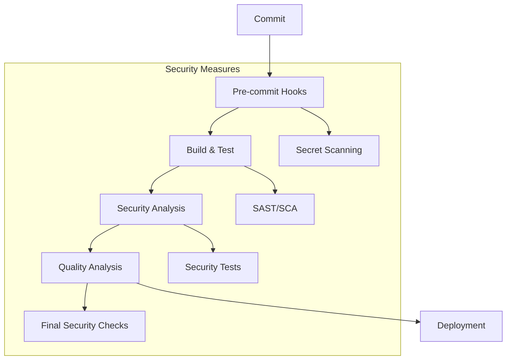

> # Desenvolvimento e Testes - Sistema AMAP (Fase 2 - Sprint 1)

|  |  |
|:------------------------------------:|:----------------------------------------:|

**Desenvolvimento de Software Seguros**  
**Mestrado em Engenharia Informática - 2024/2025 **  

**Professores:** 
Paulo Baltarejo de Sousa (T),
Joana Santos (PL),
Cláudio Maia (TP)

**Autores: **
Diana Marques 1240445, 
Diogo Costa 1211514, 
Pedro Costa 1211439, 
Pedro Vilarinho 1211149, 
Tiago Tavares 1240494

**Porto, 2025-05-25**

---

## 0. Índice

[TOC]

---

## 1. Introdução

- Contextualização do projeto no âmbito do desenvolvimento de software seguro  
- Objetivos específicos do Sprint 1 e sua relação com a modelação de ameaças da Fase 1  
- Metodologia DevSecOps adotada e justificação  
- Métricas de sucesso definidas para este sprint  

---

## 2. Desenvolvimento Seguro

### 2.1 Funcionalidade Desenvolvida

- Descrição detalhada das funcionalidades implementadas com foco em segurança  
- Diagrama de arquitetura atualizado com componentes de segurança  
- Demonstração da automação implementada (capturas de ecrã, fluxos)  
- Relação entre as funcionalidades desenvolvidas e os requisitos de segurança identificados na Fase 1  

### 2.2 Boas Práticas de Desenvolvimento Adotadas

#### Validação de entradas
- Estratégias implementadas (whitelisting, parametrização, etc.)  
- Tecnologias/bibliotecas utilizadas  
- Exemplos de código relevantes  

#### Princípio do menor privilégio
- Implementação ao nível do código e infraestrutura  
- Segregação de funções e acessos  
- Gestão de permissões  

#### Tratamento de erros seguro
- Política de mensagens de erro implementada  
- Logging seguro  
- Estratégia de fallback  

#### Separação de responsabilidades
- Implementação de padrões de design seguros  
- Separação de lógica de negócio e validação  
- Centralização de controles de segurança  

#### Secure coding guidelines
- Guidelines específicas adotadas para a linguagem utilizada  
- Mecanismos de enforcement (linters, formatters)  

### 2.3 Revisões e Auditorias de Segurança

#### Revisões de código
##### Processos e workflows estabelecidos  

Para gerir o desenvolvimento colaborativo e garantir a qualidade do código, foi adotado um processo simplificado de revisão utilizando apenas recursos gratuitos do GitHub. O grupo definiu uma convenção clara para as branches, organizando o trabalho da seguinte forma:

- **main**: branch principal com código estável e pronto para produção.  
- **feature/nome**: branches para desenvolvimento de novas funcionalidades.  
- **fix/nome**: branches destinadas a correções de bugs.  
- **security/nome**: branches para correções relacionadas com segurança.

O fluxo de trabalho baseia-se na criação de branches a partir da main, com commits pequenos e frequentes para facilitar o acompanhamento das alterações. Ao concluir o desenvolvimento, a branch é enviada (push) para o repositório remoto.

##### Comunicação e Revisão

A comunicação para revisão é feita diretamente pelo chat do grupo, onde o autor informa rapidamente sobre a criação da branch ou do Pull Request (PR), incluindo uma breve descrição (2-3 linhas) das alterações implementadas. Durante o processo de revisão, os comentários são realizados nos commits, PRs ou issues do GitHub, permitindo discussões e feedback ágeis e transparentes entre os membros.

A revisão é realizada diretamente na plataforma GitHub, utilizando os seus recursos de comentários para apontar eventuais problemas ou melhorias. Este processo simples evita o uso de documentos formais, acelerando a comunicação.

##### Critérios e Checklist Simplificado de Segurança

Para garantir a qualidade e segurança do código, utilizamos uma checklist mental rápida, que contempla os seguintes pontos principais:

- **Validação de Entrada**: verificar se as entradas do utilizador são validadas quanto a tipo, tamanho e formato.  
- **Segurança**: assegurar que não há dados sensíveis hardcoded e que são prevenidos ataques comuns como SQL injection, XSS e CSRF.  
- **Qualidade do Código**: código claro, legível e livre de erros graves.  
- **Testes**: validação mínima para assegurar que as alterações não comprometem funcionalidades.

##### Processo de Pull Request, Merge e Comunicação Final

Após a revisão, o autor cria um Pull Request para integrar as alterações na branch main. A descrição do PR é simples, informando que as alterações foram feitas conforme combinado e que a revisão está pendente.

O revisor aprova o PR diretamente na plataforma, via comentário ou aprovação. Após a aprovação, o responsável pela main realiza o merge e informa a equipa pelo chat, indicando que a integração foi concluída e que a branch pode ser removida.

##### Métricas de Qualidade

Durante o desenvolvimento, foram realizadas várias revisões de código que resultaram na identificação e correção de issues relacionadas principalmente com validação de entrada e melhorias na legibilidade do código. A comunicação rápida e o processo simplificado permitiram uma resolução eficiente das questões encontradas, contribuindo para a melhoria contínua da qualidade do software.


- Exemplos de vulnerabilidades identificadas e mitigadas  

#### Análise Estática de Código (SAST)
- Ferramentas implementadas (SonarQube, Checkmarx, etc.)  
- Configuração e personalização das regras  
- Integrações na pipeline  
- Análise dos resultados com métricas  
- Gestão de falsos positivos  

#### Análise Dinâmica de Código (DAST)
- Ferramentas implementadas (OWASP ZAP, Burp Suite, etc.)  
- Configuração dos scanners  
- Testes realizados (autenticação, injeção, etc.)  
- Resultados e mitigações implementadas  

#### Análise Interativa de Código (IAST)
- Implementação e integração  
- Cobertura de código alcançada  
- Vulnerabilidades detectadas durante a execução  

#### Análise de Composição de Software (SCA)
- Ferramentas implementadas (OWASP Dependency-Check, Snyk, etc.)  
- Inventário completo de dependências  
- Vulnerabilidades identificadas em componentes de terceiros  
- Estratégia de atualização e mitigação  
- Políticas de gestão de licenças  

---

## 3. Compilação e Testes

### 3.1 Inventário de Componentes

Durante o Sprint 1 foi realizada a tarefa de identificação e avaliação dos componentes externos utilizados no sistema, com foco na gestão segura de dependências e conformidade com as boas práticas definidas pela OWASP (nomeadamente ASVS V1.1.1 e V14.2.1).

#### Bibliotecas e Frameworks

A identificação dos componentes foi feita utilizando o comando:

```bash
dotnet list package
```

Este comando permite listar todos os pacotes NuGet utilizados em cada projeto (`AMAP.Api`, `AMAP.DataAccess` e `AMAP.Entities`), bem como as versões efetivamente resolvidas durante o processo de build. A análise revelou o uso das seguintes bibliotecas principais:

- **Microsoft.AspNetCore.Authentication.JwtBearer** (v8.0.11)
- **Microsoft.AspNetCore.Cors** (v2.2.0 — versão desatualizada)
- **Microsoft.AspNetCore.Identity.EntityFrameworkCore** (v8.0.11)
- **Microsoft.AspNetCore.Mvc.Core** (v2.2.5 — versão desatualizada)
- **Microsoft.EntityFrameworkCore** e pacotes associados (v9.0.0)
- **Newtonsoft.Json** (v13.0.3 — versão desatualizada)
- **Swashbuckle.AspNetCore** (v6.6.2)

### 6.2 Verificação de Vulnerabilidades

A verificação de vulnerabilidades conhecidas foi realizada utilizando o comando:

```bash
dotnet list package --vulnerable
```
Esta verificação abrange todos os pacotes instalados, cruzando-os com bases de dados públicas de vulnerabilidades como a do NuGet.org. O resultado da análise foi o seguinte:

> "O projeto fornecido AMAP.Api não tem nenhum pacote vulnerável, considerando as fontes atuais."  
> "O projeto fornecido AMAP.DataAccess não tem nenhum pacote vulnerável, considerando as fontes atuais."  
> "O projeto fornecido AMAP.Entities não tem nenhum pacote vulnerável, considerando as fontes atuais."

Apesar da ausência de vulnerabilidades conhecidas, foram detetadas versões desatualizadas ou depreciadas, o que constitui um risco potencial em termos de manutenção e segurança futura.

### 6.3 Documentação e Plano de Ação

A documentação dos componentes foi organizada de acordo com os seguintes critérios:

- Nome do pacote e versão utilizada  
- Função no sistema  
- Estado da versão (atual/desatualizada/depreciada)  
- Existência de vulnerabilidades conhecidas  
- Plano de ação (atualizar, manter, substituir)  

A tabela seguinte apresenta um excerto do inventário:

| Componente                                      | Versão Utilizada | Versão Mais Recente | Função no Sistema                           | Estado       | Ação Recomendada          |
|------------------------------------------------|------------------|---------------------|--------------------------------------------|--------------|--------------------------|
| Microsoft.AspNetCore.Authentication.JwtBearer  | 8.0.11           | 9.0.5               | Autenticação via JWT                        | Atual        | Monitorar futuras versões |
| Microsoft.AspNetCore.Cors                       | 2.2.0            | 2.3.0               | Suporte a CORS                             | Desatualizada| Atualizar                |
| Microsoft.AspNetCore.Identity.EntityFrameworkCore | 8.0.11         | 9.0.5               | Gestão de identidade com EF Core            | Atual        | Monitorar futuras versões |
| Microsoft.AspNetCore.Mvc.Core                   | 2.2.5            | 2.3.0               | Lógica MVC                                 | Desatualizada| Atualizar                |
| Microsoft.EntityFrameworkCore                   | 9.0.0            | 9.0.5               | ORM - acesso a dados                        | Atual        | Atualizar                |
| Microsoft.EntityFrameworkCore.Design            | 9.0.0            | 9.0.5               | Ferramentas de scaffolding do EF Core      | Atual        | Atualizar                |
| Microsoft.EntityFrameworkCore.SqlServer         | 9.0.0            | 9.0.5               | Provider EF Core para SQL Server            | Atual        | Atualizar                |
| Microsoft.EntityFrameworkCore.Tools              | 9.0.0            | 9.0.5               | CLI e tooling EF Core                       | Atual        | Atualizar                |
| Newtonsoft.Json                                | 13.0.3           | 13.0.3 (última)      | Serialização/Deserialização de JSON         | Depreciada   | Avaliar substituição     |
| Swashbuckle.AspNetCore                         | 6.6.2            | 8.1.1               | Geração de documentação Swagger/OpenAPI     | Desatualizada| Atualizar                |

Este inventário será mantido ao longo do próximo sprint como parte do processo de revisão contínua da segurança do projeto.

### 3.2 Planos e Execução de Testes de Segurança

#### Metodologia de teste
- Abordagem estruturada (white/gray/black box)  
- Cobertura de teste alcançada  
- Frequência de execução  

#### Testes baseados em casos de abuso
- Derivação de casos de testes a partir da modelação de ameaças  
- Implementação automatizada  
- Resultados e feedback loop  

#### Testes unitários com foco em segurança
- Abordagem para testar características de segurança  
- Exemplos de testes importantes  

#### Fuzzing e testes de robustez
- Implementação e configuração  
- Casos de erro identificados  

#### Análise dinâmica de comportamento
- Monitorização em runtime  
- Detecção de anomalias  
- Técnicas de sandboxing implementadas  

### 3.3 Validação de Configurações e Verificação de Artefactos

#### Segurança nas configurações
- Hardening aplicado (servidor, base de dados, framework)  
- Gestão segura de configurações  
- Verificação automatizada de configurações seguras  

#### Verificação de artefactos
- Assinatura digital  
- Verificação de integridade  
- Chain of custody  
- Análise de artefactos de build  

---

## 4. Automação da Pipeline DevSecOps

### 4.1 Arquitetura e Implementação da Pipeline
- Diagrama completo da pipeline CI/CD  
- Justificação das ferramentas selecionadas  
- Infraestrutura como código (configuration as code)  

Esta secção descreve a pipeline de Integração Contínua e Entrega Contínua (CI/CD) implementada para o projeto AMAP utilizando o GitHub Actions. A pipeline foi concebida de acordo com os princípios DevSecOps, integrando práticas de segurança em todas as fases.
#### Diagrama completo da pipeline CI/CD



#### Justificação da Seleção de Ferramentas

##### Ferramentas de Build e Teste

- **GitHub Actions**: Integração nativa, marketplace extenso e configuração de workflows flexível.
- **SonarCloud**: Solução baseada na cloud para análise estática de código e avaliação da qualidade, incluindo métricas de segurança.

##### Ferramentas de Segurança

- **OWASP Dependency Check**: Ferramenta de referência para identificação de vulnerabilidades em bibliotecas e dependências.
- **Análise de Segurança do SonarCloud**: Funcionalidade integrada de análise estática (SAST).
- **GitHub Secret Scanning**:  Verificação automática da presença de segredos e credenciais no repositório.

##### Ferramentas de Teste

- **xUnit**: Framework de testes padrão para .NET.
- **Cobertura de Código**: Geração de relatórios de cobertura para monitorização da qualidade dos testes.

#### Infraestrutura como Código

A pipeline encontra-se definida através de ficheiros de workflow localizados no diretório `.github/workflows/`, permitindo uma abordagem de *configuration as code*:

- **Ficheiro principal**: `.github/workflows/main.yml`.
- **Gestão de segredos e variáveis**: Realizada nas definições do repositório GitHub.
- **Requisitos de infraestrutura**: Documentados diretamente nos workflows, assegurando reprodutibilidade e rastreabilidade.

### 4.2 Integração de Segurança em Cada Fase da Pipeline

A segurança foi incorporada de forma transversal ao longo de todas as fases da pipeline CI/CD, assegurando a conformidade com as boas práticas DevSecOps. Segue-se a descrição detalhada das medidas aplicadas em cada fase.

#### Fase de commit
##### *Pre-commit Hooks* e Controlo de Código:
- Aplicação de regras de proteção no *branch* principal (main).
- Revisões obrigatórias de pull requests.
- Verificação obrigatória do estado da pipeline antes de fazer merge.

##### Deteção de Segredos:
- Utilização da funcionalidade nativa de *Secret Scanning* do GitHub.
- Verificação adicional através da análise estática do SonarCloud.
- Implementação de políticas de rotação periódica de credenciais e tokens de acesso.

#### Fase de build
##### SAST (Testes Estáticos de Segurança de Aplicações):
- Análise estática do código fonte com SonarCloud, integrando verificações de vulnerabilidades comuns.
- Avaliação contínua da qualidade do código com base em métricas como cobertura, complexidade ciclomática e duplicação.
- Deteção de vulnerabilidades de segurança.

##### SCA (Análise de Composição de Software):
- Utilização do OWASP Dependency Check para inspeção de bibliotecas e dependências.
- Deteção automática de vulnerabilidades conhecidas (CVEs).
- Geração de relatórios com recomendações para atualização ou mitigação de riscos identificados.

#### Fase de teste
##### Testes de Segurança Automatizados:
- Requisitos de cobertura mínima de testes unitários.
- Execução de testes de integração e validação de fluxos críticos.
- Inclusão de testes de segurança automatizados como parte integrante da pipeline.

##### DAST/IAST:
- Execução de testes dinâmicos de segurança de aplicações (DAST), simulando interações reais com o sistema em tempo de execução.
- Utilização de técnicas de testes interativos (IAST) para análise de comportamento e deteção de falhas internas durante a execução.
- Automatização destas verificações sempre que possível, com alertas para vulnerabilidades críticas.
#### Fase de implantação
##### Validação de Configuração:
- Verificações específicas por ambiente.
- Verificação da configuração de segurança.
- Validação de controlo de acessos.

##### Verificações Finais de Segurança:
- Análise de segurança antes do deploy.
- Confirmação da integridade e segurança do ambiente de destino.
- Verificação dos controlos de acesso.

### 4.3 Métricas e Eficiência da Automação

A eficiência da pipeline CI/CD implementada foi avaliada com base em métricas de desempenho, indicadores de segurança e indicadores-chave de desempenho (KPIs), permitindo uma análise contínua e fundamentada da qualidade e segurança do processo.

#### Métricas de Desempenho
**Tempo de Execução:**
- Tempo médio de build: ~10 segundos.
- Execução de testes: ~10 segundos.
- Análise de segurança: ~1 minuto e 24 segundos.
- Tempo total da pipeline: ~2 minutos e 40 segundos.

Estas métricas refletem uma automação eficiente, com tempos de resposta adequados ao contexto de integração contínua e iteração frequente.

#### Métricas de Segurança

**Cobertura e Efetividade da Deteção de Vulnerabilidades:**

- **Cobertura SAST:** 100% da base de código analisada através do SonarCloud
- **SCA:** Verificação sistemática de dependências com deteção de CVEs relevantes
- **Testes de Segurança:** Métricas de cobertura indicam uma validação robusta de fluxos críticos

#### KPIs

##### Qualidade de Código:
- **Classificação de Manutenibilidade:** Avaliação contínua através do SonarCloud
- **Cobertura de Código:** Percentagem de linhas e caminhos de execução testados
- **Rácio de Dívida Técnica:** Indicador da complexidade e esforço necessário para melhorar a base de código

##### Segurança:
- **Número de Vulnerabilidades Identificadas:** Monitorização por categoria e gravidade
- **Tempo Médio de Resolução:** Intervalo entre deteção e correção das falhas
- **Cobertura de Testes de Segurança:** Percentagem da aplicação validada com testes específicos

#### 4.4 Melhoria Contínua

##### Ciclo de Feedback:
- **Geração de Relatórios Automáticos:** Resultados da pipeline disponibilizados em tempo real
- **Revisões Regulares de Segurança:** Avaliações periódicas das políticas e práticas aplicadas
- **Otimização de Desempenho:** Ajustes incrementais com base nos dados obtidos

##### Processo de Melhoria:
- **Monitorização Contínua:** Acompanhamento em tempo real de métricas críticas de desempenho e segurança
- **Atualização e Evolução de Ferramentas:** Incorporação de novas versões e substituição de ferramentas com base em benchmarks e necessidades emergentes
- **Integração de Lições Aprendidas:** Inclusão de correções e melhorias no fluxo de desenvolvimento com base nos resultados anteriores

### 5. Configuração

#### 5.1 Segredos Necessários

- **SONAR_TOKEN**
  - **Finalidade**: Token de autenticação para integração com o SonarCloud.
  - **Localização**: Definido nos *Secrets* do repositório GitHub.
  - **Como obter**: [https://sonarcloud.io/account/security](https://sonarcloud.io/account/security)

### 5.2 Variáveis de Ambiente

**`DOTNET_VERSION`**: `'8.0.x'`

- Define a versão do SDK .NET utilizada durante o processo de build

### 6. Utilização da Pipeline

#### 6.1 Execução da Pipeline

**Triggers Automáticos:**

- Push para o branch principal.
- Criação de pull request.

**Trigger Manual:**
- Aceder ao separador "Actions" no GitHub.
- Selecionar o workflow.
- Clicar em "Run workflow".

#### 6.2 Visualização de Resultados

**Estado da Pipeline:**
- Separador GitHub Actions.
- Permite a análise do estado de execução de cada *job*.

**Qualidade de Código:**

- Consultar o painel do projeto no **SonarCloud**.
- Visualização de métricas como cobertura de testes, duplicação, complexidade e dívida técnica.

**Resultados da Análise de Segurança:**

- Disponíveis como artefactos no GitHub Actions.
- Podem ser descarregados após a conclusão da pipeline.

---

### 7. Resolução de Problemas

#### 7.1 Problemas Comuns

**A Pipeline Não Inicia:**
- Verificar permissões do GitHub Actions.
- Confirmar segredos do repositório.
- Certificar-se de que o ficheiro de workflow está na localização correta.

**Falha na Análise do SonarCloud:**
- Verificar se o `SONAR_TOKEN` está definido.
- Verificar a chave do projeto e a organização.
- Certificar-se de que o branch principal está corretamente configurado.

**Falhas no Build:**
- Verificar a compatibilidade da versão do .NET.
- Confirmar o caminho da solução.
- Verificar erros de compilação.

---

## 5. Avaliação com OWASP ASVS

### 5.1 Metodologia de Avaliação
- Processo de avaliação ASVS implementado  
- Ferramentas de apoio utilizadas  
- Processo de documentação e rastreabilidade  
- Versão do ASVS utilizada e justificação  

### 5.2 Resultados da Avaliação por Categoria

#### Architecture, Design and Threat Modeling
- Requisitos verificados  
- Evidências de conformidade  
- Gaps identificados  

#### Authentication
- Implementações seguras  
- Testes realizados  
- Conformidade com requisitos  

#### Session Management
- Mecanismos implementados  
- Verificações realizadas  

#### Access Control
- Implementação do modelo de controlo de acesso  
- Verificação de autorização  

#### Validation, Sanitization and Encoding
- Técnicas implementadas  
- Cobertura alcançada  

#### Stored Cryptography
- Algoritmos e implementações utilizadas  
- Gestão de chaves  

#### Error Handling and Logging
- Política implementada  
- Verificações realizadas  

#### Data Protection
- Mecanismos de proteção  
- Classificação de dados  

#### Communication
- Segurança nas comunicações  
- Verificações TLS/SSL  

#### Malicious Code
- Prevenções implementadas  
- Verificações realizadas  

#### Business Logic
- Testes de lógica de negócio  
- Prevenção de circumvention  

#### Files and Resources
- Gestão segura de ficheiros  
- Uploads/downloads seguros  

#### API and Web Service
- Segurança na implementação de APIs  
- Autenticação e autorização  

#### Configuration
- Segurança nas configurações  
- Hardening aplicado  

### 5.3 Matriz de Rastreabilidade

Tabela de rastreabilidade entre:
- Requisitos ASVS  
- Componentes do sistema  
- Testes automatizados  
- Ferramentas de verificação  
- Estado de conformidade  

---

## 6. Conclusão e Próximos Passos

- Síntese dos resultados alcançados neste sprint  
- Análise crítica do processo de desenvolvimento seguro  
- Lições aprendidas e oportunidades de melhoria  
- Planeamento detalhado para o próximo sprint  
- Roadmap de segurança atualizado  

---

## 7. Anexos

- Evidências detalhadas dos testes e verificações  
- Configurações relevantes das ferramentas  
- Relatórios completos de análise de segurança  
- Excertos de código relevantes com implementações de segurança  
- Capturas de ecrã da pipeline em execução  
- Excel ASVS preenchido com avaliações detalhadas  
- Inventário completo de componentes com análise de vulnerabilidades  
- Documentação de mitigações implementadas  

---

## 8. Referências

1. GitHub. (s.d.). *Documentação do GitHub Actions*. Disponível em: https://docs.github.com/actions
2. SonarCloud. (s.d.). *Documentação do SonarCloud*. Disponível em: https://docs.sonarcloud.io/
3. OWASP Foundation. (s.d.). *OWASP Dependency Check*. Disponível em: https://owasp.org/www-project-dependency-check/
4. Microsoft. (s.d.). *Documentação de Segurança do .NET*. Disponível em: https://learn.microsoft.com/pt-pt/dotnet/standard/security/

1. OWASP Foundation. (2021). *OWASP Application Security Verification Standard (ASVS) 4.0*. Disponível em: [https://owasp.org/www-project-application-security-verification-standard/](https://owasp.org/www-project-application-security-verification-standard/)

2. OWASP Foundation. (2021). *OWASP Top 10: The Ten Most Critical Web Application Security Risks*. Disponível em: [https://owasp.org/www-project-top-ten/](https://owasp.org/www-project-top-ten/)

3. Microsoft. (2022). *Security Development Lifecycle (SDL)*. Disponível em: [https://www.microsoft.com/en-us/securityengineering/sdl](https://www.microsoft.com/en-us/securityengineering/sdl)

4. OWASP Foundation. (s.d.). *Threat Modeling Process*. Disponível em: [https://owasp.org/www-community/Threat_Modeling_Process](https://owasp.org/www-community/Threat_Modeling_Process)

5. OWASP Foundation. (s.d.). *Free for Open Source Application Security Tools*. Disponível em: [https://owasp.org/www-community/Free_for_Open_Source_Application_Security_Tools](https://owasp.org/www-community/Free_for_Open_Source_Application_Security_Tools)

6. TechTarget. (s.d.). *Data Flow Diagram (DFD)*. Disponível em: [https://www.techtarget.com/searchdatamanagement/definition/data-flow-diagram-DFD](https://www.techtarget.com/searchdatamanagement/definition/data-flow-diagram-DFD)

7. OWASP Foundation. (s.d.). *Abuse Case Cheat Sheet*. Disponível em: [https://cheatsheetseries.owasp.org/cheatsheets/Abuse_Case_Cheat_Sheet.html](https://cheatsheetseries.owasp.org/cheatsheets/Abuse_Case_Cheat_Sheet.html)

8. Documentos de apoio disponibilizados no Moodle da unidade curricular **Desenvolvimento de Software Seguro** (ISEP, 2024/2025).
