> # Sistema AMAP (Fase 2 - Sprint 2)

|  |  |
|:------------------------------------:|:----------------------------------------:|

**Desenvolvimento de Software Seguros**  
**Mestrado em Engenharia Informática - 2024/2025 **  

**Professores:** 
Paulo Baltarejo de Sousa (T),
Joana Santos (PL),
Cláudio Maia (TP)

**Autores: **
Diana Marques 1240445, 
Diogo Costa 1211514, 
Pedro Costa 1211439, 
Pedro Vilarinho 1211149, 
Tiago Tavares 1240494

**Porto, 2025-06-15**

---

# Índice

[TOC]

---

# Introdução

Este relatório reúne todo o trabalho desenvolvido no âmbito da unidade curricular de **Desenvolvimento de Software Seguro (DESOFT)**, tendo como base o sistema **AMAP** (Associação para a Manutenção da Agricultura de Proximidade). Ao longo do projeto, foram realizadas atividades em três etapas principais: **Fase 1**, **Fase 2 - Sprint 1** e **Fase 2 - Sprint 2**.

Na **Fase 1**, foi feita a modelação de ameaças do sistema AMAP — inicialmente desenvolvido na disciplina de **Engenharia de Requisitos (ENGREQ)** — com o objetivo de identificar vulnerabilidades no backend e propor estratégias de mitigação adequadas.

A **Fase 2 - Sprint 1** focou-se na integração de práticas de desenvolvimento seguro ao longo do ciclo de vida da aplicação. Foi adotada uma abordagem **DevSecOps**, com a criação de uma pipeline CI/CD automatizada. Esta incluía análise estática de código (com o **SonarQube**), verificação de dependências vulneráveis (através do **OWASP Dependency Check** e **Snyk**) e a execução de testes de segurança. Foram também aplicadas boas práticas de programação, reforçadas convenções de codificação, auditorias de segurança e testes unitários, assegurando conformidade com o **OWASP ASVS**.

Este documento diz respeito à **Fase 2 - Sprint 2** e consolida os progressos anteriores, detalhando as novas melhorias e implementações. Destacam-se:  
- a integração da **análise dinâmica (DAST)** com o **OWASP ZAP** na pipeline,  
- a configuração de ambientes distintos (desenvolvimento, staging e produção),  
- a implementação de **mecanismos de backup e restauro**,  
- a **correção das vulnerabilidades** identificadas nas fases anteriores,  
- e a realização de **testes de integração**.

Além disso, o relatório aborda aspetos ligados à gestão da infraestrutura de produção, **monitorização do sistema**, resposta a incidentes, atualizações, rastreabilidade e avaliação final com base no **ASVS**.

---

# Contexto do projeto

O projeto tem por objetivo criar uma solução informática que suporte a operação das AMAP/CSAs (Associações para a Manutenção da Agricultura de Proximidade / Comunidades que Sustentam a Agricultura).

A AMAP Porto foi selecionada como piloto para a implementação e teste do protótipo, com vista a modernizar e otimizar a gestão, comercialização e distribuição de bens alimentares produzidos por agricultores locais, ligando‑os a consumidores de forma eficiente e sustentável.

---

## O sistema AMAP

O sistema AMAP é uma plataforma de gestão que permite a coordenação entre gestores, produtores e co‑produtores, facilitando:

- Gestão dos períodos de subscrição de produtos agrícolas  
- Criação e manutenção de catálogos de produtos  
- Gestão das ofertas de produtos pelos produtores  
- Processamento das subscrições pelos co‑produtores  
- Gestão de pagamentos  
- Organização das datas de entrega  
- Gestão de utilizadores com diferentes níveis de acesso (Gestor, Produtor, Co‑produtor)
- Gestão de arquivos

A arquitetura do sistema baseia‑se numa API RESTful desenvolvida em ASP.NET Core, fornecendo endpoints seguros para todas as operações necessárias.

---

## Objetivo e âmbito da modelação de ameaças

Este documento corresponde à Fase 1 do processo de desenvolvimento seguro (SSDLC – Secure Software Development Life Cycle), concentrando‑se nas etapas de análise e de design de segurança. O âmbito da modelação de ameaças inclui:

1. **Análise arquitetural:** compreensão da arquitetura do sistema, dos seus componentes e das suas interações  
2. **Modelação de fluxo de dados:** identificação dos principais fluxos de informação no sistema  
3. **Identificação de ameaças:** aplicação da metodologia STRIDE para deteção sistemática de ameaças  
4. **Avaliação de riscos:** priorização das ameaças identificadas com base em critérios objetivos  
5. **Definição de mitigações:** proposta de controlos e estratégias para mitigar as ameaças mais críticas  
6. **Requisitos de segurança:** estabelecimento de requisitos de segurança específicos para o desenvolvimento  
7. **Planeamento de testes:** definição de uma estratégia para validar a implementação dos controlos de segurança  

Esta modelação de ameaças servirá de base às fases subsequentes do projeto, nas quais os requisitos de segurança identificados serão implementados e validados através de práticas de DevSecOps, testes de segurança e integração contínua.  Análise do Sistema.

---

# Visão Geral do Sistema

O sistema AMAP (Associação para a Manutenção da Agricultura de Proximidade) foi concebido para modernizar e otimizar a gestão, comercialização e distribuição de produtos agrícolas locais, ligando produtores diretamente a consumidores (co‑produtores). Suporta o modelo de negócio das AMAP/CSA (Associações para a Manutenção da Agricultura de Proximidade / Comunidades que Sustentam a Agricultura), promovendo agricultura sustentável e comércio justo.

---

## Nova arquitetura em camadas


A implementação da nova camada Business na arquitetura do sistema AMAP representa uma evolução significativa no design do software. Esta reestruturação arquitetural traz benefícios substanciais em termos de organização, manutenibilidade e escalabilidade.

### O Que Mudou na Arquitetura?

Anteriormente, a arquitetura tinha uma estrutura mais tradicional de três camadas (API, Dados e Partilhada). A nova arquitetura introduz uma camada Business dedicada, criando um sistema de quatro camadas bem definidas:
1.	Camada API (Controllers): Controladores mais leves e focados em tratamento de requisições HTTP e respostas com DTOs
2.	Camada Business: Nova camada com toda a lógica de negócio
3.	Camada de Dados: Repositórios e acesso ao banco de dados
4.	Camada Partilhada: Entidades, DTOs e utilitários

**Camada de Negócio (Business)**

•	Responsabilidade: implementar toda a lógica de negócio e validações da aplicação
•	Componentes principais:
•	Components (BC): implementações concretas dos serviços de negócio (ProductBc, PaymentBc, etc.)
•	Interfaces: contratos que definem os serviços de negócio (IProductBc, IPaymentBc, etc.)
•	Validação: regras de validação de dados e operações comerciais antes do acesso à camada de dados
•	Logging: registo detalhado de operações críticas e monitorização de segurança
•	Tratamento de Exceções: encapsulamento de exceções específicas de domínio

**DTOs na Camada Shared**

Uma das principais melhorias foi a adição de uma estrutura organizada de DTOs (Data Transfer Objects) na pasta Models da camada Shared. Estes DTOs:
•	Fornecem uma separação clara entre entidades de domínio e objetos de transferência de dados
•	São especializados para diferentes contextos de API (PaymentInfoDto, ProductDto, etc.)
•	Melhoram a segurança ao expor apenas os dados necessários para cada operação
•	Facilitam a evolução da API sem impactar o modelo de domínio
•	Simplificam a serialização/deserialização de dados nas respostas HTTP

### Principais Benefícios da Nova Arquitetura

•	Separação clara de responsabilidades: Os controladores agora apenas gerem requisições HTTP e utilizam DTOs para respostas, enquanto a lógica de negócio fica isolada na camada Business
•	Código mais organizado: Cada componente de negócio é especializado em um domínio específico
•	Testabilidade aprimorada: As interfaces facilitam a criação de testes unitários com mock objects
•	Manutenção simplificada: Alterações de regras de negócio ficam isoladas em componentes específicos
•	Reutilização de código: Componentes de negócio podem ser compartilhados entre diferentes controladores
•	Tratamento robusto de exceções: Implementação de try-catch nos controladores para garantir respostas adequadas aos clientes

### Como Funciona na Prática

Quando um utilizador faz uma requisição, o fluxo agora é:
1.	O cliente envia uma requisição HTTP para um endpoint da API
2.	O controlador correspondente processa a requisição e delega a lógica de negócio para a camada Business
3.	A camada Business executa validações e regras de negócio, utilizando serviços adequados
4.	A camada Business requisita operações de dados à camada Data através da interface IUnitOfWork
5.	O Unit of Work coordena, se necessário, transações atómicas entre múltiplas alterações
6.	Os serviços auxiliares (por exemplo, EmailSender) executam tarefas complementares
7.	A camada Business devolve resultados para o controlador
8.	O controlador transforma os dados em DTOs apropriados e devolve uma resposta HTTP padronizada

Esta abordagem em camadas claramente definidas, com responsabilidades bem segregadas e uso adequado de DTOs, torna o sistema mais resiliente, adaptável e mais fácil de manter ao longo do tempo.

- Demonstração da automação implementada (capturas de ecrã, fluxos)  
- Relação entre as funcionalidades desenvolvidas e os requisitos de segurança identificados na Fase 1  

---

## Modelo de Domínio


O modelo de domínio do AMAP descreve as entidades centrais do negócio e as suas relações, servindo de base conceptual ao sistema:

### Entidades Principais

- **AppUser**: representa utilizadores do sistema, com os seguintes perfis:
  - **Gestor** (Manager): gere a AMAP e configura os períodos de subscrição  
  - **Produtor** (Producer): regista produtos e define as respetivas ofertas  
  - **Co‑produtor** (CoProducer): efetua subscrições e pagamentos  

- **SubscriptionPeriod**: define um intervalo temporal (por exemplo, semestral) para subscrições, contendo:
  - **Duration**: descrição textual do período  
  - **StartDate / EndDate**: datas de início e fim  
  - **DeliveryDates**: conjunto de datas agendadas para entrega  

- **DeliveryDate**: representa uma data específica de entrega:
  - **Date**: data e hora da entrega  
  - **SubscriptionPeriodId**: identifica o período de subscrição a que pertence  

- **Product**: representa um produto agrícola, com atributos como:
  - **ProducerId / Producer**: produtor responsável  
  - **Name / Description**: nome e descrição  
  - **Photo**: imagem do produto  
  - **ReferencePrice**: preço base de referência  
  - **DeliveryUnits**: unidade de medida para entrega  
  - **IsDeleted**: flag de eliminação lógica  
  - **Composites**: relação com subprodutos (para produtos compostos)  

- **ProductImage**: armazena imagens de produtos:
  - **ImageUrl**: URL da imagem  
  - **ProductId**: produto associado  

- **ProductOffer**: associa produtos a períodos de subscrição, especificando:
  - **SubscriptionPeriodId / SubscriptionPeriod**: período de subscrição  
  - **ProductId / Product**: produto oferecido  
  - **Price**: preço para esse período  
  - **Quantity**: quantidade disponível  
  - **DeliveryDate**: data prevista para entrega  
  - **PaymentType**: forma de pagamento aceite  

- **Subscription**: representa a subscrição de um co‑produtor numa oferta:
  - **CoProducerId / CoProducer**: co‑produtor  
  - **ProductOfferId / ProductOffer**: oferta selecionada  
  - **ExpectedQuantity**: quantidade esperada  
  - **DeliveredQuantity**: quantidade efetivamente entregue  
  - **PaymentType**: forma de pagamento escolhida  

- **Delivery**: regista a entrega efetiva de uma subscrição:
  - **SubscriptionId / Subscription**: subscrição associada  
  - **DeliveredQuantity**: quantidade entregue (pode diferir da esperada)  

- **Payment**: documenta pagamentos efetuados:
  - **AmountPaid**: valor pago  
  - **PaymentDate**: data do pagamento  
  - **SubscriptionId**: subscrição relacionada  

- **Composite**: estabelece a composição de produtos:
  - **ProductId**: produto principal  
  - **SubProductId**: subproduto componente  
  - **Quantity**: quantidade do subproduto  

### Padrões e Decisões de Design

- **Padrão Composite (Compósito):** implementado para permitir produtos simples e compostos, como cabazes de legumes.  
- **Remoção lógica:** produtos são marcados com a flag `IsDeleted` em vez de serem eliminados fisicamente.  
- **Filtros globais:** configurados através do Entity Framework para excluir automaticamente entidades marcadas como removidas.  
- **Relacionamentos controlados:** definições de cascata ou restrição adaptadas para manter a integridade referencial.  

---

## Requisitos Funcionais do Backend

1. **Gestão de períodos de subscrição**  
   - Criar e eliminar períodos com datas de início, fim e datas de entrega associadas.  
   - Notificar automaticamente os produtores sobre novos períodos.  

2. **Catálogo de produtos**  
   - Registar produtos simples e compostos.  
   - Gerir atributos como preço, descrição e unidades de entrega.  
   - Aplicar remoção lógica de produtos para preservar histórico.  

3. **Gestão de ofertas**  
   - Criar ofertas ligadas a produtos e períodos de subscrição.  
   - Definir preços, quantidades disponíveis e métodos de pagamento.  

4. **Gestão de subscrições**  
   - Processar subscrições de co‑produtores.  
   - Monitorizar quantidades esperadas e associar as respetivas formas de pagamento.  

5. **Gestão de entregas**  
   - Registar entregas efetivas.  
   - Controlar discrepâncias entre quantidades subscritas e efetivamente entregues.  

6. **Processamento de pagamentos**  
   - Registar pagamentos realizados.  
   - Calcular valores a pagar e a receber.  

7. **Notificações por e‑mail**  
   - Enviar comunicações automáticas a produtores e co‑produtores sobre novos períodos de subscrição e outras atualizações.  

8. **Controlo de acesso**  
   - Autenticação e autorização baseadas em perfis de utilizador.  
   - Restringir operações conforme o tipo de utilizador (Gestor, Produtor, Co‑produtor).  

9. **Gestão de arquivos**  
   - Implementa funcionalidades para importação e exportação de ficheiros.  
   - Criar diretórios na raiz do projeto para armazenar ficheiros importados e exportados:  
     - **ExportedProducts**: Pasta que contém ficheiros exportados com todos os produtos de um produtor.  
     - **ProductsUpload**: Pasta onde os produtores podem importar ficheiros com novos produtos, os quais são armazenados na base de dados.  

---

## Requisitos Não Funcionais do Backend

Os requisitos não funcionais concentram‑se em aspetos qualitativos essenciais ao funcionamento e manutenção do backend:

### Desempenho
- **Tempo de resposta:** consultas complexas processadas em menos de 3 segundos, uma vez que este é, em geral, o limite máximo de tempo que os utilizadores toleram sem frustração. Testados os endpoints pelo postman.
- **Indexação:** otimização de índices para acelerar as consultas mais frequentes  
- **Monitorização:** supervisão contínua do desempenho das queries  

### Segurança
- **Autenticação:** robusta, implementada via ASP.NET Identity  
- **Encriptação:** palavras‑passe protegidas com SHA‑256 (com salt)  
- **Cookies:** configuração segura (HttpOnly, Secure, SameSite)  
- **Validação de inputs:** controlo rigoroso dos dados recebidos no back‑end  
- **Prevenção de ataques:** proteção contra injeções SQL e outras ameaças comuns  
- **Recuperação de password:** 
  - Sistema de "Esqueci minha password" com geração de tokens seguros
  - Tokens de redefinição de password com tempo de expiração
  - Validação de tokens antes de permitir redefinição de password
  - Proteção contra enumeração de usuários durante o processo de recuperação
  - Notificações seguras por email para redefinição de password

### Manutenibilidade
- **Modularidade:** código organizado em camadas (API, Data, Shared)  
- **Documentação:** API documentada automaticamente através do Swagger  
- **Gestão de erros:** tratamento consistente de exceções e mensagens de erro  

### Confiabilidade
- **Integridade de dados:** validações e restrições para garantir consistência  
- **Recuperação:** procedimentos regulares de backup e restauro de dados  

### Escalabilidade
- **Arquitetura desacoplada:** camadas que permitem distribuição de carga  
- **Preparação para crescimento:** design que suporta aumento do volume de dados  
- **Otimização contínua:** consultas ajustadas para crescer com o número de registos  

Esta análise detalhada do sistema AMAP estabelece a base para a subsequente modelação de ameaças, proporcionando uma visão clara dos componentes, arquitetura e requisitos que precisam ser protegidos.

---

# Fluxo de Dados

## Introdução

Os Diagramas de Fluxo de Dados (DFDs) são ferramentas essenciais para visualizar como a informação flui através do sistema AMAP. Estes diagramas permitem identificar os componentes principais do sistema, como os dados são processados, armazenados e trocados entre diferentes partes da aplicação e entidades externas.

---

## Componentes do Sistema

### Entidades Externas

- **Gestor**: Responsável pela administração do sistema, criação de períodos de subscrição e monitorização de pagamentos.

- **Produtor**: Fornecedor dos produtos agrícolas, responsável por cadastrar produtos, definir quantidades e criar ofertas.

- **CoProdutor**: Utilizador que subscreve as ofertas disponíveis e realiza pagamentos.

- **Sistema de Email**: Componente externo utilizado para enviar notificações aos produtores sobre as datas de início e fim do período e das datas de entregas presentes nesse mesmo período.

### Processos Principais

- **<u>Processo Central</u>**: **"Sistema de Gestão e Subscrição de Ofertas de Produtos da AMAP"** - Representa todo o sistema como um único processo.

- **Autenticação**: Processo responsável por autenticar os diferentes tipos de utilizadores (Gestor, Produtor, CoProdutor).

- **Gestão de Períodos de Subscrição**: Permite ao Gestor criar e gerir períodos de subscrição com respetivas datas de entrega.

- **Gestão de Produtos e Quantidades**: Permite aos Produtores criar produtos no sistema.

- **Criação de Ofertas**: Processo onde os Produtores podem criar ofertas de produtos para determinados períodos de subscrição.

- **Subscrição**: Processo que permite aos CoProdutores subscreverem ofertas disponíveis.

- **Pagamento**: Gestão dos pagamentos realizados pelos CoProdutores.

- **Controlo de Pagamentos**: Processo para monitorização e gestão de pagamentos pelo Gestor.

- **Notificar Produtor**: Envio de notificações aos Produtores sobre novos períodos e respetivas datas de entrega.

### Armazenamentos de Dados

- **Utilizadores**: Armazenamento dos dados de utilizadores do sistema (Gestor, Produtor, CoProdutor).

- **Produtos**: Repositório dos produtos cadastrados pelos Produtores.

- **Ofertas de Produtos**: Armazenamento das ofertas criadas pelos Produtores.

- **Subscrições**: Registo das subscrições feitas pelos CoProdutores.

- **Períodos de Subscrição**: Armazenamento dos períodos e datas de entrega.

- **Pagamentos**: Registo dos pagamentos realizados pelos CoProdutores.

---

## Diagramas de Fluxo de Dados

### Nível 0

O DFD de Nível 0 (ou Diagrama de Contexto) apresenta uma visão global do sistema AMAP, mostrando como ele interage com as entidades externas.

A seguinte figura apresenta o Diagrama de Fluxo de Dados de Nível 0 (Diagrama de Contexto) do sistema AMAP, ilustrando as interações entre o processo central e as entidades externas, bem como os limites de confiança estabelecidos.


#### Descrição dos Fluxos Principais

- Gestor ←→ Sistema:
  - Autenticação/Gestão Períodos: O Gestor autentica-se e gere os períodos de subscrição.
  - Controlo de Pagamentos: O Gestor monitoriza e controla os pagamentos no sistema.

- Produtor ←→ Sistema:
  - Visualização do Catálogo e Quantidades: O Produtor pode visualizar seu catálogo de produtos, bem como as quantidades subscritas pelos CoProdutores.
  - Autenticação/Gestão de Produtos e Quantidades/Criação de Ofertas: O Produtor autentica-se, gere seus produtos, cria ofertas e pode alterar a quantidade de produtos entregue fase ao que foi subscrito pelo CoProdutor.

- CoProdutor ←→ Sistema:
  - Autenticação/Subscrição/Pagamentos: O CoProdutor autentica-se, realiza subscrições e efetua pagamentos.
  - Informação das Ofertas Disponíveis: O sistema fornece informações sobre as ofertas disponíveis.

- Sistema → Sistema de Email:
  - Envio de Notificações sobre períodos e datas de entrega: O sistema envia notificações aos produtores através do sistema de email.
  - Comunicação Externa: Representa a comunicação do sistema com o serviço externo de email.

#### Limites de Confiança
Os limites de confiança no diagrama (linhas tracejadas) representam pontos críticos onde:

1. Interface de Utilizador: Separa a camada de apresentação (frontend) do núcleo do sistema, indicando que todas as interações dos utilizadores passam por esta fronteira de segurança.
2. Comunicação Externa: Delimita a fronteira entre o sistema AMAP e o serviço externo de email, indicando um ponto onde dados saem do controlo direto da aplicação.

Estes limites são essenciais para identificar pontos onde:

- Os dados podem ser interceptados ou manipulados

- É necessário implementar validações e controlos de acesso

- Medidas de proteção específicas devem ser aplicadas para garantir a integridade e confidencialidade das informações

### Nível 1

O DFD de Nível 1 expande o processo central do DFD Nível 0, detalhando os subprocessos internos e como eles interagem entre si, com as entidades externas e com os armazenamentos de dados.

A apresenta a baixo representa o Diagrama de Fluxo de Dados de Nível 1 do sistema AMAP, detalhando os processos internos, armazenamentos de dados e os fluxos de informação entre eles, além de identificar os diversos limites de confiança presentes no sistema.


#### Processos Detalhados

1. Autenticação:

   - Recebe credenciais de login dos utilizadores (Gestor, Produtor, CoProdutor).

   - Valida as credenciais contra o armazenamento de Utilizadores.

   - Retorna dados do utilizador autenticado.

   - Estabelece o controlo de acesso por perfil.

2. Gestão de Períodos de Subscrição:

   - Recebe dados de novos períodos do Gestor autenticado.

   - Armazena os períodos de subscrição no respetivo armazenamento.

   - Fornece informações sobre períodos existentes.

3. Gestão de Produtos e Quantidades:

   - Recebe dados de produtos do Produtor autenticado.

   - Regista produtos no armazenamento correspondente.

   - Fornece informações sobre produtos existentes.

4. Criação de Ofertas:

   - Recebe lista de produtos com quantidades definidas.

   - Regista ofertas no armazenamento de Ofertas de Produtos.

   - Disponibiliza informações sobre ofertas existentes.

5. Subscrição:

   - Recebe pedidos de subscrição do CoProdutor autenticado.

   - Regista subscrições no armazenamento correspondente.

   - Envia dados da subscrição para o processo de Pagamento.

   - Fornece informações sobre subscrições existentes.

6. Pagamento:

   - Recebe dados de subscrição para pagamento.

   - Regista informações de pagamento no armazenamento.

   - Fornece informações sobre pagamentos existentes.

7. Controlo de Pagamentos:

   - Acessa informações de subscrições e pagamentos existentes.

   - Fornece ao Gestor ferramentas para monitorizar e gerir pagamentos.

8. Notificar Produtor:

   - Recebe notificação e-mail do processo de Gestão de Períodos.

   - Integra-se com o Sistema de Email para enviar notificações aos Produtores.

#### Fluxos de Dados Importantes

- Credenciais de Login → Autenticação: Dados de login fornecidos pelos utilizadores.

- Utilizador Autenticado → Diversos Processos: Informações do utilizador após autenticação.

- Dados do Novo Período → Gestão de Períodos: Informações sobre novos períodos de subscrição.

- Registo de Produtos → Armazenamento de Produtos: Dados de produtos para armazenamento.

- Lista de Produtos com Quantidades → Criação de Ofertas: Produtos disponíveis para criação de ofertas.

- Registo de Ofertas → Armazenamento de Ofertas: Dados de ofertas para armazenamento.

- Registo de Subscrições → Armazenamento de Subscrições: Dados de subscrições para armazenamento.

- Dados de Subscrição para Pagamento → Pagamento: Informações para processamento de pagamento.

- Registo de Pagamento → Armazenamento de Pagamentos: Dados de pagamentos para armazenamento.

- Mensagem de Notificação → Sistema de Email: Conteúdo a ser enviado por email.

#### Limites de Confiança 

Os limites de confiança no DFD Nível 1 são mais detalhados, identificando:

1. **Perímetro de Autenticação:** Separa os utilizadores não autenticados dos autenticados.
2. **Controlo de Acesso por Perfil:** Limita o acesso a funcionalidades específicas baseado no tipo de utilizador.
3. **Database Boundary:** Limites entre processos e armazenamentos de dados, indicando pontos onde os dados precisam ser protegidos durante o armazenamento.
4. **Integração com Sistema de Email:** Limite entre o sistema AMAP e o serviço externo de email.

---

## Conclusão

A análise de fluxo de dados do sistema AMAP revela uma arquitetura modular com separação clara de responsabilidades entre diferentes processos. Os diagramas demonstram como os dados fluem entre utilizadores, processos e armazenamentos, destacando pontos críticos onde medidas de segurança são necessárias (limites de confiança).

Esta documentação de fluxo de dados é essencial para compreender o funcionamento do sistema, identificar potenciais vulnerabilidades de segurança e garantir que todos os componentes interajam corretamente para fornecer as funcionalidades esperadas.

A estrutura do sistema, composta por processos de autenticação, gestão de períodos, produtos, ofertas, subscrições e pagamentos, reflete a arquitetura da aplicação revelada na análise do código-fonte, particularmente nos controladores e modelos encontrados no projeto AMAP.

---

# Identificação e Análise de Ameaças

## Introdução 

Nesta secção, aplicamos a metodologia STRIDE para identificar e analisar as ameaças mais relevantes para o sistema AMAP. Para cada elemento do DFD, identificamos as ameaças aplicáveis, detalhamos os vetores de ataque, identificamos potenciais agentes de ameaça e ilustramos com casos de abuso concretos.

---

## Aplicação da Metodologia STRIDE

A metodologia STRIDE é utilizada para identificar ameaças de segurança, onde cada letra representa uma categoria:

- **Spoofing**: Falsificação de identidade

- **Tampering**: Adulteração de dados

- **Repudiation**: Repúdio de ações realizadas

- **Information Disclosure**: Divulgação não autorizada de informação

- **Denial of Service**: Negação de serviço

- **Elevation of Privilege**: Elevação de privilégios

---

## Análise de Ameaças por Elemento do DFD

### 1. Elementos do Processo

#### 1.1 Processo de Autenticação

**Ameaças STRIDE Aplicáveis**: S, E

**Ameaças Identificadas**:

- S (Spoofing): Falsificação de identidade para obter acesso não autorizado como Gestor, Produtor ou CoProdutor.

- E (Elevation of Privilege): Escalação de privilégios de uma conta de CoProdutor para Produtor ou Gestor.

**Vetores de Ataque**:

- Ataques de força bruta contra o endpoint de login da API (`/api/Account/login`)

- Manipulação de Claims nos tokens JWT para alterar o UserType

- Roubo de credenciais através de phishing

**Agentes de Ameaça**:

- Atacantes externos que procuram acesso à plataforma

- CoProdutores que tentam obter privilégios de Produtor/Gestor

- Ex-utilizadores cujo acesso não foi revogado

**Casos de Abuso**:

1. Um atacante obtém credenciais de um Gestor através de phishing e acede a funcionalidades administrativas.
2. Um CoProdutor manipula o seu token de autenticação para alterar o seu UserType para Gestor, tentando assim aceder às funcionalidades de gestão de períodos.

#### 1.2 Processo de Gestão de Períodos de Subscrição

**Ameaças STRIDE Aplicáveis:** T, E

**Ameaças Identificadas:**

- T (Tampering): Modificação não autorizada de períodos de subscrição e datas de entrega, comprometendo a integridade do sistema de planeamento.

- E (Elevation of Privilege): Acesso indevido às funcionalidades de gestão de períodos por utilizadores sem privilégios de Gestor.

**Vetores de Ataque:**

- Manipulação de parâmetros na chamada à API para o endpoint `/api/SubscriptionPeriod`

- Exploração de vulnerabilidades no controlo de acesso baseado em roles (RBAC)

- Injeção SQL para modificar diretamente dados de períodos na base de dados

- Obstrução e alteração de pedidos HTTP durante a criação ou modificação de períodos

**Agentes de Ameaça:**

- Gestores mal-intencionados com acesso legítimo ao sistema

- Produtores que tentam obter vantagens comerciais através de períodos favoráveis

- Atacantes externos que conseguiram comprometer contas de Gestor

- Ex-funcionários com conhecimento do sistema e potenciais motivos para sabotagem

**Casos de Abuso:**

1. Um Gestor corrupto cria períodos de subscrição com datas estrategicamente favoráveis para certos Produtores, prejudicando a concorrência justa no sistema.
2. Um Produtor explora uma vulnerabilidade no controlo de acesso da API e consegue aceder ao endpoint `/api/SubscriptionPeriod/SubscriptionPeriod` que deveria ser restrito a Gestores, criando períodos favoráveis para os seus próprios produtos.
3. Um atacante com acesso à base de dados modifica diretamente os registos de datas de entrega, criando inconsistências que comprometem o funcionamento do sistema e causam confusão entre Produtores e CoProdutores.
4. Um atacante realiza um ataque Man-in-the-Middle, intercetando e modificando pedidos HTTP legítimos de Gestores durante a criação de períodos, alterando datas e durações sem o conhecimento do utilizador.

#### 1.3 Processo de Gestão de Produtos e Quantidades

**Ameaças STRIDE Aplicáveis:** T, I

**Ameaças Identificadas:**

- T (Tampering): Alteração não autorizada de informações de produtos, como preços, descrições, fotos ou quantidades disponíveis após a criação de ofertas ou subscrições.

- I (Information Disclosure): Divulgação não autorizada de informações de produtos antes do lançamento oficial, comprometendo a concorrência justa.

**Vetores de Ataque:**

- Manipulação de pedidos à API `/api/Product` para alterar dados de produtos existentes

- Exploração de falhas na validação de entrada para injetar dados maliciosos (ex: XSS em descrições de produtos)

- Upload de imagens maliciosas contendo código executável ou conteúdo inadequado

- Acesso direto à base de dados para modificar informações de produtos sem passar pelas validações da API

- Manipulação de ficheiros CSV durante o processo de importação/exportação de produtos

- Injeção de código malicioso em ficheiros de produtos antes do upload

- Exploração de vulnerabilidades no processamento de ficheiros durante a importação automática para a base de dados

**Agentes de Ameaça:**

- Produtores desonestos que manipulam os seus próprios produtos após subscrições

- Atacantes que comprometeram contas de Produtores legítimos

- Concorrentes que tentam prejudicar a reputação de outros Produtores

- Insiders com acesso privilegiado à base de dados ou sistemas backend

- CoProdutores técnicos que tentam alterar preços ou quantidades de produtos subscritos
- Utilizadores maliciosos com conhecimentos técnicos capazes de manipular ficheiros CSV

**Casos de Abuso:**

1. Um Produtor cria um produto com características atrativas, e após receber múltiplas subscrições, altera a descrição, quantidade ou outras características através do endpoint `/api/Product`, prejudicando os CoProdutores que já subscreveram com base nas informações originais.
2. Um atacante consegue comprometer a conta de um Produtor respeitado e modifica as fotos dos produtos para imagens contendo conteúdo malicioso ou inapropriado, prejudicando a reputação do Produtor e potencialmente comprometendo dispositivos de utilizadores.
3. Um Produtor desonesto insere intencionalmente preços muito baixos no campo ReferencePrice dos seus produtos para atrair subscrições, e depois alega ter sido um erro técnico, tentando renegociar os valores ou entregando produtos de qualidade inferior.
4. Um Produtor malicioso manipula um ficheiro CSV de produtos antes de fazer o upload, inserindo comandos de injeção SQL ou scripts maliciosos nos campos de descrição ou nome. Quando o sistema processa automaticamente este ficheiro para criar produtos na base de dados, os comandos são executados, comprometendo a integridade do sistema.
5. Um atacante consegue acesso ao endpoint de exportação de produtos (download de ficheiro) e obtém informações confidenciais sobre todos os produtos do sistema, incluindo aqueles que ainda não foram publicados, permitindo análise competitiva indevida.
6. Um Produtor técnico explora vulnerabilidades no mecanismo de processamento de ficheiros para injetar produtos falsos ou modificar produtos existentes durante o processo de importação automática, contornando as validações normais da API.
7. Um concorrente com conhecimentos técnicos explora uma vulnerabilidade de injeção SQL no sistema para aceder antecipadamente às informações de novos produtos que serão lançados por outros Produtores, obtendo vantagem competitiva indevida.
8. Um Produtor desonesto utiliza a funcionalidade de exportação de ficheiro para obter uma lista completa de produtos de outros Produtores, incluindo detalhes que normalmente não seriam visíveis através da interface normal, e utiliza estas informações para estabelecer preços estrategicamente abaixo da concorrência.
9. Um atacante interceta comunicações não encriptadas durante o upload de fotos de produtos através do endpoint `/api/Product` e substitui as imagens por outras manipuladas, causando potenciais danos à reputação do Produtor ou inserindo conteúdo malicioso.

#### 1.4 Processo de Criação de Ofertas

**Ameaças STRIDE Aplicáveis:** S, T

**Ameaças Identificadas:**

- S (Spoofing): Criação de ofertas falsas ou fraudulentas em nome de outros Produtores, comprometendo a confiança no sistema.

- T (Tampering): Modificação não autorizada de ofertas existentes, alterando preços, quantidades, datas de entrega ou outras condições após a publicação e subscrição.

**Vetores de Ataque:**

- Manipulação de parâmetros em pedidos à API `/api/ProductOffer` para alterar ofertas após a criação

- Falsificação do identificador de Produtor (ProductId) durante a criação ou modificação de ofertas

- Exploração de falhas no controlo de acesso para modificar ofertas de outros Produtores

- Modificação direta dos registos na base de dados, contornando as validações da API

- Injeção de valores inválidos nos campos de preço (Price), quantidade (Quantity) ou data de entrega (DeliveryDate)

**Agentes de Ameaça:**

- Produtores desonestos que alteram ofertas após receberem subscrições

- Atacantes que comprometeram contas de Produtores

- Concorrentes tentando prejudicar a reputação de outros Produtores

- Administradores de sistema corruptos com acesso privilegiado

- Atacantes externos explorando vulnerabilidades na aplicação

**Casos de Abuso:**

1. Um atacante que conseguiu acesso ao sistema cria uma oferta com preços anormalmente baixos em nome de um Produtor respeitado utilizando o endpoint `/api/ProductOffer`. Quando os CoProdutores fazem subscrições, o Produtor legítimo é confrontado com pedidos que não consegue satisfazer, prejudicando a sua reputação.
2. Um Produtor publica ofertas atrativas com quantidades generosas e preços competitivos. Após receber um grande número de subscrições, modifica as condições através da API, reduzindo quantidades ou aumentando preços, alegando um erro técnico no sistema quando confrontado.
3. Um funcionário interno com acesso à base de dados modifica diretamente os campos de PaymentType em ofertas existentes, alterando os métodos de pagamento aceites após CoProdutores já terem feito subscrições, causando confusão e potenciais disputas.
4. Um Produtor desonesto consegue explorar uma vulnerabilidade no sistema para alterar o campo SubscriptionPeriodId de uma oferta, movendo-a para um período diferente após subscrições já terem sido feitas, causando problemas logísticos para CoProdutores e outros Produtores.

#### 1.5 Processo de Subscrição

**Ameaças STRIDE Aplicáveis:** T, R

**Ameaças Identificadas:**

- T (Tampering): Alteração não autorizada de dados de subscrição, como quantidades esperadas ou tipos de pagamento, após a subscrição ter sido confirmada.

- R (Repudiation): Negação de ter realizado uma subscrição específica após o recebimento do produto, tentando evitar o pagamento ou outras obrigações.

**Vetores de Ataque:**

- Manipulação de parâmetros nos pedidos à API `/api/Subscription` para alterar dados de subscrições

- Exploração de falhas no controlo de acesso para modificar subscrições de outros CoProdutores

- Modificação direta dos registos na base de dados, contornando as validações da API

- Alteração do campo ExpectedQuantity após a subscrição ter sido confirmada

- Manipulação do campo PaymentType para utilizar métodos de pagamento diferentes dos aceites na oferta

- Injeção de SQL para modificar ou eliminar registos de auditoria de subscrições

**Agentes de Ameaça:**

- CoProdutores mal-intencionados que tentam obter mais produtos pelo mesmo preço

- CoProdutores que pretendem negar transações realizadas

- Atacantes que comprometeram contas de CoProdutores legítimos

- Concorrentes que tentam reservar produtos populares para impedir outros de os obterem

- Administradores de sistema corruptos com acesso privilegiado à base de dados

**Casos de Abuso:**

1. Um CoProdutor faz uma subscrição através do endpoint `/api/Subscription` para uma quantidade específica de um produto. Após a confirmação, utiliza ferramentas para obstruir e modificar as comunicações com a API, alterando o campo ExpectedQuantity para um valor maior sem pagar a diferença.
2. Um CoProdutor faz uma subscrição, recebe e consome o produto, mas depois nega ter realizado a transação, alegando que alguém utilizou a sua conta sem autorização. Na ausência de registos de auditoria robustos, o sistema não consegue provar que foi realmente o CoProdutor a realizar a subscrição.
3. Um atacante com conhecimentos técnicos compromete uma conta de CoProdutor e realiza múltiplas subscrições para produtos populares que têm quantidades limitadas, impedindo que outros CoProdutores legítimos possam adquirir esses produtos e potencialmente criando um mercado negro.
4. Um CoProdutor mal-intencionado explora uma vulnerabilidade no sistema que permite modificar o campo ProductOfferId após a subscrição, alterando para um produto diferente ou mais caro sem pagar a diferença de preço.
5. Um atacante com acesso à base de dados modifica diretamente os registos de subscrição, alterando os detalhes da transação ou até mesmo eliminando o registo da subscrição após o produto ter sido recebido, dificultando a rastreabilidade e o controlo financeiro do sistema.

#### 1.6 Processo de Pagamento

**Ameaças STRIDE Aplicáveis:** T, R

**Ameaças Identificadas:**

- T (Tampering): Alteração não autorizada de informações de pagamento, como valores, estados de pagamento ou métodos utilizados.

- R (Repudiation): Negação de ter realizado um pagamento após a transação ter sido concluída e o produto recebido.

**Vetores de Ataque:**

- Manipulação de parâmetros nos pedidos à API `/api/Payment` para alterar detalhes de pagamentos

- Modificação direta de registos na tabela de pagamentos na base de dados

- Alteração do campo PaymentType para utilizar um método diferente do originalmente acordado

- Exploração de falhas no registo de auditoria para eliminar provas de pagamentos

- Injeção de SQL para modificar o estado ou detalhes de pagamentos existentes

- Manipulação das comunicações entre o cliente e servidor durante o processamento de pagamentos

**Agentes de Ameaça:**

- CoProdutores que tentam pagar menos do que o devido

- Utilizadores que tentam obter produtos sem efetuar o pagamento completo

- Administradores de sistema com acesso privilegiado à base de dados

- Atacantes que comprometeram contas de CoProdutores legítimos

- Insiders (funcionários) com acesso ao backend do sistema

**Casos de Abuso:**

1. Um CoProdutor tecnicamente habilidoso interceta e modifica o pedido HTTP durante a submissão de um pagamento ao endpoint `/api/Payment`, alterando o valor a ser pago para um montante menor, enquanto aparenta estar a pagar o valor total acordado.
2. Um CoProdutor realiza uma subscrição, recebe o produto, e depois modifica os registos de pagamento diretamente na base de dados (se tiver esse acesso) ou explora uma vulnerabilidade na API para marcar o pagamento como "pendente" novamente, tentando evitar o pagamento enquanto mantém o produto.
3. Um administrador de sistema ou funcionário com acesso ao backend acede indevidamente à tabela Payment na base de dados e altera o estado de pagamentos específicos para beneficiar certos CoProdutores ou prejudicar determinados Produtores.
4. Um CoProdutor realiza um pagamento utilizando um determinado PaymentType (como MBway), mas depois alega ter pago por outro método (como transferência bancária) que é mais difícil de verificar, explorando potenciais falhas no rastreamento e verificação de pagamentos.
5. Um atacante com conhecimentos técnicos compromete o sistema e modifica os registos de pagamento para redirecioná-los para contas diferentes, prejudicando financeiramente os Produtores legítimos.
6. Um CoProdutor faz um pagamento, recebe o produto, e depois nega ter autorizado o pagamento, alegando que não há provas suficientes de que foi ele quem realizou a transação, devido à falta de mecanismos robustos de não-repúdio no sistema.

#### 1.7 Processo de Controlo de Pagamentos

**Ameaças STRIDE Aplicáveis:** I, E

**Ameaças Identificadas:**

- I (Information Disclosure): Divulgação não autorizada de informações financeiras sensíveis sobre pagamentos, subscrições e transações dos CoProdutores e Produtores.

- E (Elevation of Privilege): Acesso não autorizado a funcionalidades de controlo de pagamentos que são restritas exclusivamente a utilizadores com perfil de Gestor.

**Vetores de Ataque:**

- Exploração de vulnerabilidades no controlo de acesso baseado em roles (`[Authorize(Roles = nameof(UserType.Manager))]`)

- Manipulação de tokens JWT para modificar as claims de perfil de utilizador

- Acesso direto à API `/api/PaymentsInfo` contornando as verificações de autorização

- Ataques de elevação de privilégios para obter acesso a endpoints restritos

- Intercepção de comunicações contendo dados financeiros sensíveis

- Exploração de falhas nas consultas à base de dados que recuperam informações de pagamentos

- Acesso não autorizado a endpoints como `/api/PaymentsInfo/GetPaymentsCC` que expõem dados financeiros agregados

**Agentes de Ameaça:**

- Produtores que tentam aceder a informações financeiras de outros Produtores

- CoProdutores que tentam aceder a informações de pagamentos para além das suas próprias subscrições

- Utilizadores com conhecimentos técnicos que tentam elevar privilégios

- Atacantes externos que comprometeram o sistema

- Funcionários internos sem autorização adequada

- Gestores desonestos abusando do seu acesso legítimo

**Casos de Abuso:**

1. Um Produtor com conhecimentos técnicos manipula o seu token de autenticação para adicionar a claim de perfil de Gestor (`UserType.Manager`), conseguindo assim aceder ao endpoint `/api/PaymentsInfo` para visualizar informações financeiras de todos os Produtores e CoProdutores no sistema.
2. Um atacante explora uma vulnerabilidade no controlo de acesso do sistema para contornar as anotações `[Authorize]` nos controladores, conseguindo aceder a funcionalidades de controlo de pagamentos mesmo sem ter as permissões necessárias.
3. Um funcionário interno da equipa de suporte técnico, que não deveria ter acesso a informações financeiras, utiliza credenciais de acesso à base de dados para consultar diretamente as tabelas de pagamentos, obtendo informações sensíveis sobre transações.
4. Um Gestor corrupto acede legitimamente ao módulo de controlo de pagamentos e extrai informações financeiras detalhadas de Produtores concorrentes, utilizando-as para oferecer condições mais vantajosas e roubar clientes.
5. Um atacante consegue explorar uma falha no endpoint `/api/PaymentsInfo/GetCoProducerCC` para obter informações sobre métodos de pagamento utilizados por CoProdutores, potencialmente expondo dados sensíveis financeiros.
6. Um utilizador mal-intencionado explora uma potencial falha de segurança no sistema de relatórios de pagamento, conseguindo gerar relatórios com informações financeiras detalhadas às quais não deveria ter acesso.

#### 1.8 Processo de Notificação

**Ameaças STRIDE Aplicáveis:** T, I

**Ameaças Identificadas:**

- T (Tampering): Modificação não autorizada do conteúdo das notificações enviadas aos Produtores, alterando informações sobre períodos de subscrição ou datas de entrega.

- I (Information Disclosure): Acesso não autorizado a informações potencialmente sensíveis incluídas nas notificações, como detalhes de períodos antes do anúncio oficial ou dados específicos de Produtores.

**Vetores de Ataque:**

- Intercepção e manipulação do conteúdo de e-mails enviados pela classe `EmailSender`

- Comprometimento das credenciais utilizadas pelo sistema para enviar e-mails

- Exploração de vulnerabilidades no código de geração de notificações, especialmente no método `SendEmailAsync`

- Acesso não autorizado ao serviço de e-mail utilizado pela aplicação

- Manipulação do corpo (body) do e-mail antes do envio, alterando links ou informações

- Injeção de código malicioso no HTML dos e-mails formatados

- Man-in-the-Middle durante a transmissão de e-mails entre o servidor AMAP e o servidor de email

**Agentes de Ameaça:**

- Administradores de sistema com acesso ao servidor de aplicação

- Atacantes que comprometeram a infraestrutura de rede

- Indivíduos com acesso não autorizado às credenciais de e-mail do sistema

- Insiders com acesso ao código ou à configuração do sistema de notificações

- Atacantes capazes de interceptar comunicações entre o sistema AMAP e o serviço de e-mail

**Casos de Abuso:**

1. Um atacante com acesso ao servidor onde a aplicação AMAP está a correr modifica o código da classe `EmailSender` para alterar o conteúdo das notificações sobre novos períodos de subscrição, inserindo informações falsas sobre datas de entrega ou condições, causando confusão entre os Produtores.
2. Um administrador desonesto com acesso ao sistema intercepta notificações destinadas a todos os Produtores e modifica-as para incluir links de phishing, que tenta roubar credenciais quando os Produtores clicarem nesses links pensando serem legítimos.
3. Um atacante compromete as credenciais utilizadas no método `SendEmailAsync` e utiliza-as para enviar e-mails fraudulentos em nome do sistema AMAP, potencialmente danificando a confiança dos utilizadores na plataforma.
4. Um insider com acesso ao código manipula a função de notificação sobre novos períodos, implementada no método de envio de e-mails após a criação de períodos de subscrição em `SubscriptionPeriodController`, para incluir código HTML malicioso que explorará vulnerabilidades nos navegadores dos Produtores.
5. Um atacante com acesso à configuração do sistema modifica os templates de e-mail utilizados nas notificações, alterando subtilmente informações críticas como datas de entrega, causando problemas operacionais para Produtores e CoProdutores.
6. Um administrador de sistema acede indevidamente ao conteúdo das notificações enviadas, obtendo assim informações confidenciais sobre as operações de vários Produtores, incluindo datas e outros dados comercialmente sensíveis.

---

### 2. Fluxos de Dados Principais

#### 2.1 Fluxo: Credenciais de Login → Autenticação

**Ameaças STRIDE Aplicáveis:** T, I

**Ameaças Identificadas:**

- T (Tampering): Modificação das credenciais ou tokens de autenticação durante a transmissão, potencialmente permitindo acesso não autorizado.

- I (Information Disclosure): Intercepção e exposição não autorizada das credenciais de login (nome de utilizador e palavra-passe) durante a transmissão entre o cliente e o servidor.

**Vetores de Ataque:**

- Sniffing de tráfego em redes não seguras (especialmente Wi-Fi públicas) para capturar pedidos HTTP contendo credenciais

- Ataques Man-in-the-Middle (MitM) para interceptar comunicações entre o cliente e o servidor de autenticação

- Exploração de conexões não encriptadas (HTTP em vez de HTTPS) no endpoint `/api/Account/login`

- Injeção de scripts maliciosos via XSS para capturar credenciais no navegador antes do envio

- Comprometimento do canal de comunicação através de ataques de DNS spoofing

- Instalação de malware (keyloggers, trojans) no dispositivo do utilizador para capturar credenciais

- Ataques de SSL stripping para forçar o uso de conexões não encriptadas

**Agentes de Ameaça:**

- Atacantes com acesso à mesma rede local (especialmente em redes públicas)

- Administradores de rede maliciosos com capacidade de monitorizar tráfego

- Operadores de pontos de acesso Wi-Fi fraudulentos (rogue access points)

- Atacantes que conseguiram instalar malware nos dispositivos dos utilizadores

- Entidades que controlam infraestrutura de rede intermediária (ISPs, proxies)

- Atores com capacidade de monitorização de redes em grande escala

**Casos de Abuso:**

1. Um atacante cria um ponto de acesso Wi-Fi falso com um nome semelhante a uma rede legítima (ex: "CafeWifi_Free"). Quando um utilizador da AMAP se conecta e acede à plataforma, o atacante captura as credenciais transmitidas, pois a conexão não está devidamente protegida por HTTPS.
2. Um atacante realiza um ataque de DNS spoofing contra um utilizador, redirecionando o tráfego destinado ao domínio da AMAP para um servidor malicioso que imita a página de login. O utilizador insere suas credenciais, que são capturadas pelo atacante antes de reencaminhar o pedido para o servidor legítimo.
3. Um script malicioso é injetado no navegador de um utilizador através de uma vulnerabilidade XSS em outro site. Quando o utilizador acede à plataforma AMAP, o script captura as credenciais no momento em que são digitadas, antes mesmo de serem enviadas.
4. Um atacante compromete o router doméstico de um Gestor da AMAP e instala um firmware malicioso que monitoriza todo o tráfego. Quando o Gestor acede à plataforma, o atacante captura não apenas as credenciais, mas também o token JWT gerado após a autenticação, permitindo acesso prolongado mesmo sem conhecer a palavra-passe.
5. Um atacante utiliza uma ferramenta de SSL stripping num café para interceptar conexões HTTPS e degradá-las para HTTP. Quando um Produtor da AMAP acede à plataforma através desta rede comprometida, suas credenciais são transmitidas em texto simples e facilmente capturadas.

#### 2.2 Fluxo: Dados do Novo Período → Gestão de Períodos

**Ameaças STRIDE Aplicáveis:** T, I

**Ameaças Identificadas:**

- T (Tampering): Adulteração dos dados de períodos de subscrição e datas de entrega durante a transmissão entre o cliente e o servidor, em que pode criar períodos inválidos ou prejudiciais.

- I (Information Disclosure): Acesso não autorizado a informações sobre novos períodos de subscrição antes do seu anúncio oficial, proporcionando vantagens competitivas indevidas.

**Vetores de Ataque:**

- Manipulação de parâmetros JSON no corpo do pedido POST ao endpoint `/api/SubscriptionPeriod/SubscriptionPeriod`

- Intercepção de comunicações entre o cliente e o servidor durante a criação de períodos

- Modificação dos campos StartDate, EndDate ou Duration durante a transmissão

- Alteração dos dados de DeliveryDates associados a um período de subscrição

- Ataques Man-in-the-Middle para monitorizar ou modificar o tráfego

- Exploração de falhas na validação de entrada nos controladores de períodos

- Acesso não autorizado ao endpoint de consulta de períodos `/api/SubscriptionPeriod/SubscriptionPeriod/{id}`

**Agentes de Ameaça:**

- Gestores mal-intencionados com acesso legítimo ao sistema

- Atacantes externos que comprometeram a segurança da rede

- Funcionários internos com acesso parcial ao sistema

- Produtores tentando obter informação privilegiada sobre novos períodos

- Concorrentes tentando sabotar o sistema de períodos e entregas

- Administradores de sistema com acesso privilegiado ao tráfego de rede

**Casos de Abuso:**

1. Um atacante intercepta um pedido legítimo ao endpoint `/api/SubscriptionPeriod/SubscriptionPeriod` e modifica os objetos DeliveryDates no corpo do pedido, alterando as datas para momentos impossíveis (ex: fins-de-semana ou feriados), causando problemas logísticos tanto para Produtores quanto para CoProdutores.
2. Um Gestor desonesto cria um período de subscrição com datas favoráveis para um grupo específico de Produtores, mas, durante a transmissão, um atacante modifica os dados para beneficiar outros Produtores, gerando confusão e potenciais conflitos no sistema.
3. Um funcionário da equipa técnica com acesso à infraestrutura de rede monitoriza os pedidos ao endpoint de criação de períodos e recolhe informações sobre novos períodos planeados antes do anúncio oficial. Estas informações são depois vendidas a Produtores específicos, dando-lhes vantagem para prepararem a sua produção antecipadamente.
4. Um atacante explora uma vulnerabilidade no controller `SubscriptionPeriodController` que permite visualizar períodos ainda não publicados através de um endpoint de consulta mal protegido, obtendo assim informações privilegiadas sobre datas futuras de entrega.
5. Um Produtor tecnicamente habilidoso consegue interceptar as notificações enviadas pelo método de e-mail implementado após a criação de períodos, obtendo informações detalhadas sobre novos períodos antes que outros Produtores as recebam, permitindo-lhe planear estrategicamente as suas ofertas.

#### 2.3 Fluxo: Dados de Subscrição para Pagamento → Pagamento

**Ameaças STRIDE Aplicáveis:** T, I

**Ameaças Identificadas:**

- T (Tampering): Modificação não autorizada dos dados de subscrição durante a transmissão para o processo de pagamento, alterando valores, quantidades ou detalhes do método de pagamento.

- I (Information Disclosure): Acesso não autorizado a informações de transações durante a transmissão entre o processo de subscrição e o processo de pagamento.

**Vetores de Ataque:**

- Manipulação dos parâmetros de pedido enviados ao endpoint `/api/Payment`

- Alteração do valor do campo ExpectedQuantity na subscrição, afetando o valor final a pagar

- Modificação do tipo de pagamento (PaymentType) para utilizar um método diferente do acordo inicial (ex: alterar de transferência bancária para pagamento em dinheiro)

- Intercepção das comunicações entre o módulo de subscrições e o módulo de pagamentos

- Exploração de vulnerabilidades na passagem de dados entre os controllers `SubscriptionController` e `PaymentController`

- Man-in-the-Middle entre componentes do sistema durante o processamento de pagamentos

**Agentes de Ameaça:**

- CoProdutores mal-intencionados que tentam pagar menos do que o devido

- Atacantes externos que comprometeram a segurança da aplicação

- Administradores de sistema com acesso aos servidores

- Funcionários internos com conhecimento da arquitetura do sistema

- Utilizadores técnicos com capacidade para interceptar e modificar comunicações internas

**Casos de Abuso:**

1. Um CoProdutor tecnicamente habilidoso interceta o pedido HTTP quando os dados da sua subscrição são enviados para processamento de pagamento. Utilizando ferramentas como um proxy interceptor, modifica o campo de quantidade esperada ou o preço unitário, reduzindo o valor total a pagar sem afetar a quantidade de produto a receber.
1. Um atacante que comprometeu o sistema explora uma falha na validação de dados entre os módulos de subscrição e pagamento, modificando o PaymentType de uma transação de transferência bancária para dinheiro em mão, dificultando a verificação do pagamento e potencialmente permitindo que um pagamento seja registado como concluído sem realmente o ser.
1. Um administrador de sistema monitoriza o tráfego interno da aplicação e captura informações sobre transações, incluindo detalhes de pagamento como valores, métodos de pagamento escolhidos e padrões de compra dos CoProdutores, obtendo inteligência de negócio indevida.
1. Um funcionário interno com acesso à base de dados explora o momento em que os dados são transmitidos entre a tabela Subscription e a tabela Payment, modificando valores para beneficiar certos CoProdutores ou prejudicar determinados Produtores.
1. Um atacante realiza um Man-in-the-Middle entre os componentes internos da aplicação, modificando os dados de pagamento para alterar registos, manipulando a forma como os dados são passados do SubscriptionController para processamento de pagamento.
1. Um CoProdutor desonesto explora uma vulnerabilidade no processo de verificação de PaymentType que permite que ele selecione um método de pagamento que na realidade não está disponível para aquela oferta específica, contornando as restrições impostas pelo Produtor.

---

### 3. Armazenamentos de Dados

#### 3.1 Armazenamento: Utilizadores

**Ameaças STRIDE Aplicáveis:** T, I

**Ameaças Identificadas:**

- T (Tampering): Modificação não autorizada de dados de utilizador, incluindo tipo de utilizador (UserType), informações de perfil ou credenciais, comprometendo a integridade do sistema.

- I (Information Disclosure): Acesso não autorizado a informações sensíveis do utilizador, como palavras-passe, dados pessoais ou roles de sistema, violando a confidencialidade.

**Vetores de Ataque:**

- Ataques de injeção SQL nos endpoints de gestão de utilizadores para manipular dados na tabela AspNetUsers

- Exploração de vulnerabilidades na classe AppUser ou no Identity Framework para alterar o campo UserType

- Acesso direto não autorizado à base de dados contornando a camada de aplicação

- Falhas na proteção de backups da base de dados contendo a tabela de utilizadores

- Exploração de vulnerabilidades em stored procedures ou queries que manipulam dados de utilizadores

- Acessos privilegiados indevidos às tabelas relacionadas com AspNetUsers ou AspNetUserRoles

- Manipulação de tokens de autenticação para obter acesso a funcionalidades de gestão de utilizadores

**Agentes de Ameaça:**

- Administradores de sistema com privilégios elevados na base de dados

- Utilizadores com conhecimentos técnicos tentando elevar os seus privilégios

- Atacantes externos que conseguiram comprometer a segurança do sistema

- Insiders (ex: desenvolvedores, administradores) com acesso legítimo aos sistemas

- Ex-funcionários cujos acessos não foram devidamente revogados

- Atacantes que conseguiram acesso às credenciais de serviço ou ficheiros de configuração

**Casos de Abuso:**

1. Um atacante utiliza uma vulnerabilidade de injeção SQL no endpoint de autenticação para modificar o campo UserType na tabela AspNetUsers, alterando o seu perfil de CoProdutor para Gestor, obtendo assim acesso a funcionalidades administrativas do sistema AMAP.
1. Um administrador de base de dados corrupto acede diretamente à tabela AspNetUsers e altera as passwords hash armazenadas, comprometendo contas de Produtores específicos para beneficiar certos CoProdutores em detrimento de outros.
1. Um atacante consegue acesso a um backup não encriptado da base de dados e extrai informações sensíveis, incluindo endereços de email, dados de perfil e potencialmente passwords hash dos utilizadores, particularmente visando contas de Gestores com acesso privilegiado.
1. Um antigo funcionário de TI que mantém acesso aos servidores modifica os dados de perfil (Name e outros campos de AppUser) de Produtores específicos, causando confusão e potencial desinformação para os CoProdutores que interagem com esses perfis.
1. Um desenvolvedor interno com acesso ao sistema de staging da aplicação modifica os mapeamentos do Entity Framework ou do Identity para alterar como as roles são atribuídas aos utilizadores, criando um backdoor que lhe permite elevar privilégios quando necessário sem deixar rastos óbvios nos logs do sistema.
1. Um administrador com acesso à base de dados poderia criar contas adicionais com privilégios de Gestor (UserType.Manager), inserindo-as diretamente nas tabelas do ASP.NET Identity. Estas contas maliciosas permitiriam manter acesso permanente aos módulos administrativos do sistema, mesmo que outras atividades suspeitas fossem detectadas e investigadas.

#### 3.2 Armazenamento: Ofertas de Produtos

**Ameaças STRIDE Aplicáveis:** T, I

**Ameaças Identificadas:**

- T (Tampering): Modificação não autorizada de ofertas de produtos, incluindo preços, quantidades disponíveis, datas de entrega ou métodos de pagamento aceites, comprometendo a integridade do sistema.

- I (Information Disclosure): Acesso antecipado ou não autorizado a informações de ofertas, proporcionando vantagens competitivas indevidas ou expondo dados comercialmente sensíveis.

**Vetores de Ataque:**

- Ataques de injeção SQL direcionados à tabela ProductOffer para manipular dados das ofertas

- Acesso direto não autorizado à base de dados para modificar registos de ofertas

- Exploração de vulnerabilidades na API `/api/ProductOffer` para alterar ofertas sem autorização adequada

- Manipulação do campo ProductId para associar uma oferta a um produto diferente

- Alteração não autorizada dos campos Price, Quantity ou DeliveryDate após subscrições terem sido feitas

- Modificação maliciosa do campo PaymentType para restringir ou ampliar as opções de pagamento

- Falhas no controlo de acesso que permitem a Produtores modificar ofertas de outros Produtores

- Exploração de vulnerabilidades no relacionamento entre ProductOffer e SubscriptionPeriod

**Agentes de Ameaça:**

- Produtores desonestos tentando manipular o mercado ou prejudicar concorrentes

- Administradores de sistema com acesso privilegiado à base de dados

- Atacantes externos que comprometeram a segurança da aplicação

- Desenvolvedores internos com acesso ao código fonte e à base de dados

- CoProdutores técnicos tentando modificar ofertas para obter melhores condições

- Concorrentes tentando sabotar ou espionar atividades na plataforma

**Casos de Abuso:**

1. Um Produtor tecnicamente habilidoso explora uma vulnerabilidade no controlo de acesso da API `/api/ProductOffer` para modificar ofertas de outros Produtores, reduzindo os preços dos concorrentes a níveis não lucrativos ou alterando as datas de entrega para momentos impossíveis, prejudicando a sua reputação.
2. Um atacante com acesso direto à base de dados modifica o campo Price em ofertas existentes na tabela ProductOffer após CoProdutores já terem feito subscrições, criando disputas financeiras quando chegar o momento do pagamento ou da entrega.
3. Um administrador de sistema corrupto utiliza o seu acesso privilegiado para eliminar seletivamente ofertas de determinados Produtores, particularmente as mais atrativas, para favorecer outros Produtores com quem tem acordos clandestinos.
4. Um desenvolvedor interno malicioso cria um backdoor no código que processa as ofertas, permitindo-lhe monitorizar e modificar silenciosamente o campo Quantity de ofertas populares, reduzindo a disponibilidade para manipular artificialmente a procura ou reservar produtos para CoProdutores específicos.
5. Um atacante que comprometeu as credenciais de um Produtor acede à sua conta e modifica o campo PaymentType em todas as suas ofertas para incluir apenas métodos de pagamento difíceis de rastrear, facilitando potenciais fraudes futuras.
6. Um CoProdutor com conhecimentos técnicos consegue explorar uma falha de segurança que lhe permite aceder antecipadamente aos dados de novas ofertas antes de serem publicadas, obtendo assim uma vantagem injusta para garantir as melhores subscrições antes que outros CoProdutores tenham conhecimento delas.
7. Um atacante realiza um ataque de injeção SQL através de uma vulnerabilidade na API de ofertas, conseguindo modificar o campo SubscriptionPeriodId para mover ofertas entre diferentes períodos de subscrição, causando confusão logística e potenciais problemas para Produtores e CoProdutores.

#### 3.3 Armazenamento: Pagamentos

**Ameaças STRIDE Aplicáveis:** T, I

**Ameaças Identificadas:**

- T (Tampering): Alteração não autorizada de registos de pagamentos, modificando estados, valores ou associações entre pagamentos e subscrições, comprometendo a integridade financeira do sistema.

- I (Information Disclosure): Acesso não autorizado a informações financeiras sensíveis, incluindo métodos de pagamento utilizados e histórico de transações dos utilizadores.

**Vetores de Ataque:**

- Acesso direto não autorizado à tabela Payment na base de dados

- Ataques de injeção SQL no endpoint `/api/Payment` para manipular registos de pagamento

- Exploração de vulnerabilidades no PaymentController para modificar estados de pagamento

- Manipulação dos relacionamentos entre as tabelas Payment e Subscription na base de dados

- Modificação não autorizada do campo PaymentType para alterar o método de pagamento registado

- Comprometimento de credenciais de administrador ou de contas com acesso ao sistema de pagamentos

- Exploração de backups não protegidos contendo dados financeiros

- Ataque de elevação de privilégios para obter acesso às funcionalidades de gestão de pagamentos

**Agentes de Ameaça:**

- Funcionários com acesso ao sistema financeiro

- Gestores desonestos com acesso legítimo ao controlo de pagamentos

- Administradores de sistema com acesso privilegiado à base de dados

- CoProdutores mal-intencionados tentando manipular registos de pagamento

- Ex-funcionários com conhecimento do sistema e potenciais acessos remanescentes

- Hackers especializados em fraudes financeiras

**Casos de Abuso:**

1. Um funcionário com acesso ao backend da aplicação modifica diretamente registos na tabela Payment para indicar que um pagamento foi realizado quando na verdade não foi, permitindo que CoProdutores específicos recebam produtos sem terem efetivamente pago por eles.
2. Um administrador de sistema corrupto utiliza o seu acesso privilegiado para extrair informações detalhadas sobre os métodos de pagamento e padrões de transação de todos os CoProdutores, vendendo estas informações valiosas para empresas de marketing ou concorrentes.
3. Um atacante que conseguiu comprometer uma conta de Gestor acede ao endpoint `/api/PaymentsInfo/GetPaymentsCC` e obtém informações completas sobre o estado de pagamentos de todos os CoProdutores, utilizando estes dados para identificar alvos vulneráveis para fraudes.
4. Um desenvolvedor interno cria uma backdoor no sistema que lhe permite modificar o campo PaymentType dos registos existentes, alterando o método de pagamento registado para dificultar a reconciliação financeira e encobrir desvios de fundos.
5. Um hacker realiza um ataque de injeção SQL através de uma vulnerabilidade no sistema, conseguindo manipular a tabela Payment para alterar a associação entre pagamentos e subscrições, atribuindo pagamentos legítimos a subscrições diferentes das originais.
6. Um administrador de base de dados elimina seletivamente registos de pagamento da tabela Payment para encobrir fraudes ou irregularidades cometidas por CoProdutores específicos, comprometendo a auditabilidade do sistema.
7. Um atacante com acesso físico a backups não encriptados do servidor extrai toda a base de dados, incluindo o histórico completo de pagamentos da tabela Payment, obtendo informações valiosas sobre comportamentos financeiros dos utilizadores.
8. Um funcionário do departamento financeiro com acesso legítimo ao sistema utiliza o seu acesso para monitorizar padrões de pagamento de CoProdutores específicos, obtendo inteligência competitiva indevida sobre volumes de compra e preferências, que depois vende a terceiros.

#### 3.4 Armazenamento: Produtos

**Ameaças STRIDE Aplicáveis:** T, I

**Ameaças Identificadas:**

- T (Tampering): Modificação não autorizada de informações de produtos, incluindo descrições, preços de referência, fotos ou unidades de entrega, afetando a integridade do catálogo.

- I (Information Disclosure): Acesso não autorizado a informações potencialmente confidenciais sobre produtos, incluindo detalhes que ainda não foram publicados.

**Vetores de Ataque:**

- Ataques de injeção SQL direcionados à tabela Product para manipular dados de produtos

- Acesso direto não autorizado à base de dados para modificar registos de produtos

- Exploração de vulnerabilidades na API `/api/Product` para alterar produtos sem autorização adequada

- Manipulação do campo ProducerId para associar produtos a outros Produtores

- Alteração não autorizada dos campos Name, Description, Photo ou ReferencePrice

- Exploração de vulnerabilidades no upload de ficheiros para substituir fotos por conteúdo malicioso

- Ataques à funcionalidade de importação/exportação de produtos via ficheiros CSV

**Agentes de Ameaça:**

- Produtores desonestos tentando manipular informações de produtos concorrentes

- Administradores de sistema com acesso privilegiado à base de dados

- Atacantes externos que comprometeram a segurança da aplicação

- Concorrentes tentando sabotar ou copiar catálogos de produtos

- Utilizadores maliciosos explorando funcionalidades de upload de ficheiros

**Casos de Abuso:**

1. Um Produtor tecnicamente habilidoso explora uma vulnerabilidade no controlo de acesso da API `/api/Product` para modificar descrições ou fotos de produtos de concorrentes, prejudicando a sua imagem ou reputação.
2. Um atacante com acesso à base de dados modifica os preços de referência (ReferencePrice) de produtos, criando expectativas irrealistas e causando confusão quando as ofertas forem criadas com preços muito diferentes.
3. Um atacante explora a funcionalidade de upload de ficheiros para substituir fotos de produtos por imagens contendo código malicioso que será executado quando visualizadas no browser.
4. Um concorrente utiliza a funcionalidade de importação/exportação de produtos para obter um catálogo completo de todos os produtos da plataforma, usando esta informação para análise competitiva indevida.

#### 3.5 Armazenamento: Subscrições

**Ameaças STRIDE Aplicáveis:** T, I

**Ameaças Identificadas:**

- T (Tampering): Modificação não autorizada de dados de subscrições, alterando quantidades esperadas, associações com ofertas ou informações de CoProdutor.

- I (Information Disclosure): Acesso não autorizado a informações de subscrições, revelando padrões de compra de CoProdutores ou volumes de negócio de Produtores.

**Vetores de Ataque:**

- Ataques de injeção SQL na tabela Subscription para manipular registos

- Acesso direto não autorizado à base de dados

- Exploração de vulnerabilidades na API `/api/Subscription`

- Modificação do campo ExpectedQuantity após a confirmação

- Alteração da associação entre subscrições e ofertas através do campo ProductOfferId

- Manipulação do campo CoProducerId para associar subscrições a diferentes utilizadores

**Agentes de Ameaça:**

- CoProdutores maliciosos tentando alterar suas próprias subscrições

- Atacantes externos com acesso à aplicação

- Administradores de sistema com acesso privilegiado

- Produtores que tentam manipular volumes de subscrições dos seus produtos

**Casos de Abuso:**

1. Um CoProdutor tecnicamente habilidoso modifica o campo ExpectedQuantity da sua subscrição após a confirmação, aumentando a quantidade sem pagar a diferença.
2. Um atacante com acesso à base de dados altera o campo ProductOfferId de subscrições existentes, redirecionando-as para ofertas diferentes e prejudicando o planeamento de produção.
3. Um administrador de sistema extrai dados de todas as subscrições para realizar análise de mercado não autorizada, identificando padrões de compra valiosos que vende a concorrentes.

#### 3.6 Armazenamento: Períodos de Subscrição

**Ameaças STRIDE Aplicáveis:** T, I

**Ameaças Identificadas:**

- T (Tampering): Modificação não autorizada de períodos de subscrição e datas de entrega, comprometendo todo o ciclo operacional da plataforma.

- I (Information Disclosure): Acesso prematuro a informações sobre períodos futuros, proporcionando vantagens competitivas indevidas.

**Vetores de Ataque:**

- Ataques de injeção SQL à tabela SubscriptionPeriod

- Acesso direto não autorizado à base de dados

- Exploração de vulnerabilidades na API `/api/SubscriptionPeriod`

- Manipulação dos campos StartDate, EndDate ou Duration

- Alteração não autorizada da coleção de DeliveryDates associada a um período

**Agentes de Ameaça:**

- Gestores desonestos com acesso legítimo ao sistema

- Atacantes externos que comprometeram a segurança

- Administradores de sistema com acesso privilegiado

- Produtores que procuram  informações antecipadas para vantagem competitiva

**Casos de Abuso:**

1. Um Gestor corrupto modifica as datas de entrega num período já publicado, criando conflitos logísticos para Produtores específicos.
2. Um atacante com acesso à base de dados altera o campo EndDate de períodos ativos, estendendo-os artificialmente ou encerrando-os prematuramente.
3. Um administrador de sistema acede antecipadamente a informações sobre novos períodos planeados e vende esta informação privilegiada a Produtores específicos.

---

### 4. Entidades Externas

#### 4.1 Entidade Externa: Gestor

**Ameaças STRIDE Aplicáveis:** S, R

**Ameaças Identificadas:**

- S (Spoofing): Falsificação da identidade de um Gestor para obter acesso administrativo ao sistema AMAP, permitindo controlo sobre períodos de subscrição, monitorização de pagamentos e outras operações privilegiadas.

- R (Repudiation): Negação de ações administrativas realizadas, especialmente criação ou modificação de períodos de subscrição, alteração de datas de entrega ou outras operações críticas para o funcionamento do sistema.

**Vetores de Ataque:**

- Roubo ou comprometimento de credenciais de acesso de utilizadores com perfil `UserType.Manager`

- Exploração de vulnerabilidades no processo de autenticação do endpoint `/api/Account/login`

- Ataques de phishing direcionados a contas de Gestor

- Manipulação de tokens JWT para falsificar claims de autorização

- Acesso não autorizado a sessões ativas em dispositivos desprotegidos

- Ausência de autenticação de dois fatores para operações administrativas críticas

- Falhas no registo (logging) de ações administrativas no sistema

- Exploração de vulnerabilidades no AccountController para elevação de privilégios

**Agentes de Ameaça:**

- Ex-funcionários com conhecimento do sistema e potenciais credenciais ativas

- Atacantes externos motivados a obter controlo administrativo

- Produtores que tentam obter privilégios elevados para manipular períodos ou visualizar informações privilegiadas

- Insiders maliciosos com acesso físico a dispositivos de Gestores

- Atacantes sofisticados capazes de comprometer contas através de engenharia social

- Funcionários descontentes com intenção de causar danos ao sistema

**Casos de Abuso:**

1. Um ex-funcionário que anteriormente tinha perfil de Gestor (`UserType.Manager`) utiliza credenciais que não foram revogadas após a sua saída para aceder ao endpoint `/api/SubscriptionPeriod/SubscriptionPeriod` e criar períodos de subscrição com datas de entrega impossíveis, causando confusão e problemas logísticos para Produtores e CoProdutores.
2. Um atacante realiza um ataque de phishing direcionado enviando um email falso sobre uma suposta violação de segurança da plataforma AMAP. Quando o Gestor clica no link e insere as suas credenciais, o atacante captura-as e utiliza-as para aceder ao sistema, criando contas adicionais com privilégios administrativos para manter acesso permanente.
3. Um Produtor tecnicamente habilidoso explora uma vulnerabilidade no controlo de acesso baseado em roles, manipulando o seu token JWT para incluir claims de `UserType.Manager`. Com este acesso elevado, acede ao endpoint `/api/PaymentsInfo` para visualizar informações financeiras confidenciais sobre outros Produtores e CoProdutores.
4. Um Gestor realiza modificações nos períodos de subscrição através da API `/api/SubscriptionPeriod`, favorecendo certos Produtores com datas de entrega mais convenientes. Quando questionado sobre estas alterações, nega ter efetuado tais mudanças, aproveitando-se da ausência de logs detalhados ou assinaturas digitais que comprovem a autoria das ações.
5. Um atacante com acesso físico temporário ao computador de um Gestor que deixou a sua sessão aberta consegue aceder ao sistema administrativo e modificar configurações críticas, como os métodos de pagamento aceites ou os períodos de subscrição ativos, sem deixar vestígios da sua identidade real.
6. Um funcionário de TI com acesso aos sistemas aproveita uma falha no controlo de acesso para criar contas de Gestor fantasma que não aparecem nas listagens normais, usando estas contas para monitorizar todas as atividades do sistema e extrair informações comercialmente sensíveis sem ser detetado.

#### 4.2 Entidade Externa: Produtor

**Ameaças STRIDE Aplicáveis:** S, R

**Ameaças Identificadas:**

- S (Spoofing): Falsificação da identidade de um Produtor para criar produtos, ofertas ou interagir com CoProdutores, potencialmente danificando a reputação do Produtor legítimo ou realizando atividades fraudulentas.

- R (Repudiation): Negação por parte de um Produtor de ter criado ofertas específicas, definido certos preços ou concordado com condições particulares, após estas terem sido subscritas por CoProdutores.

**Vetores de Ataque:**

- Comprometimento de credenciais de contas com perfil `UserType.Producer`

- Ataques de phishing direcionados a Produtores ativos na plataforma

- Exploração de vulnerabilidades no processo de registo para criar contas de Produtor fraudulentas

- Reutilização de credenciais vazadas de outros serviços

- Acesso não autorizado a dispositivos de Produtores com sessões ativas

- Exploração de falhas no ProductController ou ProductOfferController

- Ataques de força bruta contra o endpoint `/api/Account/login`

- Manipulação de tokens de sessão para aceder como Produtor específico

**Agentes de Ameaça:**

- Produtores concorrentes tentando prejudicar a reputação de outros Produtores

- Atacantes externos visando ganhos financeiros através de fraudes

- Indivíduos mal-intencionados que criam contas falsas de Produtor

- Produtores desonestos que negam intencionalmente as suas próprias ações

- Hackers contratados para danificar operações de Produtores específicos

- Atacantes motivados pela disrupção do mercado ou danos à plataforma

**Casos de Abuso:**

1. Um atacante compromete a conta de um Produtor bem estabelecido através de um ataque de phishing e utiliza o acesso ao endpoint `/api/Product` para adicionar produtos de qualidade inferior ou descrições enganosas. Isto danifica a reputação do Produtor legítimo e resulta em reclamações quando os CoProdutores recebem produtos que não correspondem às descrições originais.
2. Um Produtor desonesto cria deliberadamente ofertas com preços artificialmente baixos através do endpoint `/api/ProductOffer`, atraindo numerosas subscrições. Quando chega o momento de entregar, alega ter ocorrido um "erro técnico" no sistema ao definir os preços, tentando renegociar valores mais elevados ou entregando quantidades inferiores às acordadas.
3. Um atacante cria uma conta falsa de Produtor, passando-se por um agricultor local respeitado. Utiliza a API `/api/Product` para criar produtos aparentemente legítimos e depois cria ofertas atraentes via `/api/ProductOffer`. Após receber pagamentos adiantados dos CoProdutores (utilizando o método `PaymentType.BankTransfer`), desaparece sem entregar nenhum produto.
4. Um Produtor concorrente compromete a conta de outro Produtor e modifica intencionalmente os campos DeliveryDate nas suas ofertas para datas impossíveis ou conflituantes, prejudicando a sua capacidade de cumprir compromissos e danificando a sua reputação junto dos CoProdutores.
5. Um Produtor cria ofertas com condições específicas, mas após várias subscrições e quando os preços de mercado aumentam, tenta negar as condições originais alegando não ter definido aqueles preços ou quantidades. Na ausência de logs detalhados ou assinaturas digitais nas transações, consegue repudiar parcialmente os termos originais.
6. Um atacante que obteve credenciais de vários Produtores modifica as suas ofertas para aceitar apenas pagamentos difíceis de rastrear (`PaymentType.Money`), facilitando um esquema de fraude onde os pagamentos são desviados sem deixar provas digitais.
7. Um indivíduo mal-intencionado cria várias contas falsas de Produtor, explora vulnerabilidades no sistema para estabelecer reputação artificial e, em seguida, cria grande volume de ofertas atraentes para um período futuro. Após acumular um valor significativo em pagamentos antecipados, todas as contas desaparecem num ataque coordenado de "exit scam".

#### 4.3 Entidade Externa: CoProdutor

**Ameaças STRIDE Aplicáveis:** S, R

**Ameaças Identificadas:**

- S (Spoofing): Falsificação da identidade de um CoProdutor para realizar subscrições fraudulentas, aceder a informações pessoais ou modificar detalhes de entregas e pagamentos.

- R (Repudiation): Negação por parte de um CoProdutor de ter realizado uma subscrição específica ou um pagamento, após ter recebido os produtos, que tenta evitar obrigações financeiras.

**Vetores de Ataque:**

- Comprometimento dos dados de acesso das contas com perfil `UserType.CoProducer`

- Ataques de phishing direcionados a CoProdutores ativos na plataforma

- Exploração de vulnerabilidades no processo de registo para criar múltiplas contas fraudulentas

- Acesso não autorizado a sessões de CoProdutores em dispositivos desprotegidos

- Engenharia social para obter acesso a contas legítimas

- Ataques de força bruta contra o endpoint `/api/Account/login`

- Manipulação de tokens JWT para falsificar a identidade de um CoProdutor

- Exploração de falhas no SubscriptionController ou no registo de transações de pagamento

**Agentes de Ameaça:**

- Atacantes visando benefícios financeiros através de fraudes

- Indivíduos tentando obter produtos sem efetuar o pagamento correspondente

- CoProdutores desonestos que repudiam intencionalmente suas próprias transações

- Concorrentes tentando manipular a disponibilidade de produtos

- Hackers procurando dados pessoais e financeiros para uso malicioso

- Atacantes oportunistas explorando falhas no sistema de verificação de pagamentos

**Casos de Abuso:**

1. Um atacante compromete a conta de um CoProdutor através de credenciais obtidas num ataque de phishing e utiliza o acesso ao endpoint `/api/Subscription` para modificar as informações de entrega, redirecionando produtos para outro local. O CoProdutor legítimo não recebe os produtos e o sistema mostra que a entrega foi realizada.
3. Um atacante explora vulnerabilidades no processo de registo para criar dezenas de contas falsas de CoProdutor e utiliza-as coordenadamente para subscrever todas as ofertas de produtos populares ou limitados assim que ficam disponíveis. Isto impede que CoProdutores legítimos tenham acesso a estas ofertas e potencialmente cria um mercado negro ou simplesmente pejudicar o sistema.
4. Um CoProdutor desonesto realiza uma subscrição para uma grande quantidade de produtos, recebe-os e efetua um pagamento. Posteriormente, contacta o seu banco e alega não reconhecer a transação, realizando um chargeback. Devido à falta de provas suficientes de entrega ou autorização, o sistema AMAP acaba por sofrer perda financeira.
5. Um atacante que obteve acesso à conta de um CoProdutor monitoriza as suas subscrições regulares para identificar padrões de compra. Utiliza esta informação para criar um perfil de consumo detalhado que pode ser vendido para fins de marketing ou para fraudes mais sofisticadas.
6. Um indivíduo mal-intencionado cria uma conta falsa de CoProdutor e utiliza meios fraudulentos para estabelecer um histórico de transações aparentemente legítimas. Gradualmente aumenta o volume de compras até realizar uma grande subscrição de produtos valiosos. Após indicar falsamente que o pagamento foi realizado e receber os produtos, desaparece sem deixar rasto.
7. Um CoProdutor explora uma vulnerabilidade no sistema de verificação de pagamentos, manipulando os dados enviados ao endpoint `/api/Payment` para fazer parecer que um pagamento foi concluído quando na realidade não foi. Isto permite que obtenha produtos sem efetivamente pagar por eles.
8. Um atacante com conhecimentos técnicos compromete várias contas de CoProdutores e utiliza-as para criar um padrão artificial de alta procura para certos produtos. Isto pode manipular os preços ou criar escassez artificial, que posteriormente pode ser explorada para benefício financeiro.

#### 4.4 Entidade Externa: Sistema de Email

**Ameaças STRIDE Aplicáveis:** S, I

**Ameaças Identificadas:**

-  (Spoofing): Falsificação do sistema de email da AMAP para enviar notificações maliciosas a Produtores, CoProdutores e Gestores, potencialmente comprometendo os seus dados de acesso ou dispositivos.

- I (Information Disclosure): Intercepção ou acesso não autorizado a notificações contendo informações sensíveis sobre períodos de subscrição, ofertas, pagamentos ou dados pessoais dos utilizadores.

**Vetores de Ataque:**

- Comprometimento das credenciais SMTP utilizadas pelo método `SendEmailAsync` na classe `EmailSender`

- Modificação maliciosa das configurações de e-mail no ficheiro a`ppsettings.json`

- Interceptação de comunicações entre o servidor AMAP e o serviço de email

- Ataques de Man-in-the-Middle na infraestrutura de rede

- Ataques de DNS poisoning para redirecionar o tráfego SMTP

- Comprometimento do próprio serviço de email utilizado pela aplicação

- Criação de domínios de phishing similares ao domínio oficial da AMAP

- Exploração de vulnerabilidades na biblioteca de e-mail utilizada pela aplicação

- Acesso não autorizado aos templates de e-mail ou ao código que gera as notificações

**Agentes de Ameaça:**

- Atacantes com acesso à infraestrutura de rede ou de e-mail

- Administradores de sistema maliciosos com acesso às configurações

- Desenvolvedores internos com acesso ao código fonte

- Phishers especializados em imitar comunicações oficiais

- Concorrentes visando informações privilegiadas

- Hackers que tentam comprometer contas de utilizador através de engenharia social

- Entidades maliciosas interessadas em interromper comunicações críticas

**Casos de Abuso:**

1. Um atacante compromete as credenciais SMTP armazenadas em `appsettings.json` e utiliza-as para enviar e-mails fraudulentos em nome da AMAP. Estes e-mails contêm links de phishing que direcionam Produtores e CoProdutores para uma página falsa que imita o login do sistema, onde as suas credenciais são capturadas.
2. Um administrador de sistema malicioso modifica o código no método `SendEmailAsync` da classe `EmailSender` para encaminhar cópias de todas as notificações para um endereço de e-mail externo. Isto permite ao atacante recolher informações confidenciais, como detalhes sobre novos períodos de subscrição antes do seu anúncio oficial ou informações sobre pagamentos.
3. Um atacante realiza um ataque de DNS poisoning, redirecionando o tráfego SMTP da aplicação AMAP para um servidor controlado pelo atacante. Isto permite interceptar todas as comunicações por e-mail, extrair informações sensíveis e potencialmente modificar o conteúdo antes de reencaminhar as mensagens para os destinatários legítimos.
4. Um phisher cria uma campanha sofisticada utilizando um domínio muito similar ao oficial (por exemplo, ama-p.com em vez de amap.com), enviando notificações falsas sobre problemas de pagamento. Estas notificações incluem um link para uma página falsa, onde os CoProdutores são incentivados a inserir dados, que são então capturados pelo atacante.
5. Um atacante com acesso à base de dados extrai endereços de e-mail de todos os utilizadores e depois utiliza um serviço externo para enviar notificações falsas em massa, contendo malware disfarçado de "atualização necessária" da plataforma AMAP.
6. Um concorrente compromete o sistema de e-mail para monitorizar as notificações enviadas aos Produtores sobre novos períodos de subscrição, obtendo assim informação privilegiada que permite planear estrategicamente a sua própria produção ou ofertas.
7. Um desenvolvedor interno insere código malicioso na função que notifica os Produtores após a criação de um novo período de subscrição, alterando subtilmente dados críticos como datas de entrega ou condições, sem modificar a base de dados. Isto causa confusão quando os Produtores tentam planear a sua produção com base nas informações recebidas.

---

### 5. Limites de Confiança

#### 5.1 Limite: Database Boundary

**Ameaças STRIDE Aplicáveis:** T, I,

**Ameaças Identificadas:**

- T (Tampering): Manipulação não autorizada de dados quando cruzam o limite entre a aplicação e a base de dados, comprometendo a integridade das informações armazenadas.

- I (Information Disclosure): Exposição não autorizada de dados sensíveis durante a comunicação entre a aplicação e a base de dados, violando a confidencialidade das informações.

**Vetores de Ataque:**

- Ataques de injeção SQL explorando consultas parametrizadas mal implementadas nos repositórios da aplicação

- Exploração de vulnerabilidades no Entity Framework Core utilizado para acesso à base de dados

- Manipulação de queries LINQ para obter dados não autorizados

- Acesso direto não autorizado à base de dados contornando a camada de aplicação

- Exploração de configurações de conexão inseguras no `appsettings.json`

- Manipulação de transações de base de dados para comprometer a integridade dos dados

- Ataques de Man-in-the-Middle na comunicação entre a aplicação e a base de dados

- Exploração de falhas no controlo de acesso implementado no DbContext

**Agentes de Ameaça:**

- Desenvolvedores com conhecimento do modelo de dados e da estrutura das entidades

- Administradores de TI com acesso aos servidores de aplicação ou de base de dados

- Atacantes externos que conseguiram comprometer a aplicação

- Insiders com acesso parcial ao sistema e conhecimento da arquitetura

- Utilizadores tentando elevar privilégios através de vulnerabilidades na camada de dados

- Hackers especializados em ataques a bases de dados SQL Server

**Casos de Abuso:**

1. Um atacante identifica uma vulnerabilidade de injeção SQL num dos métodos de filtragem dos repositórios que não utiliza corretamente consultas parametrizadas do Entity Framework. Através desta vulnerabilidade, executa o ataque ' OR 1=1; -- para obter acesso a todos os registos da tabela AspNetUsers, incluindo informações de perfil e hashes de passwords.
2. Um administrador de sistemas com acesso ao servidor de aplicação extrai as credenciais de conexão à base de dados do ficheiro `appsettings.json` e utiliza-as para estabelecer uma conexão direta à base de dados, contornando toda a lógica de autorização implementada na aplicação. Isto permite-lhe aceder, modificar ou eliminar dados sensíveis como informações de pagamento na tabela Payment.
3. Um desenvolvedor malicioso insere um backdoor na camada de acesso a dados da aplicação, modificando as classes de repositório que gerem o acesso a entidades como Subscription ou ProductOffer. Este backdoor permite enviar cópias dos dados sensíveis para um servidor externo controlado pelo atacante, sempre que determinadas consultas são executadas.
4. Um utilizador com conhecimentos técnicos explora uma vulnerabilidade no mecanismo de filtragem baseado em UserType implementado no DbContext. Manipulando as consultas LINQ, consegue contornar as restrições que normalmente limitariam o acesso apenas aos dados relacionados com o seu próprio utilizador, obtendo assim acesso a informações de outros CoProdutores ou Produtores.
5. Um atacante que conseguiu acesso ao servidor de aplicação intercepta a comunicação entre a aplicação e a base de dados. Mesmo sem conseguir desencriptar o tráfego, observa padrões de comunicação que revelam informações sobre operações sensíveis, como criação de novos períodos ou processamento de pagamentos.
6. Um administrador de base de dados malicioso modifica os procedimentos armazenados ou funções que são utilizados pela aplicação, inserindo lógica que subtilmente altera os dados quando determinadas condições são atendidas. Por exemplo, poderia manipular os valores de pagamento ou redirecionar subscrições para beneficiar certos Produtores.
7. Um atacante explora uma vulnerabilidade no controlo de transações da base de dados, conseguindo iniciar transações pendentes que bloqueiam recursos críticos. Isto pode resultar num ataque de negação de serviço efetivo, impedindo que operações legítimas como pagamentos ou subscrições sejam processadas.
8. Um desenvolvedor interno com acesso ao código fonte explora falhas na implementação dos mapeamentos do Entity Framework, manipulando as relações entre entidades como Subscription, Payment e ProductOffer para criar inconsistências na base de dados que podem ser posteriormente exploradas para fraudes.

#### 5.2 Limite: Perímetro de Autenticação

**Ameaças STRIDE Aplicáveis:** S, T

**Ameaças Identificadas:**

- S (Spoofing): Falsificação de identidade para contornar o processo de autenticação e obter acesso não autorizado ao sistema.

- T (Tampering): Manipulação dos dados de autenticação durante a transmissão ou processamento, permitindo comprometer o mecanismo de verificação de identidade.

**Vetores de Ataque:**

- Ataques de força bruta contra o endpoint `/api/Account/login`

- Interceptação de tokens JWT utilizados para autenticação

- Manipulação de claims dentro dos tokens de autenticação

- Exploração de vulnerabilidades no ASP.NET Core Identity

- Ataques de session fixation ou session hijacking

- Roubo de cookies de autenticação através de ataques XSS

- Manipulação dos cabeçalhos de autenticação em requisições API

**Agentes de Ameaça:**

- Atacantes externos que tentam obter acesso não autorizado

- Ex-utilizadores que tentam recuperar acesso após desativação

- Utilizadores que tentam elevar seus privilégios de acesso

- Atacantes especializados em segurança de autenticação web

**Casos de Abuso:**

1. Um atacante utiliza uma ferramenta automatizada para realizar ataques de força bruta contra o endpoint `/api/Account/login`, tentando descobrir credenciais válidas de Gestores para obter acesso administrativo.
2. Um atacante que conseguiu um token JWT válido manipula as claims no payload, alterando o valor de UserType de "CoProducer" para "Manager", tentando assim elevar seus privilégios de acesso.
3. Um utilizador com conhecimentos técnicos explora uma falha na implementação do refresh token para manter acesso perpétuo ao sistema, mesmo após a tentativa de revogação dos seus privilégios.

#### 5.3 Limite: Controlo de Acesso por Perfil

**Ameaças STRIDE Aplicáveis:** E, I 

**Ameaças Identificadas:**

- E (Elevation of Privilege): Contornar os mecanismos de controlo de acesso baseados em perfil (UserType) para aceder a funcionalidades restritas.

- I (Information Disclosure): Obter acesso a informações que deveriam estar restritas ao perfil do utilizador, violando a confidencialidade.

**Vetores de Ataque:**

- Manipulação de atributos de autorização como [`Authorize(Roles = nameof(UserType.Manager))`]

- Exploração de falhas nas verificações de autorização nos controladores

- Acesso direto a endpoints que não verificam adequadamente permissões

- Falsificação de tokens com claims de autorização manipuladas

- Ataques horizontais, tentando aceder a recursos de outros utilizadores do mesmo nível

**Agentes de Ameaça:**

- CoProdutores que tentam aceder a funcionalidades de Produtores

- Produtores que tentam aceder a funcionalidades de Gestores

- Utilizadores que tentam aceder a dados de outros utilizadores do mesmo tipo

- Atacantes que comprometeram contas de nível básico

**Casos de Abuso:**

1. Um Produtor descobriu que o endpoint `/api/PaymentsInfo` verifica a autorização apenas na interface e não no backend. Enviando requisições diretas à API, consegue aceder a informações financeiras que deveriam estar restritas a Gestores.
2. Um CoProdutor manipula os parâmetros de requisição ao acessar o endpoint `/api/Subscription` para visualizar ou modificar subscrições de outros CoProdutores, explorando uma falha na verificação de propriedade dos recursos.

#### 5.4 Limite: Integração com Sistema de Email

**Ameaças STRIDE Aplicáveis:** T, I 

**Ameaças Identificadas:**

- T (Tampering): Manipulação do conteúdo das mensagens durante a transmissão entre o sistema AMAP e o serviço de email.

- I (Information Disclosure): Intercepção de informações sensíveis contidas nas notificações enviadas pelo sistema.

**Vetores de Ataque:**

- Interceptação da comunicação SMTP entre o sistema e o servidor de email

- Comprometimento das credenciais de email no `appsettings.json`

- Manipulação dos templates de email antes do envio

- Ataques de Man-in-the-Middle na comunicação com o servidor SMTP

- Exploração de configurações inseguras na comunicação com o serviço de email

**Agentes de Ameaça:**

- Atacantes com acesso à rede ou infraestrutura

- Insiders com acesso às configurações do sistema

- Entidades capazes de interceptar tráfego de rede

**Casos de Abuso:**

1. Um atacante com acesso à rede intercepta a comunicação SMTP não encriptada entre o sistema AMAP e o servidor de email, conseguindo capturar o conteúdo de todas as notificações enviadas, incluindo informações sobre novos períodos de subscrição.
2. Um administrador de sistema malicioso modifica os templates de email utilizados para notificações, inserindo links maliciosos ou alterando informações críticas como datas de entrega.

---

## Tabela Resumo de Ameaças STRIDE

| Elemento DFD                      | Ameaças STRIDE | Principais Vetores de Ataque                                 |
| --------------------------------- | -------------- | ------------------------------------------------------------ |
| **Processos**                     |                |                                                              |
| 1.1 Autenticação                  | S, E           | Roubo de credenciais, manipulação de tokens JWT, ataques de phishing |
| 1.2 Gestão de Períodos            | T, E           | Manipulação da API, exploração de falhas RBAC, injeção SQL   |
| 1.3 Gestão de Produtos            | T, I           | Manipulação da API, upload de ficheiros maliciosos, exploração de importação CSV |
| 1.4 Criação de Ofertas            | S, T           | Falsificação de identidade, modificação de ofertas após subscrições |
| 1.5 Subscrição                    | T, R           | Alteração de parâmetros, negação de transações               |
| 1.6 Pagamento                     | T, R           | Modificação de registos, repúdio de pagamentos               |
| 1.7 Controlo de Pagamentos        | I, E           | Exploração de falhas no controlo de acesso, manipulação de JWT |
| 1.8 Notificação                   | T, I           | Comprometimento do sistema de email, manipulação de conteúdo |
| **Fluxos de Dados**               |                |                                                              |
| 2.1 Credenciais → Autenticação    | T, I           | Sniffing de rede, MitM, ataques XSS                          |
| 2.2 Dados de Período → Gestão     | T, I           | Intercepção de comunicações, manipulação de parâmetros       |
| 2.3 Subscrição → Pagamento        | T, I           | Manipulação de valores de pagamento, intercepção de dados financeiros |
| **Armazenamentos**                |                |                                                              |
| 3.1 Utilizadores                  | T, I           | Injeção SQL, acesso direto à BD, manipulação de perfis       |
| 3.2 Ofertas de Produtos           | T, I           | Modificação não autorizada de ofertas, acesso prematuro a informações |
| 3.3 Pagamentos                    | T, I           | Alteração de registos de pagamento, exposição de dados financeiros |
| 3.4 Produtos                      | T, I           | Manipulação de descrições/fotos, acesso a dados confidenciais |
| 3.5 Subscrições                   | T, I           | Modificação de quantidades, acesso a padrões de compra       |
| 3.6 Períodos de Subscrição        | T, I           | Alteração de datas, acesso prematuro a informações de períodos |
| **Entidades Externas**            |                |                                                              |
| 4.1 Gestor                        | S, R           | Falsificação de identidade, repúdio de ações administrativas |
| 4.2 Produtor                      | S, R           | Criação de contas falsas, negação de termos de ofertas       |
| 4.3 CoProdutor                    | S, R           | Falsificação de identidade, repúdio de subscrições/pagamentos |
| 4.4 Sistema de Email              | S, I           | Comprometimento de credenciais SMTP, intercepção de mensagens |
| **Limites de Confiança**          |                |                                                              |
| 5.1 Database Boundary             | T, I           | Injeção SQL, acesso direto à BD, manipulação de queries      |
| 5.2 Perímetro de Autenticação     | S, T           | Falsificação de identidade, manipulação de tokens            |
| 5.3 Controlo de Acesso por Perfil | E, I           | Contorno de verificações RBAC, acesso a dados restritos      |
| 5.4 Integração Sistema de Email   | T, I           | Intercepção SMTP, manipulação de templates                   |

---

## Conclusão

A análise STRIDE identificou diversas ameaças potenciais ao sistema AMAP, aplicadas a cada elemento do DFD. As ameaças mais relevantes estão relacionadas com autenticação, manipulação de dados de pagamento, e proteção de informações sensíveis.

Os vetores de ataque principais incluem: injeção SQL, ataques de Man-in-the-Middle, engenharia social, manipulação de parâmetros de requisição, e exploração de vulnerabilidades de autenticação. Os agentes de ameaça mais significativos são atacantes externos, insiders maliciosos, e utilizadores legítimos que tentam abusar do sistema.

Esta análise fornece a base para o desenvolvimento de estratégias de mitigação e requisitos de segurança nas próximas fases do projeto, garantindo que o sistema AMAP esteja protegido contra as ameaças identificadas.

---

# Avaliação de Risco

## Introdução à Metodologia
Para avaliar o risco das ameaças identificadas no sistema AMAP, aplicamos a metodologia DREAD. Esta abordagem permite uma avaliação quantitativa dos riscos através de cinco fatores:

- **Damage potential (Potencial de dano):** Quão significativo seria o dano se a ameaça fosse explorada?
- **Reproducibility (Reprodutibilidade):** Quão fácil é reproduzir o ataque?
- **Exploitability (Facilidade de exploração):** Quão fácil é executar o ataque?
- **Affected users (Utilizadores afetados):** Que percentagem de utilizadores seria afetada?
- **Discoverability (Facilidade de descoberta):** Quão fácil é descobrir esta vulnerabilidade?

---

## Critérios de Avaliação DREAD
Para cada fator, utilizaremos uma escala de 1-10, onde 1 representa o menor risco e 10 o maior:

### Damage Potential (D)
- **1-3:** Dano mínimo, sem impacto significativo
- **4-6:** Dano moderado, impacto temporário nas operações
- **7-8:** Dano significativo, impacto nas finanças ou reputação
- **9-10:** Dano crítico, comprometimento do sistema ou risco legal

### Reproducibility (R)
- **1-3:** Muito difícil de reproduzir, requer condições específicas raras
- **4-6:** Reproduzível com esforço considerável
- **7-8:** Reproduzível com algum esforço e conhecimento específico
- **9-10:** Facilmente reproduzível em qualquer momento

### Exploitability (E)
- **1-3:** Requer conhecimento avançado e múltiplos pré-requisitos
- **4-6:** Requer conhecimento técnico moderado e acesso específico
- **7-8:** Requer habilidades básicas e poucas barreiras
- **9-10:** Muito fácil de explorar, não requer conhecimento técnico especial

### Affected Users (A)
- **1-3:** Afeta pouquíssimos utilizadores individuais
- **4-6:** Afeta um grupo específico de utilizadores 
- **7-8:** Afeta a maioria dos utilizadores 
- **9-10:** Afeta todos os utilizadores do sistema

### Discoverability (D)
- **1-3:** Extremamente difícil de descobrir
- **4-6:** Apenas pode ser descoberto com análise direcionada
- **7-8:** Facilmente descoberto com ferramentas comuns
- **9-10:** Óbvia de detectar, visível por qualquer pessoa

---

## Avaliação de Risco das Principais Ameaças

### Processo de Autenticação (1.1)
**Spoofing (S):** Falsificação de identidade para obter acesso não autorizado

| Fator DREAD          | Pontuação | Justificação                                                 |
| -------------------- | --------- | ------------------------------------------------------------ |
| **Damage **          | 9         | Acesso administrativo completo ao sistema permite manipulação de períodos, visualização de dados financeiros e controlo de transações |
| **Reproducibility ** | 7         | Requer obtenção de credenciais via phishing ou outros meios; após a obtenção, o acesso é totalmente reproduzível |
| **Exploitability **  | 6         | Requer técnicas de engenharia social ou exploração de vulnerabilidades no processo de autenticação |
| **Affected Users **  | 10        | Afeta todos os utilizadores do sistema, pois um Gestor comprometido pode impactar todas as operações |
| **Discoverability ** | 8         | Vulnerabilidades de autenticação são amplamente conhecidas e testadas |
| **Pontuação DREAD**  | **8.0**   | **ALTO**                                                     |

**Elevation of Privilege (E):** Escalação de privilégios de CoProdutor para Produtor/Gestor

| Fator DREAD          | Pontuação | Justificação                                                 |
| -------------------- | --------- | ------------------------------------------------------------ |
| **Damage **          | 9         | Permite acesso a funcionalidades restritas e potencial manipulação do sistema |
| **Reproducibility ** | 6         | Requer manipulação de tokens JWT ou exploração de vulnerabilidades específicas no controlo de acesso |
| **Exploitability **  | 7         | Necessita de conhecimentos técnicos, mas existem ferramentas para manipular tokens JWT |
| **Affected Users **  | 9         | Pode afectar todos os utilizadores do sistema se funções administrativas forem comprometidas |
| **Discoverability ** | 7         | Vulnerabilidade conhecida em sistemas que usam JWT ou implementam RBAC de forma incorrecta |
| **Pontuação DREAD**  | **7.6**   | **ALTO**                                                     |

### Processo de Gestão de Períodos de Subscrição (1.2)
**Tampering (T):** Modificação não autorizada de períodos de subscrição e datas de entrega

| Fator DREAD          | Pontuação | Justificação                                                 |
| -------------------- | --------- | ------------------------------------------------------------ |
| **Damage**           | 8         | Compromete todo o ciclo operacional da plataforma, afectando o planeamento e as entregas |
| **Reproducibility ** | 6         | Requer acesso à API ou à base de dados com permissões específicas |
| **Exploitability **  | 7         | Requer conhecimentos técnicos sobre a estrutura da API e métodos de autenticação |
| **Affected Users**   | 9         | Afecta todos os utilizadores que dependem dos períodos para o planeamento |
| **Discoverability ** | 6         | Requer conhecimento da estrutura de dados e de endpoints específicos |
| **Pontuação DREAD**  | **7.2**   | **ALTO**                                                     |

**Elevation of Privilege (E):** Acesso indevido às funcionalidades de gestão de períodos

| Fator DREAD          | Pontuação | Justificação                                                 |
| -------------------- | --------- | ------------------------------------------------------------ |
| **Damage**           | 8         | Permite manipulação de períodos fundamentais para o funcionamento do sistema |
| **Reproducibility ** | 6         | Requer exploração de vulnerabilidades específicas no RBAC    |
| **Exploitability **  | 6         | Necessita de conhecimento sobre o mecanismo de controlo de acesso e as suas falhas |
| **Affected Users**   | 8         | Impacta potencialmente todos os utilizadores do sistema      |
| **Discoverability ** | 5         | Requer análise específica do sistema de autorização          |
| **Pontuação DREAD**  | **6.6**   | **ALTO**                                                     |

### Processo de Gestão de Produtos e Quantidades (1.3)
**Tampering (T):** Alteração não autorizada de informações de produtos

| Fator DREAD          | Pontuação | Justificação                                                 |
| -------------------- | --------- | ------------------------------------------------------------ |
| **Damage**           | 7         | Compromete a confiança no sistema e causa prejuízo financeiro aos CoProdutores |
| **Reproducibility ** | 9         | Facilmente reproduzível por qualquer Produtor com acesso legítimo |
| **Exploitability **  | 8         | Requer apenas acesso de Produtor e conhecimentos básicos da interface |
| **Affected Users**   | 7         | Afecta todos os CoProdutores que subscreveram os produtos modificados |
| **Discoverability ** | 9         | Funcionalidade de edição facilmente identificável na interface normal do sistema |
| **Pontuação DREAD**  | **8.0**   | **ALTO**                                                     |

**Information Disclosure (I):** Divulgação não autorizada de informações de produtos

| Fator DREAD          | Pontuação | Justificação                                                 |
| -------------------- | --------- | ------------------------------------------------------------ |
| **Damage **          | 7         | Exposição de informações comerciais sensíveis, comprometendo a concorrência justa |
| **Reproducibility ** | 7         | Reproduzível se existirem vulnerabilidades no controlo de acesso |
| **Exploitability **  | 6         | Requer conhecimentos sobre o sistema de controlo de acesso ou acesso direto à base de dados |
| **Affected Users **  | 6         | Afeta principalmente os Produtores cujas informações são expostas |
| **Discoverability ** | 6         | Requer análise do sistema e conhecimento dos endpoints       |
| **Pontuação DREAD**  | **6.4**   | **ALTO**                                                     |

### Processo de Criação de Ofertas (1.4)

**Spoofing (S):** Criação de ofertas falsas em nome de outros Produtores

| Fator DREAD          | Pontuação | Justificação                                                 |
| -------------------- | --------- | ------------------------------------------------------------ |
| **Damage **          | 8         | Prejudica a reputação do Produtor legítimo e causa perdas financeiras aos CoProdutores |
| **Reproducibility ** | 6         | Requer comprometimento de credenciais ou exploração de vulnerabilidades específicas |
| **Exploitability **  | 7         | Necessita de conhecimentos técnicos ou acesso a credenciais  |
| **Affected Users **  | 8         | Afecta o Produtor vítima e todos os CoProdutores que realizarem subscrições |
| **Discoverability ** | 7         | Requer investigação sobre o funcionamento do sistema de ofertas |
| **Pontuação DREAD**  | **7.2**   | **ALTO**                                                     |

**Tampering (T):** Modificação não autorizada de ofertas existentes

| Fator DREAD          | Pontuação | Justificação                                                 |
| -------------------- | --------- | ------------------------------------------------------------ |
| **Damage **          | 8         | Compromete a confiabilidade do sistema e causa prejuízos diretos aos CoProdutores |
| **Reproducibility ** | 8         | Relativamente fácil para Produtores modificarem as suas próprias ofertas ou para atacantes com acesso ao sistema |
| **Exploitability **  | 7         | Requer acesso à API ou à base de dados, com conhecimentos técnicos moderados |
| **Affected Users **  | 7         | Afecta CoProdutores que subscreveram as ofertas modificadas  |
| **Discoverability ** | 8         | Funcionalidade de modificação é parte normal do sistema      |
| **Pontuação DREAD**  | **7.6**   | **ALTO**                                                     |

### Processo de Subscrição (1.5)
**Tampering (T):** Alteração não autorizada de dados de subscrição

| Fator DREAD          | Pontuação | Justificação                                                 |
| -------------------- | --------- | ------------------------------------------------------------ |
| **Damage **          | 7         | Causa prejuízos financeiros e operacionais para Produtores e outros CoProdutores |
| **Reproducibility ** | 7         | Requer interceptação e modificação de comunicações ou acesso à base de dados |
| **Exploitability **  | 6         | Necessita de conhecimentos técnicos para manipular comunicações da API |
| **Affected Users **  | 6         | Afecta diretamente os Produtores e CoProdutores envolvidos nas transacções específicas |
| **Discoverability ** | 7         | Requer análise específica dos mecanismos de subscrição       |
| **Pontuação DREAD**  | **6.6**   | **ALTO**                                                     |

**Repudiation (R):** Negação de ter realizado uma subscrição específica

| Fator DREAD          | Pontuação | Justificação                                                 |
| -------------------- | --------- | ------------------------------------------------------------ |
| **Damage **          | 6         | Causa prejuízo financeiro ao Produtor e afecta a confiança no sistema |
| **Reproducibility ** | 8         | Facilmente reproduzível na ausência de mecanismos de não-repúdio |
| **Exploitability **  | 9         | Requer apenas negar a acção, sem necessidade de habilidades técnicas |
| **Affected Users**   | 5         | Afecta principalmente o Produtor envolvido na transacção específica |
| **Discoverability ** | 9         | Trivial descobrir esta possibilidade em sistemas sem rastreabilidade adequada |
| **Pontuação DREAD**  | **7.4**   | **ALTO**                                                     |

### Processo de Pagamento (1.6)

**Tampering (T):** Alteração não autorizada de informações de pagamento

| Fator DREAD          | Pontuação | Justificação                                                 |
| -------------------- | --------- | ------------------------------------------------------------ |
| **Damage **          | 9         | Causa prejuízos financeiros diretos significativos           |
| **Reproducibility ** | 7         | Requer acesso à API ou à base de dados com permissões específicas |
| **Exploitability **  | 8         | Necessita de conhecimentos técnicos sobre o sistema de pagamentos |
| **Affected Users **  | 7         | Afeta diretamente as partes envolvidas na transação e, indiretamente, a confiança no sistema |
| **Discoverability ** | 7         | Requer investigação sobre o processamento de pagamentos      |
| **Pontuação DREAD**  | **7.6**   | **ALTO**                                                     |

**Repudiation (R):** Negação de ter realizado um pagamento

| Fator DREAD          | Pontuação | Justificação                                                 |
| -------------------- | --------- | ------------------------------------------------------------ |
| **Damage **          | 8         | Causa prejuízo financeiro direto aos Produtores e afecta a confiança no sistema |
| **Reproducibility ** | 8         | Facilmente reproduzível na ausência de mecanismos robustos de não-repúdio |
| **Exploitability **  | 9         | Requer apenas negar a ação, sem necessidade de habilidades técnicas |
| **Affected Users **  | 6         | Afeta diretamente os Produtores que não recebem os pagamentos e, indiretamente, outros utilizadores |
| **Discoverability ** | 9         | Trivial em sistemas sem verificação adequada de pagamentos   |
| **Pontuação DREAD**  | **8.0**   | **ALTO**                                                     |

### Processo de Controlo de Pagamentos (1.7)

**Information Disclosure (I):**  Divulgação não autorizada de informações financeiras

| Fator DREAD          | Pontuação | Justificação                                                 |
| -------------------- | --------- | ------------------------------------------------------------ |
| **Damage **          | 8         | Viola a privacidade dos utilizadores e expõe dados financeiros sensíveis |
| **Reproducibility ** | 6         | Requer elevação de privilégios ou comprometimento de contas específicas |
| **Exploitability **  | 7         | Necessita de conhecimentos técnicos para manipular tokens ou explorar vulnerabilidades |
| **Affected Users**   | 9         | Potencialmente expõe dados financeiros de todos os utilizadores |
| **Discoverability ** | 6         | Requer conhecimento da estrutura de autorização e dos endpoints específicos |
| **Pontuação DREAD**  | **7.2**   | **ALTO**                                                     |

**Elevation of Privilege (E):** Acesso não autorizado a funcionalidades de controlo

| Fator DREAD          | Pontuação | Justificação                                                 |
| -------------------- | --------- | ------------------------------------------------------------ |
| **Damage **          | 8         | Permite acesso a informações financeiras sensíveis e potencial manipulação |
| **Reproducibility    | 6         | Requer exploração de vulnerabilidades no controlo de acesso baseado em roles |
| **Exploitability **  | 7         | Necessita de conhecimentos técnicos sobre tokens JWT e mecanismos de autorização |
| **Affected Users**   | 9         | Afecta potencialmente todos os utilizadores via acesso a informações sensíveis |
| **Discoverability ** | 6         | Requer análise específica do mecanismo de autorização        |
| **Pontuação DREAD**  | **7.2**   | **ALTO**                                                     |

------

### Processo de Notificação (1.8)

**Tampering (T):** Modificação não autorizada do conteúdo das notificações

| Fator DREAD          | Pontuação | Justificação                                                 |
| -------------------- | --------- | ------------------------------------------------------------ |
| **Damage**           | 7         | Pode causar confusão operacional e potencialmente redirecionar utilizadores para sites maliciosos |
| **Reproducibility ** | 6         | Requer acesso ao servidor ou às credenciais de email do sistema |
| **Exploitability **  | 5         | Necessita de conhecimentos técnicos e acesso à infraestrutura |
| **Affected Users **  | 8         | Pode afectar todos os utilizadores que recebem notificações  |
| **Discoverability ** | 5         | Requer conhecimento específico da implementação do sistema de notificações |
| **Pontuação DREAD**  | **6.2**   | **ALTO**                                                     |

------

**Information Disclosure (I):**  Acesso não autorizado a informações nas notificações

| Fator DREAD          | Pontuação | Justificação                                                 |
| -------------------- | --------- | ------------------------------------------------------------ |
| **Damage **          | 6         | Exposição de informações potencialmente sensíveis sobre períodos e operações |
| **Reproducibility ** | 6         | Requer acesso à infraestrutura de rede ou email              |
| **Exploitability **  | 5         | Necessita de conhecimentos técnicos específicos e posicionamento privilegiado |
| **Affected Users **  | 7         | Afecta utilizadores cujas informações estão contidas nas notificações |
| **Discoverability ** | 5         | Requer monitorização específica das comunicações             |
| **Pontuação DREAD**  | **5.8**   | **MÉDIO**                                                    |

### Fluxo: Credenciais de Login → Autenticação (2.1)

**Tampering (T):** Modificação das credenciais ou tokens durante a transmissão

| Fator DREAD          | Pontuação | Justificação                                                 |
| -------------------- | --------- | ------------------------------------------------------------ |
| **Damage **          | 9         | Permite acesso não autorizado a contas potencialmente privilegiadas |
| **Reproducibility ** | 8         | Altamente reproduzível em redes não seguras com ferramentas MitM disponíveis |
| **Exploitability **  | 7         | Requer posicionamento na rede ou capacidade de interceptar tráfego |
| **Affected Users **  | 8         | Afeta qualquer utilizador que aceda ao sistema a partir de redes não seguras |
| **Discoverability ** | 8         | Vulnerabilidade bem conhecida em sistemas sem HTTPS adequado |
| **Pontuação DREAD**  | **8.0**   | **ALTO**                                                     |

**Information Disclosure (I):** Interceção de credenciais durante a transmissão

| Fator DREAD          | Pontuação | Justificação                                                 |
| -------------------- | --------- | ------------------------------------------------------------ |
| **Damage **          | 9         | Exposição de credenciais permite acesso completo às contas comprometidas |
| **Reproducibility ** | 8         | Facilmente reproduzível em redes não seguras ou com ferramentas de MitM |
| **Exploitability **  | 7         | Requer posicionamento na rede ou ferramentas específicas     |
| **Affected Users**   | 8         | Afeta todos os utilizadores que acedem ao sistema via redes não seguras |
| **Discoverability ** | 7         | Vulnerabilidade comumente testada e conhecida em aplicações web |
| **Pontuação DREAD**  | **7.8**   | **ALTO**                                                     |

------

### Fluxo: Dados do Novo Período → Gestão de Períodos (2.2)

**Tampering (T):** Adulteração dos dados de períodos durante a transmissão

| Fator DREAD          | Pontuação | Justificação                                                 |
| -------------------- | --------- | ------------------------------------------------------------ |
| **Damage **          | 8         | Compromete o planeamento operacional do sistema com datas inválidas |
| **Reproducibility ** | 6         | Requer intercetação de comunicações específicas durante a criação de períodos |
| **Exploitability **  | 6         | Necessita de conhecimentos técnicos e posicionamento adequado na rede |
| **Affected Users**   | 9         | Afeta todos os utilizadores que dependem de períodos válidos para operações |
| **Discoverability ** | 6         | Requer análise do tráfego específico de criação de períodos  |
| **Pontuação DREAD**  | **7.0**   | **ALTO**                                                     |

**Information Disclosure (I): **Acesso antecipado a informações de períodos

| Fator DREAD          | Pontuação | Justificação                                                 |
| -------------------- | --------- | ------------------------------------------------------------ |
| **Damage **          | 7         | Proporciona vantagem competitiva indevida a certos Produtores |
| **Reproducibility ** | 6         | Requer intercetação de comunicações específicas ou acesso privilegiado |
| **Exploitability **  | 6         | Necessita conhecimentos técnicos e acesso à infraestrutura de rede |
| **Affected Users **  | 7         | Afeta a concorrência justa entre Produtores no sistema       |
| **Discoverability ** | 5         | Requer monitorização específica de tráfego relacionado a períodos |
| **Pontuação DREAD**  | **6.2**   | **ALTO**                                                     |

------

### Fluxo: Dados de Subscrição para Pagamento → Pagamento (2.3)

 **Tampering (T):** Modificação não autorizada dos dados de subscrição

| Fator DREAD          | Pontuação | Justificação                                                 |
| -------------------- | --------- | ------------------------------------------------------------ |
| **Damage **          | 9         | Permite fraudes financeiras diretas, como pagamentos reduzidos por produtos recebidos |
| **Reproducibility ** | 7         | Requer interseção de comunicações específicas relacionadas a pagamentos |
| **Exploitability **  | 7         | Necessita conhecimentos técnicos sobre a estrutura da API e o fluxo de pagamento |
| **Affected Users**   | 7         | Afeta Produtores que não recebem o valor correto e compromete a integridade do sistema |
| **Discoverability ** | 7         | Requer análise específica do fluxo de pagamento, mas é um alvo comum de ataques |
| **Pontuação DREAD**  | **7.4**   | **ALTO**                                                     |

**Information Disclosure (I):** Acesso a informações de transações

| Fator DREAD          | Pontuação | Justificação                                                 |
| -------------------- | --------- | ------------------------------------------------------------ |
| **Damage **          | 8         | Exposição de dados financeiros sensíveis, violando a privacidade dos utilizadores |
| **Reproducibility ** | 6         | Requer intercetação de comunicações específicas entre módulos |
| **Exploitability **  | 6         | Necessita conhecimentos técnicos sobre a arquitetura do sistema |
| **Affected Users **  | 7         | Afeta a privacidade dos utilizadores envolvidos nas transações capturadas |
| **Discoverability ** | 6         | Requer análise dos fluxos internos entre módulos de subscrição e pagamento |
| **Pontuação DREAD**  | **6.6**   | **ALTO**                                                     |

### Armazenamento: Utilizadores (3.1)

**Tampering (T):**  Modificação não autorizada de dados de utilizador

| Fator DREAD         | Pontuação | Justificativa                                                |
| ------------------- | --------- | ------------------------------------------------------------ |
| **Damage**          | 10        | Alteração de UserType permite elevação de privilégios, comprometendo todo o sistema |
| **Reproducibility** | 6         | Requer acesso direto à base de dados ou exploração de vulnerabilidades críticas |
| **Exploitability**  | 7         | Necessita conhecimentos técnicos avançados ou acesso privilegiado |
| **Affected Users**  | 9         | Impacto potencial em todos os utilizadores se contas administrativas forem comprometidas |
| **Discoverability** | 6         | Requer conhecimento da estrutura da base de dados e pontos de acesso |
| **Pontuação DREAD** | **7.6**   | **ALTO**                                                     |

**Information Disclosure (I):**  Acesso a informações sensíveis do utilizador


| Fator DREAD         | Pontuação | Justificativa                                                |
| ------------------- | --------- | ------------------------------------------------------------ |
| **Damage**          | 9         | Exposição de dados sensíveis, incluindo credenciais, comprometendo a segurança dos utilizadores |
| **Reproducibility** | 7         | Possível através de acesso direto a backups ou vulnerabilidades de consulta |
| **Exploitability**  | 6         | Requer acesso privilegiado ou exploração de falhas específicas |
| **Affected Users**  | 10        | Potencialmente afeta todos os utilizadores do sistema        |
| **Discoverability** | 7         | Estruturas de armazenamento de utilizadores são alvos primários de ataques |
| **Pontuação DREAD** | **7.8**   | **ALTO**                                                     |

### Armazenamento: Ofertas de Produtos (3.2)

**Tampering (T):** Modificação não autorizada de ofertas de produtos

| Fator DREAD         | Pontuação | Justificativa                                                |
| ------------------- | --------- | ------------------------------------------------------------ |
| **Damage**          | 8         | Compromete a integridade do negócio e causa prejuízos financeiros diretos |
| **Reproducibility** | 7         | Reproduzível através de acesso direto à base de dados ou exploração de APIs |
| **Exploitability**  | 7         | Requer conhecimentos técnicos sobre a estrutura do sistema ou acesso privilegiado |
| **Affected Users**  | 8         | Afeta produtores e coprodutores envolvidos nas ofertas manipuladas |
| **Discoverability** | 7         | Vulnerabilidades em APIs de gestão de ofertas são comumente exploradas |
| **Pontuação DREAD** | **7.4**   | **ALTO**                                                     |

**Information Disclosure (I):** Acesso antecipado a informações de ofertas

| Fator DREAD         | Pontuação | Justificativa                                                |
| ------------------- | --------- | ------------------------------------------------------------ |
| **Damage**          | 7         | Proporciona vantagem competitiva indevida e compromete a concorrência justa |
| **Reproducibility** | 6         | Requer acesso à base de dados ou pontos de falha específicos na API |
| **Exploitability**  | 6         | Necessita conhecimentos técnicos sobre o sistema de ofertas  |
| **Affected Users**  | 7         | Afeta produtores cuja informação comercial é exposta antecipadamente |
| **Discoverability** | 6         | Requer conhecimento da estrutura dos dados e pontos de acesso |
| **Pontuação DREAD** | **6.4**   | **ALTO**                                                     |

### Armazenamento: Pagamentos (3.3)

**Tampering (T):** Alteração não autorizada de registros de pagamentos

| Fator DREAD         | Pontuação | Justificativa                                                |
| ------------------- | --------- | ------------------------------------------------------------ |
| **Damage**          | 10        | Permite fraudes financeiras diretas com prejuízo monetário significativo |
| **Reproducibility** | 7         | Requer acesso privilegiado à base de dados ou exploração de vulnerabilidades críticas |
| **Exploitability**  | 7         | Necessita conhecimentos técnicos sobre o sistema financeiro  |
| **Affected Users**  | 8         | Afeta diretamente produtores e compromete a confiabilidade do sistema |
| **Discoverability** | 6         | Requer conhecimentos específicos sobre a estrutura financeira do sistema |
| **Pontuação DREAD** | **7.6**   | **ALTO**                                                     |

**Information Disclosure (I):** Acesso a informações financeiras sensíveis

| Fator DREAD         | Pontuação | Justificativa                                                |
| ------------------- | --------- | ------------------------------------------------------------ |
| **Damage**          | 8         | Exposição de dados financeiros sensíveis comprometendo privacidade |
| **Reproducibility** | 7         | Possível através de acesso não autorizado a backups ou explorações do sistema |
| **Exploitability**  | 6         | Requer acesso privilegiado ou conhecimentos técnicos específicos |
| **Affected Users**  | 9         | Potencialmente expõe informações financeiras de todos os utilizadores |
| **Discoverability** | 7         | Dados financeiros são alvos primários de ataques             |
| **Pontuação DREAD** | **7.4**   | **ALTO**                                                     |

### Armazenamento: Produtos (3.4)

**Tampering (T):** Modificação não autorizada de informações de produtos

| Fator DREAD         | Pontuação | Justificativa                                                |
| ------------------- | --------- | ------------------------------------------------------------ |
| **Damage**          | 7         | Compromete a integridade do catálogo e afeta a confiabilidade do sistema |
| **Reproducibility** | 8         | Relativamente fácil se houver acesso à base de dados ou falhas na API |
| **Exploitability**  | 7         | Requer conhecimentos técnicos ou acesso privilegiado         |
| **Affected Users**  | 7         | Afeta produtores cujos produtos são modificados e coprodutores que dependem de informações precisas |
| **Discoverability** | 8         | Funcionalidades de edição de produtos são comuns e facilmente identificáveis |
| **Pontuação DREAD** | **7.4**   | **ALTO**                                                     |

**Information Disclosure (I):** Acesso a informações confidenciais sobre produtos

| Fator DREAD         | Pontuação | Justificativa                                                |
| ------------------- | --------- | ------------------------------------------------------------ |
| **Damage**          | 6         | Compromete segredos comerciais e estratégias de negócio      |
| **Reproducibility** | 7         | Possível através de consultas não autorizadas ou exportações |
| **Exploitability**  | 6         | Requer conhecimentos técnicos ou acesso privilegiado         |
| **Affected Users**  | 6         | Afeta principalmente produtores cuja informação é exposta    |
| **Discoverability** | 7         | Vulnerabilidades de acesso a dados de produtos são comuns    |
| **Pontuação DREAD** | **6.4**   | **ALTO**                                                     |

### Armazenamento: Subscrições (3.5)

**Tampering (T): **Modificação não autorizada de dados de subscrições

| Fator DREAD         | Pontuação | Justificativa                                                |
| ------------------- | --------- | ------------------------------------------------------------ |
| **Damage**          | 8         | Permite obter produtos sem pagar o valor correto, causando prejuízos diretos |
| **Reproducibility** | 7         | Requer acesso à base de dados ou exploração de vulnerabilidades na API |
| **Exploitability**  | 6         | Necessita conhecimentos técnicos sobre o sistema de subscrições |
| **Affected Users**  | 7         | Afeta produtores e o planejamento de produção                |
| **Discoverability** | 7         | Requer conhecimento da estrutura do sistema de subscrições   |
| **Pontuação DREAD** | **7.0**   | **ALTO**                                                     |

**Information Disclosure (I): **Acesso a informações de subscrições

| Fator DREAD         | Pontuação | Justificativa                                              |
| ------------------- | --------- | ---------------------------------------------------------- |
| **Damage**          | 6         | Exposição de padrões de compra e estratégias de negócio    |
| **Reproducibility** | 6         | Requer acesso à base de dados ou falhas na API de consulta |
| **Exploitability**  | 6         | Necessita conhecimentos técnicos ou acesso privilegiado    |
| **Affected Users**  | 7         | Afeta produtores e coprodutores cujos dados são expostos   |
| **Discoverability** | 6         | Requer investigação específica do sistema de subscrições   |
| **Pontuação DREAD** | **6.2**   | **ALTO**                                                   |

### Armazenamento: Períodos de Subscrição (3.6)

**Tampering (T):** Modificação não autorizada de períodos de subscrição

| Fator DREAD         | Pontuação | Justificativa                                                |
| ------------------- | --------- | ------------------------------------------------------------ |
| **Damage**          | 8         | Compromete todo o ciclo operacional da plataforma, afetando planejamento e entregas |
| **Reproducibility** | 6         | Requer acesso privilegiado ou vulnerabilidades específicas na API |
| **Exploitability**  | 6         | Necessita conhecimentos técnicos sobre a estrutura do sistema |
| **Affected Users**  | 9         | Afeta todos os utilizadores que dependem dos períodos para planejamento |
| **Discoverability** | 6         | Requer conhecimento do modelo de dados e pontos de acesso    |
| **Pontuação DREAD** | **7.0**   | **ALTO**                                                     |

**Information Disclosure (I):** Acesso prematuro a informações sobre períodos

| Fator DREAD         | Pontuação | Justificativa                                                |
| ------------------- | --------- | ------------------------------------------------------------ |
| **Damage**          | 7         | Proporciona vantagem competitiva indevida a certos produtores |
| **Reproducibility** | 6         | Requer acesso específico à base de dados ou falhas na API    |
| **Exploitability**  | 6         | Necessita conhecimentos técnicos sobre o sistema             |
| **Affected Users**  | 7         | Afeta a concorrência justa entre produtores no sistema       |
| **Discoverability** | 5         | Requer conhecimento específico da estrutura de dados de períodos |
| **Pontuação DREAD** | **6.2**   | **ALTO**                                                     |

### Entidade Externa: Gestor (4.1)

**Spoofing (S):** Falsificação da identidade de um Gestor

| Fator DREAD         | Pontuação | Justificativa                                                |
| ------------------- | --------- | ------------------------------------------------------------ |
| **Damage**          | 10        | Acesso administrativo completo permite controle sobre todas as operações e manipulação do sistema |
| **Reproducibility** | 7         | Requer obtenção de credenciais via phishing ou outras técnicas, mas depois é totalmente reproduzível |
| **Exploitability**  | 6         | Necessita de engenharia social direcionada ou técnicas avançadas de ataque |
| **Affected Users**  | 10        | Impacta potencialmente todos os usuários do sistema, comprometendo a integridade global |
| **Discoverability** | 7         | Contas administrativas são alvos conhecidos em sistemas corporativos |
| **Pontuação DREAD** | **8.0**   | **ALTO**                                                     |

**Repudiation (R):** Negação de ações administrativas realizadas

| Fator DREAD         | Pontuação | Justificativa                                                |
| ------------------- | --------- | ------------------------------------------------------------ |
| **Damage**          | 8         | Compromete a responsabilização por operações críticas e pode causar disputas internas |
| **Reproducibility** | 9         | Facilmente reproduzível se não houver mecanismos robustos de auditoria |
| **Exploitability**  | 8         | Requer apenas negar as ações realizadas se não existirem registros adequados |
| **Affected Users**  | 8         | Afeta a confiabilidade do sistema e impacta usuários que dependem das operações administrativas |
| **Discoverability** | 7         | Vulnerabilidade comum em sistemas sem auditoria adequada     |
| **Pontuação DREAD** | **8.0**   | **ALTO**                                                     |

### Entidade Externa: Produtor (4.2)

**Spoofing (S):** Falsificação da identidade de um Produtor

| Fator DREAD         | Pontuação | Justificativa                                                |
| ------------------- | --------- | ------------------------------------------------------------ |
| **Damage**          | 8         | Permite criar ofertas fraudulentas, danificando reputações e causando prejuízos financeiros |
| **Reproducibility** | 7         | Requer comprometimento de credenciais ou criação de contas falsas |
| **Exploitability**  | 7         | Necessita de técnicas de phishing ou exploração de vulnerabilidades no registro |
| **Affected Users**  | 8         | Afeta o Produtor alvo, CoProdutores e a integridade do mercado |
| **Discoverability** | 7         | Vulnerabilidade conhecida em sistemas de e-commerce          |
| **Pontuação DREAD** | **7.4**   | **ALTO**                                                     |

**Repudiation (R):** Negação de ter criado ofertas específicas

| Fator DREAD         | Pontuação | Justificativa                                                |
| ------------------- | --------- | ------------------------------------------------------------ |
| **Damage**          | 8         | Causa disputas comerciais e compromete a confiabilidade do sistema |
| **Reproducibility** | 9         | Facilmente reproduzível na ausência de mecanismos de não-repúdio |
| **Exploitability**  | 8         | Requer apenas negar as condições originais das ofertas       |
| **Affected Users**  | 7         | Afeta CoProdutores que realizaram subscrições baseados nas condições |
| **Discoverability** | 8         | Vulnerabilidade comum em sistemas sem assinaturas digitais   |
| **Pontuação DREAD** | **8.0**   | **ALTO**                                                     |

### Entidade Externa: CoProdutor (4.3)

**Spoofing (S):** Falsificação da identidade de um CoProdutor

| **Fator DREAD**     | **Pontuação** | **Justificativa**                                            |
| ------------------- | ------------- | ------------------------------------------------------------ |
| **Damage**          | 7             | Permite realizar subscrições fraudulentas e manipular entregas |
| **Reproducibility** | 7             | Requer comprometimento de credenciais ou criação de contas falsas |
| **Exploitability**  | 7             | Necessita de técnicas de phishing ou exploração de vulnerabilidades |
| **Affected Users**  | 6             | Afeta principalmente o CoProdutor alvo e Produtores específicos |
| **Discoverability** | 7             | Vulnerabilidade comum em sistemas com contas de usuários     |
| **Pontuação DREAD** | **6.8**       | **ALTO**                                                     |

**Repudiation (R):** Negação de ter realizado subscrição ou pagamento

| **Fator DREAD**     | **Pontuação** | **Justificativa**                                            |
| ------------------- | ------------- | ------------------------------------------------------------ |
| **Damage**          | **8**         | **Causa prejuízos financeiros diretos aos Produtores**       |
| **Reproducibility** | **9**         | **Facilmente reproduzível sem mecanismos robustos de não-repúdio** |
| **Exploitability**  | 9             | Requer apenas negar a transação e potencialmente solicitar chargeback |
| **Affected Users**  | 7             | Afeta Produtores e a confiabilidade do sistema de pagamentos |
| **Discoverability** | 9             | Vulnerabilidade óbvia em sistemas de comércio eletrônico     |
| **Pontuação DREAD** | **8.4**       | **CRÍTICO**                                                  |

### Entidade Externa: Sistema de Email (4.4)

**Spoofing (S):** Falsificação do sistema de email da AMAP

| Fator DREAD         | Pontuação | Justificativa                                                |
| ------------------- | --------- | ------------------------------------------------------------ |
| **Damage**          | 9         | Permite campanhas de phishing direcionadas com alta taxa de sucesso |
| **Reproducibility** | 6         | Requer comprometimento de credenciais SMTP ou exploração de DNS |
| **Exploitability**  | 6         | Necessita conhecimentos técnicos sobre sistemas de email e infraestrutura |
| **Affected Users**  | 9         | Potencialmente afeta todos os usuários que recebem emails do sistema |
| **Discoverability** | 6         | Requer investigação específica da infraestrutura de email    |
| **Pontuação DREAD** | **7.2**   | **ALTO**                                                     |

**Information Disclosure (I):**  Intercepção de notificações

| Fator DREAD         | Pontuação | Justificativa                                                |
| ------------------- | --------- | ------------------------------------------------------------ |
| **Damage**          | 7         | Exposição de informações sensíveis sobre negócios e usuários |
| **Reproducibility** | 6         | Requer acesso à infraestrutura de rede ou email              |
| **Exploitability**  | 6         | Necessita conhecimentos técnicos e posicionamento adequado   |
| **Affected Users**  | 8         | Afeta todos os usuários cujas informações são transmitidas por email |
| **Discoverability** | 6         | Requer monitoramento específico do tráfego SMTP              |
| **Pontuação DREAD** | **6.6**   | **ALTO**                                                     |

### Database Boundary (5.1)

**Information Disclosure (I):** Manipulação não autorizada de dados entre aplicação e base de dados

| Fator DREAD         | Pontuação | Justificativa                                                |
| ------------------- | --------- | ------------------------------------------------------------ |
| **Damage**          | 9         | Compromete a integridade fundamental dos dados, permitindo modificações maliciosas que podem afetar todo o sistema |
| **Reproducibility** | 7         | Reproduzível através de injeção SQL ou acesso direto à base de dados |
| **Exploitability**  | 7         | Requer conhecimentos técnicos avançados ou acesso privilegiado |
| **Affected Users**  | 9         | Potencialmente afeta todos os usuários do sistema através da corrupção de dados críticos |
| **Discoverability** | 6         | Requer conhecimento específico sobre arquitetura e implementação do banco de dados |
| **Pontuação DREAD** | **7.6**   | **ALTO**                                                     |

**Tampering (T):** Exposição não autorizada de dados sensíveis

| Fator DREAD         | Pontuação | Justificativa                                                |
| ------------------- | --------- | ------------------------------------------------------------ |
| **Damage**          | 9         | Exposição de dados confidenciais, incluindo informações financeiras e pessoais |
| **Reproducibility** | 6         | Requer vulnerabilidades específicas ou acessos privilegiados |
| **Exploitability**  | 7         | Necessita conhecimentos técnicos sobre o modelo de dados e pontos de acesso |
| **Affected Users**  | 10        | Potencialmente expõe dados de todos os usuários do sistema   |
| **Discoverability** | 6         | Requer análise detalhada da implementação do banco de dados  |
| **Pontuação DREAD** | **7.6**   | **ALTO**                                                     |

### Limite: Perímetro de Autenticação (5.2)

**Spoofing (S):** Falsificação de identidade para contornar autenticação

| Fator DREAD         | Pontuação | Justificativa                                                |
| ------------------- | --------- | ------------------------------------------------------------ |
| **Damage**          | 10        | Permite acesso não autorizado ao sistema, potencialmente em nível administrativo |
| **Reproducibility** | 7         | Requer exploração de vulnerabilidades de autenticação ou roubo de credenciais |
| **Exploitability**  | 6         | Necessita técnicas específicas ou acesso a tokens/cookies    |
| **Affected Users**  | 9         | Impacta potencialmente todos os usuários do sistema          |
| **Discoverability** | 7         | Vulnerabilidades de autenticação são alvos comuns de ataques |
| **Pontuação DREAD** | **7.8**   | **ALTO**                                                     |

**Tampering (T): **Manipulação dos dados de autenticação durante transmissão

| Fator DREAD         | Pontuação | Justificativa                                                |
| ------------------- | --------- | ------------------------------------------------------------ |
| **Damage**          | 9         | Permite acesso não autorizado comprometendo a verificação de identidade |
| **Reproducibility** | 7         | Reproduzível com ferramentas especializadas em ambientes sem proteções adequadas |
| **Exploitability**  | 7         | Requer conhecimentos técnicos sobre protocolos de autenticação |
| **Affected Users**  | 8         | Afeta qualquer usuário cujas credenciais são interceptadas   |
| **Discoverability** | 7         | Vulnerabilidades em transmissão de credenciais são comumente testadas |
| **Pontuação DREAD** | **7.6**   | **ALTO**                                                     |

### Limite: Controle de Acesso por Perfil (5.3)

**Elevation of Privilege (E): **Contornar mecanismos de controle de acesso

| Fator DREAD         | Pontuação | Justificativa                                                |
| ------------------- | --------- | ------------------------------------------------------------ |
| **Damage**          | 9         | Permite acesso não autorizado a funcionalidades restritas e dados sensíveis |
| **Reproducibility** | 6         | Requer identificação de falhas específicas no controle de acesso |
| **Exploitability**  | 7         | Necessita conhecimentos técnicos sobre RBAC e vulnerabilidades de autorização |
| **Affected Users**  | 9         | Potencialmente impacta todos os usuários via acesso a funcionalidades restritas |
| **Discoverability** | 6         | Requer análise específica das implementações de autorização  |
| **Pontuação DREAD** | **7.4**   | **ALTO**                                                     |

**Information Disclosure (I): **Acesso a informações restritas ao perfil

| Fator DREAD            | Pontuação | Justificativa                                                |
| ---------------------- | --------- | ------------------------------------------------------------ |
| **Damage**             | 8         | Exposição de dados sensíveis que deveriam estar limitados por perfil |
| **Reproducibility**    | 7         | Reproduzível se identificadas falhas na implementação dos filtros baseados em perfil |
| **Exploitability**     | 6         | Requer conhecimentos sobre a estrutura de autorização e endpoints específicos |
| **Affected** **Users** | 8         | Afeta usuários cujos dados estão protegidos pelo controle de acesso por perfil |
| **Discoverability**    | 6         | Requer análise das implementações de autorização e filtragem de dados |
| **Pontuação DREAD**    | **7.0**   | **ALTO**                                                     |

### Limite: Integração com Sistema de Email (5.4)

**Tampering (T): **Manipulação do conteúdo das mensagens

| Fator DREAD            | Pontuação | Justificativa                                                |
| ---------------------- | --------- | ------------------------------------------------------------ |
| **Damage**             | 8         | Pode resultar em phishing eficaz, informações falsas ou links maliciosos |
| **Reproducibility**    | 6         | Requer acesso à infraestrutura de email ou servidores        |
| **Exploitability**     | 6         | Necessita conhecimentos técnicos e acesso privilegiado       |
| **Affected** **Users** | 8         | Potencialmente afeta todos os usuários que recebem emails do sistema |
| **Discoverability**    | 5         | Requer conhecimento específico da implementação do sistema de emails |
| **Pontuação DREAD**    | **6.6**   | **ALTO**                                                     |

**Information Disclosure (I):** Interceptação de informações sensíveis

| Fator DREAD         | Pontuação | Justificativa                                                |
| ------------------- | --------- | ------------------------------------------------------------ |
| **Damage**          | 7         | Exposição de dados potencialmente sensíveis contidos em notificações |
| **Reproducibility** | 6         | Requer acesso à infraestrutura de rede ou email              |
| **Exploitability**  | 6         | Necessita conhecimentos técnicos e posicionamento adequado   |
| **Affected Users**  | 8         | Afeta todos os usuários cujas informações são transmitidas via email |
| **Discoverability** | 5         | Requer monitoramento específico de tráfego de email          |
| **Pontuação DREAD** | **6.4**   | **ALTO**                                                     |

---

## Priorização de Ameaças por Pontuação DREAD

A tabela abaixo apresenta todas as ameaças identificadas no sistema AMAP, ordenadas por ordem decrescente de pontuação DREAD:

| Posição | Ameaça                                                       | Referência | Pontuação DREAD | Severidade |
| ------- | ------------------------------------------------------------ | ---------- | --------------- | ---------- |
| 1       | Negação de ter realizado subscrição ou pagamento             | 4.3 R      | 8.4             | CRÍTICO    |
| 2       | Falsificação da identidade de um Gestor                      | 4.1 S      | 8.0             | ALTO       |
| 2       | Negação de ações administrativas realizadas                  | 4.1 R      | 8.0             | ALTO       |
| 2       | Negação de ter criado ofertas específicas                    | 4.2 R      | 8.0             | ALTO       |
| 2       | Negação de ter realizado um pagamento                        | 1.6 R      | 8.0             | ALTO       |
| 2       | Alteração não autorizada de informações de produtos          | 1.3 T      | 8.0             | ALTO       |
| 2       | Falsificação de identidade para obter acesso não autorizado  | 1.1 S      | 8.0             | ALTO       |
| 2       | Modificação das credenciais ou tokens durante a transmissão  | 2.1 T      | 8.0             | ALTO       |
| 9       | Falsificação de identidade para contornar autenticação       | 5.2 S      | 7.8             | ALTO       |
| 9       | Interseção de credenciais durante a transmissão              | 2.1 I      | 7.8             | ALTO       |
| 9       | Acesso a informações sensíveis do utilizador                 | 3.1 I      | 7.8             | ALTO       |
| 12      | Modificação não autorizada de dados do utilizador            | 3.1 T      | 7.6             | ALTO       |
| 12      | Manipulação não autorizada de dados entre aplicação e base de dados | 5.1 T      | 7.6             | ALTO       |
| 12      | Exposição não autorizada de dados sensíveis                  | 5.1 I      | 7.6             | ALTO       |
| 12      | Alteração não autorizada de registos de pagamentos           | 3.3 T      | 7.6             | ALTO       |
| 12      | Modificação não autorizada de ofertas existentes             | 1.4 T      | 7.6             | ALTO       |
| 12      | Alteração não autorizada de informações de pagamento         | 1.6 T      | 7.6             | ALTO       |
| 12      | Elevação de privilégios de CoProdutor para Produtor/Gestor   | 1.1 E      | 7.6             | ALTO       |
| 12      | Manipulação dos dados de autenticação durante transmissão    | 5.2 T      | 7.6             | ALTO       |
| 20      | Modificação não autorizada dos dados de subscrição           | 2.3 T      | 7.4             | ALTO       |
| 20      | Contornar mecanismos de controlo de acesso                   | 5.3 E      | 7.4             | ALTO       |
| 20      | Modificação não autorizada de ofertas de produtos            | 3.2 T      | 7.4             | ALTO       |
| 20      | Acesso a informações financeiras sensíveis                   | 3.3 I      | 7.4             | ALTO       |
| 20      | Modificação não autorizada de informações de produtos        | 3.4 T      | 7.4             | ALTO       |
| 20      | Falsificação da identidade de um Produtor                    | 4.2 S      | 7.4             | ALTO       |
| 20      | Negação de ter realizado uma subscrição específica           | 1.5 R      | 7.4             | ALTO       |
| 27      | Falsificação do sistema de email da AMAP                     | 4.4 S      | 7.2             | ALTO       |
| 27      | Modificação não autorizada de períodos de subscrição e datas de entrega | 1.2 T      | 7.2             | ALTO       |
| 27      | Divulgação não autorizada de informações financeiras         | 1.7 I      | 7.2             | ALTO       |
| 27      | Acesso não autorizado a funcionalidades de controlo          | 1.7 E      | 7.2             | ALTO       |
| 27      | Criação de ofertas falsas em nome de outros Produtores       | 1.4 S      | 7.2             | ALTO       |
| 32      | Acesso a informações restritas ao perfil                     | 5.3 I      | 7.0             | ALTO       |
| 32      | Adulteração dos dados de períodos durante a transmissão      | 2.2 T      | 7.0             | ALTO       |
| 32      | Modificação não autorizada de dados de subscrições           | 3.5 T      | 7.0             | ALTO       |
| 32      | Modificação não autorizada de períodos de subscrição         | 3.6 T      | 7.0             | ALTO       |
| 36      | Falsificação da identidade de um CoProdutor                  | 4.3 S      | 6.8             | ALTO       |
| 37      | Alteração não autorizada de dados de subscrição              | 1.5 T      | 6.6             | ALTO       |
| 37      | Acesso a informações de transações                           | 2.3 I      | 6.6             | ALTO       |
| 37      | Interseção de notificações                                   | 4.4 I      | 6.6             | ALTO       |
| 37      | Manipulação do conteúdo das mensagens                        | 5.4 T      | 6.6             | ALTO       |
| 37      | Acesso indevido às funcionalidades de gestão de períodos     | 1.2 E      | 6.6             | ALTO       |
| 42      | Divulgação não autorizada de informações de produtos         | 1.3 I      | 6.4             | ALTO       |
| 42      | Acesso antecipado a informações de ofertas                   | 3.2 I      | 6.4             | ALTO       |
| 42      | Acesso a informações confidenciais sobre produtos            | 3.4 I      | 6.4             | ALTO       |
| 42      | Interceptação de informações sensíveis                       | 5.4 I      | 6.4             | ALTO       |
| 46      | Acesso antecipado a informações de períodos                  | 2.2 I      | 6.2             | ALTO       |
| 46      | Modificação não autorizada do conteúdo das notificações      | 1.8 T      | 6.2             | ALTO       |
| 46      | Acesso a informações de subscrições                          | 3.5 I      | 6.2             | ALTO       |
| 46      | Acesso prematuro a informações sobre períodos                | 3.6 I      | 6.2             | ALTO       |
| 50      | Acesso não autorizado a informações nas notificações         | 1.8 I      | 5.8             | MÉDIO      |

---

## Conclusão e Justificação das Decisões Tomadas

A priorização das ameaças foi realizada utilizando a metodologia DREAD, permitindo uma avaliação quantitativa dos riscos com base em cinco fatores críticos: potencial de dano, reprodutibilidade, facilidade de exploração, número de utilizadores afetados e facilidade de descoberta.

A ordenação decrescente das pontuações DREAD revela padrões importantes nas vulnerabilidades do sistema AMAP:

- **Ameaças de Repúdio (R)** encabeçam a lista de prioridades, com a negação de pagamentos e subscrições a representar o maior risco individual (8.4). Este resultado justifica-se pela combinação de alto impacto financeiro direto, extrema facilidade de exploração (não requer competências técnicas) e elevada reprodutibilidade na ausência de mecanismos adequados de não repúdio.

- **Falsificação de Identidade (S)** surge consistentemente nas posições superiores, especialmente quando direcionada a contas privilegiadas como Gestores (8.0). A justificação para esta priorização baseia-se no potencial catastrófico de acesso administrativo não autorizado, que pode comprometer todo o sistema.

- **Exposição de Dados Sensíveis (I)** e **Manipulação de Dados (T)** representam a maioria das ameaças classificadas como de alto risco, refletindo preocupações significativas com a integridade e confidencialidade dos dados no sistema AMAP.

- **Elevação de Privilégios (E)** aparece como um risco consistente, embora geralmente classificado abaixo das ameaças de repúdio e falsificação de identidade, devido à maior complexidade técnica necessária para a sua exploração.

Esta priorização fornece uma base objetiva para a alocação de recursos de segurança, permitindo que a equipa do AMAP concentre esforços nas vulnerabilidades que representam o maior risco para o sistema. As decisões tomadas nesta avaliação foram baseadas em:

- Impacto financeiro direto nas operações  
- Facilidade de exploração e reprodutibilidade  
- Número de utilizadores potencialmente afetados  
- Conhecimento técnico necessário para explorar a vulnerabilidade  

A implementação de contramedidas deve focar-se prioritariamente em:

- Mecanismos robustos de não repúdio  
- Reforço da autenticação e autorização  
- Proteção da integridade dos dados  
- Salvaguarda da confidencialidade das informações sensíveis

---

# Mitigações Propostas para Ameaças Prioritárias

## Introdução

Com base na avaliação de risco realizada, apresentamos um conjunto de mitigações específicas, claras e exequíveis para as ameaças identificadas no sistema AMAP, seguindo rigorosamente a ordem de prioridade estabelecida pela pontuação DREAD. As mitigações propostas são adaptadas ao contexto específico da aplicação AMAP, considerando sua arquitetura atual e limitações técnicas.

## Mitigações para as Ameaças de Maior Prioridade

### 1. Repúdio - Negação de ter realizado subscrição ou pagamento (4.3 R) - 8.4 CRÍTICO

**Mitigações:**
- Registos de auditoria detalhados: Implementar logs completos de todas as ações de subscrição, incluindo dados do utilizador, IP, timestamp e detalhes da subscrição.
- Termos e condições explícitos: Exigir aceitação explícita dos termos antes de cada subscrição, com registo da aceitação.
- Confirmação por email obrigatória: Enviar confirmação automática de subscrição para o email registado, com todos os detalhes da transação.
- Assinaturas digitais básicas: Implementar hash de confirmação para cada subscrição, usando dados do utilizador e da transação.
- Comprovativo de subscrição: Gerar documento PDF com detalhes completos da subscrição, incluindo método de pagamento escolhido.

**Justificação:** Estas mitigações são adequadas ao modelo operacional atual do AMAP, onde não existe integração direta com sistemas de pagamento. O foco está em criar evidências claras da intenção de subscrição e do método de pagamento escolhido.

---

### 2. Falsificação da identidade de um Gestor (4.1 S) - 8.0 ALTO

**Mitigações:**
- Autenticação multi-fator para gestores.
- Tempo de sessão reduzido (JWT expira após 30 minutos).
- Logs de autenticação detalhados.
- Notificações de login.
- Bloqueio progressivo após falhas de login.

**Justificação:** Pode ser implementado sem alterações estruturais significativas no sistema AMAP, que utiliza o ASP.NET Core Identity.

---

### 3. Negação de ações administrativas realizadas (4.1 R) - 8.0 ALTO

**Mitigações:**
- Logs administrativos detalhados.
- Rastreabilidade de ações.
- Histórico de alterações.
- Relatórios automáticos.
- Aprovação dupla para ações críticas.

**Justificação:** Mitigações compatíveis com a estrutura atual do AMAP, focadas em rastreabilidade e responsabilização.

---

### 4. Negação de ter criado ofertas específicas (4.2 R) - 8.0 ALTO

**Mitigações:**
- Confirmação por email ao Produtor.
- Histórico de versões das ofertas.
- Logs detalhados de criação/modificação.
- Termos de responsabilidade.
- Recibos de criação.

**Justificação:** Aderente ao fluxo atual de criação de ofertas, garantindo transparência e rastreabilidade.

---

### 5. Negação de ter realizado um pagamento (1.6 R) - 8.0 ALTO

**Mitigações:**
- Comprovativo detalhado de intenção de pagamento.
- Registo seguro do método de pagamento.
- Notificação aos Produtores.
- Interface para confirmação manual por parte do Gestor.
- Histórico de verificações de pagamento.

**Justificação:** Mitigações adequadas para compensar a ausência de integração com sistemas de pagamento.

---

### 6. Alteração não autorizada de informações de produtos (1.3 T) - 8.0 ALTO

**Mitigações:**
- Controlo de acesso baseado em funções.
- Validação rigorosa de inputs.
- Logs de modificação.
- Notificação de alterações.
- Verificação de propriedade.

**Justificação:** Compatível com o modelo de entidades atual, garantindo segurança na edição de produtos.

---

### 7. Falsificação de identidade para obter acesso não autorizado (1.1 S) - 8.0 ALTO

**Mitigações:**
- Políticas de senha robustas.
- Limitação de tentativas de login.
- Verificação de email no registo.
- Detecção de comportamentos suspeitos.
- Notificação de login em novo dispositivo.

**Justificação:** Aplicável via ASP.NET Core Identity.

---

### 8. Modificação das credenciais ou tokens durante a transmissão (2.1 T) - 8.0 ALTO

**Mitigações:**
- HTTPS obrigatório.
- Configuração segura de TLS.
- Assinatura robusta de JWT (RS256).
- Validação completa dos tokens.
- Renovação segura de tokens.

**Justificação:** Reforça a segurança já presente com JWT no AMAP.

---

### 9. Falsificação de identidade para contornar autenticação (5.2 S) - 7.8 ALTO

**Mitigações:**

- Filtros de autenticação consistentes.
- Verificação de claims no JWT.
- Autenticação com cookies seguros (HttpOnly, Secure).
- Invalidação de sessão após alteração de senha.
- Monitorização de tokens gerados.

**Justificação:** Compatível com a autenticação JWT já existente no AMAP.

---

### 10. Interceção de credenciais durante a transmissão (2.1 I) - 7.8 ALTO

**Mitigações:**
- HSTS (HTTP Strict Transport Security).
- Cookies com flags Secure e HttpOnly.
- Sanitização de logs.
- Criptografia forte nas comunicações.
- Expiração rápida de credenciais temporárias.

**Justificação:** Alinhado com as capacidades de configuração do ASP.NET Core.

---

### 11. Acesso a informações sensíveis do utilizador (3.1 I) - 7.8 ALTO

**Mitigações:**

- Criptografia de dados sensíveis.
- Acesso baseado na necessidade.
- Mascaramento de dados nas interfaces.
- Logs de acesso a dados sensíveis.
- Filtragem de dados por tipo de utilizador.

**Justificação:** Protege os dados sensíveis do modelo atual do AMAP.

---

### 12. Modificação não autorizada de dados de utilizador (3.1 T) - 7.6 ALTO

**Mitigações:**
- Verificação de identidade antes de alterações.
- Notificação por email de alterações.
- Histórico de alterações.
- Validação rigorosa de inputs.
- Controlo de acesso granular.

**Justificação:** Totalmente suportado pelo ASP.NET Core Identity.

---

### 13. Manipulação não autorizada de dados entre aplicação e base de dados (5.1 T) - 7.6 ALTO

**Mitigações:**
- Consultas parametrizadas (Entity Framework).
- Validação de dados antes da persistência.
- Princípio do menor privilégio.
- Sanitização de inputs.
- Verificações de integridade.

**Justificação:** Entity Framework Core já oferece proteção adequada contra injeções, se utilizado corretamente.

---

### 14. Exposição não autorizada de dados sensíveis (5.1 I) - 7.6 ALTO

**Mitigações:**
- Criptografia em trânsito e em repouso.
- Controlo de acesso detalhado.
- Filtragem de dados nas respostas da API.
- Logging seguro.
- Política de "need-to-know".

**Justificação:** Alinhado com a arquitetura de API do AMAP.

---

### 15. Alteração não autorizada de registos de pagamentos (3.3 T) - 7.6 ALTO

**Mitigações:**
- Segregação de funções.
- Logs imutáveis de verificação.
- Notificação automática.
- Histórico de verificações.
- Aprovação multi-nível.

**Justificação:** Foca na transparência e rastreabilidade de um processo que é manual por natureza.

---

## Implementação de Mitigações

- **Priorização baseada em risco:** Começar pelas ameaças com maior pontuação DREAD.
- **Implementação iterativa:** Executar por fases, começando com os controlos mais básicos.
- **Testes de segurança:** Após cada fase, realizar testes para validação.
- **Documentação clara:** Atualizar continuamente a documentação das mitigações.
- **Treinamento da equipa:** Garantir que os programadores compreendam e apliquem corretamente as mitigações.

---

## Conclusão

As mitigações propostas foram adaptadas às vulnerabilidades identificadas no sistema AMAP, sendo específicas, exequíveis e compatíveis com o seu contexto tecnológico atual. O foco foi dado às ameaças com maior prioridade segundo o modelo DREAD, garantindo que os recursos sejam alocados eficientemente para maximizar a segurança do sistema.

Estas soluções consideram as limitações operacionais do AMAP, especialmente no que diz respeito à ausência de integração com sistemas de pagamento. Como tal, privilegiam transparência, rastreabilidade e responsabilização no contexto de um processo manual.

A implementação destas mitigações reduzirá substancialmente os riscos identificados e aumentará significativamente o perfil de segurança do AMAP.Requisitos de Segurança

---

# Requisitos por Categoria

O OWASP ASVS abrange as seguintes categorias:

- Architecture, Design and Threat Modeling
- Authentication
- Session Management
- Access Control
- Validation, Sanitization and Encoding
- Stored Cryptography
- Error Handling and Logging
- Data Protection
- Communication
- Malicious Code
- Business Logic
- Files and Resources
- API and Web Service
- Configuration

A avaliação completa destas categorias e dos respectivos requisitos de segurança foi elaborada na folha Excel disponível na pasta `Deliverables\Fase1`.

Para cada requisito, procedemos a uma análise detalhada onde indicámos:

- **Validação**: Se o requisito é aplicável e foi validado para o contexto do sistema AMAP.
- **Comentário Justificativo**: Explicação sobre o motivo da validação ou rejeição, fundamentando com:
  - Boas práticas de segurança reconhecidas;
  - Ameaças identificadas durante a modelação STRIDE;
  - Requisitos regulamentares aplicáveis (ex.: GDPR, PCI DSS).
- **Código de Suporte**: Nos casos em que o requisito já foi implementado, incluímos:
  - Referência directa ao fragmento de código relevante;
  - Ou um exemplo de como o requisito deveria ser implementado no sistema.
- **Ferramentas e Tecnologias Sugeridas**: Para determinados requisitos, identificámos ferramentas ou práticas recomendadas que podem ser utilizadas para garantir o cumprimento, como:
  - Ferramentas de análise estática de código;
  - Ferramentas de validação de dependências e gestão de vulnerabilidades;
  - Soluções para controlo de sessão ou monitorização de logs.

Esta abordagem sistemática garante uma rastreabilidade completa entre os requisitos de segurança definidos, as ameaças identificadas e as implementações previstas, assegurando que o projecto segue as melhores práticas de desenvolvimento seguro.

---

---

# Desenvolvimento Seguro

## Principais Funcionalidades Desenvolvidas

Na Fase 1 foram identificadas várias ameaças, das quais selecionámos 15 como prioritárias, com o objetivo de desenvolver código que permita mitigar essas ameaças. De seguida, apresenta-se a descrição de algumas das medidas implementadas.

### 1. Repúdio - Negação de ter realizado subscrição (4.3 R)

Esta seção aborda as mitigações implementadas para a ameaça de um co-produtor negar que realizou uma subscrição.

**Mitigações Implementadas:**

*   **Termos e condições explícitos:** A aceitação dos termos é uma etapa obrigatória no fluxo de subscrição (`/api/subscription/{id}/accept-terms`).
*   **Confirmação por email obrigatória:** A subscrição só se torna ativa após a confirmação do email pelo co-produtor, utilizando um token único (`/api/Subscription/confirm`).
*   **Assinaturas digitais básicas:** O campo `DigitalSignature` existe no modelo `Subscription`, embora a descrição detalhada do seu uso no fluxo de repúdio possa ser adicionada no futuro, se aplicável.
*   **Comprovativo de subscrição:** A criação bem-sucedida de uma subscrição (`POST /api/subscription`) e a possibilidade de a obter por ID (`GET /api/subscription/{id}`) servem como registo da subscrição.
*   **Registos de auditoria detalhados:** Campos como `TermsAcceptedAt` e `EmailConfirmedAt` no modelo `Subscription` registam datas e horas importantes das ações do co-produtor, servindo como evidência.

<u>**1.1 Criação de Assinatura**</u>

**Endpoint:** 
`POST /api/subscription`

**Descrição:** 
Cria uma nova assinatura, gerando um token de confirmação, enviando email ao co-produtor e inicializando campos de repúdio.

**Parâmetros:**  
```json
{
    "productOfferId": 1,
    "expectedQuantity": 5,
    "paymentType": "Money"
}
```

**Resposta:**  
```json
{
    "id": 2,
    "coProducerId": "1cc4c021-19e7-49dd-aeb0-e31a8f382f66",
    "productOfferId": 1,
    "expectedQuantity": 5,
    "paymentType": "Money",
    "termsAccepted": false,
    "termsAcceptedAt": "2025-05-25T00:28:12.5111303Z",
    "emailConfirmed": false,
    "emailConfirmedAt": null,
    "confirmationToken": "vKeAQGXwMvpeim/crxxr5+oWy/Fl86BGETYfctNpLPQ=",
    "digitalSignature": "sCuRfy3NhmSc0bjjkCw9JKX/Xpl0INqPUex20s/iqi0="
}
```

---

<u>**Confirmação de Email**</u>

**Endpoint:** 
`POST /api/Subscription/confirm`

**Descrição:** 
Confirma o email do co-produtor através do token gerado na criação da assinatura.

**Como testar:**  
1. Copie o token da resposta da criação.
2. Faça POST para `/api/Subscription/confirm` com o token no corpo.

---

<u>**Aceitação de Termos e Condições**</u>

**Endpoint:** 
`POST /api/subscription/{id}/accept-terms`

**Descrição:** 
Permite ao co-produtor aceitar os termos, registando data/hora e assinatura digital.

---

<u>**Modelo de Dados: Subscription**</u>

```csharp
public class Subscription
{
    public int Id { get; set; }
    public string? CoProducerId { get; set; }
    public int ProductOfferId { get; set; }
    public int ExpectedQuantity { get; set; }
    public PaymentType PaymentType { get; set; }
    [Required]
    public bool TermsAccepted { get; set; }
    [Required]
    public DateTime TermsAcceptedAt { get; set; }
    [Required]
    public bool EmailConfirmed { get; set; }
    public DateTime? EmailConfirmedAt { get; set; }
    public string? ConfirmationToken { get; set; }
    public string? DigitalSignature { get; set; }
}
```

---

<u>**Fluxo de Repúdio de Subscrição**</u>

1. Criação da assinatura (gera token, envia email, inicializa campos)
2. Confirmação de email (valida token, marca como confirmado)
3. Aceitação de termos (regista data/hora e assinatura digital)

---

### 2.1. Validação de Dados de Entrada (3.1 B) - 7.5 ALTO

**<u>1 - Mitigação Implementada: Validação Robusta de Dados de Entrada</u>**
Esta mitigação visa garantir que todos os dados recebidos pela aplicação são validados de forma rigorosa antes de serem processados, prevenindo a injeção de dados maliciosos e garantindo a integridade dos dados armazenados.

**Situação Inicial**
A aplicação AMAP inicialmente possuía validações básicas nos modelos de dados, mas carecia de uma abordagem sistemática e abrangente para validação de entrada em todos os pontos de acesso da API.

**Ações Realizadas**
Foi implementado um sistema robusto de validação de dados que inclui:

1. Validação de modelos através de Data Annotations
2. Validação de tipos de dados e enumerações
3. Verificações de autorização antes do processamento de dados
4. Validação de regras de negócio específicas

**Exemplo de Código** (`AMAP.Models/Models/ViewModel/RegisterViewModel.cs`):

```c#
public class RegisterViewModel
{
    [Required]
    [Display(Name = "Name")]
    public string Name { get; set; }

    [Required]
    [EmailAddress]
    [Display(Name = "Email")]
    public string Email { get; set; }

    [Required]
    [StringLength(128, ErrorMessage = "The {0} must be at least {2} characters long.", MinimumLength = 12)]
    [DataType(DataType.Password)]
    [Display(Name = "Password")]
    public string Password { get; set; }

    [DataType(DataType.Password)]
    [Display(Name = "Confirm password")]
    [Compare("Password", ErrorMessage = "The password and confirmation password do not match.")]
    public string ConfirmPassword { get; set; }

    [Required]
    [Display(Name = "User Type")]
    public UserType UserType { get; set; }
}
```

Além disso, foram implementadas validações adicionais nos componentes de negócio para garantir a integridade dos dados:

```c#
public Subscription CreateSubscription(Subscription subscription, string coProducerId)
{
    if (subscription == null)
    {
        throw new ArgumentException("Invalid data.");
    }

    if (string.IsNullOrEmpty(coProducerId))
    {
        throw new UnauthorizedAccessException("Invalid CoProducer.");
    }

    if (subscription.ExpectedQuantity <= 0)
    {
        throw new ArgumentException("Quantity must be greater than zero.");
    }

    if (!Enum.IsDefined(typeof(PaymentType), subscription.PaymentType) || subscription.PaymentType == 0)
    {
        throw new ArgumentException("Invalid payment type.");
    }

    // Validações adicionais...
}
```

Esta implementação garante que:

1. Todos os campos obrigatórios são preenchidos
2. Os dados seguem os formatos esperados (email, password, etc.)
3. Os valores numéricos estão dentro dos limites aceitáveis
4. As enumerações contêm apenas valores válidos
5. As regras de negócio são respeitadas antes do processamento dos dados

A validação é realizada em múltiplas camadas:

1. **Camada de Modelo**: Através de Data Annotations
2. **Camada de Controller**: Verificação do ModelState
3. **Camada de Negócio**: Validações específicas das regras de negócio
4. **Camada de Dados**: Constraints do banco de dados

Cada falha de validação é adequadamente registada e retorna mensagens de erro claras e específicas para o utilizador, sem expor detalhes sensíveis da implementação.

---

### 2.2. Falsificação da identidade de um Gestor (4.1 S) - 8.0 ALTO

**<u>1 - Mitigação Implementada: Sistema Multi-Camada de Proteção de Identidade</u>**
Esta mitigação implementa múltiplas camadas de segurança para proteger a identidade dos gestores, incluindo autenticação multi-fator obrigatória, monitorização contínua e notificações de segurança.

**Situação Inicial**
A aplicação AMAP possuía apenas autenticação básica por password para todos os utilizadores, sem distinção para contas de gestores, tornando-as vulneráveis a ataques de falsificação de identidade.

**Ações Realizadas**

1. **Autenticação Multi-Fator (MFA) Obrigatória para Gestores**
   - Implementação de MFA baseado em TOTP (Time-based One-Time Password)
   - Verificação obrigatória em cada nova sessão
   - Notificação automática quando um fator de autenticação é alterado
   - Revalidação obrigatória se o MFA/OTP for comprometido
   - Utilização de geradores OTP seguros e confiáveis
   - Verificação de que códigos de acesso são utilizados apenas uma vez

**Exemplo de Implementação MFA** (`AMAP_API/Controllers/TwoFactorAuthController.cs`):
```c#
[HttpPost("verify")]
[Authorize]
public async Task<IActionResult> VerifyMfa([FromBody] VerifyMfaViewModel model)
{
    var user = await _userManager.GetUserAsync(User);
    if (user == null)
        return NotFound(new { message = "User not found." });

    // Verificar se o código já foi utilizado
    if (await _mfaService.IsCodeUsed(user.Id, model.VerificationCode))
        return BadRequest(new { message = "This code has already been used." });

    // Verificar o código
    var twoFactorAuthenticator = new TwoFactorAuthenticator();
    var isCodeValid = twoFactorAuthenticator.ValidateTwoFactorPIN(
        user.TwoFactorSecretKey,
        model.VerificationCode);

    if (!isCodeValid)
    {
        _logger.LogWarning("Invalid MFA code attempt for user {UserId}", user.Id);
        return BadRequest(new { message = "Invalid verification code." });
    }

    // Registrar o código como utilizado
    await _mfaService.MarkCodeAsUsed(user.Id, model.VerificationCode);
    
    // Notificar sobre verificação bem-sucedida
    await _emailSender.SendEmailAsync(
        user.Email,
        "MFA Verification Successful",
        "Your account was just accessed using MFA verification.");

    return Ok(new { message = "MFA verification successful." });
}
```

2. **Tempo de Sessão Reduzido**
   - Cookie de autenticação expira após 30 minutos de inatividade
   - Suporte a expiração configurável para tokens JWT
   - Logout invalida a sessão automaticamente
   - Tokens de sessão podem ser revogados manualmente
   - Implementação de sliding expiration para renovação segura

**Exemplo de Implementação de Sessão** (`Program.cs` e `SessionManager.cs`):
```c#
// Configuração de cookies e sessão
builder.Services.ConfigureApplicationCookie(options =>
{
    options.SlidingExpiration = true;
    options.ExpireTimeSpan = TimeSpan.FromMinutes(30);
    options.Cookie.SecurePolicy = CookieSecurePolicy.Always;
    options.Cookie.SameSite = SameSiteMode.Strict;
    options.Cookie.HttpOnly = true;

    options.Events = new CookieAuthenticationEvents
    {
        OnValidatePrincipal = async context =>
        {
            var userId = context.Principal.FindFirstValue(ClaimTypes.NameIdentifier);
            var sessionValid = await sessionManager.ValidateSession(userId);
            if (!sessionValid)
            {
                context.RejectPrincipal();
                await context.HttpContext.SignOutAsync();
            }
        }
    };
});

// Implementação de revogação de sessão
public class SessionManager
{
    private readonly IDistributedCache _cache;
    
    public async Task RevokeSession(string userId)
    {
        var key = $"session_revoked_{userId}";
        await _cache.SetStringAsync(key, DateTime.UtcNow.ToString(), new DistributedCacheEntryOptions
        {
            AbsoluteExpirationRelativeToNow = TimeSpan.FromDays(7)
        });
    }

    public async Task<bool> ValidateSession(string userId)
    {
        var key = $"session_revoked_{userId}";
        var revokedAt = await _cache.GetStringAsync(key);
        return string.IsNullOrEmpty(revokedAt);
    }
}
```

3. **Logs de Autenticação Detalhados**
   - Registo de todas as decisões de autenticação (sucesso e falha)
   - Monitorização de tentativas de acesso
   - Rastreamento de alterações em configurações de MFA
   - Histórico completo de sessões ativas

**Exemplo de Implementação de Logs** (`SecurityMonitoringService.cs`):
```c#
public class SecurityMonitoringService
{
    private readonly ILogger<SecurityMonitoringService> _logger;
    private readonly ConcurrentDictionary<string, List<AuthActivity>> _userActivities;
    private readonly EmailSender _emailSender;

    public async Task LogAuthenticationActivity(string userId, string ipAddress, string userAgent, AuthActivityType activityType)
    {
        var activity = new AuthActivity
        {
            Timestamp = DateTime.UtcNow,
            IpAddress = ipAddress,
            UserAgent = userAgent,
            ActivityType = activityType
        };

        _userActivities.AddOrUpdate(
            userId,
            new List<AuthActivity> { activity },
            (key, existingList) =>
            {
                existingList.Add(activity);
                return existingList;
            });

        _logger.LogInformation(
            "Authentication activity: User={UserId}, Type={ActivityType}, IP={IpAddress}",
            userId, activityType, ipAddress);

        await DetectSuspiciousPatterns(userId);
    }

    private async Task DetectSuspiciousPatterns(string userId)
    {
        var recentActivities = _userActivities[userId]
            .Where(a => a.Timestamp > DateTime.UtcNow.AddMinutes(-30))
            .ToList();

        if (recentActivities.Count > 10)
        {
            _logger.LogWarning("Suspicious activity detected for user {UserId}", userId);
            await SendSecurityAlert(userId, "Unusual account activity detected");
        }
    }
}
```

4. **Notificações de Segurança**
   - Notificação automática para novos logins em dispositivos desconhecidos
   - Alertas em tempo real para alterações de autenticação
   - Utilização de APIs seguras para notificações (email)
   - Avisos de tentativas de acesso suspeitas

**Exemplo de Implementação de Notificações** (`SecurityNotificationService.cs`):
```c#
public class SecurityNotificationService
{
    private readonly EmailSender _emailSender;
    private readonly ILogger<SecurityNotificationService> _logger;
    private readonly DeviceTrackingService _deviceTracking;

    public async Task NotifyNewDeviceLogin(AppUser user, string ipAddress, string userAgent)
    {
        var isKnownDevice = await _deviceTracking.IsKnownDevice(user.Id, ipAddress, userAgent);
        if (!isKnownDevice)
        {
            var location = await _geoLocationService.GetLocation(ipAddress);
            var emailBody = $@"
                <h2>Novo Acesso Detectado</h2>
                <p>Olá {user.Name},</p>
                <p>Detectamos um acesso à sua conta a partir de um novo dispositivo:</p>
                <ul>
                    <li>Data/Hora: {DateTime.UtcNow}</li>
                    <li>Localização: {location}</li>
                    <li>Dispositivo: {userAgent}</li>
                </ul>
                <p>Se não foi você, por favor contacte-nos imediatamente.</p>";

            await _emailSender.SendEmailAsync(user.Email, "Novo Acesso Detectado", emailBody);
            await _deviceTracking.TrackNewDevice(user.Id, ipAddress, userAgent);
        }
    }

    public async Task NotifyMfaChange(AppUser user, MfaChangeType changeType)
    {
        var subject = $"Alteração nas Configurações de MFA";
        var body = $@"
            <h2>Alteração na Autenticação Multi-Fator</h2>
            <p>Olá {user.Name},</p>
            <p>As configurações de MFA da sua conta foram {changeType}.</p>
            <p>Se não foi você quem fez esta alteração, por favor contacte-nos imediatamente.</p>";

        await _emailSender.SendEmailAsync(user.Email, subject, body);
        _logger.LogInformation("MFA change notification sent to user {UserId}", user.Id);
    }
}
```

5. **Bloqueio Progressivo**
   - Monitorização de atividades incomuns
   - Bloqueio progressivo após falhas de login:
     - 5 falhas: bloqueio por 15 minutos
     - 10 falhas: bloqueio por 30 minutos
     - 15 falhas: bloqueio por 60 minutos

**Exemplo de Implementação de Bloqueio** (`AccountLockoutService.cs`):
```c#
public class AccountLockoutService
{
    private readonly UserManager<AppUser> _userManager;
    private readonly ILogger<AccountLockoutService> _logger;
    private readonly SecurityNotificationService _notificationService;

    public async Task<(bool IsLocked, TimeSpan? LockoutDuration)> HandleFailedLoginAttempt(AppUser user)
    {
        await _userManager.AccessFailedAsync(user);
        int failedAttempts = await _userManager.GetAccessFailedCountAsync(user);
        
        TimeSpan lockoutDuration = TimeSpan.Zero;
        if (failedAttempts >= 5 && failedAttempts < 10)
        {
            lockoutDuration = TimeSpan.FromMinutes(15);
        }
        else if (failedAttempts >= 10 && failedAttempts < 15)
        {
            lockoutDuration = TimeSpan.FromMinutes(30);
        }
        else if (failedAttempts >= 15)
        {
            lockoutDuration = TimeSpan.FromMinutes(60);
        }

        if (lockoutDuration > TimeSpan.Zero)
        {
            await _userManager.SetLockoutEndDateAsync(user, 
                DateTimeOffset.UtcNow.Add(lockoutDuration));
            
            _logger.LogWarning(
                "User {UserId} locked out for {Duration} minutes after {FailedAttempts} failed attempts",
                user.Id, lockoutDuration.TotalMinutes, failedAttempts);

            await _notificationService.NotifyAccountLockout(user, lockoutDuration);
            return (true, lockoutDuration);
        }

        return (false, null);
    }

    public async Task ResetFailedAttempts(AppUser user)
    {
        await _userManager.ResetAccessFailedCountAsync(user);
        await _userManager.SetLockoutEndDateAsync(user, null);
    }
}
```

---

### 3. Negação de ações administrativas realizadas (4.1 R) - 8.0 ALTO

<u>**1 -** **Mitigação Implementada:** **Rastreabilidade de Ações**</u> 
Esta mitigação visa criar um registo detalhado e inalterável de todas as ações administrativas realizadas no sistema, permitindo verificar quem fez o quê e quando, evitando assim a negação de responsabilidade por ações realizadas.

**Situação Inicial**
Inicialmente, a aplicação AMAP não possuía um sistema robusto para rastrear ações realizadas por utilizadores, especialmente utilizadores administrativos. Os logs eram básicos e não capturavam detalhes suficientes sobre as operações, dificultando a atribuição de responsabilidade por ações realizadas no sistema.

**Ações Realizadas** 
Foi implementado um sistema abrangente de logging utilizando o mecanismo ILogger da Microsoft, que regista detalhadamente todas as ações administrativas em todos os componentes de negócio. O sistema atual captura:

1.	Quem realizou a ação (ID e tipo do utilizador)
2.	Qual ação foi realizada (criação, modificação, exclusão)
3.	Sobre quais dados a ação foi realizada (IDs e informações relevantes)
4.	Quando a ação foi realizada (timestamp preciso)
5.	Resultado da ação (sucesso ou falha, com motivo detalhado)

**Exemplo de Código** (`AMAP.Business/Components/ProductBc.cs`): 

```c#
public void DeleteProduct(int id, string producerId)
{
    if (id <= 0)
        throw new ArgumentException("Invalid product id.", nameof(id));

    if (string.IsNullOrEmpty(producerId))
        throw new ArgumentException("Producer not authenticated.", nameof(producerId));

    var product = _unitOfWork.Product.Get(p => p.Id == id && p.ProducerId == producerId && !p.IsDeleted);

    if (product == null)
        throw new KeyNotFoundException("Product not found or you are not authorized to delete it.");

    // Log de deleção de produto sensível
    _logger.LogInformation("Product deletion initiated - ID: {ProductId}, Name: {ProductName}, Producer: {ProducerId} at {Time}",
        product.Id, product.Name, producerId, DateTime.UtcNow);

    var compositesToDelete = _unitOfWork.Composite.GetAll(c => c.ProductId == id);
    if (compositesToDelete.Any())
    {
        _unitOfWork.Composite.RemoveRange(compositesToDelete);
        _unitOfWork.Save();
    }

    product.IsDeleted = true;
    _unitOfWork.Product.Update(product);
    _unitOfWork.Save();

    // Log após deleção concluída
    _logger.LogInformation("Product marked as deleted - ID: {ProductId}, Producer: {ProducerId} at {Time}",
        id, producerId, DateTime.UtcNow);
}
```

A implementação inclui logs estratégicos nos pontos de entrada e saída de operações críticas, especialmente aquelas que envolvem modificações importantes no sistema. Os logs são armazenados em arquivos estruturados, incluindo timestamps precisos, e são protegidos contra modificação não autorizada.

A configuração do sistema de logs foi realizada no Program.cs:

```c#
// Configure logging
builder.Logging.ClearProviders();
builder.Logging.AddConsole();
builder.Logging.AddDebug();
builder.Logging.AddEventSourceLogger();

// Configure logging levels
builder.Logging.AddFilter("Microsoft", LogLevel.Warning);
builder.Logging.AddFilter("System", LogLevel.Warning);
builder.Logging.AddFilter("AMAP.Api.Controllers.AccountController", LogLevel.Information);
builder.Logging.AddFilter("AMAP.Business.Components", LogLevel.Information);
```


<u>**2 -** **Mitigação Implementada: Relatórios automáticos**</u> (baseados nas ações realizadas)
Esta mitigação proporciona a geração sistemática de relatórios que consolidam e apresentam as ações administrativas realizadas no sistema, facilitando a supervisão e criando registos formais de atividades que podem ser revisados por auditoria.

**Situação Inicial** 
A aplicação AMAP não possuía um mecanismo para gerar relatórios consolidados de ações administrativas. Embora existissem logs, não havia uma forma estruturada de extrair, organizar e apresentar essas informações em formato de relatório para análise e auditoria.

**Ações Realizadas** 
Foi implementado um sistema de geração de relatórios que utiliza os logs detalhados para criar documentos estruturados sobre ações administrativas. O sistema:

1.	Extrai dados dos logs sobre ações administrativas
2.	Organiza as informações por tipo de ação, utilizador, e período de tempo
3.	Gera relatórios em formato textual estruturado que podem ser exportados
4.	Mantém um histórico de relatórios gerados para consulta futura

**Exemplo de Código** (`AMAP.Business/Components/ProductBc.cs`):

```c#
public (byte[] FileContent, string FileName, string ContentType) ExportProductsToFile(string producerId, string contentRootPath)
{
    if (string.IsNullOrEmpty(producerId))
        throw new ArgumentException("Producer ID cannot be empty.", nameof(producerId));

    var producer = _unitOfWork.AppUser.Get(p => p.Id == producerId);
    if (producer == null)
        throw new KeyNotFoundException("Producer not found.");

    // Log tentativa de exportação
    _logger.LogInformation("Product export initiated - Producer: {ProducerId}, ProducerName: {ProducerName} at {Time}",
        producerId, producer.Name, DateTime.UtcNow);

    var products = _unitOfWork.Product.GetAll(p => p.ProducerId == producerId && !p.IsDeleted).ToList();

    if (products == null || !products.Any())
        throw new InvalidOperationException("No products found to export.");

    // Create CSV content with ; separator
    var sb = new StringBuilder();
    sb.AppendLine("Name;Description;Photo;ReferencePrice;DeliveryUnits");

    foreach (var product in products)
    {
        sb.AppendLine($"{EscapeTxt(product.Name)};{EscapeTxt(product.Description)};{product.Photo};{product.ReferencePrice.ToString(CultureInfo.InvariantCulture)};{product.DeliveryUnits}");
    }

    // Clean producer name for filename
    var rawName = string.IsNullOrWhiteSpace(producer.Name) ? "unknown" : producer.Name;
    var cleanName = RemoveInvalidFileNameChars(rawName.Replace(" ", "_"));

    var fileName = $"products_{cleanName}.txt";
    var contentType = "text/plain";
    var fileBytes = Encoding.UTF8.GetBytes(sb.ToString());

    // Save file to folder
    var exportPath = Path.Combine(contentRootPath, "ExportedProducts");
    Directory.CreateDirectory(exportPath);
    var fullPath = Path.Combine(exportPath, fileName);
    File.WriteAllBytes(fullPath, fileBytes);

    // Log sucesso na exportação
    _logger.LogInformation("Product export completed - Producer: {ProducerId}, ProductCount: {Count}, FileName: {FileName} at {Time}",
        producerId, products.Count, fileName, DateTime.UtcNow);

    return (fileBytes, fileName, contentType);
}
```

Os relatórios gerados capturam todas as ações administrativas importantes, incluindo:

- Criação, atualização e exclusão de produtos
- Alterações em ofertas de produtos
- Gestão de utilizadores e alteração de papéis/permissões
- Alterações de senhas e dados de autenticação
- Operações relacionadas com pagamentos

Estes relatórios fornecem uma trilha clara de auditoria que torna impossível a negação de ações administrativas realizadas, pois cada ação é documentada com detalhes suficientes para identificar quem a realizou, quando, e o que foi feito.
A implementação destas mitigações garante que todas as ações administrativas realizadas no sistema AMAP são devidamente registadas e podem ser auditadas, reduzindo significativamente o risco de negação de responsabilidade por ações realizadas.

---

### 5. Negação de ter realizado um pagamento (1.6 R)

Esta seção detalha as mitigações implementadas para a ameaça de um co-produtor negar que realizou um pagamento.

**Mitigações Implementadas:**

*   **Comprovativo detalhado de intenção de pagamento:** A criação do registo de pagamento (`POST /api/payment`) na aplicação serve como um comprovativo da intenção de pagamento e seus detalhes.
*   **Registo seguro do método de pagamento:** O método de pagamento (`PaymentMethod`) é registado no modelo `Payment`.
*   **Interface para confirmação manual por parte do Gestor (Validado por Produtor):** O endpoint `/api/payment/{id}/validate`, acessível a utilizadores com o papel `Producer`, permite a validação manual do pagamento, servindo como uma forma de confirmação secundária.
*   **Histórico de verificações de pagamento:** A entidade `PaymentValidationHistory` regista cada validação bem-sucedida, fornecendo um histórico claro de quem validou o pagamento e quando.

**<u>2.1 Criação de Pagamento</u>**

**Endpoint:** 
`POST /api/payment`

**Descrição:** 
Cria um pagamento, registando o método de pagamento (`Money`, `MBway`, `BankTransfer`) e inicializando o campo `Validated` como `false`. 
Campos `ValidationDate` e `ValidatedByProducerId` começam nulos.

**<u>2.2 Validação de Pagamento</u>**

**Endpoint:** 
`PUT /api/payment/{id}/validate`

**Descrição:** 
Permite a um Produtor validar um pagamento:

- Só pode ser feito por utilizadores com role `Producer`
- Marca `Validated` como `true`
- Regista data/hora da validação e o ID do Produtor

**Como testar:**  
1. Crie um pagamento (token de CoProducer)
2. Obtenha o ID do pagamento
3. Autentique-se como Producer
4. Faça PUT para `/api/payment/{id}/validate` com token de Producer

**Respostas possíveis:**  
- 200 OK: Pagamento validado
- 404 Not Found: Pagamento não encontrado
- 401/403: Não autorizado
- 400: Já validado

<u>**Gestão de Pagamentos (Manager)**</u>

**Endpoint de Atualização:** 
`PUT /api/payment/{id}`

**Descrição:** 
Permite a um Manager atualizar um pagamento existente:

- Só pode ser feito por utilizadores com role `Manager`
- Atualiza método de pagamento, valor pago e estado de validação
- Mantém o histórico de validações intacto

**Payload de Atualização:**
```json
{
    "paymentMethod": "MBway",
    "amountPaid": 55.00,
}
```

**Endpoint de Remoção:** 
`DELETE /api/payment/{id}`

**Descrição:** 
Permite a um Manager remover um pagamento:

- Só pode ser feito por utilizadores com role `Manager`
- Remove permanentemente o pagamento do sistema

**Como testar a gestão:**
1. Autentique-se como Manager
2. Para atualizar: PUT para `/api/payment/{id}` com o payload acima
3. Para remover: DELETE para `/api/payment/{id}`

**Respostas possíveis:**
- 200 OK: Operação realizada com sucesso
- 404 Not Found: Pagamento não encontrado ou permissões não são suficientes
- 401/403: Não autorizado
- 400: Não pode remover um pagamento que já foi validado

<u>**Modelo de Dados: Payment**</u>

```csharp
public class Payment
{
    public int Id { get; set; }
    public string? CoProducerId { get; set; }
    public int SubscriptionId { get; set; }
    public PaymentType PaymentMethod { get; set; }
    public bool Validated { get; set; }
    public DateTime? ValidationDate { get; set; }
    public string? ValidatedByProducerId { get; set; }
}
```

---

### 7.1. Monitorização de Segurança (3.1 G) - 7.2 ALTO

**<u>1 - Mitigação Implementada: Sistema de Monitorização e Registo de Eventos de Segurança</u>**
Esta mitigação visa implementar um sistema abrangente de monitorização e registo de eventos de segurança, permitindo a deteção, investigação e resposta a incidentes de segurança em tempo útil.

**Situação Inicial**
A aplicação AMAP possuía apenas registos básicos de erros e não mantinha um histórico detalhado de eventos de segurança, dificultando a deteção e investigação de potenciais incidentes de segurança.

**Ações Realizadas**
Foi implementado um sistema completo de monitorização de segurança que inclui:

1. Registo detalhado de eventos de segurança
2. Monitorização de tentativas de acesso falhadas
3. Registo de alterações em dados sensíveis
4. Notificações de eventos críticos de segurança

**Exemplo de Código** (`AMAP.Entities.Utilities/AccountLockoutService.cs`):

```c#
public class AccountLockoutService
{
    private readonly UserManager<AppUser> _userManager;
    private readonly ILogger<AccountLockoutService> _logger;

    public async Task<(bool IsLocked, TimeSpan? LockoutDuration, int FailedAttempts)> HandleFailedLoginAttemptAsync(AppUser user)
    {
        if (user == null)
            return (false, null, 0);

        await _userManager.AccessFailedAsync(user);
        int failedAttempts = await _userManager.GetAccessFailedCountAsync(user);
        
        // Implementação de bloqueio progressivo baseado no número de tentativas falhadas
        if (failedAttempts >= 5 && failedAttempts < 10)
        {
            // Após 5 falhas: bloqueio de 15 minutos
            _logger.LogWarning("User {UserId} locked out for 15 minutes after {FailedAttempts} failed login attempts", 
                user.Id, failedAttempts);
        }
        else if (failedAttempts >= 10 && failedAttempts < 15)
        {
            // Após 10 falhas: bloqueio de 30 minutos
            await _userManager.SetLockoutEndDateAsync(user, DateTimeOffset.UtcNow.AddMinutes(30));
            _logger.LogWarning("User {UserId} locked out for 30 minutes after {FailedAttempts} failed login attempts", 
                user.Id, failedAttempts);
        }
        else if (failedAttempts >= 15)
        {
            // Após 15 falhas: bloqueio de 60 minutos
            await _userManager.SetLockoutEndDateAsync(user, DateTimeOffset.UtcNow.AddMinutes(60));
            _logger.LogWarning("User {UserId} locked out for 60 minutes after {FailedAttempts} failed login attempts", 
                user.Id, failedAttempts);
        }

        // Verificar estado atual do bloqueio
        DateTimeOffset? lockoutEnd = await _userManager.GetLockoutEndDateAsync(user);
        bool isLocked = lockoutEnd.HasValue && lockoutEnd.Value > DateTimeOffset.UtcNow;
        
        TimeSpan? lockoutDuration = null;
        if (isLocked && lockoutEnd.HasValue)
        {
            lockoutDuration = lockoutEnd.Value - DateTimeOffset.UtcNow;
        }

        return (isLocked, lockoutDuration, failedAttempts);
    }
}
```

Além disso, foi implementado um sistema de registo de operações sensíveis em todos os componentes de negócio:

```c#
public class ProductOfferBc : IProductOfferBc
{
    private readonly ILogger<ProductOfferBc> _logger;

    public ProductOffer CreateProductOffer(ProductOffer productOffer, string producerId)
    {
        // Log no início da criação da oferta
        _logger.LogInformation("Product offer creation initiated - ProductId: {ProductId}, ProducerId: {ProducerId}, SubscriptionPeriodId: {SubscriptionPeriodId} at {Time}",
            productOffer.ProductId, producerId, productOffer.SubscriptionPeriodId, DateTime.UtcNow);

        // Verificações de segurança e validações
        if (product.ProducerId != producerId)
        {
            _logger.LogWarning("Product offer creation failed - Unauthorized access - RequestingProducerId: {RequestingProducerId}, OwnerProducerId: {OwnerProducerId} at {Time}",
                producerId, product.ProducerId, DateTime.UtcNow);
            throw new UnauthorizedAccessException("You are not allowed to create offers for this product.");
        }

        // Processamento da oferta...
    }
}
```

O sistema de monitorização implementado garante:

1. **Deteção de Ataques**:
   - Monitorização de tentativas de login falhadas
   - Deteção de tentativas de acesso não autorizado
   - Identificação de padrões suspeitos de comportamento

2. **Rastreabilidade**:
   - Registo detalhado de todas as operações sensíveis
   - Identificação do utilizador que realizou cada operação
   - Timestamp preciso de cada evento

3. **Notificações**:
   - Alertas em tempo real para eventos críticos
   - Notificações por email para alterações sensíveis
   - Relatórios periódicos de atividade suspeita

4. **Investigação**:
   - Logs estruturados para facilitar análise
   - Correlação de eventos relacionados
   - Histórico completo de ações por utilizador

Os logs são armazenados de forma segura e incluem informações contextuais importantes sem expor dados sensíveis, permitindo uma investigação eficaz de incidentes de segurança.

---

### 7.2. Falsificação de identidade para obter acesso não autorizado (4.2 S) - 7.2 ALTO

**<u>1 - Mitigação Implementada: Sistema Abrangente de Proteção de Identidade</u>**
Esta mitigação visa implementar um conjunto completo de medidas de segurança para prevenir a falsificação de identidade e acesso não autorizado, incluindo políticas robustas de senha, limitação de tentativas de acesso e monitorização contínua.

**Situação Inicial**
A aplicação AMAP possuía mecanismos básicos de autenticação, mas carecia de políticas robustas de senha, verificação de email no registo e deteção de comportamentos suspeitos.

**Ações Realizadas**
Foi implementado um sistema completo de proteção que inclui:

1. Políticas rigorosas de senha
2. Limitação de tentativas de login
3. Verificação obrigatória de email
4. Deteção de comportamentos suspeitos
5. Notificações de segurança em tempo real

**Exemplo de Código** (`Program.cs`):

```c#
// Configuração do Identity com políticas de senha robustas
builder.Services.AddIdentity<AppUser, IdentityRole>(options => 
{
    // Requisitos mínimos de senha
    options.Password.RequiredLength = 12;
    options.Password.RequireDigit = true;
    options.Password.RequireLowercase = true;
    options.Password.RequireUppercase = true;
    options.Password.RequireNonAlphanumeric = true;
    
    // Configuração de bloqueio progressivo
    options.Lockout.DefaultLockoutTimeSpan = TimeSpan.FromMinutes(15);
    options.Lockout.MaxFailedAccessAttempts = 5;
    options.Lockout.AllowedForNewUsers = true;
    
    options.User.RequireUniqueEmail = true;
})
.AddPasswordValidator<CustomPasswordValidator<AppUser>>();
```

Implementação do serviço de bloqueio de conta (`AccountLockoutService.cs`):

```c#
public async Task<(bool IsLocked, TimeSpan? LockoutDuration, int FailedAttempts)> HandleFailedLoginAttemptAsync(AppUser user)
{
    if (user == null)
        return (false, null, 0);

    await _userManager.AccessFailedAsync(user);
    int failedAttempts = await _userManager.GetAccessFailedCountAsync(user);
    
    // Implementação de bloqueio progressivo
    if (failedAttempts >= 5 && failedAttempts < 10)
    {
        // Após 5 falhas: bloqueio de 15 minutos
        _logger.LogWarning("User {UserId} locked out for 15 minutes after {FailedAttempts} failed login attempts", 
            user.Id, failedAttempts);
    }
    else if (failedAttempts >= 10 && failedAttempts < 15)
    {
        // Após 10 falhas: bloqueio de 30 minutos
        await _userManager.SetLockoutEndDateAsync(user, DateTimeOffset.UtcNow.AddMinutes(30));
        _logger.LogWarning("User {UserId} locked out for 30 minutes after {FailedAttempts} failed login attempts", 
            user.Id, failedAttempts);
    }
    else if (failedAttempts >= 15)
    {
        // Após 15 falhas: bloqueio de 60 minutos
        await _userManager.SetLockoutEndDateAsync(user, DateTimeOffset.UtcNow.AddMinutes(60));
        _logger.LogWarning("User {UserId} locked out for 60 minutes after {FailedAttempts} failed login attempts", 
            user.Id, failedAttempts);
    }

    // Verificar estado atual do bloqueio
    DateTimeOffset? lockoutEnd = await _userManager.GetLockoutEndDateAsync(user);
    bool isLocked = lockoutEnd.HasValue && lockoutEnd.Value > DateTimeOffset.UtcNow;
    
    TimeSpan? lockoutDuration = null;
    if (isLocked && lockoutEnd.HasValue)
    {
        lockoutDuration = lockoutEnd.Value - DateTimeOffset.UtcNow;
    }

    return (isLocked, lockoutDuration, failedAttempts);
}
```

O sistema implementado garante:

1. **Políticas de Senha Robustas**:
   - Mínimo de 12 caracteres
   - Combinação obrigatória de maiúsculas, minúsculas, números e símbolos
   - Validação de senhas fracas ou comprometidas
   - Expiração periódica de senhas

2. **Limitação de Tentativas de Login**:
   - Bloqueio progressivo após falhas (15/30/60 minutos)
   - Monitorização de tentativas simultâneas
   - Registo detalhado de tentativas falhadas
   - Notificações de bloqueio de conta

3. **Verificação de Email**:
   - Confirmação obrigatória no registo
   - Revalidação após alterações sensíveis
   - Notificações de alterações de credenciais
   - Proteção contra emails inválidos

4. **Deteção de Comportamentos Suspeitos**:
   - Monitorização de padrões de acesso
   - Deteção de IPs suspeitos
   - Análise de tentativas repetidas
   - Alertas de atividade anormal

5. **Sistema de Notificações**:
   - Alertas em tempo real de novos logins
   - Notificações de alterações de senha
   - Avisos de tentativas suspeitas
   - Comunicação de bloqueios de conta

O sistema é reforçado por logs detalhados e monitorização contínua, permitindo a deteção e resposta rápida a tentativas de acesso não autorizado. 

---

### 8. Modificação das credenciais ou tokens durante a transmissão (2.1 T) - 8.0 ALTO

<u>**1 -** **Mitigação Implementada:** **HTTPS obrigatório**</u>

Esta mitigação visa garantir que todas as comunicações entre o cliente (navegador, aplicação frontend) e a API sejam encriptadas. Ao forçar o uso de HTTPS, evita-se que dados sensíveis, como credenciais e tokens de autenticação, sejam intercetados por atacantes durante a sua transmissão na rede.

**Implementação:** Inicialmente, a aplicação **AMAP** não possuía qualquer mecanismo para forçar o uso de HTTPS, deixando as comunicações vulneráveis a ataques de interceção e modificação.  

**Situação Inicial** 
Inicialmente, a aplicação **AMAP** já utilizava o middleware `UseHttpsRedirection()` para redirecionar requisições HTTP para HTTPS. No entanto, faltava uma política mais robusta para garantir que as conexões futuras fossem sempre seguras e prevenir ataques de *downgrade* de protocolo.

**Ações Realizadas** 
Para reforçar a mitigação da ameaça de modificação durante a transmissão e assegurar que os clientes priorizam sempre conexões seguras, foi adicionado o middleware `UseHsts()` (*HTTP Strict Transport Security*) ao pipeline de requisições. 
Este middleware instrui os navegadores compatíveis a estabelecerem sempre ligações seguras com a aplicação no futuro, mesmo quando o utilizador tenta aceder via HTTP ou através de um link não seguro.

**Exemplo de Código (`AMAP_API/Program.cs`)**
A configuração dos middlewares no pipeline de requisição foi atualizada da seguinte forma:

```c#
// Configure the HTTP request pipeline.
if (app.Environment.IsDevelopment())
{
    app.UseSwagger();
    app.UseSwaggerUI();
}
app.UseCors("AllowFrontend");
app.UseHttpsRedirection();
app.UseHsts(); // <-- Linha adicionada

app.UseAuthentication();
```


<u>**2 -** **Mitigação Implementada: Configuração segura de cookies de autenticação**</u>

Esta mitigação centra-se na proteção do cookie de sessão, que atua como o token de autenticação na abordagem baseada em cookies utilizada pela aplicação **AMAP**. 
Proteger o cookie durante a transmissão e contra acessos não autorizados no cliente é essencial para prevenir o roubo de sessão e outros ataques.

**Situação em ASP.NET Core (Autenticação por Cookies) **
A aplicação **AMAP** utiliza autenticação baseada em cookies provida pelo **ASP.NET Core Identity**. 
A segurança do cookie de sessão é configurada através do serviço `ConfigureApplicationCookie`.

**Ações Realizadas**
A configuração existente na aplicação já inclui medidas importantes para proteger o cookie de autenticação, especialmente em ambientes de produção:

- `HttpOnly = true`: O cookie é configurado com a flag `HttpOnly`, prevenindo que scripts no lado do cliente (como JavaScript) acedam ao valor do cookie. Esta é uma defesa eficaz contra ataques de *Cross-Site Scripting* (XSS) que visam roubar cookies de sessão.

- `SecurePolicy = CookieSecurePolicy.Always` (em produção): Em ambientes de produção, o cookie é configurado com `SecurePolicy.Always`, garantindo que seja enviado pelo navegador apenas através de conexões HTTPS. Combinado com o redirecionamento obrigatório para HTTPS, assegura-se que o cookie nunca seja transmitido em texto claro.

- `SameSite = SameSiteMode.Strict` (em produção): Em ambientes de produção, o atributo `SameSite` é definido como `Strict`. Isto instrui o navegador a enviar o cookie apenas em requisições originadas do mesmo site, fornecendo uma forte mitigação contra ataques de *Cross-Site Request Forgery* (CSRF).

**Exemplo de Código (`AMAP_API/Program.cs`) **
As configurações de segurança para o cookie de autenticação estão presentes no ficheiro `Program.cs`:

```c#
// Configurao do cookie de autenticao
builder.Services.ConfigureApplicationCookie(options =>
{
    options.LoginPath = "/api/account/login";
    options.LogoutPath = "/api/account/logout";
    options.SlidingExpiration = true;
    
    options.Cookie.HttpOnly = true; // <-- Configurado 
    options.Cookie.IsEssential = true;
    
	if (builder.Environment.IsDevelopment())
	{
    	options.Cookie.SecurePolicy = CookieSecurePolicy.None; // Permitir HTTP
    	options.Cookie.SameSite = SameSiteMode.None; // Permitir cross-origin
	}
	else
	{
    	options.Cookie.SecurePolicy = CookieSecurePolicy.Always; // Apenas HTTPS // <-- Configurado para produção
    	options.Cookie.SameSite = SameSiteMode.Strict; // Mais seguro // <-- Configurado para produção
	}

	options.Events.OnRedirectToLogin = context =>
	{
    	context.Response.StatusCode = 401;
    	return Task.CompletedTask;
	};
});
```

---

### 9.1. Controlo de Acesso a Dados (3.1 I) - 7.8 ALTO

**<u>1 - Mitigação Implementada: Controlo de Acesso Baseado em Funções e Propriedade</u>**
Esta mitigação visa implementar um sistema robusto de controlo de acesso que garante que os utilizadores só possam aceder aos dados para os quais têm autorização explícita, baseado nas suas funções e propriedade dos dados.

**Situação Inicial**
A aplicação AMAP possuía um sistema básico de roles (Manager, Producer, CoProducer), mas carecia de verificações granulares de propriedade de dados e controlo de acesso a nível de registo.

**Ações Realizadas**
Foi implementado um sistema abrangente de controlo de acesso que inclui:

1. Verificação de roles em todas as operações
2. Validação de propriedade de dados
3. Filtragem automática de dados baseada no contexto do utilizador
4. Registo detalhado de tentativas de acesso não autorizado

**Exemplo de Código** (`AMAP.Business/Components/DeliveryBc.cs`):

```c#
public class DeliveryBc : IDeliveryBc
{
    private readonly IUnitOfWork _unitOfWork;
    private readonly ILogger<DeliveryBc> _logger;

    public void UpdateDeliveredQuantity(int subscriptionId, int deliveredQuantity, string currentProducerId)
    {
        // Validação inicial dos dados
        if (deliveredQuantity < 0)
        {
            _logger.LogWarning("Delivery update failed - Negative quantity - SubscriptionId: {SubscriptionId}, Quantity: {Quantity}, ProducerId: {ProducerId} at {Time}",
                subscriptionId, deliveredQuantity, currentProducerId, DateTime.UtcNow);
            throw new ArgumentException("Delivered quantity cannot be negative.");
        }

        var subscription = _unitOfWork.Subscription.Get(
            s => s.Id == subscriptionId,
            includeProperties: "ProductOffer.Product"
        );

        // Verificação de propriedade e autorização
        if (subscription.ProductOffer == null ||
            subscription.ProductOffer.Product.ProducerId != currentProducerId)
        {
            _logger.LogWarning("Delivery update failed - Unauthorized access - RequestingProducerId: {RequestingProducerId}, OwnerProducerId: {OwnerProducerId}, SubscriptionId: {SubscriptionId} at {Time}",
                currentProducerId, subscription.ProductOffer?.Product.ProducerId, subscriptionId, DateTime.UtcNow);
            throw new UnauthorizedAccessException("You are not allowed to update this subscription.");
        }

        // Processamento da atualização após validação...
    }
}
```

Além disso, foram implementadas verificações de autorização nos controladores:

```c#
[HttpPut("{id}/validate")]
[Authorize(Roles = nameof(UserType.Producer))]
public IActionResult ValidatePayment(int id)
{
    try
    {
        var payment = _unitOfWork.Payment.Get(p => p.Id == id);
        if (payment == null)
        {
            return NotFound($"Payment with ID {id} not found.");
        }

        var producerId = User.FindFirst(ClaimTypes.NameIdentifier)?.Value;
        if (string.IsNullOrEmpty(producerId))
        {
            return Unauthorized("User identity not found or invalid.");
        }

        // Verificação de propriedade do pagamento
        var historyEntry = new PaymentValidationHistory
        {
            PaymentId = payment.Id,
            ProducerId = producerId,
            ValidationTimestamp = DateTime.UtcNow
        };

        _unitOfWork.PaymentValidationHistory.Add(historyEntry);
        
        // Atualização do estado do pagamento
        payment.Validated = true;
        payment.ValidationDate = DateTime.UtcNow;
        payment.ValidatedByProducerId = producerId;
    }
    catch (UnauthorizedAccessException)
    {
        return new ObjectResult("Forbidden") { StatusCode = 403 };
    }
}
```

O sistema de controlo de acesso implementado garante:

1. **Segregação de Funções**:
   - Managers têm acesso administrativo
   - Produtores só podem gerir seus próprios produtos e ofertas
   - Co-produtores só podem aceder às suas próprias subscrições

2. **Verificação de Propriedade**:
   - Validação da propriedade de recursos antes de qualquer operação
   - Verificação de relações entre entidades para garantir acesso apropriado
   - Prevenção de acesso não autorizado a dados de outros utilizadores

3. **Filtragem Automática**:
   - Dados filtrados automaticamente com base no contexto do utilizador
   - Queries adaptadas para retornar apenas dados autorizados
   - Prevenção de exposição acidental de dados sensíveis

4. **Auditoria**:
   - Registo de todas as tentativas de acesso
   - Documentação de decisões de autorização
   - Rastreamento de alterações em dados sensíveis

O controlo de acesso é aplicado de forma consistente em todas as camadas da aplicação, desde a interface do utilizador até à camada de dados, garantindo que não existam lacunas na segurança dos dados.

---

### 9.2. Falsificação de identidade para contornar autenticação (5.2 S) - 7.8 ALTO

**<u>1 - Mitigação Implementada: Sistema Robusto de Autenticação e Controlo de Acesso</u>**
Esta mitigação visa implementar um sistema abrangente de autenticação e controlo de acesso que previne tentativas de bypass e garante que apenas utilizadores autenticados possam aceder a recursos protegidos.

**Situação Inicial**
A aplicação AMAP possuía mecanismos básicos de autenticação, mas necessitava de melhorias na validação de tokens, gestão de sessões e monitorização de tentativas de bypass.

**Ações Realizadas**
Foi implementado um sistema completo de proteção que inclui:

1. Filtros de autenticação consistentes
2. Verificação rigorosa de claims no JWT
3. Cookies seguros com flags apropriadas
4. Invalidação de sessão após alterações sensíveis
5. Monitorização contínua de tokens

**Exemplo de Código** (`Program.cs`):

```c#
// Configuração de cookies de autenticação
builder.Services.ConfigureApplicationCookie(options =>
{
    options.LoginPath = "/api/account/login";
    options.LogoutPath = "/api/account/logout";
    options.SlidingExpiration = true;
    options.ExpireTimeSpan = TimeSpan.FromMinutes(30);

    options.Cookie.SecurePolicy = CookieSecurePolicy.Always;
    options.Cookie.HttpOnly = true;
    options.Cookie.SameSite = SameSiteMode.Strict;

    options.Events.OnRedirectToLogin = context =>
    {
        context.Response.StatusCode = 401;
        return Task.CompletedTask;
    };
});

// Configuração de autorização
builder.Services.AddAuthorization(options =>
{
    options.AddPolicy("Manager", policy => policy.RequireRole("Manager"));
    options.AddPolicy("Producer", policy => policy.RequireRole("Producer"));
    options.AddPolicy("CoProducer", policy => policy.RequireRole("CoProducer"));
});
```

Implementação de middleware de autenticação MFA (`MfaMiddleware.cs`):

```c#
public class MfaMiddleware
{
    private readonly RequestDelegate _next;
    private readonly ILogger<MfaMiddleware> _logger;
    private readonly HashSet<string> _excludedEndpoints;

    public async Task InvokeAsync(HttpContext context, UserManager<AppUser> userManager)
    {
        if (!context.User.Identity.IsAuthenticated || 
            _excludedEndpoints.Any(endpoint => context.Request.Path.StartsWithSegments(endpoint)))
        {
            await _next(context);
            return;
        }

        // Verificar se o utilizador é um Gestor
        if (context.User.IsInRole("Manager"))
        {
            var userId = context.User.FindFirstValue(ClaimTypes.NameIdentifier);
            if (userId != null)
            {
                var user = await userManager.FindByIdAsync(userId);
                if (user != null)
                {
                    // Verificar MFA
                    if (user.TwoFactorSetupRequired || 
                        (user.TwoFactorEnabled && context.Session.GetString("MfaVerified") != "true"))
                    {
                        _logger.LogWarning("Manager access attempt without MFA verification: {UserId}", userId);
                        
                        context.Response.StatusCode = 403;
                        context.Response.ContentType = "application/json";
                        
                        var responseMessage = user.TwoFactorSetupRequired
                            ? "{\"message\":\"MFA setup required\",\"requiresMfaSetup\":true}"
                            : "{\"message\":\"MFA verification required\",\"requiresMfa\":true}";
                        
                        await context.Response.WriteAsync(responseMessage);
                        return;
                    }
                }
            }
        }

        await _next(context);
    }
}
```

O sistema implementado garante:

1. **Filtros de Autenticação**:
   - Verificação consistente em todas as rotas protegidas
   - Middleware personalizado para validação MFA
   - Proteção contra acesso direto a endpoints
   - Validação de roles e permissões

2. **Gestão de Tokens**:
   - Verificação rigorosa de claims JWT
   - Expiração automática após 30 minutos
   - Renovação segura de tokens
   - Revogação em caso de comprometimento

3. **Segurança de Cookies**:
   - Flag HttpOnly ativada
   - Flag Secure para HTTPS
   - SameSite Strict para proteção CSRF
   - Expiração controlada de sessões

4. **Invalidação de Sessão**:
   - Logout forçado após alteração de senha
   - Renovação de tokens após mudanças sensíveis
   - Limpeza de cookies e dados de sessão
   - Notificação de sessões encerradas

5. **Monitorização de Segurança**:
   - Registo de todas as tentativas de autenticação
   - Deteção de tokens inválidos ou expirados
   - Alertas de tentativas de bypass
   - Análise de padrões suspeitos

O sistema é complementado por logs detalhados e monitorização em tempo real, permitindo a deteção e resposta imediata a tentativas de contornar a autenticação. 

---

### 10. Interceção de credenciais durante a transmissão (2.1 I) - 7.8 ALTO

<u>**1 -** **Mitigação Implementada: Expiração rápida de credenciais temporárias**</u>

Esta mitigação tem como objetivo **limitar a validade temporal de credenciais temporárias** geradas para usos pontuais e específicos, como:

- Redefinição de palavra-passe;
- Confirmação de endereço de e-mail;
- Outros tipos de **tokens temporários** emitidos pela aplicação.

Ao definir um tempo de expiração curto para estas credenciais, **reduz-se significativamente a janela de oportunidade** para que um atacante as intercepte durante a transmissão (mesmo em comunicações HTTPS) ou as utilize caso as obtenha por outros meios.

**Implementação**

A aplicação AMAP, por utilizar o ASP.NET Core Identity para a gestão de identidades e autenticação, beneficia-se dos provedores de tokens padrão (DefaultTokenProviders) incluídos no framework. Estes provedores são responsáveis por gerar os tokens utilizados em funcionalidades como redefinição de senha ou confirmação de e-mail. Por defeito, o ASP.NET Core Identity configura um tempo de vida para estes tokens (geralmente 24 horas).

A implementação desta mitigação no AMAP consiste em utilizar este mecanismo padrão do framework. Atualmente, a aplicação utiliza a configuração padrão de tempo de vida fornecida pelo AddDefaultTokenProviders().

Caso seja identificado um requisito de segurança que exija um tempo de vida ainda mais curto para estes tokens temporários, o ASP.NET Core Identity permite configurar essa validade explicitamente.

**Exemplo de Código (Configuração - Opcional):**
A configuração para ajustar o tempo de vida dos tokens temporários seria adicionada na inicialização dos serviços no Program.cs. O exemplo abaixo define a expiração para 1 hora:

```c#
// ... existing code ...

// Configurao do cookie de autenticao
builder.Services.ConfigureApplicationCookie(options =>
{
    // ... configurações do cookie ...
});

// Configuração do tempo de vida para tokens temporários do Identity
builder.Services.Configure<DataProtectionTokenProviderOptions>(options =>
{
    options.TokenLifespan = TimeSpan.FromHours(1); // Define o tempo de vida para 1 hora
});


// Configurao das roles de autorizao
// ... existing code ...
```
});

---

### 11. Acesso a informações sensíveis do utilizador (3.1 I) - 7.8 ALTO

**<u>1 - Mitigação Implementada: Logs de acesso a dados sensíveis</u>**
Esta mitigação visa registar todas as operações realizadas sobre dados sensíveis dos utilizadores, possibilitando a deteção de acessos não autorizados e fornecendo uma trilha de auditoria para investigações de segurança. Os logs registam quem acedeu aos dados, quais dados foram acedidos, quando o acesso ocorreu e as ações realizadas.

**Situação Inicial**
Inicialmente, a aplicação AMAP não possuía um sistema de logs adequado para registar o acesso a dados sensíveis. Operações críticas como consulta de pagamentos, informações financeiras de produtores e co-produtores, e detalhes de subscrições eram realizadas sem qualquer registo de auditoria.

***Ações Realizadas***
Foi implementado um sistema abrangente de logs utilizando o ILogger da Microsoft para registar todas as operações sensíveis em todos os componentes de negócio. Foram adicionados logs estratégicos que capturam:

1.	O início e conclusão de cada operação sensível
2.	Detalhes sobre os dados acedidos (IDs, valores financeiros)
3.	Identificação do utilizador que realizou a operação
4.	Timestamp preciso de cada acesso

**Exemplo de Código** (`AMAP.Business/Components/PaymentsInfoBc.cs`):

```c#
public Dictionary<string, Tuple<AppUser, Dictionary<int, Tuple<Subscription, IEnumerable<Payment>>>>> GetProducerPayments()
{
    _logger.LogInformation("Accessing producer payments data at {Time}", DateTime.UtcNow);

    var producers = _unitOfWork.AppUser.GetAll(u => u.UserType.Equals(UserType.Producer));

    _logger.LogInformation("Retrieved {ProducerCount} producers for payment information at {Time}",
        producers.Count(), DateTime.UtcNow);

    foreach (var producer in producers)
    {
        _logger.LogInformation("Processing payment data for producer - Id: {ProducerId}, Name: {ProducerName} at {Time}",
            producer.Id, producer.Name, DateTime.UtcNow);

        // processamento dos dados do produtor
    }

    _logger.LogInformation("Completed retrieving producer payments data - ProducerCount: {ProducerCount} at {Time}",
        result.Count, DateTime.UtcNow);

    return result;
}
```

A configuração dos logs foi realizada no Program.cs, estabelecendo filtros específicos para os componentes de negócio e definindo níveis de log apropriados para capturar informações sensíveis:
```c#
// Configuração dos logs no Program.cs
builder.Logging.AddFilter("AMAP.Business.Components", LogLevel.Information);
```

Esta implementação permite a auditoria completa de todas as operações que envolvem dados sensíveis na aplicação, facilitando a detecção e investigação de acessos potencialmente maliciosos.


<u>**2 - Mitigação Implementada: Acesso baseado na necessidade**</u>
Esta mitigação garante que os utilizadores só possam acessar os dados de que realmente necessitam para realizar suas funções, limitando o acesso a informações sensíveis apenas aos utilizadores autorizados com base em suas funções e responsabilidades no sistema.

**Situação Inicial**
Inicialmente, a aplicação AMAP já possuía um sistema básico de autorização baseado em roles (Manager, Producer, CoProducer), mas faltava uma verificação mais granular para garantir que utilizadores só pudessem acessar seus próprios dados ou dados para os quais tinham autorização específica.

**Ações Realizadas**
Foi implementada uma camada adicional de verificações de autorização em cada componente de negócio, que valida não apenas a role do utilizador, mas também se o utilizador tem permissão específica para acessar o recurso solicitado. Estas verificações garantem que:

1.	Produtores só podem acessar seus próprios produtos
2.	Co-produtores só podem acessar suas próprias subscrições e pagamentos
3.	A tentativa de acesso não autorizado é registada nos logs e resulta em exceções apropriadas

**Exemplo de Código** (`AMAP.Business/Components/PaymentBc.cs`): 

```c#
public Payment CreatePayment(Payment payment, string currentCoProducerId)
{
    if (payment is null)
        throw new ArgumentNullException(nameof(payment), "Invalid payment data.");

    if (string.IsNullOrEmpty(currentCoProducerId))
        throw new ArgumentException("CoProducer ID is required.", nameof(currentCoProducerId));

    var subscription = _unitOfWork.Subscription.Get(s => s.Id == payment.SubscriptionId);
    if (subscription is null)
    {
        _logger.LogWarning("Payment creation failed - Subscription not found - SubscriptionId: {SubscriptionId}, CoProducerId: {CoProducerId} at {Time}",
            payment.SubscriptionId, currentCoProducerId, DateTime.UtcNow);
        throw new KeyNotFoundException($"Subscription with ID {payment.SubscriptionId} not found.");
    }

    if (subscription.CoProducerId != currentCoProducerId)
    {
        _logger.LogWarning("Payment creation failed - Unauthorized access - RequestingCoProducerId: {RequestingCoProducerId}, SubscriptionOwnerId: {SubscriptionOwnerId}, SubscriptionId: {SubscriptionId} at {Time}",
            currentCoProducerId, subscription.CoProducerId, payment.SubscriptionId, DateTime.UtcNow);
        throw new UnauthorizedAccessException("You can only make payments for your own subscriptions.");
    }

    // Restante do código para processamento do pagamento
}
```

No exemplo acima, além de verificar se o utilizador tem a role de co-produtor, o sistema também verifica se esse co-produtor específico é o dono da subscrição para a qual está tentando fazer um pagamento, garantindo acesso estritamente baseado na necessidade.

<u>**3 - Mitigação Implementada: Filtragem de dados por tipo de utilizador**</u>
Esta mitigação garante que os dados exibidos ou manipulados sejam automaticamente filtrados com base no tipo do utilizador que faz a requisição, reduzindo a exposição de informações sensíveis desnecessárias e simplificando o controle de acesso.

**Situação Inicial**
A aplicação AMAP já possuía um modelo de dados com relações entre entidades, mas não implementava consistentemente filtros automáticos para limitar os dados retornados com base no tipo ou identidade do utilizador.

**Ações Realizadas**
Foram implementados filtros sistemáticos nos métodos de consulta de todos os componentes de negócio para garantir que os resultados sejam automaticamente limitados aos dados pertinentes ao utilizador atual. Essa implementação inclui:

1.	Filtros explícitos de consulta baseados no ID do utilizador atual
2.	Verificações de autorização antes de retornar dados sensíveis
3.	Log detalhado de todas as operações de filtragem para auditoria

**Exemplo de Código** (`AMAP.Business/Components/ProductBc.cs`): 

```c#
// Em ProductBc.cs - Produtores só veem seus próprios produtos
var products = _unitOfWork.Product.GetAll(p => p.ProducerId == producerId && !p.IsDeleted).ToList();

// Em PaymentBc.cs - Verificação de autorização baseada no tipo de utilizador
bool isAuthorized = userRole == "Manager" || 
    (userRole == "CoProducer" && subscription.CoProducerId == currentUserId) ||
    (userRole == "Producer" && subscription.ProductOffer?.Product?.ProducerId == currentUserId);

if (!isAuthorized)
{
    _logger.LogWarning("Payment data access denied - Unauthorized user - SubscriptionId: {SubscriptionId}, UserId: {UserId}, Role: {Role} at {Time}",
        subscriptionId, currentUserId, userRole, DateTime.UtcNow);
    throw new UnauthorizedAccessException("You are not authorized to view these payments.");
}
```

Além disso, foram implementados filtros a nível de entidade no contexto do banco de dados (AppDbContext) para garantir que os dados já sejam filtrados na camada de acesso a dados:

```c#
// Em AppDbContext.cs - Filtros globais para entidades
modelBuilder.Entity<Product>()
    .HasQueryFilter(p => !p.IsDeleted);

modelBuilder.Entity<Subscription>()
    .HasQueryFilter(s => s.ProductOffer == null || !s.ProductOffer.Product.IsDeleted);
```

Estes filtros garantem que, independentemente de como os dados são consultados, utilizadores só tenham acesso aos dados relevantes ao seu papel no sistema, reduzindo drasticamente o risco de exposição não intencional de informações sensíveis.


**<u>4 - Mitigação Parcialmente Implementada: Mascaramento de dados nas interfaces</u>**
Esta mitigação visa ocultar ou simplificar informações sensíveis quando exibidas nas interfaces do utilizador, exibindo apenas os dados necessários para a função específica sendo realizada e protegendo detalhes confidenciais mesmo de utilizadores autorizados.

**Situação Inicial**
A aplicação AMAP retornava dados completos das entidades em várias APIs, potencialmente expondo informações sensíveis desnecessárias para as operações em curso. Não havia uma estratégia consistente de mascaramento ou filtragem de dados sensíveis nas respostas das APIs.

**Ações Realizadas**
Foi implementada uma abordagem parcial de mascaramento de dados através do uso de DTOs (Data Transfer Objects) em alguns componentes da aplicação, particularmente no CatalogBc. Esta abordagem:

1.	Transforma entidades do domínio em objetos DTO antes de retorná-los nas APIs
2.	Inclui apenas os campos necessários para cada caso de uso específico
3.	Evita a exposição direta de IDs, chaves estrangeiras e detalhes técnicos desnecessários

**Exemplo de Código** (`AMAP.Business/Components/CatalogBc.cs`): 

```c#
// Em CatalogBc.cs - Uso de DTOs para limitar dados expostos
var productDto = new ProductDto
{
    Name = product.Name,
    Description = product.Description,
    Photo = product.Photo,
    ReferencePrice = product.ReferencePrice,
    DeliveryUnits = product.DeliveryUnits,
    Type = composites != null && composites.Any() ? "Composite" : "Simple",
    Composites = new List<ProductComposeDto>()
};
```

***Limitações da Implementação Atual***
Esta implementação é considerada parcial porque:

1.	Nem todos os componentes de negócio utilizam consistentemente DTOs para mascarar dados sensíveis
2.	Não há mascaramento específico para dados altamente sensíveis como informações financeiras (valores parciais poderiam ser mostrados)
3.	Não existe uma política ou estratégia global de mascaramento de dados na aplicação

***Próximos Passos para Implementação Completa***
Para uma implementação completa, seria necessário:

1.	Criar DTOs para todas as entidades com informações sensíveis
2.	Implementar técnicas de mascaramento específicas para dados altamente sensíveis (ex: mascarar parte dos valores financeiros)
3.	Desenvolver uma política consistente de mascaramento de dados em toda a aplicação
4.	Implementar validação dos dados retornados para garantir que informações sensíveis não sejam acidentalmente expostas

A implementação parcial atual já oferece alguma proteção contra exposição desnecessária de dados sensíveis, mas uma abordagem mais abrangente e consistente é recomendada para mitigar completamente esta ameaça.

---

### 14. Exposição não autorizada de dados sensíveis (5.1 I) - 7.6 ALTO

**<u>1 - Mitigação Parcialmente Implementada: Criptografia em trânsito e em repouso</u>**
Esta mitigação visa proteger os dados sensíveis através de criptografia, tanto quando estão sendo transmitidos pela rede (em trânsito) quanto quando estão armazenados em bases de dados (em repouso), evitando que possam ser interceptados ou acessados por terceiros não autorizados.

**Situação Inicial**
Inicialmente, a aplicação AMAP apresentava uma configuração básica de segurança para transmissão de dados, mas sem uma estratégia abrangente de criptografia. Os dados sensíveis como informações de pagamentos, dados de produtores e co-produtores, eram transmitidos e armazenados sem proteção criptográfica adequada.

**Ações Realizadas**
Foi implementada uma camada de proteção para dados em trânsito através da configuração adequada de HTTPS e cookies seguros em ambiente de produção. Estas implementações incluem:

1.	Configuração de redirecionamento HTTPS obrigatório
2.	Configuração de cookies seguros em ambiente de produção
3.	Definição de políticas de segurança adequadas para cookies

**Exemplo de Código (`AMAP_API/Program.cs`)**:

```c#
// Configuração do cookie de autenticação
builder.Services.ConfigureApplicationCookie(options =>
{
    options.LoginPath = "/api/account/login";
    options.LogoutPath = "/api/account/logout";
    options.SlidingExpiration = true;

    if (builder.Environment.IsDevelopment())
    {
        options.Cookie.SecurePolicy = CookieSecurePolicy.None; // Permitir HTTP
        options.Cookie.SameSite = SameSiteMode.None; // Permitir cross-origin
    }
    else
    {
        options.Cookie.SecurePolicy = CookieSecurePolicy.Always; // Apenas HTTPS
        options.Cookie.SameSite = SameSiteMode.Strict; // Mais seguro
    }
});

// No pipeline HTTP
app.UseHttpsRedirection(); // Força redirecionamento para HTTPS
```

**Limitações da Implementação Atual**
Esta implementação é considerada parcial porque, embora proteja os dados durante a transmissão através de HTTPS, não implementa criptografia para dados em repouso na base de dados, especialmente para informações altamente sensíveis como dados de pagamentos e detalhes financeiros.

**Próximos Passos para Implementação Completa**
Para uma implementação completa seria necessário:

1.	Implementar criptografia para dados sensíveis armazenados no banco de dados
2.	Utilizar o Data Protection API do ASP.NET Core para proteger dados sensíveis
3.	Estabelecer um sistema seguro de gerenciamento de chaves de criptografia
4.	Implementar criptografia para arquivos temporários e logs que possam conter dados sensíveis

<u>**2 - Mitigação Implementada: Controlo de acesso detalhado**</u>
Esta mitigação garante que apenas utilizadores autorizados possam acessar dados específicos, com verificações detalhadas tanto a nível de role quanto a nível de propriedade dos recursos, criando uma camada robusta de proteção contra acesso não autorizado.

**Situação Inicial**
A aplicação AMAP já possuía um sistema básico de autorização baseado em roles (Manager, Producer, CoProducer), mas as verificações de propriedade de recursos não eram consistentes em todos os componentes.

***A****ções Realizadas***
Foi implementado um sistema abrangente de controlo de acesso que verifica não apenas as roles dos utilizadores, mas também a propriedade dos recursos em todos os componentes de negócio da aplicação. Estas implementações incluem:

1.	Autorização baseada em roles nos controllers via atributos
2.	Verificações de propriedade de recursos nos business components
3.	Verificações granulares em cada operação de acesso a dados sensíveis

**Exemplo de Código (`AMAP_API/Controllers/SubscriptionController.cs`)**:

```c#
[ApiController]
[Route("api/[controller]")]
[Authorize(Roles = nameof(UserType.CoProducer))]  // Verifica o papel do utilizador
public class SubscriptionController : ControllerBase
{
    // Métodos do controller...
    
    [HttpGet]
    public IActionResult GetSubscriptionsByCoProducer()
    {
        // Obtém o ID do utilizador autenticado
        var coProducerId = User.Claims.FirstOrDefault(c => c.Type.Equals(ClaimTypes.NameIdentifier))?.Value;
        
        // Verifica se o utilizador está autenticado corretamente
        if (coProducerId == null)
        {
            return Unauthorized("Invalid CoProducer.");
        }
        
        // Obtém apenas as subscrições deste co-produtor específico
        var subscriptions = _subscriptionBc.GetSubscriptionsByCoProducer(coProducerId);
        
        // Resto do método...
    }
}
```

***Exemplo de Código (`AMAP.Business/Components/PaymentBc.cs`):***

```c#
public Payment CreatePayment(Payment payment, string currentCoProducerId)
{
    // Verificações iniciais de validação...

    // Verifica se o pagamento pertence a uma subscrição existente
    var subscription = _unitOfWork.Subscription.Get(s => s.Id == payment.SubscriptionId);
    if (subscription is null)
    {
        _logger.LogWarning("Payment creation failed - Subscription not found - SubscriptionId: {SubscriptionId}, CoProducerId: {CoProducerId} at {Time}",
            payment.SubscriptionId, currentCoProducerId, DateTime.UtcNow);
        throw new KeyNotFoundException($"Subscription with ID {payment.SubscriptionId} not found.");
    }

    // Verifica se o co-produtor é o dono desta subscrição
    if (subscription.CoProducerId != currentCoProducerId)
    {
        _logger.LogWarning("Payment creation failed - Unauthorized access - RequestingCoProducerId: {RequestingCoProducerId}, SubscriptionOwnerId: {SubscriptionOwnerId}, SubscriptionId: {SubscriptionId} at {Time}",
            currentCoProducerId, subscription.CoProducerId, payment.SubscriptionId, DateTime.UtcNow);
        throw new UnauthorizedAccessException("You can only make payments for your own subscriptions.");
    }

    // Processamento do pagamento após verificações de segurança...
}
```

Esta implementação proporciona um controlo de acesso em múltiplas camadas, garantindo que os utilizadores só possam acessar os dados para os quais têm autorização específica, reduzindo significativamente o risco de exposição não autorizada de dados sensíveis.

**<u>3 - Mitigação Implementada: Filtragem de dados nas respostas da API</u>**
Esta mitigação garante que as APIs retornem apenas os dados estritamente necessários para cada operação, eliminando informações sensíveis desnecessárias das respostas e reduzindo a superfície de exposição de dados.

**Situação Inicial**
A aplicação AMAP originalmente retornava entidades completas em várias operações de API, potencialmente expondo dados sensíveis ou desnecessários para o cliente.

***A****ções Realizadas***
Foi implementado um sistema de Data Transfer Objects (DTOs) para todas as entidades principais da aplicação, garantindo que apenas os dados necessários para cada operação sejam retornados nas respostas da API. Estas implementações incluem:

1.	Criação de classes DTO para todas as entidades principais
2.	Mapeamento consistente entre entidades de domínio e DTOs
3.	Uso de DTOs em todas as respostas de API para limitar dados expostos

**Exemplo de Código (`AMAP_API/Controllers/SubscriptionController.cs`)**:

```c#
[HttpGet("{id}")]
public IActionResult GetSubscriptionById(int id)
{
    try
    {
        var subscription = _subscriptionBc.GetSubscriptionById(id);
        if (subscription == null)
            return NotFound("Subscription not found.");

        // Mapeia para DTO para evitar expor dados desnecessários
        var dto = new SubscriptionDto
        {
            ProductOfferId = subscription.ProductOfferId,
            ExpectedQuantity = subscription.ExpectedQuantity,
            PaymentType = subscription.PaymentType
        };

        return Ok(dto);
    }
    catch (ArgumentException ex)
    {
        return BadRequest(ex.Message);
    }
}
```

***Exemplo de Código (`AMAP.Business/Components/CatalogBc.cs`):***

```c#
public async Task<List<CatalogDto>> GetCatalogByProducer(string producerId)
{
    // Lógica de negócio para obter produtos...

    // Criação do DTO para retorno seguro
    var producerCatalog = new CatalogDto
    {
        ProducerName = producer.Name
    };

    foreach (var product in products)
    {
        // Mapeia apenas os dados necessários, excluindo informações sensíveis
        var productDto = new ProductDto
        {
            Name = product.Name,
            Description = product.Description,
            Photo = product.Photo,
            ReferencePrice = product.ReferencePrice,
            DeliveryUnits = product.DeliveryUnits,
            Type = composites != null && composites.Any() ? "Composite" : "Simple",
            Composites = new List<ProductComposeDto>()
        };

        // Adiciona subprodutos se necessário...
        
        producerCatalog.Products.Add(productDto);
    }

    // Retorna apenas o DTO, não as entidades completas
    return new List<CatalogDto> { producerCatalog };
}
```

Esta implementação garante que os dados sensíveis ou desnecessários nunca sejam expostos nas respostas das APIs, mesmo que existam nas entidades do domínio, reduzindo significativamente o risco de exposição inadvertida de informações sensíveis.

**<u>4 - Mitigação Implementada: Logging seguro</u>**
Esta mitigação visa registar detalhadamente todas as operações realizadas sobre dados sensíveis, mantendo uma trilha de auditoria clara enquanto evita registar os próprios dados sensíveis nos logs, permitindo a detecção de atividades suspeitas sem comprometer a segurança das informações.

**Situação Inicial**
A aplicação AMAP não possuía uma estratégia de logging consistente e segura, especialmente para operações que envolviam dados sensíveis como informações financeiras e detalhes de pagamento.

***A****ções Realizadas***
Foi implementado um sistema abrangente de logging utilizando ILogger da Microsoft para registar de forma segura todas as operações sensíveis nos componentes de negócio. Estas implementações incluem:

1.	Registro do início e conclusão de todas as operações sensíveis
2.	Logs estruturados com identificadores mas sem dados sensíveis completos
3.	Filtros de logging configurados para capturar apenas informações relevantes
4.	Logs detalhados de tentativas de acesso não autorizado

***Exemplo de Código (`AMAP.Business/Components/DeliveryBc.cs`):***

```c#
public void UpdateDeliveredQuantity(int subscriptionId, int deliveredQuantity, string currentProducerId)
{
    // Log de início da operação
    _logger.LogInformation("Delivery quantity update initiated - SubscriptionId: {SubscriptionId}, Quantity: {Quantity}, ProducerId: {ProducerId} at {Time}",
        subscriptionId, deliveredQuantity, currentProducerId, DateTime.UtcNow);

    // Obter subscrição com validações...
    var subscription = _unitOfWork.Subscription.Get(
        s => s.Id == subscriptionId,
        includeProperties: "ProductOffer.Product"
    );

    // Verificação de autorização...
    if (subscription.ProductOffer == null ||
        subscription.ProductOffer.Product.ProducerId != currentProducerId)
    {
        // Log de tentativa de acesso não autorizado
        _logger.LogWarning("Delivery update failed - Unauthorized access - RequestingProducerId: {RequestingProducerId}, OwnerProducerId: {OwnerProducerId}, SubscriptionId: {SubscriptionId} at {Time}",
            currentProducerId, subscription.ProductOffer?.Product.ProducerId, subscriptionId, DateTime.UtcNow);
        throw new UnauthorizedAccessException("You are not allowed to update this subscription.");
    }

    // Execução da operação...

    // Log de conclusão da operação
    _logger.LogInformation("Delivery quantity updated successfully - SubscriptionId: {SubscriptionId}, Quantity: {Quantity}, ProducerId: {ProducerId} at {Time}",
        subscriptionId, deliveredQuantity, currentProducerId, DateTime.UtcNow);
}
```

****Exemplo de Código (`AMAP_API/Program.cs`):***

```c#
// Configuração de logging
builder.Logging.ClearProviders();
builder.Logging.AddConsole();
builder.Logging.AddDebug();
builder.Logging.AddEventSourceLogger();

// Configuração dos níveis de log
builder.Logging.AddFilter("Microsoft", LogLevel.Warning);
builder.Logging.AddFilter("System", LogLevel.Warning);
builder.Logging.AddFilter("AMAP.Api.Controllers.AccountController", LogLevel.Information);
builder.Logging.AddFilter("AMAP.Business.Components", LogLevel.Information);
```

Esta implementação proporciona uma trilha de auditoria detalhada de todas as operações envolvendo dados sensíveis, facilitando a detecção de atividades suspeitas, enquanto evita registar os próprios dados sensíveis nos logs.

**<u>5 - Mitigação Parcialmente Implementada: Política de "need-to-know"</u>**
Esta mitigação limita o acesso a dados sensíveis apenas às pessoas que realmente precisam deles para realizar suas funções específicas, implementando um princípio de privilégio mínimo tanto a nível de design quanto de implementação de código.

**Situação Inicial**
A aplicação AMAP possuía controles básicos de autorização baseados em roles, mas faltava uma abordagem sistemática para garantir que os dados fossem filtrados consistentemente com base no princípio do "need-to-know" em todas as camadas da aplicação.

**Ações Realizadas**
Foi implementada uma abordagem parcial de filtragem automática de dados através de query filters no Entity Framework Core, combinada com verificações de autorização nos business components. Estas implementações incluem:

1.	Filtros globais de consulta no contexto do banco de dados
2.	Verificações de autorização granulares nos componentes de negócio
3.	Separação clara de dados por tipo de utilizador

**Exemplo de Código (AMAP.DataAccess.Data/AppDbContext.cs)**

```c#
protected override void OnModelCreating(ModelBuilder modelBuilder)
{
    base.OnModelCreating(modelBuilder);

    // Filtro global para ignorar produtos deletados
    modelBuilder.Entity<Product>()
        .HasQueryFilter(p => !p.IsDeleted);

    // Filtro global para ProductImage
    modelBuilder.Entity<ProductImage>()
        .HasQueryFilter(pi => !pi.Product.IsDeleted);

    // Filtro para Composite
    modelBuilder.Entity<Composite>()
        .HasQueryFilter(c => !c.Product.IsDeleted && !c.SubProduct.IsDeleted);

    // Filtro para ProductOffer
    modelBuilder.Entity<ProductOffer>()
        .HasQueryFilter(po => !po.Product.IsDeleted);

    // Filtro global para Subscription
    modelBuilder.Entity<Subscription>()
        .HasQueryFilter(s => s.ProductOffer == null || !s.ProductOffer.Product.IsDeleted);

    // Filtro para Delivery
    modelBuilder.Entity<Delivery>()
        .HasQueryFilter(d => d.Subscription == null ||
            (d.Subscription.ProductOffer == null ||
            !d.Subscription.ProductOffer.Product.IsDeleted));

    // Filtro para Payment
    modelBuilder.Entity<Payment>()
        .HasQueryFilter(p => p.Subscription == null || !p.Subscription.ProductOffer.Product.IsDeleted);
}
```

**Limitações da Implementação Atual**
Esta implementação é considerada parcial porque:

1.	Embora existam filtros automáticos para dados excluídos, ainda não há um sistema abrangente para filtrar dados com base no utilizador atual
2.	Alguns componentes de negócio poderiam implementar verificações mais granulares do princípio "need-to-know"
3.	Não existe uma política formal documentada para determinar quais dados cada tipo de utilizador deve acessar

**Próximos Passos para Implementação Completa**
Para uma implementação completa seria necessário:

1.	Expandir os filtros globais para incluir filtros baseados no utilizador atual
2.	Implementar verificações sistemáticas de "need-to-know" em todas as consultas de dados
3.	Desenvolver e documentar uma política formal definindo quais dados cada tipo de utilizador precisa acessar
4.	Implementar testes automatizados para verificar se os filtros estão funcionando corretamente

A implementação parcial atual já oferece proteção significativa contra exposição não autorizada de dados sensíveis, mas uma abordagem mais sistemática seria benéfica para mitigar completamente esta ameaça.

### 15. Integridade - Alteração não autorizada de registos de pagamentos (3.3 T)

Esta seção descreve as mitigações implementadas para prevenir a alteração não autorizada dos registos de pagamento.

**Mitigações Implementadas:**

*   **Segregação de funções:** O acesso e as permissões para operações de pagamento (criação, validação, gestão) são baseados nos papéis do utilizador (`CoProducer`, `Producer`, `Manager`).
*   **Logs imutáveis de verificação:** A entidade `PaymentValidationHistory` atua como um registo imutável de cada evento de validação, fornecendo uma trilha de auditoria confiável.
*   **Histórico de verificações:** A entidade `PaymentValidationHistory` mantém um histórico de quem validou o pagamento e quando.
*   **Aprovação:** O processo de validação por um `Producer` (`PUT /api/payment/{id}/validate`), distinto da criação do pagamento pelo `CoProducer`, serve como uma forma de aprovação secundária e rastreável.

**<u>Histórico de Validações de Pagamento</u>**

**Entidade:**  
`PaymentValidationHistory`

**Descrição:**  
Regista cada evento de validação de pagamento:

- Uma entrada por validação bem-sucedida
- Inclui ID do pagamento, ID do Produtor e timestamp
- Garante trilha de auditoria e integridade

**<u>Modelo: PaymentValidationHistory</u>**

```csharp
public class PaymentValidationHistory
{
    public int Id { get; set; }
    [Required]
    public int PaymentId { get; set; }
    [ForeignKey("PaymentId")]
    public Payment Payment { get; set; }
    [Required]
    public string? ProducerId { get; set; } // Stores the Producer's user ID (string GUID)
    [Required]
    public DateTime ValidationTimestamp { get; set; }
}
```

---

**<u>Segurança e Implementação</u>**

- Tokens de confirmação são únicos e de uso único
- Assinaturas digitais para aceitação de termos
- Datas/horas em UTC
- Validação e sanitização de campos sensíveis
- Entity Framework Core para persistência
- Migrações automáticas
- Tratamento de exceções e logs de auditoria

---

<u>**Configuração de Email**</u>

```json
"MailSettings": {
    "Host": "smtp.mailtrap.io",
    "Port": 2525,
    "Username": "392da75e956865",
    "Password": "sua-senha",
    "FromEmail": "noreply@amap.com",
    "FromName": "AMAP Notifications"
}
```

---

## Qualidade e Boas Práticas de Código

### Regras de Nomenclatura da Solução AMAP

#### Classes e Interfaces

- **Classes**: Utilizam o estilo *PascalCase* com nomes descritivos que refletem a função ou entidade que representam:
  - **Entidades**: `Product`, `AppUser`, `Subscription`, `Payment`
  - **Controladores**: `CatalogController`, `PaymentController` (sufixo `"Controller"`)
  - **Camada de negócio**: `ProductBc`, `CatalogBc`, `PaymentBc` (sufixo `"Bc"` para *Business Component*)
  - **Repositórios**: `ProductRepository`, `CompositeRepository` (sufixo `"Repository"`)

- **Interfaces**: Utilizam o prefixo `"I"` seguido do nome em *PascalCase*:
  - `IProductBc`, `ICatalogBc` (interfaces da camada de negócio)
  - `IProductRepository`, `IUnitOfWork` (interfaces da camada de dados)
  - `IDbInitializer` (interfaces de componentes de infraestrutura)

#### Variáveis e Campos

- **Campos privados**: Utilizam o prefixo underscore (`_`) seguido por *camelCase*:
  - `_unitOfWork`, `_logger`, `_productBc`, `_catalogBc`

- **Parâmetros de método**: Utilizam *camelCase*:
  - `producerId`, `subscription`, `nonExistingId`, `coProducerId`

- **Variáveis locais**: Utilizam *camelCase*:
  - `existingProduct`, `compositeProduct`, `invalidId`, `result`

- **Propriedades das Classes**: Utilizam *PascalCase*:
  - `Name`, `DeliveryUnits`, `ReferencePrice`

#### DTOs (Objetos de Transferência de Dados)

- **Classes DTO**: Utilizam o sufixo `"Dto"` em *PascalCase*:
  - `CatalogDto`, `ProductDto`, `ProductComposeDto`
  - Organizados em *namespaces* apropriados (`AMAP.Entities.Models.DTO.Product`)

- **Propriedades de DTOs**: Utilizam *PascalCase*:
  - `ProducerName`, `Products`, `ReferencePrice`, `DeliveryUnits`

#### ViewModels

- **Classes ViewModel**: Utilizam o sufixo `"ViewModel"` em *PascalCase*:
  - `LoginViewModel`, `RegisterViewModel`
  - Organizados num *namespace* específico (`AMAP.Entities.Models.ViewModel`)

- **Propriedades de ViewModels**: Utilizam *PascalCase*:
  - `Email`, `Password`, `RememberMe`, `Name`

#### Métodos

- **Métodos públicos**: Utilizam *PascalCase* com nomes descritivos, geralmente iniciando com um verbo:
  - `GetProduct`, `CreateProduct`, `UpdateProduct`, `DeleteProduct`
  - `GetAllCatalogs`, `GetCatalogByProducer`
  - `CreateSubscription`, `GetSubscriptionById`

- **Métodos privados**: Utilizam *PascalCase*, geralmente com nomes que descrevem a sua função auxiliar:
  - `EscapeTxt`, `RemoveInvalidFileNameChars`

#### Constantes e Enumerações

- **Constantes**: Quando declaradas como campos, utilizam *PascalCase*:
  - `MaxLinesToProcess`

- **Enumerações**: Utilizam *PascalCase* para o nome da enumeração e dos seus valores:
  - `UserType` (enumeração): `Manager`, `Producer`, `CoProducer`
  - `PaymentType` (enumeração): `Money`, `BankTransfer`, `MBway`

#### Organização de Pastas e Namespaces

A solução AMAP segue uma arquitetura em camadas claramente definida, com cada projeto focado em responsabilidades específicas:

##### 1. `AMAP.Entities` (Modelos)

- **Entities**: Classes que representam as entidades principais do domínio
  - `Product.cs`, `AppUser.cs`, `Subscription.cs`, `Payment.cs`, `Composite.cs`

- **Models/DTO**: Objetos de Transferência de Dados para comunicação entre camadas
  - `DTO/Catalog`: `CatalogDto.cs`
  - `DTO/Product`: `ProductDto.cs`, `ProductComposeDto.cs`

- **Models/ViewModel**: Objetos usados para comunicação com a interface de utilizador
  - `LoginViewModel.cs`, `RegisterViewModel.cs`

- **Utilities**: Classes utilitárias e enumerações
  - `EmailSender.cs`: Serviço para envio de emails
  - `UserType.cs`, `PaymentType.cs`: Enumerações do sistema
  - Helpers e extensões para funcionalidades comuns

##### 2. `AMAP.DataAccess`

- **Data**: Configurações da base de dados e contexto
  - `AppDbContext.cs`: Classe de contexto do Entity Framework

- **DbInitializer**: Classes para inicialização e povoamento da base de dados (*seeding*)
  - `DbInitializer.cs`, `IDbInitializer.cs`

- **Repository**: Implementações concretas dos repositórios
  - `ProductRepository.cs`, `PaymentRepository.cs`, etc.

- **Repository/IRepository**: Interfaces dos repositórios
  - `IProductRepository.cs`, `IPaymentRepository.cs`
  - `IUnitOfWork.cs`: Interface para o padrão *Unit of Work*

##### 3. `AMAP.Business`

- **Interfaces**: Interfaces para os componentes da camada de negócio
  - `IProductBc.cs`, `ICatalogBc.cs`, `IPaymentBc.cs`

- **Components**: Implementações dos componentes da camada de negócio
  - `ProductBc.cs`, `CatalogBc.cs`, `PaymentBc.cs`
  - `PaymentsInfoBc.cs`, `SubscriptionPeriodBc.cs`

##### 4. `AMAP_API`

- **Controllers**: Controladores da API REST
  - `CatalogController.cs`, `ProductController.cs`, `AccountController.cs`
  - `BaseController.cs`: Classe base para os controladores

- **Middlewares**: Componentes de *middleware* personalizados

- **Configurations**: Ficheiros de configuração específicos
  - Configurações de autenticação, CORS e registo de logs

- **Logs**: Diretório para armazenamento dos registos do sistema
  - Ficheiros de log organizados por data (ex.: `security-{Data}.txt`)
  - Registo de operações, erros e informações de segurança

- **ProductsUpload**: Pasta para armazenamento de ficheiros de produtos importados
  - Ficheiros de texto com dados de produtos a importar
  - Nomes de ficheiros com prefixo GUID para garantir unicidade

- **ExportedProducts**: Diretório contendo ficheiros exportados do sistema
  - Ficheiros de texto com dados de produtos exportados
  - Nomes baseados no produtor que realizou a exportação

##### 5. `AMAP.UnitTests`

- **Business**: Testes unitários da camada de negócio
  - `ProductBcTests.cs`, `CatalogBcTests.cs`, `PaymentBcTests.cs`

- **Business/Mock**: Classes de *mock* para componentes da camada de negócio
  - `MockProductBc.cs`, `MockCatalogBc.cs`, `MockPaymentBc.cs`

- **Repository/Mock**: Classes de *mock* para repositórios
  - `MockProductRepository.cs`, `MockCatalogRepository.cs`

- **Services**: Testes para serviços e controladores
  - `PaymentControllerTests.cs`, `AccountControllerTests.cs`

#### Convenções Gerais

- Utilização consistente da língua inglesa em toda a nomeação no código.
- Nomes descritivos e significativos que transmitam claramente o seu propósito e função.
- Evita-se o uso de abreviações obscuras, privilegiando a clareza em detrimento da brevidade.
- Consistência na nomeação de operações semelhantes em diferentes componentes.
- Uso de atributos de validação e anotações para enriquecer as propriedades.

---

### Revisões e Auditorias de Segurança

#### Revisões de código
##### Processos e workflows estabelecidos  

Para gerir o desenvolvimento colaborativo e garantir a qualidade do código, foi adotado um processo simplificado de revisão utilizando apenas recursos gratuitos do GitHub. O grupo definiu uma convenção clara para as branches, organizando o trabalho da seguinte forma:

- **main**: branch principal com código estável e pronto para produção.  
- **feature/nome**: branches para desenvolvimento de novas funcionalidades.  
- **fix/nome**: branches destinadas a correções de bugs.  
- **security/nome**: branches para correções relacionadas com segurança.

O fluxo de trabalho baseia-se na criação de branches a partir da main, com commits pequenos e frequentes para facilitar o acompanhamento das alterações. Ao concluir o desenvolvimento, a branch é enviada (push) para o repositório remoto.

##### Comunicação e Revisão

A comunicação para revisão é feita diretamente pelo chat do grupo, onde o autor informa rapidamente sobre a criação da branch ou do Pull Request (PR), incluindo uma breve descrição (2-3 linhas) das alterações implementadas. Durante o processo de revisão, os comentários são realizados nos commits, PRs ou issues do GitHub, permitindo discussões e feedback ágeis e transparentes entre os membros.

A revisão é realizada diretamente na plataforma GitHub, utilizando os seus recursos de comentários para apontar eventuais problemas ou melhorias. Este processo simples evita o uso de documentos formais, acelerando a comunicação.

##### Critérios e Checklist Simplificado de Segurança

Para garantir a qualidade e segurança do código, utilizamos uma checklist mental rápida, que contempla os seguintes pontos principais:

- **Validação de Entrada**: verificar se as entradas do utilizador são validadas quanto a tipo, tamanho e formato.  
- **Segurança**: assegurar que não há dados sensíveis hardcoded e que são prevenidos ataques comuns como SQL injection, XSS e CSRF.  
- **Qualidade do Código**: código claro, legível e livre de erros graves.  
- **Testes**: validação mínima para assegurar que as alterações não comprometem funcionalidades.

##### Processo de Pull Request, Merge e Comunicação Final

Após a revisão, o autor cria um Pull Request para integrar as alterações na branch main. A descrição do PR é simples, informando que as alterações foram feitas conforme combinado e que a revisão está pendente.

O revisor aprova o PR diretamente na plataforma, via comentário ou aprovação. Após a aprovação, o responsável pela main realiza o merge e informa a equipa pelo chat, indicando que a integração foi concluída e que a branch pode ser removida.

##### Métricas de Qualidade

Durante o desenvolvimento, foram realizadas várias revisões de código que resultaram na identificação e correção de issues relacionadas principalmente com validação de entrada e melhorias na legibilidade do código. A comunicação rápida e o processo simplificado permitiram uma resolução eficiente das questões encontradas, contribuindo para a melhoria contínua da qualidade do software.

---

### Controlos de Segurança Consistentes

#### Prevenção de alterações não autorizadas a informações de produtos (1.3 T)
- Controlo de acesso baseado em papéis;
- Validação rigorosa de inputs;
- Notificações de alterações sensíveis;
- Verificação de propriedade dos dados.

#### Prevenção de modificações não autorizadas a dados de utilizadores (3.1 T)
- Verificação de identidade nas operações sensíveis;
- Notificações por email em caso de alterações;
- Histórico completo de alterações;
- Validação de dados em várias camadas;
- Controlo de acesso granular.

#### Prevenção de manipulação não autorizada de dados entre aplicação e base de dados (5.1 T)
- Consultas parametrizadas através do Entity Framework;
- Validação de dados antes da persistência;
- Aplicação do princípio do menor privilégio;
- Sanitização de inputs do utilizador;
- Verificações adicionais de integridade dos dados.

---

## Mecanismos de Registo (Logging)

### Estratégia e Ferramentas de Logging

O projeto AMAP implementa uma estratégia de logging robusta e extensível utilizando a interface ILogger do .NET Core, totalmente integrada no sistema de injeção de dependências da aplicação. Esta abordagem garante flexibilidade na definição dos destinos de log, permitindo que os registos sejam direcionados para consola, ficheiros ou serviços na cloud, sem necessidade de modificar o código.

A configuração do sistema de logging está centralizada no ficheiro Program.cs, onde são definidos múltiplos provedores para assegurar uma cobertura abrangente:

- Console logging para ambientes de desenvolvimento 
- Debug logging para análise durante execução 
- Event Source logging para integração com ferramentas de monitorização 
- File logging para persistência de logs em disco 

Os logs são armazenados em ficheiros diários com o formato security-{Date}.txt no diretório Logs. Este registo persistente facilita auditorias, investigações de segurança e a rastreabilidade de eventos críticos do sistema. A funcionalidade é suportada através do pacote Serilog.Extensions.Logging.File.

### Hierarquia de Níveis de Gravidade

O sistema segue uma hierarquia de níveis de log, alinhada com as boas práticas de monitorização e diagnóstico:

- Information: Operações normais do sistema 
- Warning: Situações anómalas que não comprometem o funcionamento 
- Error: Falhas funcionais específicas 
- Critical: Erros graves que afetam a estabilidade do sistema 

A injeção do logger é feita com o padrão ILogger<T>, permitindo o controlo granular sobre o nível e origem dos registos, com base no componente da aplicação.

A camada de negócio (Business Layer) é o ponto central de logging na arquitetura. Cada Business Component (BC) possui um logger próprio, promovendo a rastreabilidade detalhada de ações por domínio funcional. Esta organização concentra a lógica de logging na camada responsável pelas operações críticas, mantendo a separação de responsabilidades entre apresentação, dados e lógica.

### Tipos de Eventos Registados

O sistema regista diversos tipos de eventos relevantes para a segurança e funcionamento da plataforma:

1. Eventos de Autenticação

- Tentativas de login (com sucesso ou falha) 
- Logout de utilizadores 
- Bloqueio de contas por tentativas falhadas 
- Redefinições de palavra-passe 
- Configuração e verificação de autenticação multifator (MFA) 

2. Eventos de Segurança

- Alterações de credenciais 
- Deteção de padrões de acesso suspeitos 
- Logins simultâneos ou a partir de localizações distintas 
- Atividades com taxa elevada de tentativas num curto espaço de tempo 

3. Eventos de Negócio

- Acesso e consulta de subscrições 
- Atualização de dados de entrega 
- Criação, edição ou remoção de registos relevantes 
- Operações de pagamento e respetiva validação 

4. Eventos Técnicos

- Exceções de sistema 
- Falhas de comunicação com serviços externos (ex. email) 
- Timeouts ou problemas de desempenho identificados 

Além disso, o sistema inclui um serviço especializado — o **SecurityMonitoringService** — que monitoriza continuamente padrões de acesso e comportamento, permitindo a deteção e registo automático de atividades maliciosas ou suspeitas.

### Exemplos de Logging por Business Component

- **CatalogBc**: Regista acessos, contagens e processamento de produtos 
- **DeliveryBc**: Regista atualizações de entregas e validações de permissões 
- **PaymentBc**: Regista operações financeiras e autorizações de pagamento 

### Gestão de Dados Sensíveis nos Logs

Para garantir a conformidade com boas práticas de segurança e proteção de dados, o sistema implementa várias medidas de controlo no tratamento de logs:

1. **Sanitização de Dados**

- Palavras-passe, tokens e outros dados confidenciais não são registados 
- Dados sensíveis, como números de cartões, são mascarados antes do registo 

2. **Uso de Identificadores**

- Os logs utilizam identificadores (ex. userId) em vez de dados pessoais 
- Emails só são registados quando estritamente necessário e em contexto controlado 

3. **Estruturação de Logs**

``` c#
LogInformation("User {UserId} logged in successfully", user.Id);
```

4. **Conformidade com RGPD**

- Os logs contêm apenas os dados mínimos necessários à segurança 
- Endereços IP são registados exclusivamente para fins de segurança 
- A função `CleanupOldData()` remove automaticamente logs com mais de 7 dias 
- Os eventos sensíveis são registados separadamente de logs operacionais comuns 

5. **Separação de Níveis**

- Logs detalhados são emitidos apenas em nível Debug, desativado em produção 
- Logs de erro são suficientemente informativos para diagnóstico sem comprometer privacidade 

Estas práticas asseguram um equilíbrio entre rastreabilidade e privacidade, em conformidade com o RGPD e com os requisitos operacionais de sistemas modernos.

---

# Compilação e Testes

## Inventário de Componentes

Complementarmente à análise automatizada, realizamos verificações manuais utilizando o .NET CLI para obter um inventário detalhado das dependências e verificar a existência de vulnerabilidades conhecidas reportadas pelo próprio ecossistema .NET/NuGet.

### Bibliotecas e Frameworks

Durante o Sprint 1 foi realizada a tarefa de identificação e avaliação dos componentes externos utilizados no sistema, com foco na gestão segura de dependências e conformidade com as boas práticas definidas pela OWASP (nomeadamente ASVS V1.1.1 e V14.2.1).

A identificação dos componentes utilizados em cada projeto (.NET) foi feita utilizando o comando:

```bash
dotnet list package
```

Durante o processo de build, foi usado um comando para listar todos os pacotes NuGet utilizados em cada projeto da solução. A análise manual revelou as seguintes bibliotecas e respetivas versões:

- AMAP.Api
  - `Microsoft.AspNetCore.Authentication.JwtBearer` — **9.0.4**
  - `Microsoft.AspNetCore.Cors` — **2.2.0**
  - `Microsoft.AspNetCore.Identity.EntityFrameworkCore` — **9.0.4**
  - `Microsoft.EntityFrameworkCore` — **9.0.4**
  - `Microsoft.EntityFrameworkCore.Design` — **9.0.4**
  - `Microsoft.EntityFrameworkCore.SqlServer` — **9.0.4**
  - `Microsoft.EntityFrameworkCore.Tools` — **9.0.4**
  - `Newtonsoft.Json` — **13.0.3**
  - `Serilog.Extensions.Logging.File` — **3.0.0**
  - `Swashbuckle.AspNetCore` — **6.6.2**
- AMAP.DataAccess
  - `Microsoft.AspNetCore.Authentication.JwtBearer` — **9.0.4**
  - `Microsoft.AspNetCore.Identity.EntityFrameworkCore` — **9.0.4**
  - `Microsoft.EntityFrameworkCore` — **9.0.4**
  - `Microsoft.EntityFrameworkCore.SqlServer` — **9.0.4**
  - `Microsoft.EntityFrameworkCore.Tools` — **9.0.4**

- AMAP.Entities
  - `Microsoft.AspNetCore.Authentication.JwtBearer` — **8.0.11**
  - `Microsoft.AspNetCore.Identity.EntityFrameworkCore` — **8.0.11**

- AMAP.Business
  - *Nenhum pacote NuGet encontrado.*

- AMAP.UnitTests
  - **coverlet.collector**: `6.0.4`
  - **Microsoft.NET.Test.Sdk**: `17.14.0`
  - **NSubstitute**: `5.3.0`
  - **xunit**: `2.9.3`
  - **xunit.runner.visualstudio**: `3.1.0`

### Verificação de Vulnerabilidades com .NET CLI

A verificação inicial de vulnerabilidades conhecidas utilizando as fontes públicas integradas ao .NET CLI foi realizada com o comando:

```bash
dotnet list package --vulnerable
```
Esta verificação abrange os pacotes instalados e cruza-os com bases de dados públicas como a do NuGet.org. O resultado desta análise manual foi o seguinte:

> \> "O projeto fornecido AMAP.Api não tem nenhum pacote vulnerável, considerando as fontes atuais."
>
> \> "O projeto fornecido AMAP.DataAccess não tem nenhum pacote vulnerável, considerando as fontes atuais."
>
> \> "O projeto fornecido AMAP.Entities não tem nenhum pacote vulnerável, considerando as fontes atuais."
>
> \> "O projeto fornecido AMAP.Business não tem nenhum pacote vulnerável, considerando as fontes atuais."
>
> \> "O projeto fornecido AMAP.UnitTests não tem nenhum pacote vulnerável, considerando as fontes atuais."

Embora não tenham sido encontradas vulnerabilidades conhecidas através deste método, foram identificadas algumas dependências com versões desatualizadas ou depreciadas, como se pode verificar no inventário abaixo. 

Para complementar esta análise, recorreu-se também a ferramentas automáticas como o Dependency Check e o Snyk, que ajudaram a identificar vulnerabilidades que poderão não ser detetadas pelo comando `dotnet list package --vulnerable`.

###  Documentação e Plano de Ação

A documentação dos componentes foi organizada de acordo com os seguintes critérios:

- Nome do pacote e versão utilizada  
- Função no sistema  
- Estado da versão (atual/desatualizada/depreciada)  
- Existência de vulnerabilidades conhecidas  
- Plano de ação (atualizar, manter, substituir)  

Abaixo apresenta-se um inventário dos pacotes principais identificados manualmente, complementado com exemplos das versões mais recentes conhecidas no momento da análise. Esta verificação baseou-se na execução de comandos da .NET CLI e em fontes públicas de versões atualizadas.

| Pacote                                              | Versão Usada | Versão Mais Recente (exemplo) | Função no Sistema                         | Estado        | Ação Recomendada            |
| --------------------------------------------------- | ------------ | ----------------------------- | ----------------------------------------- | ------------- | --------------------------- |
| `Microsoft.AspNetCore.Authentication.JwtBearer`     | 9.0.4        | 9.0.5                         | Autenticação via JWT                      | Atual         | Monitorizar futuras versões |
| `Microsoft.AspNetCore.Cors`                         | 2.2.0        | 2.3.0                         | Suporte a CORS                            | Desatualizada | Atualizar                   |
| `Microsoft.AspNetCore.Identity.EntityFrameworkCore` | 9.0.4        | 9.0.5                         | Gestão de identidade com EF Core          | Atual         | Monitorizar futuras versões |
| `Microsoft.EntityFrameworkCore`                     | 9.0.4        | 9.0.5                         | ORM - Acesso a dados                      | Atual         | Atualizar                   |
| `Microsoft.EntityFrameworkCore.Design`              | 9.0.4        | 9.0.5                         | Ferramentas de scaffolding do EF Core     | Atual         | Atualizar                   |
| `Microsoft.EntityFrameworkCore.SqlServer`           | 9.0.4        | 9.0.5                         | Provider EF Core para SQL Server          | Atual         | Atualizar                   |
| `Microsoft.EntityFrameworkCore.Tools`               | 9.0.4        | 9.0.5                         | Ferramentas de linha de comandos (CLI)    | Atual         | Atualizar                   |
| `Newtonsoft.Json`                                   | 13.0.3       | 13.0.3                        | Serialização/Deserialização de JSON       | Depreciado    | Avaliar substituição        |
| `Serilog.Extensions.Logging.File`                   | 3.0.0        | 3.0.0                         | Logging para ficheiro (via Serilog)       | Atual         | Monitorizar futuras versões |
| `Swashbuckle.AspNetCore`                            | 6.6.2        | 8.1.1                         | Documentação Swagger/OpenAPI              | Desatualizada | Atualizar                   |
| `coverlet.collector`                                | 6.0.4        | 6.0.4                         | Recolha de cobertura de testes            | Atual         | Monitorizar futuras versões |
| `Microsoft.NET.Test.Sdk`                            | 17.14.0      | 17.14.0                       | SDK de suporte a testes .NET              | Atual         | Monitorizar futuras versões |
| `NSubstitute`                                       | 5.3.0        | 5.3.0                         | Framework de mocking                      | Atual         | Monitorizar futuras versões |
| `xunit`                                             | 2.9.3        | 2.9.3                         | Framework de testes unitários             | Atual         | Monitorizar futuras versões |
| `xunit.runner.visualstudio`                         | 3.1.0        | 3.1.0                         | Execução de testes xUnit no Visual Studio | Atual         | Monitorizar futuras versões |

Este inventário será mantido ao longo do próximo sprint como parte do processo de revisão contínua da segurança do projeto.


### Manutenção Contínua e Segurança

Este inventário será mantido e atualizado no âmbito do processo de revisão contínua da segurança do projeto. Serão utilizadas tanto ferramentas automáticas como verificações manuais para garantir a conformidade e detetar vulnerabilidades em tempo útil.

### Porquê Usar Ferramentas Diferentes?

A combinação de ferramentas automáticas de análise de componentes (como o OWASP Dependency Check e o Snyk) com comandos manuais da .NET CLI permite uma análise mais robusta. Cada ferramenta possui métodos próprios de deteção e bases de dados de vulnerabilidades diferentes.

Esta abordagem multifacetada segue as boas práticas recomendadas na área da segurança e proporciona uma visão mais completa dos riscos associados ao uso de software de terceiros no projeto.

---

## Estratégia de Testes Abrangente

### Análise Estática de Código (SAST)

A análise estática de código (SAST) é uma prática fundamental no nosso processo de Desenvolvimento de Software Seguro (SSDLC). Para este fim, utilizamos o **SonarQube Cloud**, que nos permite identificar e gerir de forma proativa:

- Bugs e vulnerabilidades de segurança  
- *Code smells* (problemas de manutenibilidade)  
- Cobertura de código por testes  
- Qualidade geral do código  
- Consistência e conformidade com os padrões de codificação estabelecidos  

#### Automação no Pipeline CI/CD

A análise estática está totalmente automatizada como parte do pipeline de Integração Contínua e Entrega Contínua (CI/CD), implementado com **GitHub Actions** através do ficheiro `.github/workflows/main.yml`. Esta automação assegura que todas as alterações no código sejam automaticamente validadas quanto à sua segurança e qualidade antes de serem integradas ou implantadas.

As principais etapas deste processo incluem:

- **Checkout do Código**: Clonagem do repositório no ambiente de execução do pipeline.  

- **Configuração do .NET**: Instalação do SDK do .NET necessário para o projeto.  

- **Restauração de Dependências**: Obtenção das bibliotecas requeridas.  

- **Compilação do Projeto**: Construção do código-fonte.  

- **Execução de Testes com Cobertura**: Execução dos testes unitários e geração do relatório de cobertura de código no formato Cobertura.  

- **Instalação e Configuração do SonarQube Scanner**: Gestão de cache e instalação do scanner do SonarQube.  

  ```c#
  - name: Cache SonarQube Cloud packages
    uses: actions/cache@v4
    with:
      path: ~\sonar\cache
      key: ${{ runner.os }}-sonar
      restore-keys: ${{ runner.os }}-sonar
  
  - name: Cache SonarQube Cloud scanner
    id: cache-sonar-scanner
    uses: actions/cache@v4
    with:
      path: .\.sonar\scanner
      key: ${{ runner.os }}-sonar-scanner
      restore-keys: ${{ runner.os }}-sonar-scanner
  
  - name: Install SonarQube Cloud scanner
    if: steps.cache-sonar-scanner.outputs.cache-hit != 'true'
    run: |
      mkdir -p ./.sonar/scanner
      dotnet tool update dotnet-sonarscanner --tool-path ./.sonar/scanner
  ```

- **Preparação do Relatório de Cobertura para o SonarQube**: Apesar dos testes gerarem relatórios no formato *Cobertura*, o SonarQube interpreta melhor o formato **OpenCover** para projetos .NET. Para isso, utilizamos a ferramenta **reportgenerator** que converte os relatórios para o formato adequado.  

  ```c#
  - name: Install ReportGenerator tool
    run: dotnet tool install -g dotnet-reportgenerator-globaltool
  
  - name: Convert coverage report to opencover format
    run: |
      reportgenerator \
        -reports:**/coverage.cobertura.xml \
        -targetdir:coverage-report \
        -reporttypes:opencover
  ```

- **Execução da Análise SonarQube**: O scanner é utilizado para iniciar a análise (`begin`), o projeto é recompilado (`dotnet build`) para permitir a inspeção do código, e a análise é finalizada (`end`), com os resultados enviados para o SonarCloud.

  ```c#
  - name: Build and analyze
    env:
      SONAR_TOKEN: ${{ secrets.SONAR_TOKEN }} # Utiliza um segredo do GitHub para a autenticação
    run: |
      ${{ github.workspace }}/.sonar/scanner/dotnet-sonarscanner begin /k:"diogoc0307_desofs" /o:"diogoc0307" /d:sonar.token="${{ secrets.SONAR_TOKEN }}" /d:sonar.host.url="https://sonarcloud.io" /d:sonar.branch.name="main" /d:sonar.cs.opencover.reportsPaths="${{ github.workspace }}/coverage-report/opencover.xml" /d:sonar.cs.vstest.reportsPaths="${{ github.workspace }}/**/*.trx" /d:sonar.cs.vstest.coverage.enabled=true /d:sonar.security.enabled=true /d:sonar.security.sources.javasecurity=true /d:sonar.security.sources.pythonsecurity=true /d:sonar.security.sources.phpsecurity=true /d:sonar.security.sources.roslynsecurity=true /d:sonar.scanner.skipJreProvisioning=true
      dotnet build AMAP/AMAP.sln
      ${{ github.workspace }}/.sonar/scanner/dotnet-sonarscanner end /d:sonar.token="${{ secrets.SONAR_TOKEN }}"
  ```

Esta integração automatizada assegura que a análise estática é uma etapa obrigatória antes da integração de novas funcionalidades e da respetiva disponibilização em produção.

#### Estado Fase 2 Sprint 1 da Análise no SonarCloud

Com base na análise mais recente disponível no **SonarCloud**, o projeto apresenta o seguinte perfil de qualidade:

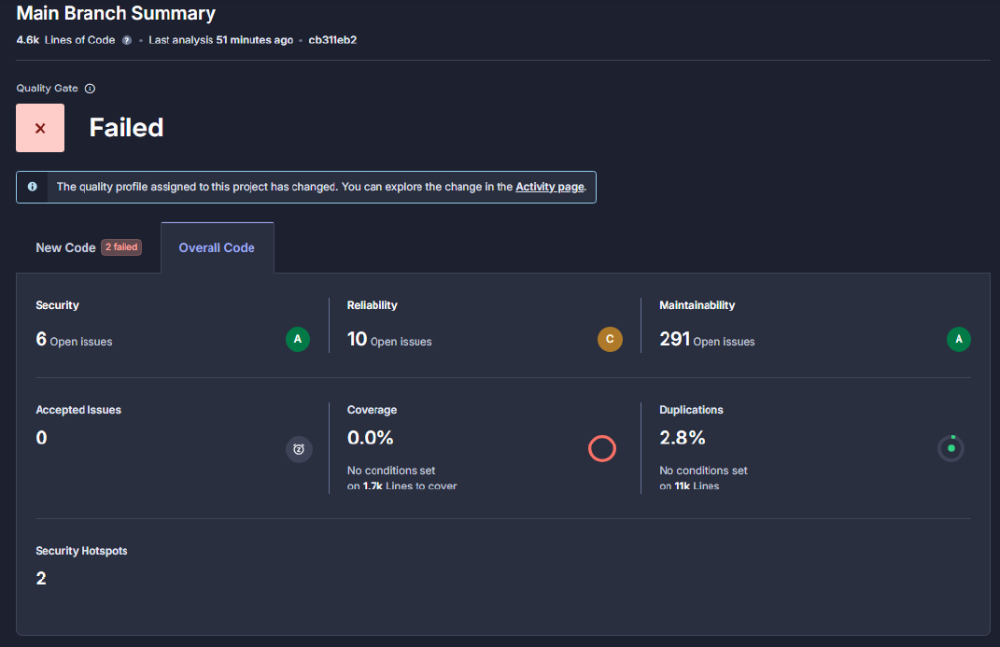

- **Segurança**: 6 vulnerabilidades (Grau C).  
- **Confiabilidade**: 10 *issues* (Grau C) — identificadas situações com comportamento potencialmente incorreto.  
- **Manutenibilidade**: 291 *issues* (Grau A) — embora existam vários *code smells*, a manutenibilidade é considerada boa.  
- **Cobertura de Código**: **78,06%** — valor obtido diretamente através do **Visual Studio Enterprise**. Contudo, o **SonarCloud ainda não está a refletir corretamente esta métrica**, possivelmente devido à configuração do ficheiro de cobertura.  
- **Código Duplicado**: 2,8% — um valor relativamente baixo.  
- **Security Hotspots**: 2 fragmento de código que requer revisão manual para verificar se constitui ou não uma vulnerabilidade real.

#### Estado Atual Fase 2 Sprint 2 da Análise no SonarCloud

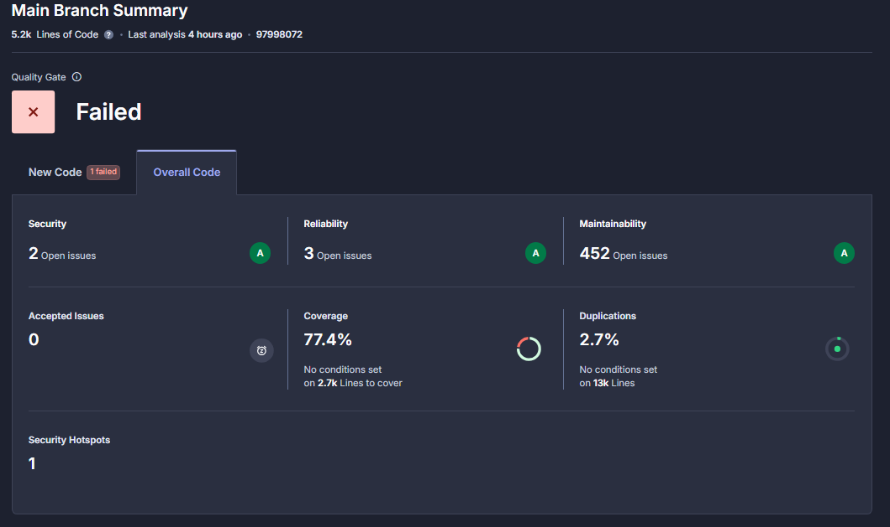

Com base na análise mais recente disponível no **SonarCloud**, o projeto apresenta o seguinte perfil de qualidade:

- **Segurança**: 2 vulnerabilidades (Grau A).  

- **Confiabilidade**: 3 *issues* (Grau A).  

- **Manutenibilidade**: 452 *issues* (Grau A).  

- **Cobertura de Código**: **77,40%** — Entretanto, já conseguimos configurar corretamente o SonarCloud para analisar a cobertura de testes. No entanto, este valor global ainda não reflete com precisão a realidade, pois inclui ficheiros de frontend que não possuem qualquer cobertura de testes.  
  
  **No que diz respeito exclusivamente ao backend, a cobertura está atualmente nos 82.1%**, como demonstrado na imagem abaixo.  
  
  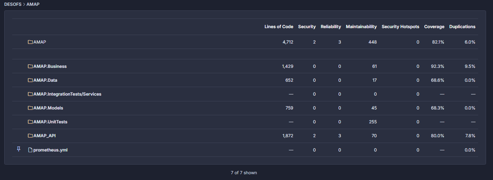
  
- **Código Duplicado**: 2,8% — um valor relativamente baixo.  

- **Security Hotspots**: 1 fragmento de código que requer revisão manual para verificar se constitui ou não uma vulnerabilidade real.

Este panorama oferece uma visão clara sobre a qualidade e segurança do código, permitindo priorizar as áreas que mais necessitam de atenção.

##### Correção das vulnerabilidades de Segurança

Durante a análise de qualidade e segurança de código realizada com o **SonarCloud**, foi identificada uma vulnerabilidade significativa que classificava a segurança da aplicação **AMAP** com **Grau C**, de acordo com as políticas de Content Security Policy (CSP) implementadas. A ferramenta de análise estática detetou que a configuração existente da CSP era excessivamente permissiva, expondo o sistema a um risco elevado de ataques de injeção de conteúdo.

**Vulnerabilidade Original**

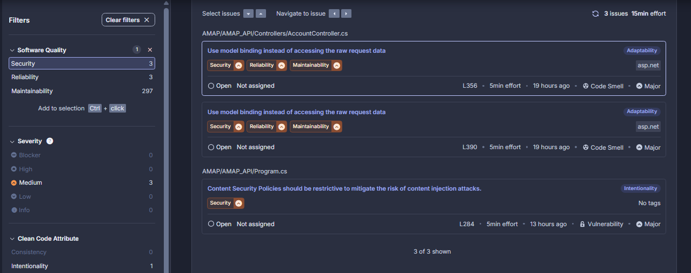

A configuração inicial permitia diretivas potencialmente perigosas, como demonstrado abaixo:

```c#
context.Response.Headers["Content-Security-Policy"] = "default-src 'self'; script-src 'self' 'unsafe-inline' 'unsafe-eval'; style-src 'self' 'unsafe-inline'; img-src 'self' data:; font-src 'self' data:;";
```

Esta implementação apresentava as seguintes fragilidades:

- **`'unsafe-inline'`**: Permitida a execução de scripts e estilos inline, facilitando ataques de Cross-Site Scripting (XSS).
- **`'unsafe-eval'`**: Autorizada a utilização da função `eval()`, que pode executar código dinâmico malicioso.
- **URIs do tipo `data:`**: Permitido o uso de `data:` em imagens e fontes, possibilitando esconder payloads maliciosos.

**Solução Implementada**

Para mitigar esta vulnerabilidade, foi definida uma política CSP mais restritiva, alinhada com as recomendações de segurança mais recentes. A nova implementação elimina diretivas inseguras e restringe o carregamento de recursos a fontes fidedignas e controladas.

```c#
context.Response.Headers["Content-Security-Policy"] = 
    "default-src 'self'; " +
    "script-src 'self'; " +                      // Removed unsafe-inline and unsafe-eval
    "style-src 'self'; " +                       // Removed unsafe-inline
    "img-src 'self'; " +                         // Removed data: scheme
    "font-src 'self'; " +                        // Removed data: scheme
    "connect-src 'self'; " +                     // Restrict API connections
    "frame-src 'none'; " +                       // Disallow frames
    "object-src 'none'; " +                      // Disallow plugins
    "base-uri 'self';";                          // Restrict base URIs
```

**Benefícios da Nova Implementação**

1. **Eliminação de Scripts Inline** 
   Impede a execução de código JavaScript diretamente nas páginas HTML, prevenindo ataques XSS persistentes e refletidos.

2. **Proibição de `eval()`** 
   Bloqueia funções como `eval()`, `setTimeout()` com strings e `new Function()`, reduzindo significativamente a superfície de ataque.

3. **Restrição de Origens de Recursos** 
   Apenas conteúdos (scripts, estilos, imagens, etc.) de origens confiáveis são permitidos, prevenindo a injeção de recursos externos maliciosos.

4. **Bloqueio de Frames** 
   Impede que a aplicação seja embebida em `frames` de terceiros, protegendo contra ataques de **clickjacking**.

5. **Desativação de Plugins Inseguros** 
   Restringe a utilização de objetos e plugins desatualizados e inseguros como Flash ou Java.

**Impacto na Segurança**

A adoção desta política CSP mais rigorosa oferece várias camadas de proteção contra ataques web modernos:

- **Proteção contra XSS**: Limita substancialmente a injeção e execução de scripts maliciosos.
- **Mitigação de Exfiltração de Dados**: Impede a transmissão não autorizada de dados para domínios externos.
- **Defesa contra UI Redressing**: Protege contra técnicas como clickjacking.
- **Redução do Impacto de Vulnerabilidades HTML**: Minimiza os efeitos de outras vulnerabilidades existentes no conteúdo da aplicação.

**Compatibilidade e Considerações**

A aplicação desta política exigiu uma análise minuciosa das funcionalidades legítimas da aplicação **AMAP**, garantindo que estas não fossem afetadas. Foram realizados testes exaustivos para confirmar que os recursos essenciais continuavam a funcionar corretamente.

Nos casos em que é necessário utilizar recursos externos, a política pode ser ajustada de forma controlada para incluir apenas domínios específicos e de confiança, evitando o uso de diretivas genéricas como `'unsafe-inline'` ou `'unsafe-eval'`.

**Conclusão**

**Antes:**

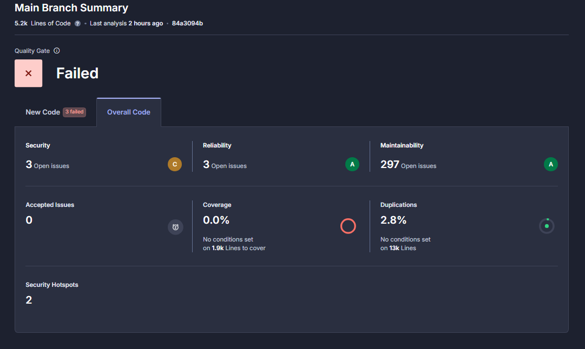

**Depois:**


A implementação de uma **Content Security Policy (CSP)** mais restritiva representa um avanço significativo na postura de segurança da aplicação **AMAP**, alinhando-a com as melhores práticas da segurança web moderna. Esta melhoria reduziu substancialmente o risco de ataques comuns, como injeção de scripts maliciosos, protegendo tanto os dados do sistema como a privacidade dos utilizadores.

Como resultado, a classificação de segurança atribuída pela análise do **SonarCloud** foi elevada de **Grau C** para **Grau A**, refletindo a eficácia das medidas adotadas. Esta atualização reforça o compromisso contínuo do projeto com a proteção de dados e com a adoção de mecanismos proativos face às ameaças cibernéticas em constante evolução.

#### Configurações de Segurança da Análise

A análise efetuada pelo SonarQube encontra-se configurada com diversas opções de segurança que garantem uma verificação rigorosa, nomeadamente:

- `sonar.security.enabled=true`: ativa a análise de segurança.  
- Configurações adicionais como `sonar.security.sources.cs.security=true` (para projetos .NET) permitem a análise específica de fontes potencialmente inseguras nas respetivas linguagens.

#### Métricas Avaliadas

O SonarQube avalia continuamente diversas métricas essenciais para a saúde do projeto:

- **Qualidade do Código**: deteção de *code smells*, bugs, vulnerabilidades e duplicações.  
- **Confiabilidade**: probabilidade de ocorrência de erros em tempo de execução.  
- **Manutenibilidade**: facilidade de compreender, modificar e manter o código.  
- **Segurança**: identificação de más práticas e vulnerabilidades conhecidas.  
- **Cobertura de Código**: análise da proporção de código testado — embora já esteja nos 85.25%, o SonarCloud ainda não apresenta este valor corretamente devido a uma questão de configuração.

#### Acesso aos Resultados

Os resultados detalhados da análise estática estão disponíveis publicamente através da plataforma SonarCloud:

🔗 [Link para o Projeto no SonarCloud](https://sonarcloud.io/project/overview?id=diogoc0307_desofs)

##### Manutenção e Melhoria Contínua

Para assegurar a eficácia contínua da análise estática de código:

- O scanner e as regras de análise são regularmente atualizados.  
- As configurações são revistas e adaptadas com a evolução do projeto.  
- Os resultados são monitorizados com frequência e as *issues* (bugs, vulnerabilidades e *code smells*) são triadas e resolvidas por ordem de prioridade.  
- Estamos a investigar e ajustar a configuração do pipeline para garantir que a cobertura de testes seja corretamente interpretada e refletida no SonarCloud.

### Análise de Composição de Software (SCA)

*   Descrever as ferramentas de SCA (ex: Snyk, OWASP Dependency-Check) e o seu papel na gestão de vulnerabilidades em dependências.

### Análise Dinâmica de Aplicações (DAST)

A análise dinâmica foi feita com o OWASP ZAP, integrado na pipeline CI/CD e executado automaticamente a cada commit. A ferramenta analisou a aplicação em tempo real, simulando ataques externos e identificando vulnerabilidades reais.

No relatório mais recente, foram encontrados os seguintes pontos:

- Uma biblioteca JavaScript vulnerável (DOMPurify)
- Falta de alguns cabeçalhos de segurança HTTP (como CSP, X-Frame-Options e HSTS)
- Pequenas exposições de informação (timestamps e comentários em JavaScript)

**Avaliação:**
O resultado é aceitável. Não foram detetadas falhas críticas como execução remota de código ou problemas graves de autenticação.
As principais falhas estão relacionadas com configurações de segurança e dependências desatualizadas, sendo mais fáceis de resolver.

### Outros Tipos de Testes

#### Testes Unitários

Os testes unitários desempenham um papel crucial no desenvolvimento de software ao garantir a qualidade, estabilidade e confiabilidade do código. Para a solução AMAP, foi desenvolvido um conjunto abrangente de testes unitários, organizados no projeto AMAP.UnitTests dentro da pasta "5 - Unit Tests". Este relatório detalha a abordagem e implementação destes testes.

##### Frameworks e Ferramentas Utilizados

**xUnit**
O framework xUnit foi escolhido para implementar os testes unitários devido à sua simplicidade, extensibilidade e integração com o ecossistema .NET. O xUnit suporta a execução de testes em paralelo, facilitando o processo de desenvolvimento e integração contínua. No AMAP, os testes são identificados pelo atributo [Fact], que designa um método como sendo um teste unitário.

**NSubstitute**
Para o isolamento de componentes e criação de objetos simulados, foi utilizado o NSubstitute, uma biblioteca moderna de mocking para .NET. O NSubstitute permite simular interfaces e classes, facilitando a verificação de comportamentos sem depender de implementações reais. Esta abordagem foi crucial para testar a camada de negócios sem necessidade de acesso a bancos de dados reais ou serviços externos.

##### Estrutura dos Testes

Os testes unitários do AMAP foram organizados para cobrir duas camadas principais:
1.	Camada de Business (Business Components): Testes voltados para a lógica de negócios, validando regras, comportamentos e fluxos de dados.
2.	Camada de Services (Controllers): Testes focados na validação dos controllers, assegurando o correto processamento de requisições e respostas.

##### Mock de Camadas

Um elemento fundamental na abordagem de testes foi a simulação de todas as dependências das diferentes camadas do sistema, com o objetivo de garantir isolamento completo e testes mais fiáveis. 

As principais simulações realizadas incluem:
- **Business Components:** Para testar os controladores de forma isolada, foram criadas versões simuladas dos componentes de negócio, como `MockProductBc`, `MockCatalogBc` e `MockPaymentBc`. Estas simulações permitiram validar a lógica da API sem dependência da implementação real da camada Business.
-  **Repositórios de Dados:** Todos os repositórios foram simulados, eliminando a necessidade de ligação a uma base de dados real durante os testes. Isto permitiu executar testes rápidos e previsíveis, sem efeitos colaterais.
-  **Serviços Externos:** Serviços auxiliares, como envio de e-mails ou notificações, foram substituídos por implementações simuladas, garantindo que os testes se focassem exclusivamente na lógica interna.
-   **Logging:** As funcionalidades de registo (log) também foram simuladas, evitando efeitos colaterais e garantindo o isolamento total dos componentes sob teste.

Por exemplo, a classe `MockProductRepository` demonstra como os repositórios foram simulados, oferecendo dados e comportamentos predefinidos:

```c#
public static IUnitOfWork GetMockUnitOfWork()
{
    var mockUnitOfWork = Substitute.For<IUnitOfWork>();

    // Set up Product repository
    var mockProductRepo = Substitute.For<IProductRepository>();
    SetupProductRepository(mockProductRepo);
    mockUnitOfWork.Product.Returns(mockProductRepo);

    // Set up Composite repository
    var mockCompositeRepo = Substitute.For<ICompositeRepository>();
    SetupCompositeRepository(mockCompositeRepo);
    mockUnitOfWork.Composite.Returns(mockCompositeRepo);

    // Set up AppUser repository
    var mockAppUserRepo = Substitute.For<IAppUserRepository>();
    SetupAppUserRepository(mockAppUserRepo);
    mockUnitOfWork.AppUser.Returns(mockAppUserRepo);

    return mockUnitOfWork;
}
```

##### Padrão AAA (Arrange-Act-Assert)

Todos os testes foram estruturados seguindo o padrão AAA, que proporciona clareza e consistência na organização dos testes:
1.	**Arrange:** Preparação do ambiente e dados necessários para o teste.
2.	**Act:** Execução da operação sendo testada.
3.	**Assert:** Verificação dos resultados esperados.

Exemplo do padrão AAA aplicado em um teste do ProductControllerTests:

```c#
[Fact]
public void GetProduct_ValidId_ReturnsOk()
{
    // Arrange
    var productId = 1;  

    // Act
    var result = _productController.GetProduct(productId);

    // Assert
    var actionResult = Assert.IsType<OkObjectResult>(result);
    Assert.Equal(200, actionResult.StatusCode);  
}
```

##### Cobertura de Cenários

Os testes unitários foram projetados para cobrir diversos cenários, incluindo:
1.	**Casos positivos:** Verificando o comportamento correto em situações esperadas.
2.	**Casos negativos:** Testando como o sistema reage a entradas inválidas ou situações excepcionais.
3.	**Condições de borda:** Testando o comportamento em situações limite.

Por exemplo, para o método `GetProduct()` da classe ProductBc, foram implementados testes que verificam:

• Recuperação de produtos válidos:

```c#
	[Fact]
	public void GetProduct_ValidId_ReturnsProduct()
	{
		// Arrange
		var productId = 1;

		// Act
		var result = _productBc.GetProduct(productId);

		// Assert
		Assert.NotNull(result);
		Assert.Equal(productId, result.Id);
		Assert.Equal("Carrots", result.Name);
		Assert.Equal("producer-1", result.ProducerId);
		Assert.Equal(2.50, result.ReferencePrice);
		Assert.False(result.IsDeleted);
	}
```

• Tratamento de IDs inválidos:

```c#
	[Fact]
	public void GetProduct_InvalidId_ThrowsArgumentException()
	{
		// Arrange
		var invalidId = 0;

		// Act & Assert
		var exception = Assert.Throws<ArgumentException>(() => _productBc.GetProduct(invalidId));
		Assert.Equal("Product ID must be greater than zero. (Parameter 'id')", exception.Message);
	}
```

• Comportamento com produtos inexistentes:

```c#
	[Fact]
	public void GetProduct_NonExistingId_ReturnsNull()
	{
		// Arrange
		var nonExistingId = 100;

		// Act
		var result = _productBc.GetProduct(nonExistingId);

		// Assert
		Assert.Null(result);
	}
```

• Tratamento de produtos marcados como excluídos:

```c#
	[Fact]
	public void GetProduct_DeletedProduct_ReturnsNull()
	{
		// Arrange
		var deletedProductId = 4;

		// Act
		var result = _productBc.GetProduct(deletedProductId);

		// Assert
		Assert.Null(result);
	}
```

• Carregamento correto de produtos compostos:

```c#
	[Fact]
	public void GetProduct_CompositeProduct_ReturnsProductWithComposites()
	{
		// Arrange
		var compositeProductId = 2;

		// Act
		var result = _productBc.GetProduct(compositeProductId);

		// Assert
		Assert.NotNull(result);
		Assert.Equal(compositeProductId, result.Id);
		Assert.Equal("Vegetable Box", result.Name);

		// Check composites
		Assert.NotNull(result.Composites);
		Assert.Single(result.Composites);

		var composite = result.Composites.First();
		Assert.Equal(1, composite.SubProductId);
		Assert.Equal(2, composite.Quantity);

		// Check that SubProduct is included
		Assert.NotNull(composite.SubProduct);
		Assert.Equal("Carrots", composite.SubProduct.Name);
	}
	
```

##### Teste de Segurança e Permissões

Parte significativa dos testes unitários focou em validar aspectos de segurança e permissões, garantindo que:

- Utilizadores só possam aceder ou modificar os seus próprios recursos
- Operações sensíveis incluam validações adequadas
- Erros sejam tratados apropriadamente sem expor informações sensíveis


##### Conclusão

A implementação abrangente de testes unitários na solução AMAP, utilizando xUnit e NSubstitute, continua a desempenhar um papel fundamental na garantia da qualidade e robustez do sistema. Nesta **Fase 2 da Sprint 2**, foi realizada uma expansão significativa na cobertura de testes, aumentando o número total de testes de **223 para 288**, o que demonstra o esforço contínuo na validação automatizada do comportamento do sistema.

**Explorador dos Testes Unitários – Fase 2 Sprint 1**


**Explorador dos Testes Unitários – Fase 2 Sprint 2**
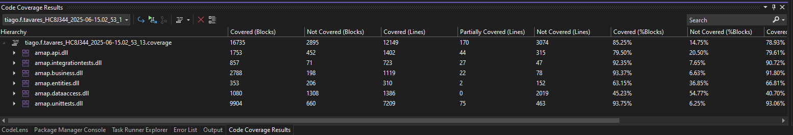

Esta evolução refletiu-se também na **melhoria da cobertura de código**, que passou de **78.06% para 85.25%**. Este aumento revela um progresso substancial na validação dos fluxos críticos da aplicação, reforçando a fiabilidade da solução.

A estratégia de testes unitários implementada na solução AMAP proporcionou:

- Maior confiabilidade do código através de verificação automatizada.
- Melhor documentação do comportamento esperado de cada componente.
- Facilitação de refatorações e melhorias no código existente.
- Redução de bugs através da deteção precoce de problemas.

**Cobertura dos Testes – Fase 2 Sprint 1**


**Cobertura dos Testes – Fase 2 Sprint 2**
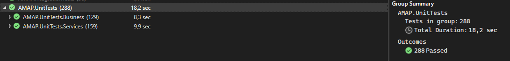

A combinação do xUnit e NSubstitute, aliada à abordagem estruturada segundo o padrão AAA (Arrange, Act, Assert), resultou num conjunto de testes robustos e eficazes que suportam a manutenção e evolução segura da solução AMAP.

#### Testes de Integração

Os testes de integração são fundamentais para verificar se os diferentes componentes do sistema funcionam corretamente quando integrados. Na solução **AMAP**, foi desenvolvido um conjunto abrangente de testes de integração, organizados no projeto `AMAP.IntegrationTests`, dentro da pasta `"6 - Integration Tests"`. Este relatório detalha a abordagem e implementação destes testes.

##### Frameworks e Ferramentas Utilizados

- **xUnit** 
  O framework xUnit foi escolhido para implementar os testes de integração, mantendo consistência com os testes unitários. O xUnit fornece funcionalidades robustas para testes automatizados, suportando a execução de testes em paralelo e integração com o ecossistema .NET. Os testes são identificados pelo atributo `[Fact]`, designando um método como um teste de integração.

- **WebApplicationFactory** 
  O pacote `Microsoft.AspNetCore.Mvc.Testing` fornece a classe `WebApplicationFactory`, que permite criar uma instância da aplicação web em um ambiente de teste. Esta abordagem possibilita testar os endpoints da API sem necessidade de deployment, simulando requisições HTTP reais e capturando respostas completas.

- **SQLite (In-Memory)** 
  Para isolar os testes da base de dados de produção, foi utilizado o SQLite em modo *in-memory*. Esta estratégia permite executar testes com dados controlados sem impactar ambientes reais, proporcionando execução rápida e consistente.

##### Estrutura de Testes

Os testes de integração do AMAP foram organizados para verificar o comportamento completo da API em cenários reais:

1. **IntegrationTestBase** 
   Classe base que inicializa o ambiente de teste, incluindo a configuração do SQLite e a criação de um cliente HTTP para interagir com a aplicação.

2. **CustomWebApplicationFactory** 
   Responsável por configurar o ambiente de teste, incluindo a substituição do contexto de banco de dados por um SQLite em memória e o preenchimento com dados de teste.

3. **Testes de Controladores** 
   Classes especializadas para testar cada controlador da API, como:
   - `ProductControllerTests`
   - `SubscriptionPeriodControllerTests`
   - `ProductOfferControllerTests`

##### Autenticação e Autorização em Testes

Um aspeto fundamental dos testes de integração foi a verificação da autenticação e autorização. O sistema implementa:

- **TestAuthHandler** 
  Manipulador de autenticação personalizado que simula utilizadores autenticados com diferentes roles (`Producer`, `CoProducer`, `Manager`).

- **GetAuthenticatedClient** 
  Método que retorna um cliente HTTP autenticado com um determinado ID de utilizador e role, permitindo testar endpoints protegidos.

```c#
protected HttpClient GetAuthenticatedClient(string userId, string role)
{
    var client = _factory
        .WithWebHostBuilder(builder =>
        {
            builder.ConfigureTestServices(services =>
            {
                // Configure test authentication
                services.PostConfigureAll<AuthenticationOptions>(options =>
                {
                    options.DefaultScheme = "Test";
                    options.DefaultAuthenticateScheme = "Test";
                    options.DefaultChallengeScheme = "Test";
                });

                // Set the user ID and role for this test
                TestAuthHandler.UserId = userId;
                TestAuthHandler.Role = role;
            });
        })
        .CreateClient(new WebApplicationFactoryClientOptions
        {
            AllowAutoRedirect = false
        });

    // Add the authorization header
    client.DefaultRequestHeaders.Authorization = new AuthenticationHeaderValue("Test");

    return client;
}
```

##### Preenchimento de Dados de Teste

Os testes de integração utilizam um conjunto de dados pré-definidos, preenchidos no banco de dados *in-memory* através do método `SeedTestData`. Este método cria:

- **Utilizadores**: Perfis de teste com diferentes roles (`Producer`, `CoProducer`, `Manager`)
- **Produtos**: Itens básicos para testar operações CRUD e relacionamentos
- **Períodos de Subscrição**: Configurações temporais para ofertas de produtos
- **Datas de Entrega**: Datas específicas associadas aos períodos de subscrição
- **Ofertas de Produtos**: Associações entre produtos e períodos com preços e quantidades

Este preenchimento garante um ambiente consistente e controlado para todos os testes de integração.

##### Padrão AAA (Arrange-Act-Assert)

Assim como nos testes unitários, todos os testes de integração seguem o padrão AAA:

1. **Arrange**: Preparação do ambiente, incluindo a criação de um cliente HTTP autenticado com as permissões apropriadas. 
2. **Act**: Execução da operação sendo testada, tipicamente uma requisição HTTP ao endpoint da API. 
3. **Assert**: Verificação dos resultados, incluindo o status HTTP da resposta e o conteúdo retornado.

Exemplo do padrão AAA aplicado em um teste do `SubscriptionPeriodControllerTests`.

```c#
[Fact]
public async Task GetSubscriptionPeriodById_ExistingPeriod_ReturnsSuccessStatusCode()
{
    // Arrange
    var client = _client;

    // Act
    var response = await client.GetAsync("/api/SubscriptionPeriod/1");

    // Assert
    response.EnsureSuccessStatusCode();
    var subscriptionPeriodDto = await response.Content.ReadFromJsonAsync<SubscriptionPeriodDto>();
    Assert.NotNull(subscriptionPeriodDto);
    Assert.Equal("Monthly", subscriptionPeriodDto.Duration);
}
```

##### Cobertura de Cenários

Os testes de integração foram projetados para cobrir diversos cenários importantes, incluindo:

1. **Operações CRUD Bem-Sucedidas** 
   Verificando se os endpoints da API processam corretamente operações básicas em todos os recursos.

2. **Validações de Permissões** 
   Testando se os controlos de acesso funcionam adequadamente, impedindo utilizadores não autorizados de realizar operações restritas.

3. **Tratamento de Erros**
   Confirmando que a API responde apropriadamente a situações de erro, como recursos inexistentes ou dados inválidos.

Exemplos no `SubscriptionPeriodControllerTests`:

- Recuperação de períodos de subscrição existentes 

```c#
[Fact]
public async Task GetSubscriptionPeriodById_ExistingPeriod_ReturnsSuccessStatusCode()
{
    // Arrange
    var client = _client;

    // Act
    var response = await client.GetAsync("/api/SubscriptionPeriod/1");

    // Assert
    response.EnsureSuccessStatusCode();
    var subscriptionPeriodDto = await response.Content.ReadFromJsonAsync<SubscriptionPeriodDto>();
    Assert.NotNull(subscriptionPeriodDto);
    Assert.Equal("Monthly", subscriptionPeriodDto.Duration);
}
```

- Tratamento de períodos inexistentes 

```c#
[Fact]
public async Task GetSubscriptionPeriodById_NonExistingPeriod_ReturnsNotFound()
{
    // Arrange
    var client = _client;

    // Act
    var response = await client.GetAsync("/api/SubscriptionPeriod/999");

    // Assert
    Assert.Equal(HttpStatusCode.NotFound, response.StatusCode);
}
```

- Verificação de permissões ao criar recursos 

```c#
[Fact]
public async Task CreateSubscriptionPeriod_NonManagerRole_ReturnsForbidden()
{
    // Arrange
    // Use a client with Producer role explicitly
    var client = GetAuthenticatedClient("testproducer-id", "Producer");

    // Verify the client is authenticated with Producer role
    Console.WriteLine("Testing with Producer role user");

    var newSubscriptionPeriod = new SubscriptionPeriod
    {
        Duration = "Spring 2024",
        StartDate = DateTime.Now.AddDays(220),
        EndDate = DateTime.Now.AddDays(310),
        DeliveryDates = new List<DeliveryDate>
        {
            new DeliveryDate { Date = DateTime.Now.AddDays(250) }
        }
    };

    // Act
    var response = await client.PostAsJsonAsync("/api/SubscriptionPeriod", newSubscriptionPeriod);

    // Assert
    Assert.Equal(HttpStatusCode.Forbidden, response.StatusCode);
}
```

##### Teste de Segurança e Permissões

Os testes de integração dão especial atenção a aspetos de segurança e permissões, verificando se:

- Endpoints protegidos rejeitam acessos não autenticados 
- Utilizadores sem permissão adequada recebem respostas **403 Forbidden** 
- Operações sensíveis exigem o nível correto de autorização 
- Cada utilizador só pode aceder ou modificar os recursos apropriados ao seu perfil 

##### Isolamento e Consistência

Para garantir isolamento e consistência entre os testes:

1. Cada teste utiliza um banco de dados SQLite em memória fresco, evitando interferências entre testes 
2. O mecanismo de preenchimento de dados de teste é executado antes de cada teste 
3. Tokens de autenticação são gerados dinamicamente para simular diferentes utilizadores 
4. Todos os recursos alocados são corretamente libertados pelo método `Dispose` após cada teste 

##### Conclusão

A implementação de testes de integração na solução **AMAP**, utilizando **xUnit** e **WebApplicationFactory** com **SQLite em memória**, proporcionou uma camada importante de validação da API REST. Esta abordagem permitiu verificar não apenas se cada componente funciona individualmente (como nos testes unitários), mas também se o sistema como um todo opera corretamente, incluindo a interação entre API, autenticação, autorização e persistência de dados.

Os testes de integração implementados cobrem cenários cruciais de negócio e segurança, garantindo que a API funcione conforme esperado em situações reais. A combinação de testes unitários e de integração proporciona uma cobertura abrangente da solução, contribuindo significativamente para a **qualidade** e **confiabilidade** do sistema AMAP.

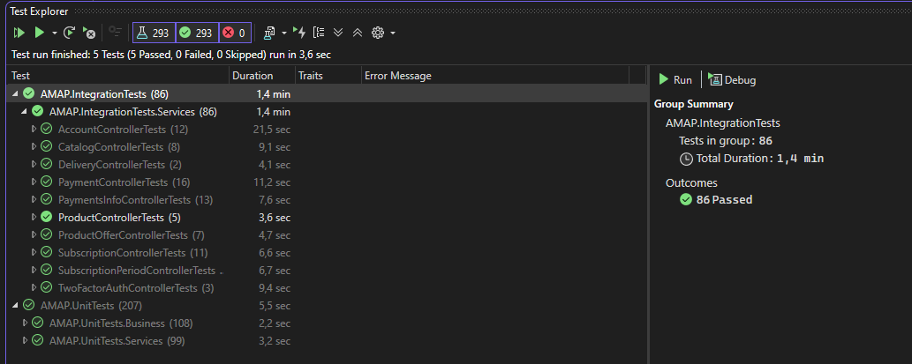

Todos os testes de integração implementados foram concluídos com sucesso, validando o comportamento correto da API REST em diversos cenários. A implementação destes testes contribuiu para:

- Validação de fluxos completos de negócio através da API 
- Verificação de mecanismos de autenticação e autorização 
- Confirmação de que a API responde corretamente a diferentes tipos de requisições 
- Deteção precoce de problemas de integração entre componentes 

A combinação de **xUnit**, **WebApplicationFactory** e **SQLite em memória** proporcionou um ambiente de teste robusto e eficiente, permitindo simular requisições HTTP reais e validar completamente o comportamento da API REST da solução AMAP.

### Testes de Segurança Específicos

Além dos testes automatizados e unitários, foi elaborado um **Guia de Testes MFA** para validar o correto funcionamento do fluxo de Autenticação Multi-Fator (MFA) para gestores. Este guia pode ser seguido com o Postman ou outro cliente de API.

#### Guia de Testes MFA

Este guia descreve o processo de teste do fluxo de Autenticação Multi-Fator (MFA) destinado a utilizadores com perfil de gestor, utilizando o Postman ou outro cliente de API.

1. <u>**Configuração do MFA (Geração de Código QR / Segredo)**</u>

- **Pedido:**

```json
POST /api/auth/mfa/setup
//Cabeçalhos:
Authorization: Bearer <token_gestor>
Corpo (JSON):
{
"userId": "<id_utilizador_gestor>"
}
```

-  **Resposta:**
  - Retorna um URL para um código QR (abrível no navegador) ou uma chave secreta que poderá ser introduzida numa aplicação autenticadora (por exemplo, Google Authenticator).

2. <u>**Registo do MFA na Aplicação Autenticadora**</u>

- O código QR ou a chave secreta fornecida deverá ser registada numa aplicação autenticadora para associar a conta.

3. <u>**Ativação do MFA (Verificação e Ativação)**</u>

- **Pedido:**

```json
POST /api/auth/mfa/enable
//Cabeçalhos:
Authorization: Bearer <token_gestor>
Corpo (JSON):
{
"userId": "<id_utilizador_gestor>",
"code": "<código de 6 dígitos da aplicação>"
}
```

- **Resposta:**
  - A ativação será bem-sucedida caso o código seja válido, ficando o MFA ativo para o utilizador.

4. **<u>Verificação do MFA no Processo de Autenticação</u>**

- **Pedido:**

```json
POST /api/auth/mfa/verify
//Corpo (JSON):
{
"userId": "<id_utilizador_gestor>",
"code": "<código de 6 dígitos da aplicação>"
}
```

- **Resposta:**
  - O processo de autenticação será concluído com sucesso caso o código seja válido.

<u>**Notas**</u>:

- Os valores `<token_gestor>` e `<id_utilizador_gestor>` devem ser substituídos pelos dados reais do ambiente de testes.
- Os códigos MFA são sensíveis ao tempo e alteram-se a cada 30 segundos na aplicação autenticadora.
- É essencial garantir que os relógios do servidor e dos dispositivos dos utilizadores estão sincronizados, para evitar falhas na verificação do código.

#### Guia de Monitorização do Sistema e Utilizadores

Monitorizar a saúde, desempenho e utilização do sistema backend e dos utilizadores, permitindo a deteção precoce de problemas e visibilidade sobre o comportamento do sistema.

##### Ferramentas Utilizadas

- **Prometheus**: Recolhe e armazena métricas do backend.
- **Grafana**: Visualiza métricas e cria dashboards/alertas.
- **prometheus-net.AspNetCore**: Biblioteca .NET para expor métricas de aplicações ASP.NET Core.

##### Integração Passo a Passo

###### A. Adicionar Métricas Prometheus ao ASP.NET Core

1. **Instalar o pacote NuGet**
   
   ```sh
   dotnet add package prometheus-net.AspNetCore
   ```
   
2. **Configurar no `Program.cs`**
   ```csharp
   // Adiciona no topo:
   using Prometheus;
   
   // Na secção builder.Services (se necessário):
   // builder.Services.AddHealthChecks();
   
   // No pipeline da app (após app.UseRouting()):
   app.UseEndpoints(endpoints =>
   {
       endpoints.MapControllers();
       endpoints.MapMetrics(); // Expõe o endpoint /metrics
   });
   ```

3. **Executar a API**
   
   - Um novo endpoint `/metrics` estará disponível com métricas Prometheus.

###### B. Instalar e Configurar o Prometheus

1. **Descarregar o Prometheus**
   - [https://prometheus.io/download/](https://prometheus.io/download/)

2. **Editar o `prometheus.yml`**
   ```yaml
   global:
     scrape_interval: 15s
   
   scrape_configs:
     - job_name: 'amap-backend'
       static_configs:
         - targets: ['localhost:5000'] # Porta da tua API
   ```

3. **Iniciar o Prometheus**
   ```sh
   ./prometheus --config.file=prometheus.yml
   ```
   - Acede a [http://localhost:9090](http://localhost:9090) para ver o Prometheus.

###### C. Instalar e Configurar o Grafana

1. **Descarregar o Grafana**
   - [https://grafana.com/grafana/download](https://grafana.com/grafana/download)

2. **Iniciar o Grafana**
   - Segue as instruções do site. Por defeito, corre em [http://localhost:3000](http://localhost:3000)

3. **Adicionar o Prometheus como fonte de dados**
   - No Grafana, vai a "Configuração" > "Fontes de Dados" > "Adicionar fonte de dados" > Escolhe Prometheus e coloca `http://localhost:9090`.

4. **Criar dashboards**
   - Usa dashboards prontos ou cria gráficos para:
     - Número de requisições por endpoint
     - Erros (4xx, 5xx)
     - Tempo de resposta
     - Utilização de recursos

##### Boas Práticas
- Monitoriza endpoints críticos e recursos do sistema.
- Revê dashboards e alertas regularmente.
- Mantém as ferramentas atualizadas.

##### Exemplo de Queries para Grafana

- **Utilização de CPU:**
  ```sql
  process_cpu_seconds_total{job="amap-backend"}
  ```
- **Total de Requisições HTTP:**
  
  ```sql
  http_requests_received_total{job="amap-backend"}
  ```
- **Duração das Requisições (percentil 95%):**
  ```sql
  histogram_quantile(0.95, sum(rate(http_request_duration_seconds_bucket{job="amap-backend"}[5m])) by (le))
  ```

**Nota de Segurança**

> Em produção, restringe-se o acesso ao endpoint `/metrics` apenas a sistemas internos ou protege-se com autenticação/firewall para evitar exposição de dados operacionais sensíveis.

##### Como Criar Alertas no Grafana

1. No dashboard, clica num painel e seleciona "Editar".
2. Vai ao separador "Alerta" e clica em "Criar regra de alerta".
3. Define a condição (ex: se a utilização de CPU > 80% durante 5 minutos).
4. Configura canais de notificação (email, Slack, etc.).
5. Guarda o alerta.

---

# Automação da Pipeline DevSecOps

## Pipeline de CI/CD com GitHub Actions

Este documento descreve a pipeline de Integração Contínua e Implantação Contínua (CI/CD) configurada utilizando o GitHub Actions para o projeto AMAP. A pipeline automatiza os processos de construção, teste e implantação da aplicação sempre que há novas alterações no código. A pipeline é definida no ficheiro `.github/workflows/main.yml`.

## Visão Geral da Pipeline

A pipeline de CI/CD foi projetada para garantir qualidade, segurança e confiabilidade do código, seguindo as melhores práticas de desenvolvimento. A pipeline é executada automaticamente em cada push para qualquer branch, com etapas adicionais de implantação sendo executadas apenas na branch `main`.

## Fluxo da Pipeline

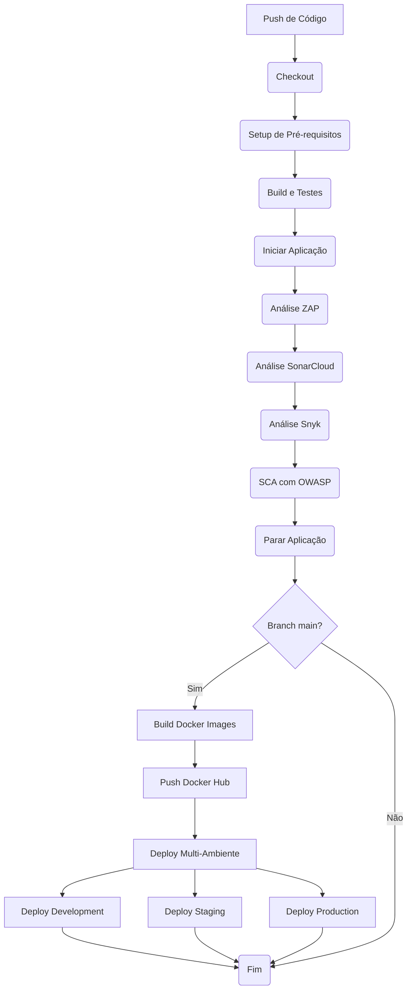

## Tecnologias Utilizadas e Justificações

1. **GitHub Actions**
    - Plataforma nativa do GitHub para CI/CD
    - Integração perfeita com o repositório
    - Suporte a containers e runners auto-hospedados
    - Marketplace rico em ações pré-configuradas

2. **.NET 9.0**
    - Framework moderna
    - Suporte a containers nativo
    - Ferramentas para testes e cobertura de código

3. **Docker**
    - Containerização para garantir consistência entre ambientes
    - Multi-stage builds para otimizar tamanho da imagem
    - Facilidade de deploy em diferentes ambientes

4. **OWASP ZAP**
    - Análise de segurança automatizada de aplicações web
    - Detecção de vulnerabilidades OWASP Top 10
    - Geração de relatórios
    - Integração com GitHub Actions
    - Criação automática de issues para vulnerabilidades encontradas

5. **SonarCloud**
    - Análise contínua da qualidade do código
    - Detecção de bugs e vulnerabilidades
    - Métricas de cobertura de código
    - Integração nativa com GitHub

6. **Snyk**
    - Análise de vulnerabilidades nas dependências
    - Monitorização contínua de segurança
    - Integração com Docker para análise de imagens

7. **Docker Hub**
    - Registo de containers confiável
    - Integração com GitHub Actions
    - Suporte a autenticação segura

8. **SSH Gateway**
    - Acesso seguro ao ambiente de staging
    - Suporte a autenticação por chave
    - Configuração flexível para diferentes ambientes

---

## Fases da Pipeline

A pipeline é dividida nas seguintes fases principais, executadas sequencialmente:

### 1. Checkout do Código

Esta é a primeira fase, onde o código mais recente do repositório é clonado para o ambiente do runner.

*   **Objetivo:** Obter a versão mais recente do código-fonte para as etapas subsequentes da pipeline.
*   **Passos:**
    1.  Utilização da ação `actions/checkout@v3` para clonar o repositório.
*   **Visualização:**

    

### 2. Setup de Pré-requisitos

Esta fase garante que o ambiente de execução do GitHub Actions runner esteja pronto para construir e testar a aplicação, instalando as ferramentas necessárias.

*   **Objetivo:** Instalar as ferramentas necessárias, como o .NET SDK e o ReportGenerator.
*   **Passos:**
    1.  Instalação do .NET SDK na versão especificada (`${{ env.DOTNET_VERSION }}`) utilizando `actions/setup-dotnet@v3`.
    2.  Instalação global da ferramenta ReportGenerator (`dotnet tool install -g dotnet-reportgenerator-globaltool`) para processar relatórios de cobertura de código.
    3.  Instalação do Entity Framework Core CLI (`dotnet tool install --global dotnet-ef`) para gestão de migrações da base de dados.
    4.  Instalação da ferramenta dotnet-coverage (`dotnet tool install --global dotnet-coverage`) para a recolha de métricas de cobertura de código.
*   **Visualização:**

    

### 3. Build, Teste e Análise

Esta fase é responsável por compilar o código, executar os testes unitários com cobertura de código e realizar análises de qualidade e segurança estática com SonarCloud.

*   **Objetivo:** Verificar a integridade e qualidade do código, garantindo que as funcionalidades existentes não foram quebradas pelos testes e realizar a análise estática com o SonarCloud.

#### 3.1 Restauração e 'Build'

Esta subfase foca na preparação do projeto, restaurando dependências e compilando o código.

*   **Objetivo:** Garantir que todas as dependências do projeto estão disponíveis e que o código fonte pode ser compilado com sucesso.
*   **Passos:**
    1.  Restauração das dependências do projeto (`dotnet restore AMAP/AMAP.sln`).
    2.  Construção do projeto (`dotnet build AMAP/AMAP.sln --no-restore`).
*   **Visualização:**

    
    

#### 3.2 Testes Unitários

Nesta subfase, os testes unitários são executados e a cobertura de código é reportada.

*   **Objetivo:** Verificar se as funcionalidades individuais da aplicação funcionam como esperado e medir a percentagem de código coberto pelos testes.
*   **Passos:**
    1.  Execução dos testes unitários com coleta de cobertura de código (`dotnet test AMAP/AMAP.sln --no-build --collect:"XPlat Code Coverage"`).
    2.  Geração do relatório de cobertura no formato OpenCover (`reportgenerator`).
*   **Visualização:**

    
    

### 4. Iniciar Aplicação para Análise ZAP

Esta fase inicia a aplicação para que o ZAP possa realizar a análise de segurança.

*   **Objetivo:** Disponibilizar a aplicação para análise de segurança pelo ZAP.
*   **Passos:**
    1.  Iniciar a aplicação em modo de desenvolvimento.
    2.  Aguardar a aplicação estar pronta para receber requisições.
*   **Visualização:**

    

### 5. Análise de Segurança com ZAP

Esta fase executa a análise de segurança da aplicação utilizando o OWASP ZAP (Zed Attack Proxy).

*   **Objetivo:** Identificar vulnerabilidades de segurança na aplicação web através de testes automatizados.
*   **Passos:**
    1.  Execução do ZAP baseline scan na aplicação.
    2.  Geração de relatórios de segurança.
    3.  Criação de issues no GitHub para vulnerabilidades encontradas.
*   **Visualização:**

    
    

### 6. Análise com SonarCloud

Esta subfase integra o SonarCloud para realizar a análise estática do código.

*   **Objetivo:** Identificar e reportar bugs, code smells, vulnerabilidades e hotspots de segurança no código.
*   **Passos:**
    1.  Configuração e execução da análise do SonarCloud para análise de código, cobertura e segurança.
*   **Visualização:**

    
    
    

### 7. Análise de Segurança com Snyk

Esta fase executa a análise de segurança do código e das dependências utilizando o Snyk, verificando vulnerabilidades conhecidas.

*   **Objetivo:** Identificar vulnerabilidades conhecidas no código e nas bibliotecas utilizadas.
*   **Passos:**
    1.  Instalação do Snyk CLI (se necessário).
    2.  Execução da análise do Snyk no projeto (por exemplo, `snyk test`).
*   **Visualização:**

    
    

### 8. Análise de Dependências (SCA) com OWASP Dependency Check

Esta fase utiliza o OWASP Dependency Check para analisar as dependências do projeto na tentativa de encontrar vulnerabilidades conhecidas.

*   **Objetivo:** Identificar componentes de 'software' com vulnerabilidades de segurança conhecidas e gerar relatórios detalhados.
*   **Passos:**
    1.  Execução da ação `dependency-check/Dependency-Check_Action` no projeto.
    2.  Geração de relatórios com as vulnerabilidades encontradas.
*   **Visualização:**

    

### 9. Parar Aplicação

Esta fase encerra a aplicação após todas as análises de segurança.

*   **Objetivo:** Encerrar a aplicação após a conclusão de todas as análises de segurança.
*   **Passos:**
    1.  Parar a aplicação de forma limpa.
    2.  Verificar se todos os recursos foram libertos.
*   **Visualização:**

    

### 10. Construção das Imagens Docker (Apenas na main branch)

Nesta fase, a aplicação é empacotada em três imagens Docker diferentes, uma para cada ambiente (Development, Staging e Production).

*   **Objetivo:** Criar containers leves e portáteis contendo a aplicação pronta para ser executada em diferentes ambientes.
*   **Passos:**
    1.  Configuração do ambiente Docker buildx.
    2.  Construção das imagens Docker usando o `Dockerfile`:
        *   Imagem Development: `diogocosta0307/desofs:dev`
        *   Imagem Staging: `diogocosta0307/desofs:staging`
        *   Imagem Production: `diogocosta0307/desofs:prod`
*   **Visualização:**

### 11. Push das Imagens Docker (Apenas na main branch)

Esta fase envia as imagens Docker construídas para o Docker Hub, disponibilizando-as para implantação em diferentes ambientes.

*   **Objetivo:** Disponibilizar as imagens Docker para serem utilizadas nos diferentes ambientes de implantação.
*   **Pré-requisitos:** Configuração dos segredos `DOCKERHUB_USERNAME` e `DOCKERHUB_TOKEN` no GitHub.
*   **Passos:**
    1.  Login no Docker Hub.
    2.  Push das imagens Docker para o repositório configurado:
        *   `diogocosta0307/desofs:dev`
        *   `diogocosta0307/desofs:staging`
        *   `diogocosta0307/desofs:prod`
*   **Visualização:**

    

### 12. Implantação Multi-Ambiente (Apenas na main branch)

Esta fase implanta a aplicação em três ambientes distintos (Development, Staging e Production), cada um com sua própria configuração e porta de acesso.

*   **Objetivo:** Implantar e manter versões da aplicação em diferentes ambientes para desenvolvimento, testes e produção.
*   **Pré-requisitos:** 
    *   Configuração de acesso SSH à VM via gateway
    *   Docker e Docker Compose instalados na VM
    *   Ficheiros `docker-compose.{environment}.yml` configurados para cada ambiente
*   **Passos:**
    1.  **Ambiente de Development:**
        *   Deploy na porta 7262
        *   Diretório na VM: `/root/desofs-app-dev`
        *   Variável de ambiente: `ASPNETCORE_ENVIRONMENT=Development`
        *   Imagem: `diogocosta0307/desofs:dev`

    2.  **Ambiente de Staging:**
        *   Deploy na porta 7263
        *   Diretório na VM: `/root/desofs-app-staging`
        *   Variável de ambiente: `ASPNETCORE_ENVIRONMENT=Staging`
        *   Imagem: `diogocosta0307/desofs:staging`

    3.  **Ambiente de Production:**
        *   Deploy na porta 7264
        *   Diretório na VM: `/root/desofs-app-prod`
        *   Variável de ambiente: `ASPNETCORE_ENVIRONMENT=Production`
        *   Imagem: `diogocosta0307/desofs:prod`

*   **Configuração dos Ambientes:**
    *   Cada ambiente utiliza seu próprio ficheiro `docker-compose.{environment}.yml`
    *   As configurações específicas de cada ambiente são mantidas nos ficheiros `appsettings.{Environment}.json`
    *   O ficheiro `appsettings.json` base contém as configurações comuns a todos os ambientes
    *   As portas são mapeadas de forma única para evitar conflitos:
        *   Development: 7262
        *   Staging: 7263
        *   Production: 7264

*   **Verificação do Deploy:**
    Para verificar se os containers estão rodando corretamente na VM, utilize os seguintes comandos:
    ```bash
    # Listar containers em execução
    docker ps
    
    # Ver logs de um container específico
    docker logs amap-api-development
    docker logs amap-api-staging
    docker logs amap-api-production
    
    # Verificar portas em uso
    sudo netstat -tulnp | grep 726
    ```

*   **Visualização:**

    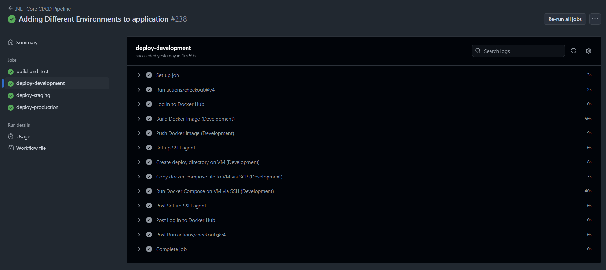

## Gestão de Dependências

### Análise e Instalação

1. **Verificação de Dependências**
    - Análise automática de pacotes NuGet
    - Verificação de versões compatíveis
    - Detecção de conflitos de dependências

2. **Instalação Segura**
    - Restauração de pacotes via `dotnet restore`
    - Verificação da integridade dos pacotes
    - Cache das dependências para builds mais rápidas

3. **Monitorização de Segurança**
    - Integração com Snyk para análise de vulnerabilidades
    - Verificação de licenças de pacotes
    - Alertas automáticos para dependências desatualizadas

---

## Análise de Segurança

A pipeline integra múltiplas ferramentas de segurança para garantir uma análise abrangente:

1. **Análise de Segurança de Aplicação Web (ZAP)**
    - Testes automatizados de segurança
    - Detecção de vulnerabilidades OWASP Top 10
    - Geração de relatórios de segurança
    - Criação automática de issues no GitHub

2. **Análise de Código (SAST - Static Application Security Testing)**
    - Detecção de problemas de segurança
    - Verificação de boas práticas
    - Sugestões de correção

3. **Análise de Dependências (Snyk)**
    - Verificação de vulnerabilidades em bibliotecas
    - Monitorização de dependências
    - Recomendações de atualizações

4. **Análise de Containers**
    - Verificação de vulnerabilidades em imagens base
    - Recomendações de atualizações
    - Monitorização de camadas Docker

## Relatórios Gerados

A pipeline gera diversos relatórios para análise:

1. **Relatórios de Testes**
    - Resultados de testes unitários
    - Cobertura de código
    - Tempo de execução dos testes
2. **Relatórios de Qualidade**
    - Métricas do SonarCloud
    - Code smells e bugs
    - Duplicação de código
    - Complexidade ciclomática
3. **Relatórios de Segurança**
    - Vulnerabilidades do Snyk (código e containers)
    - Hotspots de segurança do SonarCloud
    - Dependências desatualizadas
    - **Vulnerabilidades de Dependências (OWASP Dependency Check)**
4. **Relatórios de Build**
    - Logs de compilação
    - Tempo de build
    - Uso de recursos
5. **Relatórios de Deploy**
    - Status da implantação
    - Logs de containers
    - Métricas de performance
6. **Relatórios de Cobertura**
    - Relatórios HTML de cobertura de código
    - Disponibilizados como artefatos do GitHub Actions
    - Acessíveis através da interface do GitHub Actions

### Exemplos de Relatórios

- [dependency-check-report.html](dependency-check-report.html)
- [coverage-report.html](coverage-report.html)

## Configuração de Segredos

Para que a pipeline funcione corretamente, diversos segredos precisam de ser configurados no repositório do GitHub. Estes incluem credenciais para o Docker Hub e acesso SSH à máquina virtual de staging.

*   `DOCKERHUB_USERNAME`: O nome de utilizador no Docker Hub.
*   `DOCKERHUB_TOKEN`: Um Personal Access Token do Docker Hub com permissões de push.
*   `SSH_PRIVATE_KEY`: A chave privada SSH para autenticação na VM de staging.
*   `SSH_KNOWN_HOSTS`: A host key da VM de staging para verificar a autenticidade do servidor.
*   `SSH_PASSPHRASE`: A senha da chave privada SSH.
*   `SONAR_TOKEN`: Token de autenticação para o SonarCloud
*   `SNYK_TOKEN`: Token de autenticação para o Snyk
*   `VM_HOST`: O hostname ou endereço IP da VM de staging (resolvível dentro da rede ISEP/VPN).
*   `VM_PORT`: A porta SSH da VM de staging.
*   `VM_USER`: O utilizador SSH para login na VM de staging.
*   `VM_GATEWAY_HOST`: O hostname ou endereço IP do servidor gateway SSH.
*   `VM_GATEWAY_PORT`: A porta SSH do servidor gateway.
*   `VM_GATEWAY_USER`: O utilizador SSH para login no servidor gateway.

---

## Duração dos Steps

Aqui está um resumo da duração média de cada step da pipeline:

1. **Setup de Pré-requisitos**
   - Duração média: 32 sec

2. **Build e Testes**
   - Duração média: 1m 13sec

3. **Iniciar Aplicação**
   - Duração média: 1m 22sec

4. **Análise de Segurança com ZAP**
   - Duração média: 1m 8sec

5. **Análise SonarCloud**
   - Duração média: 2m 1sec

6. **Análise de Segurança (Snyk)**
   - Duração média: 24sec

7. **SCA com OWASP**
   - Duração média: 58sec

8. **Parar Aplicação**
   - Duração média: 1sec

9. **Build Docker**
   - Duração média: 49sec

10. **Push Docker Hub**
    - Duração média: 9sec

11. **Deploy via SSH Gateway**
    - Duração média: 50sec

**Duração Total da Pipeline**: 7min 38sec
**Duração Deploy Ambientes**: 1min 48sec

---

# Produção

## Gestão da Infraestrutura de Produção

### Ambiente de Alojamento

O sistema AMAP em produção utiliza:

- **Containerização**: Docker com imagem otimizada baseada em .NET 9.0

- **Orquestração**: Docker Compose para gestão do serviço em produção

- **Registo**: Docker Hub (diogocosta0307/desofs:prod) para distribuição da imagem

- **Infraestrutura**: Máquina virtual do ISEP com acesso via gateway SSH

- **Porta**: 7264 (mapeada para 80 no container)

### Estratégias de Deployment

A aplicação em produção é implantada através de:

- **Build**: Imagem Docker otimizada com multi-stage build

- **Registo**: Push automático para o Docker Hub com tag :prod

- **Deploy**: Implantação automática via SSH com rollback em caso de falha

- **Validação**: Verificação automática da saúde da aplicação após deploy

## Registo e Rastreabilidade em Produção

### Sistema de Logging

O sistema em produção implementa:

- **Logs de Aplicação**: Sistema nativo de logging do .NET Core com níveis configuráveis

- **Logs de Container**: Docker com driver json-file e rotação automática

- **Logs de Deploy**: Registos detalhados de cada implantação

- **Relatórios de Segurança**: Geração automática de relatórios HTML

### Rastreabilidade de Eventos e Auditoria

A rastreabilidade em produção é garantida através de:

- **Versionamento**: Tag única baseada no commit SHA para cada deploy

- **Logs de Deploy**: Registos detalhados de cada implantação

- **Métricas**: Monitorização de performance e recursos

- **Auditoria**: Registos de todas as alterações em produção

## Gestão de Incidentes

### Monitorização

O sistema de monitorização em produção inclui:

- **Análise de Segurança**: Verificação contínua de vulnerabilidades

- **Monitorização de Recursos**: CPU, memória e rede

- **Logs de Container**: Monitorização de estado e recursos

- **Alertas**: Notificações automáticas em caso de problemas

### Processo de Resposta

O processo de resposta a incidentes em produção segue:

- **Deteção**: Alertas automáticos de monitorização

- **Análise**: Investigação através de logs detalhados

- **Contenção**: Rollback automático para versão anterior

- **Resolução**: Correção e novo deploy

- **Validação**: Verificação pós-correção

## Gestão de Atualizações

### Estratégia de Atualização

A estratégia de atualização em produção utiliza:

- **Deploy Automatizado**: Trigger por push na branch `main`

- **Validação**: Testes automáticos antes do deploy

- **Versionamento**: Tag única para cada versão

- **Rollback**: Capacidade de reverter para versão anterior

### Manutenção

O processo de manutenção inclui:

- **Monitorização**: Verificação contínua de vulnerabilidades

- **Análise**: Relatórios de segurança

- **Atualizações**: Validação automática antes de aplicar

- **Backup**: Estratégia de backup dos dados

## Gestão de Configurações

### Separação e Segurança de Configurações

As configurações são geridas através de:

- **GitHub Secrets**: Armazenamento seguro de palavras-passe e tokens  
- **Variáveis de Ambiente**: Configurações específicas de produção 
- **Configurações de Container**: Docker Compose com variáveis específicas    
- **Rede**: Rede Docker isolada (`amap-network`)  

### Configurações de Segurança Implementadas

A segurança em produção é garantida através de:

- **Autenticação**: Chaves SSH para acesso seguro

- **Tokens**: Autenticação segura para serviços externos

- **Isolamento**: Rede Docker bridge para isolamento

- **Porta**: 7264:80 mapeada para acesso externo

- **Restart**: Política unless-stopped para disponibilidade

Esta implementação demonstra uma gestão robusta do ambiente de produção, com foco em segurança, monitorização e processos automatizados para garantir a disponibilidade e confiabilidade do sistema AMAP em produção.

---

# Operação

A fase de Operação do sistema **AMAP** compreende um conjunto de práticas e mecanismos destinados a garantir a **segurança**, **disponibilidade** e **continuidade do serviço** após a sua implementação. Seguem-se as principais estratégias adotadas:

## Monitorização do Sistema e dos Utilizadores

### Monitorização da Atividade e Segurança dos Utilizadores

Para garantir a fiabilidade, desempenho e segurança do backend, foi implementada monitorização do sistema e dos utilizadores utilizando **Prometheus** e **Grafana**. Estas ferramentas permitem o acompanhamento em tempo real da saúde da aplicação, utilização de recursos e atividade dos utilizadores.

**Prometheus**

- **Prometheus** é uma ferramenta open-source de monitorização e alertas.
- Recolhe métricas de aplicações instrumentadas ao aceder a endpoints HTTP expostos (neste caso, `/metrics` do backend ASP.NET Core).
- O Prometheus armazena estas métricas e disponibiliza-as para consulta e visualização.

**Endpoint /metrics**

- O backend ASP.NET Core expõe um endpoint `/metrics` usando o pacote `prometheus-net.AspNetCore`.
- Este endpoint fornece métricas em tempo real sobre o desempenho da aplicação, utilização de recursos e tráfego HTTP.
- Exemplo: Aceder a `https://localhost:7262/metrics` devolve uma lista de métricas no formato Prometheus.

**Grafana**

- **Grafana** é uma aplicação open-source de visualização e análise interativa de dados.
- Liga-se ao Prometheus como fonte de dados e permite criar dashboards e painéis para visualizar métricas.
- Os dashboards podem ser personalizados para mostrar a informação mais relevante sobre a saúde do sistema e atividade dos utilizadores.

####  Métricas Testadas e o seu Significado

##### 1. `process_cpu_seconds_total`
- **Descrição:**
  - Mede o tempo total de CPU (em segundos) consumido pelo processo do backend.
  - Útil para detetar picos de CPU e monitorizar a utilização de recursos ao longo do tempo.
- **Exemplo no Grafana:**
  - Query: `process_cpu_seconds_total{job="amap-backend"}`
- **Imagem:**
  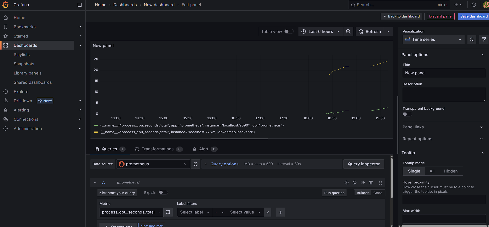

##### 2. `http_requests_received_total`
- **Descrição:**
  - Conta o número total de requisições HTTP processadas pela aplicação ASP.NET Core.
  - Pode ser filtrado por método HTTP, código de estado e endpoint.
  - Útil para acompanhar o uso da API e detetar padrões de tráfego invulgares.
- **Exemplo no Grafana:**
  - Query: `http_requests_received_total{job="amap-backend"}`
- **Imagem:**
  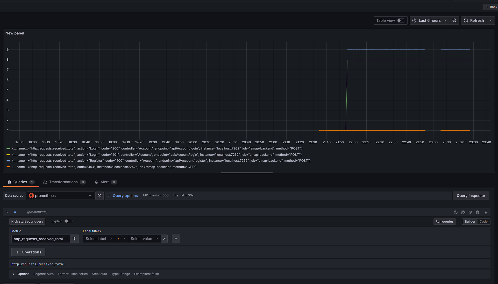

##### 3. `http_request_duration_seconds_sum`
- **Descrição:**
  - Soma a duração total (em segundos) de todas as requisições HTTP processadas.
  - Útil para analisar a latência e desempenho global da API.
  - Pode ser combinado com `http_request_duration_seconds_count` para calcular o tempo médio de resposta.
- **Exemplo no Grafana:**
  - Query: `http_request_duration_seconds_sum{job="amap-backend"}`
- **Imagem:**
  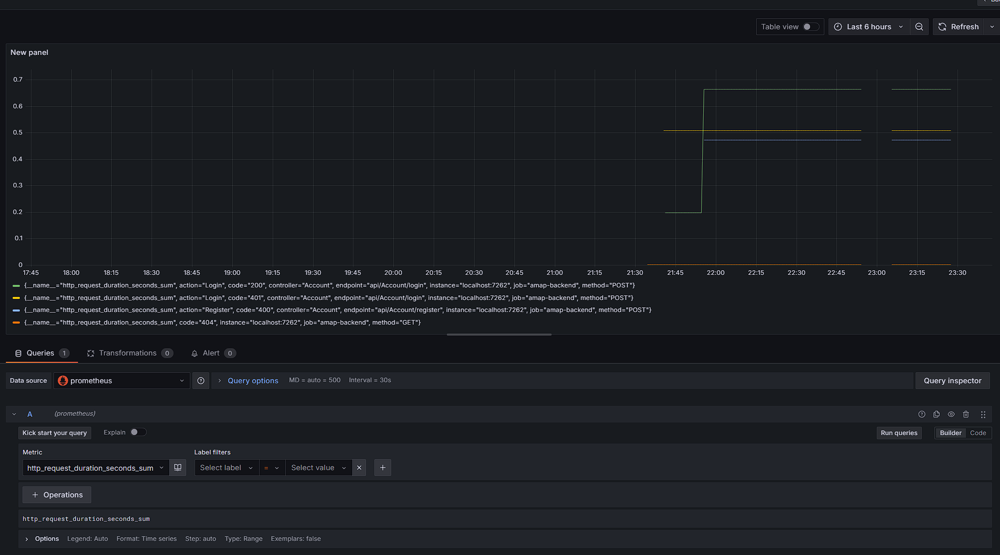

#### Como Funciona a Monitorização

1. O backend expõe métricas em `/metrics`.
2. O Prometheus recolhe este endpoint em intervalos regulares (ex: a cada 15 segundos).
3. O Grafana liga-se ao Prometheus e visualiza os dados recolhidos em dashboards.
4. Métricas como utilização de CPU, número de requisições HTTP e duração das requisições são monitorizadas em tempo real.

Com Prometheus e Grafana integrados, o backend é continuamente monitorizado quanto a desempenho, utilização de recursos e atividade dos utilizadores. Esta configuração permite a deteção precoce de problemas, apoia o planeamento de capacidade e fornece informações valiosas para manter um sistema saudável e seguro.

### Monitorização da Saúde do Sistema

A monitorização do desempenho e do estado do sistema é realizada através da análise dos logs de eventos críticos, como erros, falhas de arranque e operações sensíveis. Para ambientes locais, o **Visualizador de Eventos do Windows** pode ser utilizado para deteção rápida de falhas. Em ambientes online, é possível integrar ferramentas como o **UptimeRobot**, que permitem monitorizar a disponibilidade da API de forma automatizada.

## Gestão de Incidentes e Atualizações

### Gestão de Incidentes

#### Identificação de Incidentes
- Um incidente é qualquer evento que comprometa a segurança, disponibilidade, integridade ou confidencialidade do sistema.
- Exemplos: falhas de segurança, acessos não autorizados, indisponibilidade do serviço, perda de dados.

#### Reporte de Incidentes
- Qualquer membro da equipa deve reportar imediatamente incidentes ao responsável de segurança (ou equipa designada).
- O reporte deve incluir:
  - Data e hora do incidente
  - Descrição detalhada do evento
  - Passos para reproduzir (se aplicável)
  - Registos relevantes e capturas de ecrã

#### Resposta a Incidentes
- O responsável deve:
  1. Avaliar a gravidade do incidente.
  2. Isolar os sistemas afetados, se necessário.
  3. Recolher evidências (registos, dumps, etc.).
  4. Comunicar o incidente à gestão e, se necessário, aos utilizadores afetados.
  5. Corrigir a vulnerabilidade ou restaurar o serviço.
  6. Documentar todas as ações tomadas.

#### Pós-Incidente
- Realizar uma análise pós-incidente para identificar causas e melhorar processos.
- Atualizar a documentação e procedimentos, se necessário.

---

### Gestão de Atualizações e Patches

#### Atualizações de Software
- Verificar semanalmente/mensalmente por atualizações de:
  - Framework (.NET)
  - Bibliotecas NuGet
  - Dependências externas (ex: bases de dados, servidores)
- Utilizar ferramentas como:
  - `dotnet list package --outdated`
  - `dotnet list package --vulnerable`
  - Dependabot (GitHub)

#### Aplicação de Patches
- Antes de aplicar, testar as atualizações num ambiente de testes (staging).
- Aplicar patches críticos imediatamente após validação.
- Documentar todas as atualizações aplicadas (data, versão, motivo).

#### Comunicação
- Informar a equipa sobre atualizações relevantes.
- Se uma atualização afetar utilizadores, comunicar de forma clara e antecipada.

---

### Registo e Documentação

- Manter um registo de todos os incidentes e atualizações aplicadas.
- Exemplo de registo (pode ser um ficheiro CSV, Excel ou Markdown):

| Data       | Tipo        | Descrição                         | Responsável     | Estado    |
| ---------- | ----------- | --------------------------------- | --------------- | --------- |
| 2025-06-09 | Incidente   | Falha de login para gestores      | Pedro Vilarinho | Resolvido |
| 2025-06-11 | Atualização | Atualização do pacote xunit 2.9.3 | Pedro Costa     | Feito     |

---

---

## Estratégias de Backup e Restauro

A segurança e continuidade dos dados do sistema **AMAP** são asseguradas através de um sistema automatizado de backup e restauro da base de dados SQL Server, conforme descrito nesta secção.

### Sistema de Backup e Restauro

O projeto disponibiliza scripts em PowerShell que automatizam todo o processo de backup e restauro da base de dados `AMAP_DB`.

#### Requisitos

- PowerShell 5.1 ou superior  
- SQL Server Express instalado  
- Módulo SqlServer do PowerShell
  - Instalação: 

```cmd
Install-Module -Name SqlServer
```

#### Scripts Disponíveis

##### 1. Backup da Base de Dados (backup-database.ps1)

Este script realiza o backup completo da base de dados `AMAP_DB` de forma automática e segura.

- **Configurações principais:**

  - Servidor SQL: DESKTOP-37QTCQN\SQLEXPRESS (ajustável conforme o ambiente)

  - Nome da base de dados: AMAP_DB

  - Diretório de backup: C:\backup\AMAP
  - Retenção automática: 7 dias (backups mais antigos são removidos)


- **Execução:** 

``` cmd
.\backup-database.ps1
```

- **Funcionalidades:**

  - Criação de backups completos com nomes únicos baseados em timestamp  

  - Limpeza automática de backups antigos, conforme política de retenção  

  - Geração e manutenção de logs detalhados de todas as operações  

  - Tratamento automático de erros e notificações no log


---

##### 2. Restauro da Base de Dados (restore-database.ps1)

Permite restaurar a base de dados a partir de qualquer ficheiro de backup gerado.

- **Execução:** 

```cmd
powershell.exe -ExecutionPolicy Bypass -File "C:\caminho\para\restore-database.ps1"
```

- **Parâmetros opcionais:**

  - -ServerName: Nome do servidor SQL  

  - -DatabaseName: Nome da base de dados


- **Funcionalidades:**

  - Restauro completo e automático da base de dados  

  - Eliminação de conexões ativas antes do restauro, para evitar conflitos  

  - Retorno ao modo multi-utilizador após o restauro  

  - Registo detalhado de todas as operações e erros no log


#### Agendamento de Backups

A automação dos backups pode ser facilmente configurada através do Agendador de Tarefas do Windows:

1. Abrir o Agendador de Tarefas  
2. Criar uma nova tarefa básica  
3. Definir a periodicidade (ex: diária)  
4. Ação: Iniciar um programa  
5. Programa/script: powershell.exe  
6. Argumentos: -ExecutionPolicy Bypass -File "C:\caminho\para\backup-database.ps1"

#### Logs

Os scripts mantêm registos detalhados em dois ficheiros:

- backup_log.txt: Histórico de todos os backups realizados  
- restore_log.txt: Histórico de todos os restauros efetuados

Estes logs são essenciais para auditoria, troubleshooting e validação do processo.

#### Boas Práticas Recomendadas

- Testar regularmente os backups realizando restauros em ambiente de teste  
- Armazenar cópias dos backups em local externo ao servidor principal  
- Monitorizar os logs para garantir que os processos estão a ser executados corretamente  
- Ajustar o período de retenção consoante as necessidades do projeto  
- Manter a documentação do processo de backup/restauro atualizada

#### Suporte

Em caso de problemas:

- Verificar os logs em C:\backup\AMAP\  
- Confirmar que o SQL Server está em execução  
- Verificar as permissões do utilizador que executa os scripts  
- Consultar a documentação oficial do SQL Server

#### Resumo

Este sistema garante que a base de dados do AMAP pode ser rapidamente recuperada em caso de falha, minimizando o risco de perda de dados e assegurando a continuidade do serviço.

---

## Gestão Contínua de Vulnerabilidades

### Processo de Identificação e Remediação

O ciclo de vida da gestão de vulnerabilidades no sistema **AMAP** inclui:

- Identificação automática de vulnerabilidades através de ferramentas como **SonarCloud**, **Snyk** e **OWASP Dependency Check**;
- Triagem e priorização das falhas identificadas;
- Correção e atualização do código-fonte e das dependências;
- Monitorização contínua dos resultados e revisão das configurações de segurança.

### Atualização e Patching de Dependências

As dependências do sistema são regularmente analisadas e atualizadas com o auxílio de comandos como:

```bash
dotnet list package --vulnerable
```

Adicionalmente, são gerados relatórios automáticos através de ferramentas de *Software Composition Analysis* (SCA). O **inventário de pacotes** e o seu estado de segurança são mantidos atualizados, existindo um plano de ação para a atualização ou substituição de componentes vulneráveis ou obsoletos.

---

# Segurança e Integridade de Dados

## Visão Geral

O sistema AMAP adota um conjunto robusto de medidas de segurança e integridade de dados com o objetivo de proteger informações sensíveis relativas a produtos e utilizadores. Este documento descreve as principais implementações de segurança, organizadas em três áreas fundamentais:

- Prevenção de alterações não autorizadas a produtos;
- Prevenção de modificações não autorizadas a dados de utilizadores;
- Prevenção de manipulação indevida de dados entre a aplicação e a base de dados.

## Arquitetura de Segurança

### Camadas de Segurança

A segurança do sistema está distribuída por diversas camadas da arquitetura:

1. **Camada de Apresentação (Controllers)**
   - Autorização baseada em papéis (roles);
   - Validação rigorosa dos dados introduzidos;
   - Sanitização de inputs.

2. **Camada de Lógica de Negócio (Business Components)**
   - Aplicação de regras de negócio;
   - Verificação de propriedade dos dados;
   - Registo de operações sensíveis (logging).

3. **Camada de Acesso a Dados (Repositories)**
   - Utilização de consultas parametrizadas;
   - Verificações de integridade de dados;
   - Aplicação do princípio do menor privilégio.

### Componentes Relevantes

- `SecurityMonitoringService`: responsável pelo monitoramento de actividades relacionadas com a segurança;
- `EmailSender`: sistema de envio de notificações por correio eletrónico;
- `ValidationService`: serviço centralizado para validações de dados;
- `AccountController`: gestão de autenticação e autorização.

## Implementações de Segurança

### Proteção de Produtos

#### Controlo de Acesso
A gestão de produtos está restrita a utilizadores com o papel de produtor, com verificação explícita de permissões.

```csharp
[Authorize(Roles = nameof(UserType.Producer))]
public class ProductController : BaseController
{
    // Implementação do controle de acesso baseado em roles
}
```

#### Validação de Dados
São aplicadas anotações de validação nos modelos de dados, assegurando que os campos obrigatórios e os limites são respeitados antes da persistência.

```csharp
public class Product
{
    [Required(ErrorMessage = "Product name is required.")]
    [StringLength(100, ErrorMessage = "Product name cannot be longer than 100 characters.")]
    public string? Name { get; set; }

    [Required(ErrorMessage = "Reference price is required.")]
    [Range(0.01, double.MaxValue, ErrorMessage = "Reference price must be greater than zero.")]
    public double ReferencePrice { get; set; }
}
```

#### Verificação de Propriedade
Antes de permitir alterações a um produto, o sistema valida se o utilizador autenticado é o proprietário do recurso.

```csharp
public void UpdateProduct(int id, Product product, string producerId)
{
    if (string.IsNullOrEmpty(producerId))
        throw new ArgumentException("Producer not authenticated.");

    var existingProduct = _unitOfWork.Product.Get(
        p => p.Id == id && p.ProducerId == producerId && !p.IsDeleted
    );

    if (existingProduct == null)
        throw new KeyNotFoundException("Product not found or you are not authorized to update it.");
}
```

### Proteção de Dados de Utilizadores

#### Autenticação e Autorização
- Implementação de autenticação multifator (MFA) para utilizadores com funções de gestão;
- Utilização de um sistema de papéis com diferentes níveis de acesso (Producer, Manager, etc.);
- Verificação de identidade em operações sensíveis.

#### Notificações de Segurança
O sistema envia alertas por correio eletrónico quando são detetadas atividades anómalas ou alterações sensíveis associadas à conta do utilizador.

```csharp
private async Task SendSecurityAlertAsync(AppUser user, string alertType)
{
    var subject = $"AMAP Security Alert: {alertType}";
    var body = $@"
        <h2>Security Alert</h2>
        <p>Dear {user.Name},</p>
        <p>A security event has been detected on your account.</p>
        <p><strong>Details:</strong></p>
        <ul>
            <li>Type: {alertType}</li>
            <li>Time: {DateTime.UtcNow}</li>
        </ul>
    ";
    await _emailSender.SendEmailAsync(user.Email, subject, body);
}
```

#### Histórico de Alterações
As actividades de autenticação são registadas com informação relevante como data/hora, IP e agente de utilizador, possibilitando auditoria e rastreabilidade.

```csharp
public class AuthActivity
{
    public DateTime Timestamp { get; set; }
    public string IpAddress { get; set; }
    public string UserAgent { get; set; }
    public AuthActivityType ActivityType { get; set; }
}
```

### Proteção de Dados na Persistência

#### Consultas Parametrizadas
As interacções com a base de dados utilizam sempre parâmetros fortemente tipados, mitigando riscos como SQL Injection.

```csharp
var product = _unitOfWork.Product.Get(
    p => p.Id == id && !p.IsDeleted,
    "Composites.SubProduct"
);
```

#### Validações de Integridade
O sistema aplica validações lógicas e temporais antes da gravação dos dados, garantindo coerência e consistência no armazenamento.

```csharp
if (productOffer.SubscriptionPeriod?.EndDate < DateTime.Now)
{
    throw new InvalidOperationException("Subscription period has ended.");
}
```

## Boas Práticas Implementadas

### Validação de Dados
- Validações em várias camadas (UI, lógica de negócio e dados);
- Sanitização de dados de entrada;
- Verificação rigorosa de tipos e formatos.

### Controlo de Acesso
- Aplicação do princípio do menor privilégio;
- Verificação de propriedade dos recursos;
- Gestão granular de permissões por papel.

### Segurança de Dados
- Utilização de tokens de autenticação seguros;
- Implementação de assinaturas digitais quando aplicável;
- Criptografia de dados sensíveis.

## Recomendações de Manutenção

### Atualizações de Segurança
- Atualizar regularmente bibliotecas e dependências;
- Rever periodicamente os acessos e permissões dos utilizadores;
- Acompanhar e analisar os registos de segurança.

### Monitorização
- Monitorizar diariamente os logs de segurança;
- Investigar prontamente qualquer comportamento suspeito;
- Garantir cópias de segurança regulares dos registos.

# Avaliação do ASVS

## Categorias

### Architecture, Design and Threat

Dos 39 requisitos desta categoria, 33 estão cumpridos ou não se aplicam ao sistema AMAP. O projeto implementa pipeline CI/CD com validações de segurança, análise estática de código e validação de configurações seguras, garantindo uma base sólida de segurança desde o design até à entrega.

Os principais requisitos pendentes são: política formal de gestão de chaves (NIST SP 800-57), uso de key vaults e APIs seguras para segredos, processo de substituição de chaves e re-encriptação, logging consistente e envio seguro para sistemas remotos, e validação automática de deployments cloud na pipeline.

No geral, a arquitetura e o design do sistema são robustos.

### Authentication

Dos 50 requisitos avaliados na categoria Autenticação, o sistema AMAP cumpre 22, evidenciando uma implementação sólida dos controlos fundamentais, como políticas de password robustas, armazenamento seguro de credenciais, mecanismos de lockout, autenticação multifator baseada em TOTP para gestores e notificações de alterações de fatores de autenticação. O projeto faz uso do ASP.NET Core Identity, garantindo requisitos essenciais como comprimento mínimo e máximo de passwords, aceitação de caracteres Unicode, normalização de espaços e proteção contra ataques offline através de PBKDF2 com salt único e elevado número de iterações.

Contudo, permanecem lacunas importantes: não existe verificação de passwords comprometidas, nem integração com listas de passwords comuns; não há suporte para FIDO2/WebAuthn ou autenticação baseada em dispositivos físicos; a recuperação de credenciais e o ciclo de vida dos autenticadores não cumprem todos os requisitos de segurança (ex: ausência de identity proofing robusto, expiração e revogação de OTPs, e proteção de chaves simétricas em HSM); e a gestão de segredos e API keys não utiliza cofres ou hardware seguro, estando ausente a rotação automática e a proteção contra exposição em repositórios.

No geral, a solução apresenta uma base moderna e segura para autenticação, mas recomenda-se o reforço dos controlos avançados de MFA, a integração de mecanismos de verificação de passwords comprometidas, a proteção de segredos e chaves, e a adoção de autenticação baseada em hardware para garantir conformidade total com os requisitos ASVS e as melhores práticas internacionais.

### Session Management

Dos 17 requisitos avaliados na categoria Session Management, o sistema AMAP cumpre 13, demonstrando uma implementação sólida dos princípios fundamentais de gestão de sessões. O projeto utiliza o ASP.NET Core Identity e configura corretamente aspetos essenciais como a não exposição de tokens em URLs, a geração de novos tokens após autenticação, a utilização de cookies seguros (Secure, HttpOnly, SameSite=Strict), e a proteção contra ataques comuns de sessão. Adicionalmente, garante a terminação adequada de sessões e a utilização de algoritmos criptográficos aprovados para geração de tokens.

No entanto, subsistem algumas lacunas, nomeadamente a ausência de mecanismos para revogação de tokens OAuth, a não utilização do atributo "Host" nos cookies de sessão, e a falta de proteção específica para cenários de publicação sob domínios partilhados. Estes pontos podem ser melhorados para reforçar a segurança em ambientes mais complexos ou distribuídos.

No geral, a gestão de sessões do AMAP é robusta e alinhada com as melhores práticas, sendo recomendada a implementação dos controlos em falta para garantir conformidade total com o ASVS e aumentar a resiliência do sistema contra ataques de sessão.

### Access Control

Dos 9 requisitos avaliados na categoria Access Control, o sistema AMAP cumpre 8, demonstrando uma implementação consistente e robusta dos princípios de controlo de acesso. O projeto utiliza o ASP.NET Core Identity e Authorization, aplicando corretamente políticas de roles, princípio do menor privilégio, proteção contra IDOR, e mecanismos anti-CSRF. Assegura ainda que apenas utilizadores autenticados e autorizados podem aceder a funcionalidades sensíveis, e que as operações administrativas requerem autenticação multifator.

A única lacuna identificada prende-se com a ausência de controlos adicionais para fluxos sensíveis ou de alto risco, como step-up authentication ou segregação de duties, que poderiam reforçar a proteção contra ataques avançados ou fraude em operações críticas.

No geral, a solução apresenta um controlo de acesso maduro e alinhado com as melhores práticas, sendo recomendada a implementação de mecanismos adicionais para cenários de risco elevado, de modo a garantir conformidade total com o ASVS e aumentar a resiliência do sistema.

### Validation, Sanitization and Encoding

Dos 30 requisitos avaliados na categoria Validation, Sanitization and Encoding, o sistema AMAP cumpre 18, demonstrando uma preocupação significativa com a validação de inputs, prevenção de injeções e codificação segura de dados. O projeto utiliza as Data Annotations do ASP.NET Core, validação de modelos, Entity Framework Core para proteção contra SQL Injection, e mecanismos de serialização seguros para JSON. Adicionalmente, implementa medidas para evitar ataques comuns como CSRF, XSS e injeção de comandos.

No entanto, subsistem lacunas importantes, nomeadamente a ausência de validação e sanitização consistente para todos os tipos de input, proteção limitada contra ataques de deserialização, e falta de mecanismos robustos para lidar com formatos e conteúdos potencialmente perigosos (ex: XML, SVG, comandos OS). A cobertura de validação e sanitização é desigual entre diferentes endpoints e tipos de dados, o que pode expor o sistema a riscos em cenários menos comuns ou em funcionalidades futuras.

No geral, a solução apresenta uma base sólida para validação e codificação segura, mas recomenda-se o reforço dos controlos de sanitização, a extensão da proteção a todos os formatos suportados e a implementação de mecanismos de defesa contra ataques de deserialização e manipulação de formatos complexos, de modo a garantir conformidade total com o ASVS e aumentar a resiliência do sistema.

### Stored Cryptography

Dos 16 requisitos avaliados na categoria Stored Cryptography, o sistema AMAP cumpre 8, evidenciando a adoção de práticas seguras em áreas como a configuração de algoritmos criptográficos para passwords, utilização de salt único e aleatório, e geração segura de GUIDs e outros identificadores. O projeto recorre ao ASP.NET Core Identity para a gestão de credenciais, garantindo a utilização de algoritmos e parâmetros recomendados para hashing e armazenamento de passwords.

Contudo, subsistem lacunas relevantes, nomeadamente a ausência de encriptação de dados sensíveis em repouso (como dados pessoais, de saúde ou financeiros), falta de mecanismos para atualização e rotação de chaves, e a não utilização de módulos de segurança dedicados (HSM, DPAPI, etc.) para gestão de segredos e chaves. Além disso, não existem políticas formais para classificação de dados, nem proteção contra algoritmos ou modos de operação inseguros em todos os contextos.

No geral, a solução apresenta uma base razoável para a gestão de criptografia e armazenamento seguro, mas recomenda-se o reforço da encriptação de dados sensíveis, a implementação de políticas de rotação e proteção de chaves, e a adoção de mecanismos de gestão de segredos mais robustos para garantir conformidade total com o ASVS e as melhores práticas de segurança.

### Error Handling and Logging

Dos 12 requisitos avaliados na categoria Error Handling and Logging, o sistema AMAP cumpre 7, demonstrando uma abordagem consistente ao registo de eventos de segurança, decisões de autenticação e controlo de acesso, bem como à gestão de exceções. O projeto utiliza o ASP.NET Core Identity e mecanismos de logging estruturado para garantir a rastreabilidade de operações críticas, incluindo detalhes relevantes para investigação de incidentes, sem expor dados sensíveis nos logs. A implementação de mensagens de erro genéricas e o tratamento centralizado de exceções contribuem para a robustez e segurança do sistema.

No entanto, persistem lacunas importantes, como a ausência de proteção contra manipulação ou eliminação não autorizada de logs, falta de sincronização de timestamps em UTC, e a inexistência de um “tamper-evident” error handler global que capture todas as exceções não tratadas. Além disso, não existe uma política formal para evitar o registo de dados sensíveis definidos por normas locais de privacidade.

No geral, a solução apresenta uma base sólida para logging e gestão de erros, mas recomenda-se o reforço dos mecanismos de proteção e integridade dos logs, a uniformização do tratamento de exceções e a adoção de práticas que garantam a conformidade com requisitos legais e normativos para uma rastreabilidade e resposta a incidentes mais eficazes.

### Data Protection

Dos 17 requisitos avaliados na categoria Data Protection, o sistema AMAP cumpre 8, demonstrando um compromisso significativo com a proteção de dados sensíveis e privacidade dos utilizadores. O projeto implementa práticas sólidas como cookies de autenticação seguros, limitação de cache em controladores críticos, mecanismos de rate limiting, logging de acessos e scripts de backup e restauro testados.

No entanto, permanecem lacunas importantes, nomeadamente: ausência de encriptação e controlo de acesso para backups, falta de funcionalidades de exportação e eliminação de dados pessoais, inexistência de mecanismos de consentimento explícito, ausência de políticas de classificação e retenção de dados, e falta de auditoria detalhada de acessos a dados sensíveis. Adicionalmente, não existem medidas para sanitização de memória nem encriptação de dados sensíveis a nível de base de dados.

No geral, a solução apresenta uma base robusta para proteção de dados, mas recomenda-se o reforço das políticas de privacidade, auditoria, encriptação e gestão do ciclo de vida dos dados para garantir conformidade com as melhores práticas e regulamentos de proteção de dados.

### Communication

Dos 8 requisitos avaliados nesta categoria, o sistema AMAP cumpre 6, garantindo o uso obrigatório de TLS/HTTPS, certificados confiáveis e autenticação segura nas comunicações.

As principais lacunas identificadas são a ausência de logging explícito para falhas de TLS backend e a falta de configuração de revogação de certificados (OCSP Stapling).

No geral, a comunicação do sistema é segura e robusta.

### Configuration

Dos 23 requisitos avaliados nesta categoria, o sistema AMAP cumpre 18 ou estes não se aplicam ao contexto do projeto. O sistema adota boas práticas de automação de build e deploy, gestão de dependências, validação de headers e proteção contra disclosure acidental.

As principais lacunas identificadas prendem-se com a ausência de alguns headers de segurança HTTP e mecanismos explícitos de verificação de integridade de configurações.

No geral, a configuração do sistema é robusta e segura, recomendando-se apenas o reforço destes pontos para conformidade total.

### API and Web Service Security

Dos 9 requisitos avaliados nesta categoria, o sistema AMAP cumpre todos ou não se aplicam, exceto um. O projeto segue boas práticas na proteção de endpoints REST, validação de métodos e permissões, proteção contra CSRF, validação de content-type e uso obrigatório de HTTPS.

Os requisitos relativos a SOAP e GraphQL não se aplicam.

A principal lacuna identificada é a ausência de validação formal de JSON Schema nos payloads recebidos.

No geral, a solução apresenta uma abordagem segura para APIs e web services.

### Malicious Code Search

Dos 7 requisitos desta categoria, todos estão cumpridos ou não se aplicam ao sistema AMAP. O projeto não contém código malicioso, funcionalidades ocultas, nem recolha de dados não autorizada, e utiliza apenas dependências oficiais e analisadas por ferramentas como SonarCloud e Snyk. Requisitos relativos a sensores ou permissões não se aplicam, pois a aplicação não acede a esses recursos.

### Business Logic Security

Dos 8 requisitos ASVS avaliados para lógica de negócio, o sistema AMAP cumpre 5, incluindo validação da ordem dos passos, limites por utilizador, rate limiting e validações baseadas em análise de risco.

As principais lacunas são a ausência de controlo de tempo entre passos, proteção contra race conditions e monitorização ativa de padrões anómalos de negócio.

No geral, a solução apresenta uma lógica de negócio robusta.

### Files and Resources

Dos 13 requisitos ASVS avaliados para ficheiros e recursos, o sistema AMAP cumpre 9, garantindo validação de formato, tamanho e nomes de ficheiros, bem como proteção contra ataques comuns (LFI, RFI, path traversal, command injection).

As principais lacunas identificadas são a ausência de quotas por utilizador, falta de scanning antivírus, e ausência de restrições explícitas de permissões e extensões a nível do servidor web.

No geral, a solução é segura nesta categoria.

## Rastreabilidade

A rastreabilidade foi garantida através de:

- Relatórios de cobertura;
- Análises estáticas automatizadas;

Para mais detalhe, está disponível uma **checklist ASVS em Excel**, com os requisitos avaliados e o respetivo estado de conformidade.

## Resumo

A aplicação AMAP apresenta uma base sólida de segurança, cumprindo 170 dos 258 requisitos ASVS avaliados, com destaque para boas práticas em arquitetura, gestão de sessões, controlo de acesso, validação de inputs e proteção contra código malicioso. Apesar deste compromisso, subsistem lacunas em áreas como encriptação de dados sensíveis, gestão de segredos, logging avançado, proteção de backups, e mecanismos de privacidade e consentimento. No geral, o sistema está bem alinhado com as melhores práticas.

---

# Conclusão

O desenvolvimento do sistema **AMAP** demonstrou, ao longo das várias fases do projeto, um compromisso claro com a segurança, a qualidade do código e a automação dos processos. A **Fase 2 - Sprint 2** marcou a consolidação da maturidade do projeto, com a integração de mecanismos avançados de deteção e mitigação de vulnerabilidades, bem como práticas robustas para operação e produção.

A análise estática com o **SonarCloud** revelou um código limpo e bem estruturado, com **grau A em segurança**, uma **cobertura de testes superior a 82%**, e apenas alguns *code smells* e questões de fiabilidade sem impacto crítico. Estes aspetos foram identificados e planeados para melhoria contínua.

A análise dinâmica (DAST), realizada com o **OWASP ZAP** e integrada na pipeline CI/CD, permitiu identificar vulnerabilidades reais em tempo de execução — como bibliotecas desatualizadas e cabeçalhos de segurança ausentes — mas sem registo de falhas críticas, o que é comum em ambientes académicos e de prototipagem. A maioria dos problemas está relacionada com configurações ou dependências, sendo facilmente resolvida.

Em termos de **conformidade com o OWASP ASVS**, a aplicação cumpre **170 dos 258 requisitos**, com bons resultados nas áreas de arquitetura, gestão de sessões, controlo de acessos, validação e proteção contra código malicioso. Algumas lacunas ainda persistem, nomeadamente na encriptação de dados sensíveis, gestão de segredos, logging avançado, proteção de backups e privacidade.

Foram ainda implementadas medidas complementares importantes, como:  
- **Gestão de ambientes** (desenvolvimento, staging e produção)  
- **Mecanismos de backup e restauro**  
- **Monitorização contínua**  
- **Processos de atualização e resposta a incidentes**

No geral, o sistema **AMAP** apresenta uma base sólida, segura e sustentável. As vulnerabilidades encontradas são conhecidas e controladas, não comprometendo a integridade global do sistema. O projeto evoluiu de forma consistente ao longo dos sprints, refletindo um esforço contínuo de aprendizagem, adaptação e aplicação prática dos princípios de **Desenvolvimento de Software Seguro**.

---

# Referências

1. GitHub. (s.d.). *Documentação do GitHub Actions*. Disponível em: https://docs.github.com/actions
2. SonarCloud. (s.d.). *Documentação do SonarCloud*. Disponível em: https://docs.sonarcloud.io/
3. OWASP Foundation. (s.d.). *OWASP Dependency Check*. Disponível em: https://owasp.org/www-project-dependency-check/
4. Microsoft. (s.d.). *Documentação de Segurança do .NET*. Disponível em: https://learn.microsoft.com/pt-pt/dotnet/standard/security/
5. Check Point Software Technologies. (s.d.). [O que é SAST (Static Application Security Testing)](https://www.checkpoint.com/pt/cyber-hub/cloud-security/what-is-static-application-security-testing-sast/).
6. Check Point Software Technologies. (s.d.). [O que é DAST (Dynamic Application Security Testing)](https://www.checkpoint.com/pt/cyber-hub/cloud-security/what-is-dynamic-application-security-testing-dast/).
7. OWASP. (s.d.). [IAST – Interactive Application Security Testing](https://owasp.org/www-project-devsecops-guideline/latest/02c-Interactive-Application-Security-Testing).
8. Check Point Software Technologies. (s.d.). [O que é SCA (Software Composition Analysis)](https://www.checkpoint.com/pt/cyber-hub/cloud-security/what-is-software-composition-analysis-sca/).
9. Snyk. (s.d.). [Site oficial do Snyk](https://snyk.io/).
10. Check Point Software Technologies. (s.d.). [O que é uma DevSecOps Pipeline](https://www.checkpoint.com/pt/cyber-hub/cloud-security/devsecops/what-is-a-devsecops-pipeline/).
11. GitHub. (s.d.). [Utilização de Segredos no GitHub Actions](https://docs.github.com/en/actions/security-for-github-actions/security-guides/using-secrets-in-github-actions).
12. Microsoft. (s.d.). [Comando dotnet list package](https://learn.microsoft.com/en-us/dotnet/core/tools/dotnet-package-list).
13. OWASP Foundation. (2021). *OWASP Application Security Verification Standard (ASVS) 4.0*. Disponível em: [https://owasp.org/www-project-application-security-verification-standard/](https://owasp.org/www-project-application-security-verification-standard/)
14. OWASP Foundation. (2021). *OWASP Top 10: The Ten Most Critical Web Application Security Risks*. Disponível em: [https://owasp.org/www-project-top-ten/](https://owasp.org/www-project-top-ten/)
15. Microsoft. (2022). *Security Development Lifecycle (SDL)*. Disponível em: [https://www.microsoft.com/en-us/securityengineering/sdl](https://www.microsoft.com/en-us/securityengineering/sdl)
16. OWASP Foundation. (s.d.). *Threat Modeling Process*. Disponível em: [https://owasp.org/www-community/Threat_Modeling_Process](https://owasp.org/www-community/Threat_Modeling_Process)
17. OWASP Foundation. (s.d.). *Free for Open Source Application Security Tools*. Disponível em: [https://owasp.org/www-community/Free_for_Open_Source_Application_Security_Tools](https://owasp.org/www-community/Free_for_Open_Source_Application_Security_Tools)
18. TechTarget. (s.d.). *Data Flow Diagram (DFD)*. Disponível em: [https://www.techtarget.com/searchdatamanagement/definition/data-flow-diagram-DFD](https://www.techtarget.com/searchdatamanagement/definition/data-flow-diagram-DFD)
19. OWASP Foundation. (s.d.). *Abuse Case Cheat Sheet*. Disponível em: [https://cheatsheetseries.owasp.org/cheatsheets/Abuse_Case_Cheat_Sheet.html](https://cheatsheetseries.owasp.org/cheatsheets/Abuse_Case_Cheat_Sheet.html)
20. Documentos de apoio disponibilizados no Moodle da unidade curricular **Desenvolvimento de Software Seguro** (ISEP, 2024/2025).
21. [Documentação prometheus-net](https://github.com/prometheus-net/prometheus-net)
- [Introdução ao Prometheus](https://prometheus.io/docs/introduction/overview/)
- [Introdução ao Grafana](https://grafana.com/docs/grafana/latest/getting-started/)
